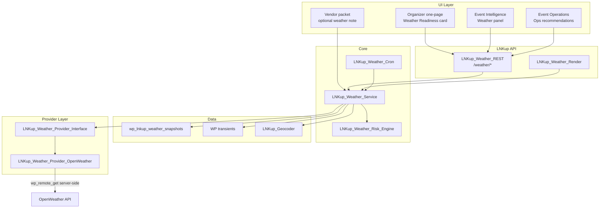

# Event Weather Intelligence (OpenWeather)

## Product intent

LNKup is the **vendor layer** for events — not attendee ticketing. Weather is **operational intelligence**: organizers plan load-in, tents, hydration, and vendor communications; vendors see setup guidance in packets. It is not a generic public weather widget.

**Provider decision (locked):** OpenWeather only for v1. No WeatherAPI.com, no Visual Crossing, no third-party WordPress weather plugins. Provider code sits behind `LNKup_Weather_Provider_Interface` so additional providers can be added later without UI changes.

---

## Current state

| Area | Status |
|------|--------|
| Organizer ops Overview | [`class-shortcodes.php`](wp-content/plugins/lnkup-marketplace/public/class-shortcodes.php) ~2598 — muted text from `$snap['weather']` |
| Snapshot | [`class-event-operations.php`](wp-content/plugins/lnkup-marketplace/includes/class-event-operations.php) — `_lnkup_weather_placeholder` meta only |
| Vendor packet | [`class-packets.php`](wp-content/plugins/lnkup-marketplace/includes/class-packets.php) — "Weather Plan" = placeholder text |
| Event Intelligence REST | [`class-intelligence-rest.php`](wp-content/plugins/lnkup-marketplace/includes/class-intelligence-rest.php) `event_dto()` — no weather field |
| Geocoder | [`class-geocoder.php`](wp-content/plugins/lnkup-marketplace/includes/class-geocoder.php) — `_lnkup_lat` / `_lnkup_lng`, Nominatim |
| Risk engine (existing) | [`class-risk-engine.php`](wp-content/plugins/lnkup-marketplace/includes/class-risk-engine.php) — compliance/payment ops risks; **separate** from weather |
| Docs | [`docs/SYSTEM_OVERVIEW.md`](docs/SYSTEM_OVERVIEW.md) §9.6 — weather not documented |

**Patterns to mirror:**
- Provider abstraction: [`class-map-provider.php`](wp-content/plugins/lnkup-marketplace/includes/class-map-provider.php)
- SQL + dbDelta: [`class-operations-tables.php`](wp-content/plugins/lnkup-marketplace/includes/class-operations-tables.php)
- Cron: [`class-intelligence-cron.php`](wp-content/plugins/lnkup-marketplace/includes/class-intelligence-cron.php)
- REST permissions: [`class-intelligence-rest.php`](wp-content/plugins/lnkup-marketplace/includes/class-intelligence-rest.php)

---

## Architecture



---

## File layout (new)

```
wp-content/plugins/lnkup-marketplace/
  includes/
    weather/
      interface-weather-provider.php          # LNKup_Weather_Provider_Interface
      class-weather-provider-openweather.php  # LNKup_Weather_Provider_OpenWeather
    class-weather-tables.php                  # LNKup_Weather_Tables
    class-weather-service.php                 # LNKup_Weather_Service
    class-weather-risk-engine.php             # LNKup_Weather_Risk_Engine
    class-weather-rest.php                    # LNKup_Weather_REST
    class-weather-render.php                  # LNKup_Weather_Render
    class-weather-cron.php                    # LNKup_Weather_Cron
  public/
    css/weather.css
    js/weather.js
```

Register in [`lnkup-marketplace.php`](wp-content/plugins/lnkup-marketplace/lnkup-marketplace.php) `$lnkup_core_files`, `lnkup_maybe_upgrade_db()` creators array, and `lnkup_marketplace_init()` (`LNKup_Weather_REST::init()`, `LNKup_Weather_Cron::init()` + schedule on upgrade).

---

## OpenWeather API strategy (server-side only)

**Never** expose `openweather_api_key` in frontend JS. All HTTP via `wp_remote_get` in `LNKup_Weather_Provider_OpenWeather`.

### Endpoints by mode

| Mode | Days until event | OpenWeather endpoints | Notes |
|------|------------------|----------------------|-------|
| `live_forecast` | 0–7 | Current Weather 2.5 + 5 Day / 3 Hour Forecast 2.5 | Current if event is today; pick forecast slots for event date/time; map condition codes for storm detection |
| `extended_forecast` | 8–16 | Same forecast API where data exists; label lower confidence | OpenWeather 5-day forecast may not cover full 16 days — show available days only, never extrapolate |
| `historical_risk` | 17+ | Historical/statistical if plan supports; else safe placeholder | If One Call / Historical not on plan: `confidence: historical`, message per spec — no fake precise temps |
| `unavailable` | — | No API call | Missing key, location, date, or disabled module |

**Units:** `imperial` (°F, mph) — default in settings.

**Alerts:** If OpenWeather response includes alert payloads (e.g. One Call on upgraded plan), surface count + summary in intelligence panel. On free Current+Forecast plan, `alerts_count: 0` — do not error.

**Historical placeholder copy (when 17+ days and no historical API):**
> Live forecast is not available yet. Add historical weather API access to unlock seasonal risk.

When `weather_historical_enabled` is false, skip historical API attempts entirely and show planning guidance from risk engine using seasonal heuristics only if we have city-level climate data cached — otherwise show placeholder only.

### Provider interface (normalized raw shape)

```php
interface LNKup_Weather_Provider_Interface {
    public function slug(): string;
    public function is_configured(): bool;
    public function fetch_live( float $lat, float $lng, array $context ): array|WP_Error;
    public function fetch_extended( float $lat, float $lng, array $context ): array|WP_Error;
    public function fetch_historical( float $lat, float $lng, array $context ): array|WP_Error;
    public function admin_status(): array;
}
```

`LNKup_Weather_Provider_OpenWeather` normalizes provider JSON into an internal `LNKup_Weather_Raw` structure (current, hourly[], daily[], alerts[]) before `LNKup_Weather_Service` applies business logic.

---

## Mode selection (`LNKup_Weather_Service`)

```php
public static function resolve_mode( int $event_id ): string {
    // Returns: live_forecast | extended_forecast | historical_risk | unavailable
}
```

Logic:
1. If `weather_intelligence_enabled` is false → `unavailable`
2. If no `openweather_api_key` → `unavailable` (status message: configure key)
3. If no event date → `unavailable`
4. `$days = days_until_event( $event_id )` using `_lnkup_event_date` (+ optional start time)
5. `0 <= $days <= 7` → `live_forecast`
6. `8 <= $days <= 16` → `extended_forecast`
7. `$days >= 17` → `historical_risk`
8. Past events: treat as `live_forecast` with "event day" = today or show post-event summary from last snapshot

### Location resolution (priority)

1. `_lnkup_lat` / `_lnkup_lng` if valid ([`LNKup_Geocoder::validate_lat/lng`](wp-content/plugins/lnkup-marketplace/includes/class-geocoder.php))
2. `LNKup_Geocoder::geocode_event( $event_id )` once per refresh (not on every poll)
3. City + state query string fallback for provider geocode-by-name if coords still missing
4. Empty state: **"Add an event location to unlock weather intelligence."**

**Event context** pulled from existing meta:
- `_lnkup_city`, `_lnkup_state`, `_lnkup_venue_name`, `_lnkup_venue_address`, `_lnkup_address_line1`
- `_lnkup_event_date`, `_lnkup_start_time`, `_lnkup_end_time`
- `_lnkup_indoor`, `_lnkup_outdoor`, `_lnkup_expected_attendance`
- `_lnkup_weather_placeholder` → organizer contingency plan (shown below live data, never overwritten)

---

## Risk engine (`LNKup_Weather_Risk_Engine`)

Input: normalized weather metrics + event context (outdoor flag, mode, confidence).

Output:

```php
array(
  'overall_risk'   => 'low|medium|high|unavailable',
  'rain_risk'      => 'low|medium|high|unavailable',
  'wind_risk'      => 'low|medium|high|unavailable',
  'heat_risk'      => 'low|medium|high|unavailable',
  'storm_risk'     => 'low|medium|high|unavailable',
  'setup_risk'     => 'low|medium|high|unavailable',
  'confidence'     => 'live|extended|historical|unavailable',
  'recommendations'=> array( /* strings */ ),
)
```

### Thresholds (locked)

| Risk | High | Medium |
|------|------|--------|
| Rain | precip probability ≥ 60% | ≥ 35% |
| Wind | sustained ≥ 20 mph OR gusts ≥ 30 mph | sustained ≥ 12 mph OR gusts ≥ 20 mph |
| Heat | temp or heat index ≥ 95°F | ≥ 88°F |
| Storm | thunderstorm/severe in condition codes, alerts, or description | — |
| Setup | Combine rain + wind + storm; **amplify if `_lnkup_outdoor`**; reduce if indoor-only | — |

`overall_risk` = max of component risks (high > medium > low).

### Recommendations (examples)

Generated when matching thresholds — return 1–5 actionable strings:
- "Review tent weights and vendor booth anchoring."
- "Prepare a rain load-in plan."
- "Consider floor covering or mats near vendor setup areas."
- "Add water station reminders for vendors."
- "Secure signage and lightweight displays."
- "Monitor forecast again 7 days before event."
- "Live forecast is not available yet; use historical risk for planning."

**Out of scope:** No refunds, payouts, or automated cancellations from weather risk.

---

## Database — `wp_lnkup_weather_snapshots`

**Class:** `LNKup_Weather_Tables::create_tables()` via dbDelta in [`lnkup_maybe_upgrade_db()`](wp-content/plugins/lnkup-marketplace/lnkup-marketplace.php).

| Column | Type | Notes |
|--------|------|-------|
| id | bigint PK AI | |
| event_id | bigint | indexed |
| provider | varchar(32) | `openweather` |
| forecast_type | varchar(32) | live_forecast / extended_forecast / historical_risk / unavailable |
| forecast_date | date | event target date |
| location_label | varchar(255) | city, venue |
| lat, lng | decimal | |
| temp_high, temp_low | decimal | |
| temperature, feels_like | decimal | current or event-slot |
| humidity | smallint | |
| precipitation_chance | smallint | 0–100 |
| precipitation_amount | decimal | inches if available |
| wind_speed, wind_gust | decimal | mph |
| condition_code | varchar(16) | OWM icon/id |
| condition_summary | varchar(255) | human text |
| alerts_count | smallint | |
| raw_payload | longtext | JSON |
| overall_risk … setup_risk | varchar(16) | each risk column |
| confidence | varchar(16) | |
| recommendations | longtext | JSON array |
| created_at, updated_at | datetime | |

**Helpers on `LNKup_Weather_Tables`:**
- `snapshots_table()`
- `insert_snapshot( $row )`
- `get_latest( $event_id )`
- `get_history( $event_id, $limit = 30 )`

On successful refresh: insert new row (keep history). UI reads **latest** snapshot; on API failure, serve last good snapshot with `stale: true` and `last_updated`.

---

## Caching and rate limits

| Layer | Key | TTL |
|-------|-----|-----|
| Transient | `lnkup_weather_intel_{event_id}` | From setting `weather_refresh_minutes` (default 30) |
| Cron lock | `lnkup_weather_daily_{Y-m-d}` | 24h |
| Snapshot DB | permanent history | — |

**Rules:**
- Organizer ops polling ([`operations.js`](wp-content/plugins/lnkup-marketplace/public/js/operations.js) ~30s) must **not** trigger OpenWeather calls — return cached DTO from transient/DB.
- `POST /weather/event/{id}/refresh` bypasses transient (still writes snapshot).
- Cron: daily refresh for events with `_lnkup_event_date` within next **14 days**; batch max **25 events/run** to respect free-tier limits.
- No sub-hourly cron.

---

## Settings (`lnkup_get_settings()` + LNKup → Settings)

New fields in [`admin/class-admin.php`](wp-content/plugins/lnkup-marketplace/admin/class-admin.php) section **"Weather Intelligence"**:

| Key | Default | UI |
|-----|---------|-----|
| `weather_intelligence_enabled` | `true` | checkbox |
| `openweather_api_key` | `''` | password; preserve-if-blank on save |
| `openweather_api_mode` | `current_forecast` | select: Current+Forecast 2.5 (document One Call as future upgrade) |
| `weather_units` | `imperial` | select |
| `weather_refresh_minutes` | `30` | number |
| `weather_historical_enabled` | `false` | checkbox — attempt historical API when 17+ days |
| `weather_vendor_packet_note` | `true` | checkbox |

---

## REST API (`LNKup_Weather_REST`)

Namespace: `lnkup/v1`. All routes require `permission_callback`.

| Method | Route | Callback | Permission |
|--------|-------|----------|------------|
| GET | `/weather/event/{event_id}` | `event_summary` | Organizer owns event OR admin OR vendor with paid/approved access |
| POST | `/weather/event/{event_id}/refresh` | `refresh_event` | Organizer owns event OR `user_has_manage_all()` |
| GET | `/weather/event/{event_id}/history` | `event_history` | Same as GET summary |
| GET | `/weather/admin/status` | `admin_status` | `lnkup_manage_settings` or `user_has_manage_all()` |

### Summary DTO (GET `/weather/event/{id}`)

```php
array(
  'success'          => true,
  'event_id'         => 123,
  'mode'             => 'live_forecast',
  'status'           => 'ok|stale|unconfigured|no_location|error',
  'confidence'       => 'live|extended|historical|unavailable',
  'forecast_status'  => 'Live forecast available', // UI copy key
  'location'         => array( 'label' => 'Austin, TX', 'lat' => 0, 'lng' => 0 ),
  'current'          => array( /* temp, feels_like, humidity, wind, condition */ ),
  'event_day'        => array( /* high, low, pop, summary */ ),
  'hourly'           => array( /* optional compact slots */ ),
  'alerts'           => array( /* optional */ ),
  'risks'            => array( /* risk engine output */ ),
  'recommendations'  => array( /* strings */ ),
  'contingency_plan' => '...', // _lnkup_weather_placeholder
  'last_updated'     => '2026-06-25T14:30:00Z',
  'stale'            => false,
  'message'          => '', // user-safe error/empty copy
)
```

Use `LNKup_Capabilities::organizer_owns_event()`, `vendor_owns_application()` / paid status check for vendor read access.

---

## UI integration

### 1. Organizer one-page dashboard — Weather Readiness card

**Where:** [`class-shortcodes.php`](wp-content/plugins/lnkup-marketplace/public/class-shortcodes.php) organizer Overview section (~line 613), near KPI strip / priority row.

**SSR shell:** `LNKup_Weather_Render::readiness_card_compact( $user_id )` — picks **next upcoming event** (same pattern as CRM widgets) or shows portfolio empty state.

**Fields:** Forecast status, overall risk, rain/wind/heat chips, top recommendation, last updated.

**Actions:** Refresh (calls POST refresh), View details (links to Event Intelligence or ops Insights tab).

`data-testid="lnkup-weather-readiness-card"`

### 2. Event Intelligence — Weather Intelligence panel

**Where:**
- Organizer expand panel `#lnkup-organizer-intelligence` — add subsection in [`intelligence.js`](wp-content/plugins/lnkup-marketplace/public/js/intelligence.js) `loadOrganizerDashboard()` OR SSR chip in [`render_organizer_intel_summary_ssr`](wp-content/plugins/lnkup-marketplace/public/class-shortcodes.php)
- Per-event: extend `event_dto()` in [`class-intelligence-rest.php`](wp-content/plugins/lnkup-marketplace/includes/class-intelligence-rest.php) with `'weather' => LNKup_Weather_Service::for_event( $event_id )`
- Event ops Insights tab `#lnkup-event-insights` — add weather block above/alongside existing intel load

**Panel content:** `LNKup_Weather_Render::intelligence_panel( $dto )` — mode badge, confidence, risk breakdown grid, alerts list, recommendations, historical guidance block.

### 3. Event Operations — operational recommendations

**Where:** [`class-shortcodes.php`](wp-content/plugins/lnkup-marketplace/public/class-shortcodes.php) ops Overview tab — replace muted weather `<p>` with `LNKup_Weather_Render::operations_panel( $dto )`.

**Also wire:** `LNKup_Event_Operations::snapshot()` returns `'weather' => LNKup_Weather_Service::for_event( $event_id )` (structured, not string).

Ops-specific copy maps recommendations to operational bullets (tent weights, load-in rain plan, mats, hydration, signage, monitor 7 days out).

### 4. Vendor packet — optional compact note

**Gated by:** `weather_vendor_packet_note` setting.

**Where:** [`class-packets.php`](wp-content/plugins/lnkup-marketplace/includes/class-packets.php) `get_dto()` weather section + vendor ops via `vendor_home_for_application()`.

Vendor sees: expected conditions (if live), setup tips, confidence label. No refresh button for vendors (read-only).

---

## Frontend JS (`public/js/weather.js`)

Minimal client module:
- `lnkupWeatherRefresh(eventId)` → POST `/weather/event/{id}/refresh` with `X-WP-Nonce`
- `lnkupWeatherLoad(eventId, container)` → GET summary, render via data attributes or innerHTML templates
- Retry on error; remove skeletons; show stale badge when `stale: true`

Enqueue only when weather shells present (organizer dashboard, ops command center, intelligence panel). Localize `weatherRestUrl: rest_url('lnkup/v1/weather')` — **no API key**.

Use existing `LNKupUI.panelEmpty` / error card patterns from [`intelligence.js`](wp-content/plugins/lnkup-marketplace/public/js/intelligence.js).

### UI states (all panels)

| State | Behavior |
|-------|----------|
| Loading | Skeleton card, max one fetch on mount |
| Empty | Mode-specific copy (no location, no key, too early) |
| Error | "We couldn't refresh weather intelligence right now. Try again later." + Retry |
| Stale | Last snapshot visible + "Last updated [time]" |
| OK | Full card/panel |

**UI copy keys:**
- "Live forecast available"
- "Extended forecast — planning guidance"
- "Too early for live forecast"
- "Showing historical weather risk"
- "Weather risk is elevated for outdoor setup"
- "Refresh forecast"

---

## Cron (`LNKup_Weather_Cron`)

- Hook: `lnkup_weather_daily`
- Schedule: `daily` (same pattern as [`LNKup_Intelligence_Cron`](wp-content/plugins/lnkup-marketplace/includes/class-intelligence-cron.php))
- `run_daily()`:
  1. Daily lock transient
  2. Query `lnkup_event` posts where `_lnkup_event_date` between today and today+14 days
  3. For each (max 25): `LNKup_Weather_Service::refresh_event( $id, 'cron' )` if transient expired
  4. Skip if module disabled or no API key

Register schedule in `lnkup_maybe_upgrade_db()` alongside other crons.

---

## Integration touchpoints (existing code changes)

| File | Change |
|------|--------|
| [`lnkup-marketplace.php`](wp-content/plugins/lnkup-marketplace/lnkup-marketplace.php) | Load weather classes; migration; cron schedule; settings defaults |
| [`admin/class-admin.php`](wp-content/plugins/lnkup-marketplace/admin/class-admin.php) | Settings UI + sanitize |
| [`class-event-operations.php`](wp-content/plugins/lnkup-marketplace/includes/class-event-operations.php) | `snapshot()`, `vendor_home_for_application()` — structured weather |
| [`class-packets.php`](wp-content/plugins/lnkup-marketplace/includes/class-packets.php) | Packet weather section |
| [`class-intelligence-rest.php`](wp-content/plugins/lnkup-marketplace/includes/class-intelligence-rest.php) | `event_dto()` weather field |
| [`class-shortcodes.php`](wp-content/plugins/lnkup-marketplace/public/class-shortcodes.php) | Dashboard card, ops panel shells, enqueue weather assets |
| [`class-operations-render.php`](wp-content/plugins/lnkup-marketplace/includes/class-operations-render.php) | Optional thin wrappers delegating to `LNKup_Weather_Render` |
| [`operations.js`](wp-content/plugins/lnkup-marketplace/public/js/operations.js) | Re-render weather block on snapshot poll (from cached DTO only) |

**Do not modify:** Financial OS, Stripe, Growth, Maps core — only read geocoder meta.

---

## Security

- API key in `wp_options` only; password field; never in `wp_localize_script`
- All provider HTTP server-side; 10s timeout
- `permission_callback` on every route
- Vendor read: paid/completed application on event + packet unlocked when packet note enabled
- Sanitize REST inputs; escape all render output
- Log errors with `error_log` — never log key or full raw payload in production
- Defensive parsing: missing OWM fields → partial DTO, not fatal

---

## Documentation

Update [`docs/SYSTEM_OVERVIEW.md`](docs/SYSTEM_OVERVIEW.md):
- New §9.x **Event Weather Intelligence** — classes, table, modes, REST, cron
- §9.6 Event Operations — weather ops recommendations cross-link
- §9.7 Intelligence — weather panel
- Settings table — weather keys
- §21 gaps — remove weather placeholder; add OpenWeather setup step

Update [`docs/CURRENT_STATE.md`](docs/CURRENT_STATE.md):
- v12.2 changelog entry
- WordPress setup checklist: OpenWeather API key

---

## Testing checklist

- Event with lat/lng + future date → Weather Readiness card loads
- City/state only → geocode attempt or graceful state
- 0–7 days → `live_forecast` mode + confidence `live`
- 8–16 days → `extended_forecast` + planning label
- 17+ days → `historical_risk`; no fake precise forecast
- Missing API key → graceful empty state
- Missing location → "Add an event location to unlock weather intelligence."
- Refresh works for owner/admin; 403 for non-owner
- Card on organizer one-page; panel in Intelligence; recommendations in Operations
- Vendor packet note respects setting
- API failure → error + retry; previous snapshot still shown
- No infinite loaders; no PHP fatals on partial JSON; no console errors

**E2E:** new `tests/e2e/weather-intelligence.spec.ts` or extend [`vendor-operations.spec.ts`](tests/e2e/vendor-operations.spec.ts) + organizer ops spec.

**PHPUnit (optional):** `LNKup_Weather_Risk_Engine` threshold unit tests with fixture arrays.

---

## Phased delivery

### Phase A — Foundation (ship first)
- Tables, settings, provider interface + OpenWeather, service, risk engine, REST, cron
- Organizer ops Overview panel + REST refresh
- Docs

### Phase B — Intelligence surfaces
- Organizer dashboard Weather Readiness card
- Event Intelligence panel + `event_dto` weather field
- Ops Insights tab weather block

### Phase C — Vendor + polish
- Vendor packet note (setting-gated)
- `weather.css` polish, E2E tests
- Historical API hook when plan upgraded (stub returns placeholder until then)

---

## Explicitly out of scope

- WeatherAPI.com, Visual Crossing, WP weather plugins
- Financial automation (refunds/cancellations) from weather
- Browser-side OpenWeather calls
- High-frequency cron
- Comms auto-broadcast from weather (manual broadcast template `weather` already exists in [`class-broadcasts.php`](wp-content/plugins/lnkup-marketplace/includes/class-broadcasts.php) — future enhancement)
