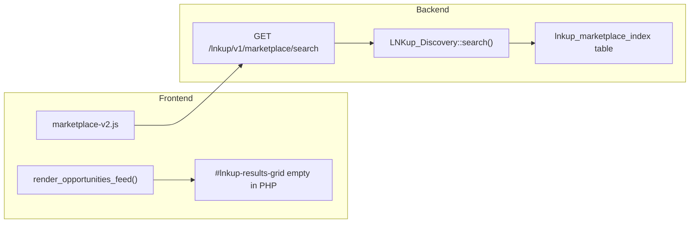

# Find Events Marketplace Discovery Plan

## Root cause of current limitations

The Find Events page (`/opportunities/`, shortcode `[lnkup_opportunities_feed]`) is **architecturally sound** but **under-exposed**:



| Limitation | Root cause |
|------------|------------|
| Feels like a thin listing | Grid is **JS-only** (no SSR); minimal hero/filter chrome |
| Missing event types | Only **12** `lnkup_event_type` terms seeded in [`class-taxonomies.php`](wp-content/plugins/lnkup-marketplace/includes/class-taxonomies.php) |
| Filters feel broken/incomplete | Backend supports `event_types`, `fee_min`, `markets`, `date_from/to`, etc., but UI in [`class-shortcodes.php`](wp-content/plugins/lnkup-marketplace/public/class-shortcodes.php) exposes ~15 controls; **event type has no UI** |
| `has_spots` mismatch | Checkbox default checked in HTML, but [`marketplace-v2.js`](wp-content/plugins/lnkup-marketplace/public/js/marketplace-v2.js) `collectFilters()` only runs on Apply—**initial REST load omits `has_spots=true`** |
| Silent failures | `loadResults()` `.catch()` clears loader with **no error UI** |
| No GET fallback | Filters only restore via `?lnkup_restore=` base64 blob—not readable query params |
| Cards missing context | [`lnkup_render_opportunity_card_v2()`](wp-content/plugins/lnkup-marketplace/includes/helpers.php) shows fee/spots but not **event type**, **venue**, **environment**, **document badges**, or **vendor application status** |
| Demo diversity | [`seed_sample_data()`](wp-content/plugins/lnkup-marketplace/includes/class-activator.php) creates **5** samples (festival/rodeo/block party/greek/market only), guarded by one-time option |

**Good news:** The index already stores the right surface area (`event_types`, `categories`, `markets`, `vendor_fee`, `attendance`, `deadline`, `indoor/outdoor`, `required_documents`, `organizer_verified`). We extend—not replace—this layer.

---

## Architecture approach

**Do not rebuild.** Keep:

- CPT model (`lnkup_opportunity` + parent `lnkup_event`)
- Denormalized index (`LNKup_Marketplace_Index`)
- Primary API: `GET /lnkup/v1/marketplace/search`
- Existing card CSS tokens in [`marketplace-v2.css`](wp-content/plugins/lnkup-marketplace/public/css/marketplace-v2.css) + theme [`components.css`](wp-content/themes/lnkup-theme/assets/dist/components.css)

**Add thin wrappers** (user-requested names, single source of truth):

```php
lnkup_get_filtered_opportunities( $args )  // wraps LNKup_Discovery::search()
lnkup_get_opportunity_card_data( $id )       // index row → normalized DTO + fallbacks
```

**Add AJAX fallback** `wp_ajax_lnkup_filter_opportunities` in [`class-ajax.php`](wp-content/plugins/lnkup-marketplace/includes/class-ajax.php) returning the same shape as REST (`html`, `count`, `pagination`, `active_filters`, `empty_state`). REST remains primary; AJAX used only when REST fails.

**Add SSR first page** in `render_opportunities_feed()`: parse `$_GET` into filter args, call `lnkup_get_filtered_opportunities()`, render initial cards + pagination HTML into `#lnkup-results-grid` so the page works without JS.

---

## Phase 1 — Taxonomy & sample data expansion

### 1A. Expand `lnkup_event_type` seeding

Update [`class-taxonomies.php`](wp-content/plugins/lnkup-marketplace/includes/class-taxonomies.php) `seed_terms()`:

- Add all **37** requested types (Festival through Other), using `term_exists()` before `wp_insert_term()` — **never delete** existing terms.
- Add missing vendor category aliases (Dessert Vendor, Beverage Vendor, Clothing Brand, Beauty Vendor, etc.) alongside legacy terms (Desserts, Drinks, Clothing).

### 1B. Re-run seeding on upgrade (not only activate)

In [`lnkup-marketplace.php`](wp-content/plugins/lnkup-marketplace/lnkup-marketplace.php) or activator upgrade hook:

- Call `LNKup_Taxonomies::seed_terms()` when plugin version changes (store `lnkup_taxonomy_seed_version` option).
- Ensures existing installs get new terms without reactivation.

### 1C. Showcase sample data (separate guard)

Add `seed_marketplace_showcase_data()` in [`class-activator.php`](wp-content/plugins/lnkup-marketplace/includes/class-activator.php):

- New option: `lnkup_marketplace_showcase_seeded` (independent of `lnkup_sample_data_seeded`).
- Create **10** additional event+opportunity pairs covering: Conference, Speaking Event, Pop-Up, Rodeo (if not exists), College Event, Market, Brand Activation, Food Festival, Workshop, plus one indoor/tented example.
- Populate richer meta: `venue_name`, `indoor/outdoor`, `_lnkup_required_documents` (comma slugs: `certificate_of_insurance,health_permit`), varied fees/attendance/deadlines.
- Call `LNKup_Marketplace_Index::sync_opportunity()` per row; run `rebuild_all()` once at end.

---

## Phase 2 — Backend query & normalization

### 2A. `lnkup_get_filtered_opportunities( $args )`

Add to [`helpers.php`](wp-content/plugins/lnkup-marketplace/includes/helpers.php):

- Sanitize/parse all filter inputs.
- Delegate to `LNKup_Discovery::search()`.
- Return `items`, `total`, `page`, `pages`, `html`, `active_filters`, `empty_state`.

### 2B. `lnkup_get_opportunity_card_data( $opportunity_id )`

New normalizer in [`helpers.php`](wp-content/plugins/lnkup-marketplace/includes/helpers.php):

- Load index row (or sync-on-miss via `LNKup_Marketplace_Index::sync_opportunity()`).
- Merge parent event type from `event_types[0]` with opportunity categories.
- Apply **fallback labels**:
  - event type → `"Event Opportunity"`
  - attendance → `"Attendance TBA"`
  - fee → `"Fee TBA"`
  - deadline → `"Rolling applications"`
  - city/state → `"Location TBA"`
  - image → branded placeholder URL/class
- Resolve vendor application state for logged-in vendor (query `lnkup_application` by `_lnkup_vendor_user_id` + opportunity/event).
- Compute `is_open`, `badges`, `apply_url`, `details_url`.

Refactor `lnkup_format_index_row()` and `lnkup_render_opportunity_card_v2()` to consume this DTO.

### 2C. Extend `LNKup_Discovery::search()`

In [`class-discovery.php`](wp-content/plugins/lnkup-marketplace/includes/class-discovery.php):

| New filter | Implementation |
|------------|----------------|
| Date presets | Add `tomorrow`, `weekend`, `next_30` to `apply_date_filters()` |
| Fee buckets | Map `fee_bucket` (`free`, `under_100`, `100_250`, …) → `fee_min`/`fee_max` |
| Availability | `newly_added` (created_at ≤7d), `closing_soon` (deadline ≤7d), `almost_full` (spots ratio ≤10%), `applications_open` (deadline future or empty) |
| Show closed | `show_closed` toggles inclusion of past-deadline rows (default false) |
| Documents | `doc_required` array → `required_documents LIKE` per slug (`coi`, `health_permit`, `business_license`, `w9`, `none`) |
| Environment | `environment` enum: `indoor`, `outdoor`, `both` (indoor+outdoor), `tented` (`tent_allowed`), `rain_or_shine` (tag/meta match) |
| Featured organizer | Placeholder: filter `organizer_verified` or future `organizer_featured` user meta |
| Sort | Add `recommended` (trending_score), `soonest` (`event_date ASC`), `spots` (`spots_remaining DESC`), alias `recently_added` → `newest` |

Update [`class-marketplace-rest.php`](wp-content/plugins/lnkup-marketplace/includes/class-marketplace-rest.php) `parse_search_args()` for new params + comma-array parsing (`event_types`, `doc_required`).

### 2D. Index tweaks (minimal)

In [`class-marketplace-index.php`](wp-content/plugins/lnkup-marketplace/includes/class-marketplace-index.php):

- Ensure `search_blob` includes opportunity post title when different from event title.
- Normalize `_lnkup_required_documents` to comma-separated slugs on sync.
- Optionally add `opportunity_title` column **only if** needed for search; otherwise store in `search_blob` to avoid migration risk.

### 2E. AJAX handler

[`class-ajax.php`](wp-content/plugins/lnkup-marketplace/includes/class-ajax.php):

```php
wp_ajax_lnkup_filter_opportunities + wp_ajax_nopriv_lnkup_filter_opportunities
```

- Nonce: `lnkup_action`
- Public browse allowed (match current REST permission model)
- Response: `{ success, data: { html, count, pagination, active_filters, empty_state } }`

---

## Phase 3 — Find Events UI/UX redesign

### 3A. Template structure (`render_opportunities_feed()`)

Restructure [`class-shortcodes.php`](wp-content/plugins/lnkup-marketplace/public/class-shortcodes.php) markup:

**A. Hero**
- Updated subtitle per spec
- Large `#lnkup-search-input`
- `#lnkup-result-count` inline
- Primary “Filters” CTA

**B. Quick chips row** (`#lnkup-quick-chips`)
- Horizontally scrollable: Festivals, Conferences, Speaking Events, Pop-Ups, Markets, Food Festivals, Rodeos, College Events, Brand Activations, This Weekend, Closing Soon, Low Fee
- Each chip sets `event_types` / `date_preset` / `fee_bucket` and triggers search

**C. Sticky filter bar (desktop)**
- Compact controls: Event Type (multi-select), Category, Location (city/state/market), Date, Fee, Attendance, More, Sort
- “More Filters” opens drawer sections: Environment, Documents, Organizer, Availability, Show closed

**D. Mobile**
- Sticky search + `#lnkup-filter-fab` bottom sheet (existing drawer, restyled)
- Large Apply / Clear buttons

**E. Active filter chips** (`#lnkup-active-filters`)
- Rendered server-side from `$_GET` on first paint; updated by JS after AJAX

**F. States**
- `#lnkup-results-grid` — SSR initial results
- `#lnkup-infinite-loader` — skeleton cards
- `#lnkup-empty-state` — helpful copy + popular categories + clear CTA
- `#lnkup-error-state` (new) — message + Retry + “Reload page” link

**G. List view** (optional)
- Toggle `data-view="list"` applying `.lnkup-event-grid--list` if not already present

Populate filter dropdowns dynamically from `get_terms('lnkup_event_type')`, `lnkup_vendor_category`, `lnkup_market`.

### 3B. CSS polish

Extend [`marketplace-v2.css`](wp-content/plugins/lnkup-marketplace/public/css/marketplace-v2.css):

- Hero spacing, sticky filter bar (`position: sticky; top: …`)
- Horizontal chip scroll (`overflow-x: auto; scroll-snap`)
- Active filter chip row
- Enhanced card media ratio, badge stack, mobile footer actions
- Bottom-sheet drawer animation
- Error/empty state blocks
- List view variant

Match existing black/white/lime tokens from theme components—no WP admin styles.

### 3C. Card improvements (`lnkup_render_opportunity_card_v2()`)

Using normalized DTO, show:

- Event image / placeholder with LNKup branding
- Event name + opportunity subtitle when titles differ
- Event type badge
- Category chips, city/state/venue with fallbacks
- Date, attendance, fee, deadline, spots
- Organizer + verified badge
- Indoor/outdoor + document requirement badges
- Trending/New/Closing Soon from existing badge engine
- Apply vs status badge (Applied / Under Review / Closed)
- View Details link (opportunity detail or `?apply=` panel)
- Favorite button (keep existing)
- `loading="lazy"` on images

---

## Phase 4 — JavaScript behavior (`marketplace-v2.js`)

### 4A. Reliable loading lifecycle

- On init: `collectFilters()` immediately (include default `has_spots=true`).
- `loadResults()`: always clear `state.loading`; show `#lnkup-error-state` on failure with Retry.
- Debounce search (300ms, existing).
- Show skeleton grid during fetch (not just infinite loader).

### 4B. GET query param sync (no-JS fallback + shareable URLs)

Readable params (examples):

`?q=Charlotte&event_types=Conference,Pop-Up&city=Atlanta&date_preset=weekend&fee_bucket=under_100&sort=recommended&page=2`

- `parseUrlFilters()` on load → populate controls + search
- `pushUrlFilters()` on filter change (use `history.replaceState`, avoid reload)
- Keep `lnkup_restore` backward compatibility

### 4C. Active filter chips

- Build from `state.filters` + `state.q` + `state.sort`
- Click chip → remove single filter → re-search
- “Clear all” resets URL + controls

### 4D. AJAX fallback

If REST `/search` fails, POST `lnkup_filter_opportunities` with same query object.

### 4E. Pagination / load more

- Preserve all filters in `buildQuery()` (existing infinite scroll)
- Add explicit pagination markup from PHP/AJAX `pagination` field for no-JS users

---

## Phase 5 — QA & regression

Update [`tests/e2e/marketplace-v2.spec.ts`](tests/e2e/marketplace-v2.spec.ts):

- SSR: grid has cards before JS runs (`page.setJavaScriptEnabled(false)`)
- Event type chip filters results
- Active filter chip removal
- Error state retry (mock REST failure)
- Empty state + clear filters
- Mobile filter drawer apply

Verify no regressions:

- Apply form (`marketplace.js` → `lnkup_apply`)
- Favorites, compare (phase 1c), map view
- Organizer/vendor dashboards untouched

---

## Files to change (summary)

| File | Changes |
|------|---------|
| [`class-taxonomies.php`](wp-content/plugins/lnkup-marketplace/includes/class-taxonomies.php) | Expand seeded event types + vendor categories |
| [`class-activator.php`](wp-content/plugins/lnkup-marketplace/includes/class-activator.php) | Showcase seed data + taxonomy re-seed on upgrade |
| [`helpers.php`](wp-content/plugins/lnkup-marketplace/includes/helpers.php) | `lnkup_get_filtered_opportunities`, `lnkup_get_opportunity_card_data`, card fallbacks |
| [`class-discovery.php`](wp-content/plugins/lnkup-marketplace/includes/class-discovery.php) | New filters, sorts, date presets |
| [`class-marketplace-index.php`](wp-content/plugins/lnkup-marketplace/includes/class-marketplace-index.php) | Search blob + document normalization |
| [`class-marketplace-rest.php`](wp-content/plugins/lnkup-marketplace/includes/class-marketplace-rest.php) | Parse new args; return `active_filters` |
| [`class-ajax.php`](wp-content/plugins/lnkup-marketplace/includes/class-ajax.php) | `lnkup_filter_opportunities` handler |
| [`class-shortcodes.php`](wp-content/plugins/lnkup-marketplace/public/class-shortcodes.php) | Hero, chips, filter bar, SSR results, error state |
| [`marketplace-v2.js`](wp-content/plugins/lnkup-marketplace/public/js/marketplace-v2.js) | URL sync, chips, error/retry, AJAX fallback, defaults |
| [`marketplace-v2.css`](wp-content/plugins/lnkup-marketplace/public/css/marketplace-v2.css) | Layout polish, mobile drawer, cards |
| [`marketplace-v2.spec.ts`](tests/e2e/marketplace-v2.spec.ts) | New coverage |

---

## How to test (post-implementation)

1. Visit `/opportunities/` as guest and logged-in vendor.
2. Confirm SSR cards visible with JS disabled.
3. Click quick chips (Conference, This Weekend, Low Fee) — result count updates.
4. Open filters → set city, event type, fee bucket, document requirement → Apply.
5. Verify active chips appear; remove one chip; Clear all.
6. Search “Charlotte” — debounced results, no stuck loader.
7. Confirm cards show event type, venue, fallbacks for missing data.
8. Apply to an opportunity — card shows application status on reload.
9. Mobile (390px): FAB opens drawer, chips scroll horizontally.
10. Break REST (devtools offline) — error state + Retry + AJAX fallback.
11. Admin: confirm new event types appear in organizer event form taxonomy picker.

---

## Recommended next polish (out of scope)

- Geolocation “Near me” + radius filter (lat/lng exists in index; UI placeholder only for now)
- Dedicated opportunity detail page (vs `?apply=` panel)
- FULLTEXT search migration (index already has FULLTEXT key)
- Organizer rating filter when rating meta is populated site-wide
