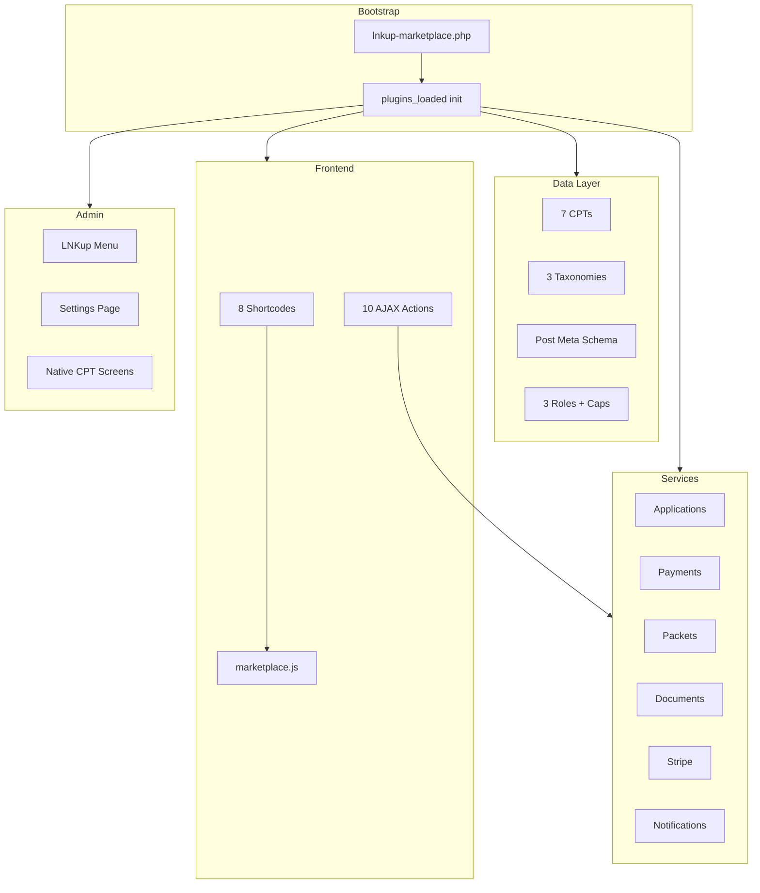
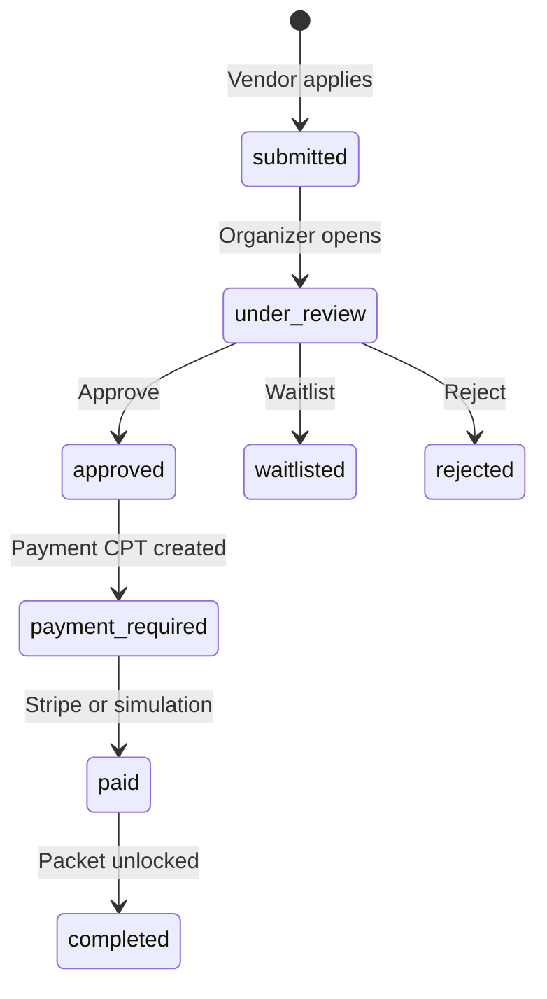

# LNKup Marketplace Platform — Current State

## Monorepo Layout

```
lnk-up-marketplace-platform/
├── app/                              # Next.js 16 reference UI (v0 template)
├── components/                       # React/shadcn components (reference)
├── package.json                      # Next.js app (pnpm, React 19, Tailwind 4)
├── README.md                         # Setup instructions
└── wp-content/
    ├── themes/lnkup-theme/           # WordPress theme (production UI)
    └── plugins/lnkup-marketplace/      # Marketplace logic plugin
```

**MVP scope:** Vendor-only marketplace layer — not attendee ticketing. Ticketing stays on Posh, Eventbrite, Universe, etc.

---

## 1. Next.js Reference Frontend (Design Source)

Runnable v0 template kept for design comparison. **Not wired to WordPress** — static/mock UI only.

**Stack:** Next.js 16.2, React 19, Tailwind 4, shadcn/ui, Recharts, Lucide icons.

### Routes (`app/`)

| Area | Pages |
|------|-------|
| Landing | `/` (`page.tsx`) |
| Vendor dashboard | `/dashboard`, `/dashboard/find-events`, `/dashboard/applications`, `/dashboard/documents`, `/dashboard/payments`, `/dashboard/profile`, `/dashboard/reviews` |
| Organizer dashboard | `/organizer`, `/organizer/create`, `/organizer/import`, `/organizer/applications`, `/organizer/vendors`, `/organizer/payouts` |
| Admin | `/admin`, `/admin/events`, `/admin/vendors`, `/admin/organizers`, `/admin/analytics` |

### Components (`components/`)

- **Landing:** `hero`, `how-it-works`, `categories`, `featured`, `site-header`, `site-footer`
- **Dashboard:** `shell`, `stat-card`, `status-badge`, `app-status-badge`
- **Brand:** `logo`
- **UI:** 22 shadcn primitives (button, card, table, dialog, sidebar, chart, etc.)
- **Shared:** `event-card.tsx`

**Run locally:**
```bash
pnpm install && pnpm dev
```

---

## 2. WordPress Theme — [lnkup-theme](wp-content/themes/lnkup-theme)

Classic PHP theme (not block/FSE). Black/white/lime accent matching the v0 design.

### Templates

| File | Purpose |
|------|---------|
| [front-page.php](wp-content/themes/lnkup-theme/front-page.php) | Landing page — composes all landing partials |
| [page.php](wp-content/themes/lnkup-theme/page.php) | Default page with site header/footer |
| [index.php](wp-content/themes/lnkup-theme/index.php) | Fallback → `page.php` |
| [header.php](wp-content/themes/lnkup-theme/header.php) / [footer.php](wp-content/themes/lnkup-theme/footer.php) | Minimal HTML shell |

### Page Templates

| Template | Role gate | Shortcode |
|----------|-----------|-----------|
| [vendor-dashboard.php](wp-content/themes/lnkup-theme/page-templates/vendor-dashboard.php) | `lnkup_vendor`, `lnkup_admin`, `administrator` | `[lnkup_vendor_dashboard]` |
| [organizer-dashboard.php](wp-content/themes/lnkup-theme/page-templates/organizer-dashboard.php) | `lnkup_organizer`, `lnkup_admin`, `administrator` | `[lnkup_organizer_dashboard]` |
| [full-width.php](wp-content/themes/lnkup-theme/page-templates/full-width.php) | None | Raw page content |

### Landing Sections (`template-parts/landing/`)

- `site-header.php` — sticky nav, mobile menu, login/dashboard CTAs
- `hero.php` — hero + CTA + trust bullets
- `how-it-works.php` — 4-step onboarding
- `categories.php` — 13 vendor category chips
- `featured.php` — featured events grid (plugin data or fallback)
- `trust.php` — stats / trust messaging
- `final-cta.php` — bottom conversion banner
- `site-footer.php` — multi-column footer

### Theme Modules (`inc/`)

| File | Role |
|------|------|
| [setup.php](wp-content/themes/lnkup-theme/inc/setup.php) | `title-tag`, thumbnails, HTML5, nav menu registration, page template labels |
| [enqueue.php](wp-content/themes/lnkup-theme/inc/enqueue.php) | Google Fonts (Sora + Inter), CSS, JS |
| [template-tags.php](wp-content/themes/lnkup-theme/inc/template-tags.php) | Logo, asset URLs, page URLs, dashboard detection |
| [dashboard.php](wp-content/themes/lnkup-theme/inc/dashboard.php) | Login/role guards, sidebar nav, dashboard shell markup |

### Assets

| Asset | Purpose |
|-------|---------|
| [assets/src/main.css](wp-content/themes/lnkup-theme/assets/src/main.css) | Tailwind v4 source + design tokens |
| `assets/dist/lnkup.css` | Compiled Tailwind (enqueued) |
| `assets/dist/components.css` | Hand-written BEM styles (header, hero, dashboard, forms, plugin UI) |
| `assets/js/theme.js` | Mobile nav toggle |
| `assets/js/dashboard.js` | Dashboard sidebar toggle |
| `assets/images/events/*.svg` | 5 event illustration SVGs |

**Build CSS:**
```bash
cd wp-content/themes/lnkup-theme && npm install && npm run build
```

### Theme Gaps (intentional / not built)

- No `single.php`, `archive.php`, `404.php`, `theme.json`
- Nav menus registered but templates use hardcoded links
- No Customizer, widget areas, or block patterns
- No `screenshot.png` or `languages/` folder

---

## 3. WordPress Plugin — [lnkup-marketplace](wp-content/plugins/lnkup-marketplace)

All marketplace business logic lives here. Bootstrap: [lnkup-marketplace.php](wp-content/plugins/lnkup-marketplace/lnkup-marketplace.php).

### Architecture



### PHP Classes (17 files)

| Class | File | Purpose |
|-------|------|---------|
| `LNKup_Activator` | [class-activator.php](wp-content/plugins/lnkup-marketplace/includes/class-activator.php) | Activation, pages, sample data |
| `LNKup_Roles` | [class-roles.php](wp-content/plugins/lnkup-marketplace/includes/class-roles.php) | Roles, registration role picker |
| `LNKup_Post_Types` | [class-post-types.php](wp-content/plugins/lnkup-marketplace/includes/class-post-types.php) | 7 CPT registrations |
| `LNKup_Taxonomies` | [class-taxonomies.php](wp-content/plugins/lnkup-marketplace/includes/class-taxonomies.php) | 3 taxonomies + term seeding |
| `LNKup_Meta` | [class-meta.php](wp-content/plugins/lnkup-marketplace/includes/class-meta.php) | Meta schema + admin meta boxes |
| `LNKup_Capabilities` | [class-capabilities.php](wp-content/plugins/lnkup-marketplace/includes/class-capabilities.php) | Ownership checks, `user_has_manage_all()` |
| `LNKup_Security` | [class-security.php](wp-content/plugins/lnkup-marketplace/includes/class-security.php) | Nonces, MIME allowlist, sanitization |
| `LNKup_Applications` | [class-applications.php](wp-content/plugins/lnkup-marketplace/includes/class-applications.php) | Apply, approve, reject, waitlist |
| `LNKup_Payments` | [class-payments.php](wp-content/plugins/lnkup-marketplace/includes/class-payments.php) | Payment records, fee calculation |
| `LNKup_Packets` | [class-packets.php](wp-content/plugins/lnkup-marketplace/includes/class-packets.php) | Vendor packet lock/unlock, QR pass |
| `LNKup_Stripe` | [class-stripe.php](wp-content/plugins/lnkup-marketplace/includes/class-stripe.php) | Checkout API, test simulation, webhook |
| `LNKup_Documents` | [class-documents.php](wp-content/plugins/lnkup-marketplace/includes/class-documents.php) | Upload, download, verification |
| `LNKup_Notifications` | [class-notifications.php](wp-content/plugins/lnkup-marketplace/includes/class-notifications.php) | HTML email via `wp_mail` |
| `LNKup_Ajax` | [class-ajax.php](wp-content/plugins/lnkup-marketplace/includes/class-ajax.php) | Logged-in AJAX handlers |
| `LNKup_Shortcodes` | [class-shortcodes.php](wp-content/plugins/lnkup-marketplace/public/class-shortcodes.php) | Frontend shortcode renderers |
| `LNKup_Admin` | [class-admin.php](wp-content/plugins/lnkup-marketplace/admin/class-admin.php) | Admin menu + settings |
| Helpers | [helpers.php](wp-content/plugins/lnkup-marketplace/includes/helpers.php) | Currency, queries, event card HTML |

### Custom Post Types (7)

| Slug | Label | Public | Notes |
|------|-------|--------|-------|
| `lnkup_vendor_profile` | Vendor Profiles | No | Business profile per vendor |
| `lnkup_event` | Events | Yes | Organizer events |
| `lnkup_opportunity` | Opportunities | Yes | Vendor slots per event |
| `lnkup_application` | Applications | No | Vendor applications |
| `lnkup_document` | Documents | No | Compliance uploads |
| `lnkup_payment` | Payments | No | Payment records |
| `lnkup_packet` | Vendor Packets | No | Post-payment venue info |

### Taxonomies (3)

| Slug | Attached To | Seeded Terms |
|------|-------------|--------------|
| `lnkup_vendor_category` | vendor profiles, opportunities | 13 (Food Vendor, Food Truck, etc.) |
| `lnkup_event_type` | events | 12 (Festival, Rodeo, etc.) |
| `lnkup_market` | events, opportunities | Hierarchical, no seed |

### Roles & Capabilities

| Role | Key capabilities |
|------|------------------|
| `lnkup_vendor` | `manage_own_profile`, `view_opportunities`, `submit_applications`, `manage_own_documents`, `view_own_payments` |
| `lnkup_organizer` | `manage_own_events`, `manage_own_opportunities`, `review_applications`, `manage_own_packets`, `view_own_payments` |
| `lnkup_admin` | `manage_all`, `verify_documents`, `manage_settings` |
| `administrator` | Receives all LNKup caps on activation |

Registration form adds Vendor/Organizer dropdown; `user_register` assigns selected role.

### Shortcodes (8)

| Shortcode | Purpose |
|-----------|---------|
| `[lnkup_vendor_dashboard]` | Vendor overview stats + quick links |
| `[lnkup_organizer_dashboard]` | Organizer overview stats |
| `[lnkup_opportunities_feed]` | Public browse/apply feed |
| `[lnkup_vendor_profile_form]` | Vendor business profile CRUD |
| `[lnkup_organizer_events]` | Event list + opportunity creation |
| `[lnkup_applications_manager]` | Organizer application review |
| `[lnkup_documents_manager]` | Vendor document uploads |
| `[lnkup_payments_dashboard]` | Payment history + checkout |

### AJAX Actions (logged-in only)

| Action | Purpose |
|--------|---------|
| `lnkup_apply` | Submit vendor application |
| `lnkup_save_profile` | Create/update vendor profile |
| `lnkup_upload_document` | Upload compliance document |
| `lnkup_review_application` | Organizer approve/waitlist/reject |
| `lnkup_create_event` | Create/import event |
| `lnkup_create_opportunity` | Create opportunity for event |
| `lnkup_download_document` | Secure document download |
| `lnkup_export_vendors` | CSV export for event |
| `lnkup_create_checkout` | Start Stripe or simulation checkout |
| `lnkup_simulate_payment` | Test-mode payment completion |

**REST:** `POST /wp-json/lnkup/v1/stripe-webhook` — handles `checkout.session.completed`

### Application Workflow



**Application statuses:** `submitted`, `under_review`, `approved`, `payment_required`, `paid`, `waitlisted`, `rejected`, `completed`, `cancelled`

**Payment statuses:** `pending`, `paid`, `failed`, `refunded`, `disputed`

**Document types:** `certificate_of_insurance`, `health_permit`, `business_license`, `w9`, `sales_tax_certificate`, `other`

### Admin UI

| Page | Capability | Content |
|------|------------|---------|
| **LNKup** (top-level) | `lnkup_manage_all` | Stats: vendors, organizers, events, applications, GMV, revenue, pending docs |
| **Settings** (submenu) | `lnkup_manage_settings` | Fees, Stripe keys, test mode, packet lock, default documents, notifications |
| Native CPT screens | WP defaults | All 7 CPTs editable in wp-admin |

### Plugin Settings (`lnkup_settings` option)

| Key | Default |
|-----|---------|
| `default_fee` | `19.99` |
| `stripe_public_key` / `stripe_secret_key` | empty |
| `test_mode` | `true` |
| `default_packet_lock` | `true` |
| `default_documents` | COI + business license |
| `notify_vendor` / `notify_organizer` / `notify_admin` | `true` |
| `support_email` | site admin email |

### Activation Behavior

On first activate ([class-activator.php](wp-content/plugins/lnkup-marketplace/includes/class-activator.php)):

1. Register roles, CPTs, taxonomies + seed taxonomy terms
2. Create 4 pages with shortcodes + theme templates
3. Seed 5 sample events + opportunities (Charlotte, Atlanta, Miami, Raleigh, Greensboro)
4. Create demo user `lnkup_demo_organizer` (`lnkup_organizer` role)
5. Set front page to `home` if none configured
6. Flush rewrite rules

| Page slug | Title | Shortcode |
|-----------|-------|-----------|
| `vendor-dashboard` | Vendor Dashboard | `[lnkup_vendor_dashboard]` |
| `organizer-dashboard` | Organizer Dashboard | `[lnkup_organizer_dashboard]` |
| `opportunities` | Find Events | `[lnkup_opportunities_feed]` |
| `vendor-profile` | Vendor Profile | `[lnkup_vendor_profile_form]` |

**Deactivation:** flush rewrites only (data persists).  
**Uninstall:** deletes settings options only — not CPT posts or roles.

---

## 4. Production Issues & Fixes Applied

### Issue 1: White screen on plugin activation (fixed)

Hardening across bootstrap, meta registration, shortcodes, activator, and admin error notices:

- PHP 7.4+ guard with admin notice
- Safe `file_exists()` requires
- Removed PHP 7.4-incompatible arrow functions in shortcodes
- Boolean meta `default` + `rest_sanitize_boolean`
- Money fields as `type => string`
- Activator try/catch + safer demo seeding
- Activation error transient shown in admin

### Issue 2: Memory exhaustion on thelnkup.com (fixed in repo, needs deploy)

**Symptom:** `Allowed memory size of 805306368 bytes exhausted` in `wp-includes/functions.php`

**Cause:** Infinite recursion in `map_meta_cap` — called `user_can('lnkup_manage_all')` which re-entered the same filter.

**Fix in [class-capabilities.php](wp-content/plugins/lnkup-marketplace/includes/class-capabilities.php):**
- Removed broken `map_meta_cap` filter
- Added `LNKup_Capabilities::user_has_manage_all()` — checks `$user->allcaps` directly
- Replaced all `user_can('lnkup_manage_all')` calls across 7 plugin files

**Deploy status:** Fix exists in local repo; must be uploaded to production (`thelnkup.com`) to take effect.

---

## 5. WordPress Setup Checklist

1. Copy/link `wp-content/themes/lnkup-theme` and `wp-content/plugins/lnkup-marketplace` into WordPress
2. Activate **LNKup Marketplace** plugin
3. Activate **LNKup Theme**
4. Build theme CSS (`npm run build` in theme dir)
5. Confirm **Settings → Reading** uses static front page
6. Configure Stripe under **LNKup → Settings** (or use test-mode simulation)
7. Assign `lnkup_vendor` / `lnkup_organizer` roles to test users

---

## 6. What Is NOT Built Yet

These exist in the Next.js reference but have no WordPress equivalent yet:

- Admin analytics dashboard (beyond basic LNKup overview stats)
- Organizer payouts UI
- Vendor reviews system
- Event import flow (AJAX stub exists; no full import UI)
- Attendee ticketing
- Block theme / FSE support
- WP nav menu integration in theme header/footer
- Full `map_meta_cap` ownership mapping for CPT edit/delete (currently uses ownership helpers in plugin logic only)
- Automated E2E / Playwright tests
- CI/CD pipeline

---

## 7. File Counts Summary

| Area | Files (approx.) |
|------|-----------------|
| Plugin PHP + JS + templates | 21 source files |
| Theme PHP + CSS + JS | ~30 source files (excl. node_modules) |
| Next.js app routes | 24 pages |
| React components | 34 files |
