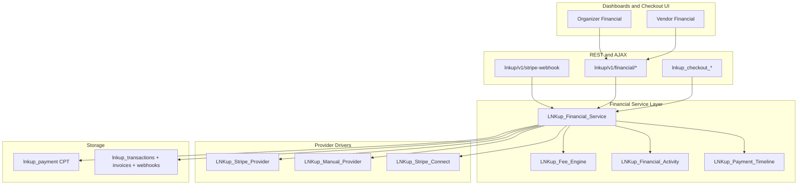
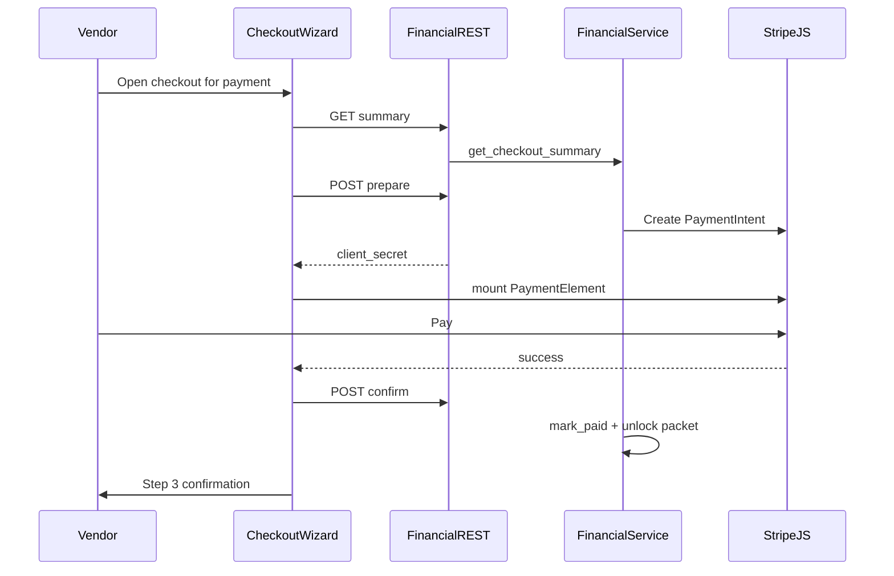

# Phase 11: Stripe-First Financial Platform

## Starting point (already shipped)

Phase 9 delivered the ledger scaffolding at **v10.1.0**. These are **done** and should be extended, not rewritten:

| Area | Existing files |
|------|----------------|
| 19 SQL tables | [`class-financial-tables.php`](wp-content/plugins/lnkup-marketplace/includes/class-financial-tables.php) |
| Provider abstraction | [`class-payment-provider.php`](wp-content/plugins/lnkup-marketplace/includes/class-payment-provider.php), [`class-stripe-provider.php`](wp-content/plugins/lnkup-marketplace/includes/class-stripe-provider.php), [`class-manual-provider.php`](wp-content/plugins/lnkup-marketplace/includes/class-manual-provider.php) |
| Domain services | `LNKup_Transactions`, `LNKup_Invoices`, `LNKup_Wallet`, `LNKup_Credits`, `LNKup_Refunds`, `LNKup_Payouts`, etc. |
| REST | [`class-financial-rest.php`](wp-content/plugins/lnkup-marketplace/includes/class-financial-rest.php) — `lnkup/v1/financial/*` |
| UI shells | [`class-financial-render.php`](wp-content/plugins/lnkup-marketplace/includes/class-financial-render.php), [`financial.js`](wp-content/plugins/lnkup-marketplace/public/js/financial.js), [`financial.css`](wp-content/plugins/lnkup-marketplace/public/css/financial.css) |
| Checkout (legacy) | [`class-payments.php`](wp-content/plugins/lnkup-marketplace/includes/class-payments.php) + AJAX `lnkup_create_checkout` in [`class-stripe.php`](wp-content/plugins/lnkup-marketplace/includes/class-stripe.php) |

**Critical gaps vs your spec:**
- No `LNKup_Financial_Service` facade; dashboards/AJAX call Stripe/provider classes directly
- Stripe via raw `wp_remote_post`; webhook signature is a placeholder; only `checkout.session.completed` handled
- `test_mode` forces manual checkout even when Stripe test keys exist
- Fee logic hardcoded in [`class-payments.php`](wp-content/plugins/lnkup-marketplace/includes/class-payments.php) and `LNKup_Payouts::PLATFORM_FEE_RATE` (8%)
- Checkout is a "Pay now" button → redirect; no embedded multi-step flow
- Dashboards are read-only tables; no charts, refund forms, payment-method management, PDF invoices, or activity feed
- No Stripe Connect model, webhook history table, or payment timeline

---

## Target architecture



**Rule:** After refactor, **no** dashboard, shortcode, or AJAX handler calls `LNKup_Stripe`, `LNKup_Stripe_Provider`, or Stripe HTTP directly. Everything routes through `LNKup_Financial_Service`.

---

## Wave 1 — Module refactor and Stripe SDK foundation

### 1a. Restructure into `includes/financial/`

Move and thin-wrap existing classes (keep class names for backward compat):

```
includes/financial/
  class-financial-service.php      # NEW — orchestrator
  interface-payment-provider.php   # extract from class-payment-provider.php
  class-stripe-provider.php        # move + rebuild
  class-stripe-connect.php         # NEW — Connect-ready stub
  class-stripe-webhooks.php        # NEW — event router + retry
  class-manual-provider.php
  class-fee-engine.php             # NEW
  class-checkout.php               # NEW — embedded checkout orchestration
  class-payment-timeline.php       # NEW
  class-financial-activity.php     # NEW
  class-financial-status.php       # NEW — smart statuses
  # Existing domain classes moved here:
  class-transactions.php, class-invoices.php, class-wallet.php, ...
```

Update [`lnkup-marketplace.php`](wp-content/plugins/lnkup-marketplace/lnkup-marketplace.php) requires. Keep thin aliases at old paths (`class-financial.php` → `require` + `class_alias` or delegate to service) so existing hooks/tests don't break.

### 1b. Add Stripe PHP SDK

- Add [`composer.json`](wp-content/plugins/lnkup-marketplace/composer.json) with `stripe/stripe-php` (^latest stable)
- Autoload in plugin bootstrap; document `composer install` in plugin README
- Replace all `wp_remote_post` Stripe calls with SDK client wrapper in `LNKup_Stripe_Provider`

### 1c. Fix test-mode behavior

- **Change:** `test_mode` uses Stripe **test keys** (real Stripe test mode), not manual simulation
- Manual provider only when `payment_provider=manual` or keys missing

### 1d. Schema expansion (v11.0.0 migration)

Extend [`class-financial-tables.php`](wp-content/plugins/lnkup-marketplace/includes/class-financial-tables.php) via `dbDelta`:

**New tables:**
- `lnkup_webhook_events` — `event_id`, `type`, `payload`, `status`, `attempts`, `processed_at`, `error`
- `lnkup_connected_accounts` — `user_id`, `role`, `stripe_account_id`, `verification_status`, `payouts_enabled`, `metadata`
- `lnkup_payment_timeline` — `payment_post_id`, `step`, `status`, `actor_id`, `notes`, `created_at`
- `lnkup_financial_activity` — unified activity feed rows
- `lnkup_fee_rules` — configurable fee engine rules

**Extend `lnkup_transactions`** with columns (nullable for backfill): `invoice_number`, `payment_method`, `stripe_customer_id`, `stripe_payment_intent`, `checkout_session_id`, `platform_fee`, `vendor_fee`, `processing_fee`, `tax_amount`, `discount_amount`, `credit_amount`, `refund_amount`, `paid_at`

Bump `LNKUP_VERSION` to **11.0.0** and run backfill migration from CPT meta → new columns.

---

## Wave 2 — Stripe provider rebuild

Expand [`LNKup_Payment_Provider`](wp-content/plugins/lnkup-marketplace/includes/class-payment-provider.php) interface:

| Method | Purpose |
|--------|---------|
| `get_or_create_customer($user_id)` | Stripe Customer |
| `create_setup_intent($user_id)` | Save card flow |
| `list_payment_methods($user_id)` | Sync from Stripe |
| `detach_payment_method($method_id)` | Remove card |
| `create_payment_intent($payment_id, $opts)` | Embedded checkout |
| `create_checkout_session($payment_id)` | Fallback redirect |
| `confirm_payment_intent($intent_id)` | Post-Element confirm |
| `refund($payment_id, $amount)` | Existing, SDK-hardened |
| `get_receipt_url($payment_id)` | Stripe receipt |

**`LNKup_Stripe_Provider` implementation:**
- Payment Element: `automatic_payment_methods` enabled (Apple Pay, Google Pay, Link)
- ACH: `payment_method_types` config flag (disabled by default, architecture-ready)
- Idempotency keys on all mutating calls
- Rich metadata on Customer/PI/Session: `payment_post_id`, `application_id`, `event_id`, `vendor_user_id`, `organizer_user_id`, `invoice_number`
- Customer ID stored in user meta `_lnkup_stripe_customer_id`

**`LNKup_Stripe_Connect` (prep only, no onboarding UI):**
- Model + table CRUD for connected accounts
- `LNKup_Financial_Service::calculate_payout_split()` uses fee engine + Connect flags
- `transfer_service` stub that logs "would transfer" when Connect not enabled

---

## Wave 3 — Webhooks, fee engine, smart statuses

### Webhooks ([`class-stripe-webhooks.php`](wp-content/plugins/lnkup-marketplace/includes/financial/class-stripe-webhooks.php))

Replace placeholder in [`class-stripe.php`](wp-content/plugins/lnkup-marketplace/includes/class-stripe.php) with delegated handler:

| Event | Action |
|-------|--------|
| `checkout.session.completed` | `FSS::handle_checkout_completed()` |
| `payment_intent.succeeded` | `mark_paid` + timeline + activity |
| `payment_intent.payment_failed` | status → failed, notify vendor |
| `charge.refunded` | sync refund amount |
| `charge.dispute.created` | open financial dispute |
| `customer.subscription.*` | log + stub for future billing |
| `account.updated` | update Connect account status |
| `transfer.created`, `payout.created` | log payout events |

Every event: insert into `lnkup_webhook_events`, verify `Stripe-Signature` via SDK, idempotent processing by `event_id`, retry failed rows via daily cron.

### Fee engine ([`class-fee-engine.php`](wp-content/plugins/lnkup-marketplace/includes/financial/class-fee-engine.php))

Replace hardcoded fee math in [`class-payments.php`](wp-content/plugins/lnkup-marketplace/includes/class-payments.php):

```php
LNKup_Fee_Engine::calculate( array(
  'vendor_fee'    => $spot_fee,
  'organizer_id'  => $organizer_id,
  'event_id'      => $event_id,
  'category'      => $category_slug,
) );
// returns: vendor_fee, platform_fee, processing_fee, tax, discounts, total
```

Support: flat, percentage, hybrid, min/max, category-specific, organizer-specific rules in `lnkup_fee_rules`. Admin settings UI in [`class-financial-admin.php`](wp-content/plugins/lnkup-marketplace/admin/class-financial-admin.php).

### Smart statuses ([`class-financial-status.php`](wp-content/plugins/lnkup-marketplace/includes/financial/class-financial-status.php))

Map CPT + invoice + installment + deposit state to:

`awaiting_invoice`, `invoice_sent`, `awaiting_deposit`, `deposit_paid`, `balance_due`, `payment_due_soon`, `paid`, `refund_pending`, `refunded`, `chargeback`, `waived`, `cancelled`

Update [`LNKup_Financial_Render::status_chip()`](wp-content/plugins/lnkup-marketplace/includes/class-financial-render.php) and CSS for all statuses.

---

## Wave 4 — Embedded multi-step checkout

Replace "Pay now" redirect with dedicated checkout view.

### Backend — [`class-checkout.php`](wp-content/plugins/lnkup-marketplace/includes/financial/class-checkout.php)

`LNKup_Financial_Service` methods:
- `get_checkout_summary($payment_id)` — event image, organizer, spot, fee breakdown, wallet credits, unlock ETA
- `prepare_checkout($payment_id)` — create PI, return `client_secret` + `publishable_key`
- `apply_wallet_credits($payment_id, $amount)`
- `finalize_checkout($payment_id, $intent_id)` — mark paid, unlock packet, issue receipt

### REST routes (add to [`class-financial-rest.php`](wp-content/plugins/lnkup-marketplace/includes/class-financial-rest.php))

- `GET /checkout/{payment_id}/summary`
- `POST /checkout/{payment_id}/prepare`
- `POST /checkout/{payment_id}/confirm`
- `POST /checkout/{payment_id}/apply-credits`

### Frontend — new assets

- [`public/js/checkout.js`](wp-content/plugins/lnkup-marketplace/public/js/checkout.js) — Stripe.js Payment Element, 3-step wizard
- [`public/css/checkout.css`](wp-content/plugins/lnkup-marketplace/public/css/checkout.css) — premium SaaS styling (rounded cards, skeletons, step indicator)

### UI flow (vendor dashboard)



**Entry points:** Replace `.lnkup-pay-btn` handler in [`marketplace.js`](wp-content/plugins/lnkup-marketplace/public/js/marketplace.js) to open checkout modal/page instead of AJAX redirect. Preserve manual provider path for dev.

**Post-payment:** Call existing `LNKup_Payments::mark_paid()` → packet unlock unchanged.

---

## Wave 5 — Invoices, receipts, timeline, activity feed

### Premium invoices

Extend [`LNKup_Invoices`](wp-content/plugins/lnkup-marketplace/includes/class-invoices.php):
- Branded HTML template (LNKup logo, line items, QR verification code)
- PDF generation via lightweight PHP lib (e.g. `dompdf/dompdf` in composer) or server-side HTML→PDF
- REST: `GET /invoices/{id}`, `GET /invoices/{id}/pdf`, `POST /invoices/{id}/email`
- QR links to `?lnkup_verify_invoice={token}` public verification endpoint

Auto-create on approval already exists in `create_from_payment()` — enhance line items via fee engine breakdown.

### Payment timeline ([`class-payment-timeline.php`](wp-content/plugins/lnkup-marketplace/includes/financial/class-payment-timeline.php))

Record steps on hooks:
`application_approved` → `invoice_created` → `reminder_sent` → `payment_received` → `packet_unlocked` → `checked_in` → `completed` → `review_submitted`

Expose via `GET /payments/{id}/timeline` and render in checkout confirmation + payment detail drawer.

### Activity feed ([`class-financial-activity.php`](wp-content/plugins/lnkup-marketplace/includes/financial/class-financial-activity.php))

Write on every financial event (invoice, payment, refund, receipt, payout). `GET /activity` scoped by role. Sidebar component on vendor/org dashboards.

---

## Wave 6 — Payment methods and wallet

### Payment methods UI

Wire [`LNKup_Payment_Methods`](wp-content/plugins/lnkup-marketplace/includes/class-payment-methods.php) to real Stripe:
- `POST /payment-methods/setup` → SetupIntent
- `POST /payment-methods` → attach after confirm
- `DELETE /payment-methods/{id}`, `PATCH` rename/default
- Expiration warnings in vendor tab (cron already calls `mark_expired_cards`)

Frontend: card list with default badge, add-card modal with Payment Element (setup mode), remove/rename actions.

### Wallet auto-apply

Enhance [`LNKup_Credits`](wp-content/plugins/lnkup-marketplace/includes/class-credits.php) + checkout step 1 toggle "Apply wallet balance" with live total recalculation. Credit types: refund, referral, promotional, manual, marketplace.

---

## Wave 7 — Refund center and dashboard redesign

### Refund center

Backend exists in [`LNKup_Refunds`](wp-content/plugins/lnkup-marketplace/includes/class-refunds.php). Add UI in [`financial.js`](wp-content/plugins/lnkup-marketplace/public/js/financial.js):

**Vendor:** request form (amount, reason, type: full/partial/credit), status timeline, organizer notes  
**Organizer:** approve/deny/partial actions wired to existing REST  
**Admin:** override in Financial Center

### Organizer financial dashboard redesign

Expand [`LNKup_Financial_Render::organizer_shell()`](wp-content/plugins/lnkup-marketplace/includes/class-financial-render.php):
- KPI cards: Gross Revenue, Platform Fees, Pending, Collected, Refunds, Outstanding
- Charts (lightweight SVG/CSS bars or Chart.js ~20KB): revenue by event, by month, vendor categories, completion rate
- Export buttons: CSV (existing reports), PDF summary
- Consolidate `#payments` legacy table into `#financial` panel; deprecate duplicate organizer payments panel

### Vendor financial dashboard redesign

Expand vendor shell:
- KPIs: Lifetime Spend, Pending, Wallet, Upcoming, Confirmed Bookings
- Charts: monthly/yearly spending
- Sections: upcoming invoices, recent payments, recent refunds, receipts with download links
- Remove redundant legacy table below tabs once checkout drawer covers pay actions

### CSS upgrade

Expand [`financial.css`](wp-content/plugins/lnkup-marketplace/public/css/financial.css) to match Stripe/Ramp/Linear patterns: larger KPI typography, chart containers, empty states, loading skeletons, subtle animations (`prefers-reduced-motion` safe), dark/light via existing `--lnkup-*` CSS vars.

---

## Wave 8 — Reminders, reports, admin

### Payment reminders

Extend [`LNKup_Financial_Cron`](wp-content/plugins/lnkup-marketplace/includes/class-financial-cron.php):
- Schedule: 7d, 3d, 24h before due, past due, final notice
- Send via existing `LNKup_Notifications` email templates (new templates: `payment_reminder`, `payment_overdue`)
- Dashboard in-app notification + activity feed entry
- SMS/push: stub hooks only

### Admin reports

Extend [`LNKup_Financial_Reports`](wp-content/plugins/lnkup-marketplace/includes/class-financial-reports.php) + admin UI:
- GMV, marketplace revenue, platform fees, refund %, chargebacks, avg vendor fee
- Top organizers/vendors, revenue by market/event type/category/month
- Wire [`LNKup_Revenue_Intelligence`](wp-content/plugins/lnkup-marketplace/includes/class-revenue-intelligence.php) to ledger-only (drop CPT fallback once backfill verified)

---

## Wave 9 — QA and compatibility

### E2E tests

Extend existing specs:
- [`tests/e2e/vendor-financial.spec.ts`](tests/e2e/vendor-financial.spec.ts) — checkout wizard, wallet apply, payment methods
- [`tests/e2e/organizer-financial.spec.ts`](tests/e2e/organizer-financial.spec.ts) — refund approve, charts load
- New `checkout-embedded.spec.ts` — mock Stripe or use test mode keys in CI

### Backward compatibility checklist

- `lnkup_payment` CPT remains source for checkout initiation
- `LNKup_Payments::create_from_application()` and `mark_paid()` unchanged signatures; internals call `LNKup_Financial_Service`
- Legacy `lnkup_create_checkout` AJAX redirects to new prepare endpoint
- Existing paid records backfilled into expanded transaction columns

---

## Files most impacted

| File | Change |
|------|--------|
| [`lnkup-marketplace.php`](wp-content/plugins/lnkup-marketplace/lnkup-marketplace.php) | v11.0.0, composer autoload, financial/ requires |
| [`class-financial-service.php`](wp-content/plugins/lnkup-marketplace/includes/financial/class-financial-service.php) | **NEW** — central orchestrator |
| [`class-stripe-provider.php`](wp-content/plugins/lnkup-marketplace/includes/class-stripe-provider.php) | Full SDK rebuild |
| [`class-stripe.php`](wp-content/plugins/lnkup-marketplace/includes/class-stripe.php) | Thin delegate to service + webhooks |
| [`class-payments.php`](wp-content/plugins/lnkup-marketplace/includes/class-payments.php) | Use fee engine; emit timeline/activity |
| [`class-financial-rest.php`](wp-content/plugins/lnkup-marketplace/includes/class-financial-rest.php) | Checkout, timeline, activity, invoice PDF routes |
| [`class-shortcodes.php`](wp-content/plugins/lnkup-marketplace/public/class-shortcodes.php) | Checkout modal/page, consolidated dashboards |
| [`financial.js`](wp-content/plugins/lnkup-marketplace/public/js/financial.js) | Charts, refund forms, activity feed, payment methods |
| [`financial.css`](wp-content/plugins/lnkup-marketplace/public/css/financial.css) | Premium SaaS design system |
| [`checkout.js`](wp-content/plugins/lnkup-marketplace/public/js/checkout.js) | **NEW** — embedded Payment Element wizard |
| [`class-financial-admin.php`](wp-content/plugins/lnkup-marketplace/admin/class-financial-admin.php) | Fee rules, webhook log, Connect status |

---

## Out of scope (architecture-ready only)

Per your spec — stub interfaces/hooks, no full implementation:
- Stripe Connect onboarding flow
- Stripe Billing / subscriptions
- Affirm, Klarna, Afterpay, insurance
- ACH live (config flag + PI types only)
- SMS/push reminders

---

## Estimated delivery order

| Wave | Focus | Depends on |
|------|-------|------------|
| 1 | Refactor + SDK + schema | — |
| 2 | Stripe provider rebuild | Wave 1 |
| 3 | Webhooks + fees + statuses | Wave 2 |
| 4 | Embedded checkout | Waves 2–3 |
| 5 | Invoices PDF + timeline + activity | Wave 4 |
| 6 | Payment methods + wallet UI | Wave 4 |
| 7 | Refund center + dashboard redesign | Waves 5–6 |
| 8 | Reminders + admin reports | Wave 7 |
| 9 | E2E + backfill verification | All |
