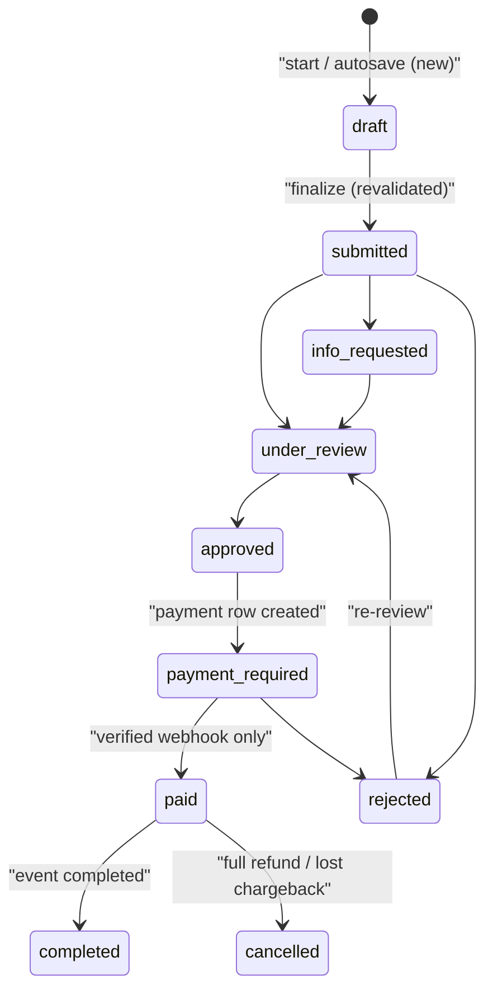

# Booking & Application OS — System Audit (2026-11-22)

Baseline audit of the vendor application → approval → payment → booking → pass → check-in path, taken before the Booking & Application OS foundation work (plugin 12.25.x). Paths are relative to `wp-content/plugins/lnkup-marketplace/` unless noted. Bug numbers (`B-n`) are referenced by the fixes and tests that close them.

## 1. Lifecycle overview

Booked = application `paid` (UI label "Confirmed"). Payment status lives on the `lnkup_payment` CPT; there is no separate booking record.

## 2. Application data model

CPT `lnkup_application` (`includes/class-post-types.php:63`). Meta schema in `LNKup_Meta::get_meta_schema` (`includes/class-meta.php`).

| Group | Keys |
|---|---|
| Links | `_lnkup_vendor_profile_id`, `_lnkup_vendor_user_id`, `_lnkup_opportunity_id`, `_lnkup_event_id`, `_lnkup_organizer_user_id` |
| Status | `_lnkup_application_status`, `_lnkup_submitted_at`, `_lnkup_approved_at`, `_lnkup_decided_at`, `_lnkup_payment_due_at`, `_lnkup_paid_at` |
| Submission | `post_content` (message), `_lnkup_selected_category`, `_lnkup_setup_notes`, `_lnkup_profile_snapshot`, `_lnkup_documents_snapshot`, `_lnkup_documents_missing` |
| Organizer | `_lnkup_rejection_reason`, `_lnkup_internal_notes`, `_lnkup_info_requests` (thread) |
| Ops | `_lnkup_checked_in_at`, `_lnkup_no_show_at`, `_lnkup_readiness_status`, `_lnkup_event_completed_at`, `_lnkup_cancellation_reason`, `_lnkup_withdrawn_at` |
| New (this work) | `_lnkup_draft_*`, `_lnkup_application_answers`, `_lnkup_document_ids`, `_lnkup_submission_group_id`, `_lnkup_idempotency_key`, `_lnkup_invite_token`, `_lnkup_status_history` |

Statuses (`LNKup_Security::sanitize_application_status`): `draft` (new), `submitted`, `under_review`, `info_requested`, `approved`, `payment_required`, `paid`, `waitlisted`, `rejected`, `completed`, `cancelled`. Transition map: `LNKup_Applications::TRANSITIONS`.

Inventory: `LNKup_Opportunity_Inventory` — holds = applications in `approved|payment_required|paid|completed`; `_lnkup_spots_total` 0 = unlimited; `with_lock()` uses `GET_LOCK('lnkup_inv_{opp}')`.

Tours/series: `lnkup_tour` CPT (`includes/matching/class-tours.php`), `_lnkup_tour_type` = `tour|series`; events link via `_lnkup_tour_id`, `_lnkup_tour_stop_order`. Applications, inventory and payments stay per stop.

## 3. Payment data model

CPT `lnkup_payment`, one per application (`LNKup_Payments::create_from_application`).

- Status `_lnkup_payment_status`: `pending` → `processing` (ACH) → `paid` | `partially_paid` → `paid`; `failed` (retryable unless `_lnkup_voided_at`); `refunded`, `partially_refunded`, `disputed`, `chargeback_lost`.
- Amounts: `_lnkup_vendor_spot_fee` (booth price frozen at approval), `_lnkup_vendor_checkout_fee`, `_lnkup_organizer_commission`, `_lnkup_lnkup_fee`, `_lnkup_processing_fee`, `_lnkup_tax_amount`, `_lnkup_discount_amount`, `_lnkup_credit_applied`, `_lnkup_total_amount`, `_lnkup_fee_breakdown`.
- Stripe: `_lnkup_stripe_payment_intent`, `_lnkup_stripe_checkout_session`, `_lnkup_stripe_expected_cents`, `_lnkup_stripe_charge_amount_cents`, `_lnkup_partial_charges`, `_lnkup_application_fee_cents`, `_lnkup_settlement_mode`.

SQL: `wp_lnkup_transactions`, `wp_lnkup_platform_fees`, `wp_lnkup_refunds`, `wp_lnkup_disputes`, `wp_lnkup_webhook_events` (unique `event_id`), `wp_lnkup_fee_rules`, `wp_lnkup_invoices`, `wp_lnkup_invoice_items`, `wp_lnkup_receipts`, `wp_lnkup_organizer_wallets`, `wp_lnkup_organizer_wallet_entries`, `wp_lnkup_credits`, `wp_lnkup_wallet_entries`, `wp_lnkup_deposits`, `wp_lnkup_installments`.

## 4. Pricing logic (production code, not marketing)

`LNKup_Fee_Engine::calculate` (`includes/financial/class-fee-engine.php`):

- Vendor checkout fee: `lnkup_settings.vendor_checkout_fee` (aliases `application_fee_flat`, `default_fee`; default 5.99); 0 for free booths; scoped `flat` rule may override.
- Organizer commission: first matching `percent|hybrid` rule in `wp_lnkup_fee_rules`, else `organizer_commission_percent` (default 6).
- `fee_payer_mode=organizer` moves the checkout fee into commission.
- Processing: 2.9% + $0.30 on booth + checkout fee (ACH 0.8% capped $5).
- Tax: organizer `sales_tax_rate` × (subtotal − discount).
- Total = subtotal + processing + tax − discount − credit.
- Destination charges: application fee = charge − (organizer net + tax − organizer-funded promo).

Price is frozen at approval (`_lnkup_vendor_spot_fee`); fees re-compute while `pending` and freeze when Stripe is called.

## 5. Routes (lnkup/v1)

| Method | Path | Permission |
|---|---|---|
| GET | `/applications/apply-context/{opp}` | public (invite-only now filtered) |
| POST | `/applications/apply-with-profile` | vendor |
| GET | `/applications/vendor`, `/applications/organizer` | vendor / organizer |
| POST | `/applications/{id}/request-info`, `/respond-info`, `/withdraw` | organizer / vendor / vendor |
| GET/PUT/DELETE | `/applications/drafts[/{opp}]`, POST `/applications/drafts/{id}/submit` | vendor (new) |
| GET | `/applications/price-quote/{opp}` | vendor (new) |
| GET | `/tours/{id}/apply-context`, POST `/tours/{id}/apply` | vendor (new) |
| GET | `/marketplace/apply/{opp}` | public (modal HTML) |
| GET/POST | `/financial/checkout/{id}/summary|prepare|confirm|apply-credits|redirect-url` | vendor + payment ownership |
| POST | `/stripe-webhook` | public, HMAC-verified |
| POST | `/financial/refunds`, `/approve`, `/deny` | financial / organizer |
| POST | `/admin/financial/reconcile`, `/repair` | `manage_options` |

Legacy AJAX: `lnkup_apply`, `lnkup_review_application`, `lnkup_create_checkout`, `lnkup_simulate_payment`.

## 6. Webhooks

`LNKup_Stripe_Client::verify_webhook` (HMAC-SHA256, 300s tolerance, platform + Connect secrets). Events logged in `wp_lnkup_webhook_events`; per-payment `GET_LOCK('lnkup_pay_{id}')`. Paid on `payment_intent.succeeded` / `checkout.session.completed` (paid, amount ≥ expected); processing / failed / refunded / dispute events handled. The success redirect never marks a booking paid.

## 7. Communications & analytics

- Separate plugin `wp-content/plugins/lnkup-communications/` (Action Scheduler). Listener `includes/listeners/class-comms-listen-applications.php` hooks `lnkup_application_submitted`, `lnkup_application_status_changed`, `lnkup_application_withdrawn`; groups organizer notices in burst windows.
- Analytics table `wp_lnkup_analytics_events` via `/marketplace/track/event`; funnels in `LNKup_Funnel_Analytics` are computed from post meta.

## 8. Mobile (lnk-up-marketplace-mobile/)

Screens: `app/apply/[opportunityId].tsx`, `app/booking/[applicationId].tsx`, `app/pass/[applicationId].tsx`, `app/(vendor)/requests.tsx`, `wallet.tsx`; checkout handoff `lib/payments/stripe-checkout*.ts`; timeline `lib/vendor/booking-timeline.ts`. No Stripe SDK; WordPress REST with Application Passwords.

## 9. Bug list (baseline)

Security
- **B-1** `LNKup_Invoices::verify_by_token` used `LIKE '%token%'` without `esc_like`; `?lnkup_verify_invoice=%` returned an arbitrary invoice publicly.
- **B-2** Test mode accepted unsigned webhooks when no secret was set; `ajax_simulate_payment` let vendors self-mark paid in test mode.
- **B-3** `GET /financial/checkout/{id}/summary` recalculated fees and could finalize payments (GET with side effects).
- **B-4** Webhook dedupe was check-then-insert; a concurrent duplicate got log id 0 and was processed.

Application / payment correctness
- **B-5** Re-approval after rejection reused the voided payment → stuck in `payment_required`.
- **B-6** Payment creation failure still set `payment_required` with no payment.
- **B-7** `paid` reachable from `rejected` / `cancelled`; late ACH could rebook a rejected vendor without capacity check. Reject did not cancel `processing` charges.
- **B-8** Refund / lost chargeback never re-locked the pass or released inventory.
- **B-9** Card refund could exceed card charge when credits were used; deposits refunded only the last PaymentIntent; `charge.refunded` overwrote cumulative refunds.
- **B-10** Voiding a payment did not restore applied credits.
- **B-11** `lnkup_invoice_created` fired twice with swapped argument order; invoice line items did not sum to total; no void/refund status; $0.00 invoice emails for free booths.
- **B-12** Seeded global `percent` fee rule shadows `organizer_commission_percent`.
- **B-13** `category` / `payment_method` not passed to fee calc (category rules, ACH rate ignored).
- **B-14** Capacity 0 (unlimited) rendered as full / blocked apply.
- **B-15** Invite-only slots not enforced at apply; invite token not validated.
- **B-16** Duplicate check blocked re-applying after withdraw / reject / expiry forever.
- **B-17** `_lnkup_decided_at` never written; `approved` never broadcast; `completed` unreachable.
- **B-18** wp-admin metabox wrote `_lnkup_application_status` directly, bypassing transitions.

Missing capability
- **G-1** No drafts / autosave / resume. **G-2** No organizer questions. **G-3** Documents not linked to applications. **G-4** No status history. **G-5** No multi-stop / series apply. **G-6** No withdraw button on web. **G-7** No add-ons, no cross-organizer combined checkout (each payment has one Connect destination — combined checkout is intentionally out of scope).

## 10. Security & authorization notes

- Ownership helpers: `LNKup_Capabilities::vendor_owns_application`, `organizer_owns_event`, `user_owns_post`, `user_has_manage_all` (allcaps direct).
- Duplicate-submit protection depends on MySQL `GET_LOCK`; this work adds a per-request idempotency key stored on the application.
- Public read routes (`apply-context`, `marketplace/apply`) now apply the invite-only discovery check.

## 11. Resolution log

See `docs/BOOKING_APPLICATION_OS_FOUNDATION.md` for what changed, how each bug was closed, and test evidence.
