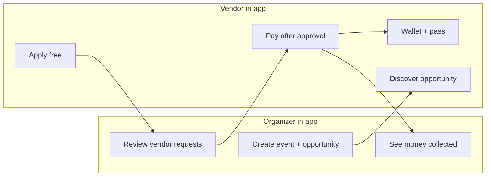

# End-to-End Marketplace Journey

Product narrative for the connected **organizer creates event → vendor purchases slot → both sides see money** loop in the Next.js app (`lnk-up-marketplace-ui/`).

**Status:** Product plan — implementation tracked in [Phase 14A](PHASE_14A_JOURNEY_HANDOFFS.md), [Phase 14B](PHASE_14B_ORGANIZER_LOOP.md), [Phase 14C](PHASE_14C_WALLET_POLISH.md).

**Architecture constraints (unchanged):** WordPress is source of truth; Financial OS stays in WordPress; Next.js is conversion shell + read-only money unless policy changes later. Checkout remains Stripe handoff via WordPress — not embedded in the app.

---

## The loop we are expanding

**North-star experience:** A vendor can go from discovery to booked pass without getting lost in WordPress; an organizer can launch, fill slots, and see fees collected — all with clear in-app status, even if card entry still happens on Stripe via handoff.

---

## Pillar 1 — Creating an event in the app

### What exists today (Phase 9)

| Step | Surface | Outcome |
|------|---------|---------|
| Convert | `/organizers` | Sign up / onboarding |
| Onboard | `/organizer/onboarding` | Cookie-based profile seed |
| Launch | `/organizer/launch` | 3-step wizard: Event → Opportunity → Review |
| Publish | `POST /api/organizer/launch/publish` → WP `POST /lnkup/v1/organizer/launch/publish` | Creates `lnkup_event` + `lnkup_opportunity` |
| Workspace | `/organizer/events/[eventId]` | Share link, requests, payments tab |

**Reference:** [PHASE_9_ORGANIZER_LAUNCH.md](PHASE_9_ORGANIZER_LAUNCH.md)

### Product gaps (organizer create)

| Gap | User impact | Expansion direction |
|-----|-------------|-------------------|
| Launch not in main nav | Organizers miss in-app creation | Add persistent “Launch event” entry in sidebar + home CTA hierarchy |
| Cookie-only drafts | Draft lost across devices | WP-backed draft save or “resume on any device” |
| One opportunity per launch | Can’t add rows to existing event in app | “Add opportunity” from event workspace |
| Thin event fields | Power organizers bounce to WP | Optional advanced fields (times, image, attendance) without full WP port |
| Share = filter URL | Vendors land on generic find, not the slot | Deep link to specific opportunity with pre-filled context |
| Handoff on publish failure | Confusing dead-end | Clearer recovery (retry, support, draft preserved) |

### Organizer “done” moment

After publish, organizer should immediately see:

1. **Share panel** — copy link vendors can use to apply
2. **Launch checklist** — review requests, approve, collect fees
3. **Money preview** — $0 collected, N slots open (ties to Pillar 3)

---

## Pillar 2 — Purchasing a vendor slot in the app

### What exists today (Phases 1–3, 10)

| Step | Surface | In-app? |
|------|---------|---------|
| Discover | `/vendor/find` | Yes |
| Apply | `apply-modal` → `POST /api/applications/apply` | Yes |
| Track | `/vendor/requests` | Yes |
| Approved → pay | Status `payment_required` | Yes (visibility) |
| Pay | Payment detail drawer → `POST .../payment-link` → **Stripe redirect** | **Handoff only** |
| Booked | `/vendor/pass/[id]` | Yes (read) |

**Reference:** [PHASE_3_PAYMENT_PACKET.md](PHASE_3_PAYMENT_PACKET.md)

**Business rule (unchanged):** Apply is free; payment only after organizer approval. There is no “instant buy slot” without application today.

### Product gaps (vendor purchase)

| Gap | User impact | Expansion direction |
|-----|-------------|-------------------|
| Checkout leaves app | Vendor loses context; may not return | **Critical:** return URL to app (`/vendor/requests?pay=…&payment=success` or `/vendor/pass/{id}`) |
| No post-pay confirmation in app | Vendor doesn’t know payment worked | Success screen + “View pass” + “View receipt” |
| No processing state | 3DS / webhook lag feels broken | “Payment processing” state with auto-refresh |
| Apply-first only | No express path for trusted vendors | Optional future: instant-approval events (WP flag exists, not wired) |
| Credits at checkout | Referral credits invisible before redirect | Show credits in payment drawer; handoff to WP apply-credits |
| Organizer approval in WP | Organizer may not use app for review | In-app approve/reject on `/organizer/vendors` (partial today) |

### Vendor “done” moment

After payment succeeds, vendor should land on:

1. **Confirmation** — “You’re booked for {event}”
2. **Pass CTA** — load-in, booth, QR
3. **Wallet CTA** — receipt and payment record (Pillar 3)

---

## Pillar 3 — Seeing money in wallet

### What exists today (Phase 12)

| Role | Surface | Data source |
|------|---------|-------------|
| Vendor | `/vendor/wallet` | BFF → WP `/financial/*` (read-only) |
| Organizer | `/organizer/money` | BFF → WP balances + activity |
| Event | Organizer event workspace Payments tab | Per-event snapshot |

**Reference:** [PHASE_12_FINANCIAL_READ_ONLY.md](PHASE_12_FINANCIAL_READ_ONLY.md)

### Product gaps (money visibility)

| Gap | User impact | Expansion direction |
|-----|-------------|-------------------|
| Stripe success → WP dashboard | Vendor never auto-opens wallet | Return URL + wallet deep link with success banner |
| No refetch after pay | Wallet stale until manual refresh | Refetch wallet/requests on `?payment=success` |
| Activity labels generic | “Activity” instead of “Booth payment” | Map WP activity copy in BFF (product copy audit) |
| Paid activity not tappable | Can’t open receipt from list | Tap row → payment detail drawer |
| Organizer money lags | Organizer doesn’t connect approval → $ | Home retention card + Money tab “collected from {vendor}” |
| Two wallets (app vs WP) | Confusion about source of truth | Single narrative: “Full statements in WordPress” handoff card |

### Money “done” moments

**Vendor:** Receipt visible in wallet activity + invoices/receipts tab; payment-required count drops to zero.

**Organizer:** `paymentRequiredCount` decreases; `collectedToDate` increases on `/organizer/money` and event Payments tab.

---

## Connected journey (recommended UX story)

### Act 1 — Organizer launches (Day 0)

1. Organizer completes `/organizer/launch` → publish
2. Lands on event workspace → copies **vendor application link**
3. Home shows: “0 vendors paid · 12 spots open”

### Act 2 — Vendor books (Day 1–7)

1. Vendor opens share link → `/vendor/find` with filters applied (Phase 14A: deep opportunity link)
2. Applies in modal → sees “Under review” on `/vendor/requests`
3. Organizer approves (app or WP) → vendor gets Phase 13 notification + home retention card “Payment required”
4. Vendor taps Continue payment → fee breakdown drawer → Stripe (handoff)
5. **Returns to app** → success → pass unlocked → wallet shows receipt

### Act 3 — Both see money (Day 7+)

| Party | Where they look | What they see |
|-------|-----------------|---------------|
| Vendor | `/vendor/wallet` | Paid booking, receipt, credits |
| Vendor | `/vendor/pass/{id}` | Booth, load-in, QR |
| Organizer | `/organizer/money` | Collected fees, pending payments |
| Organizer | Event workspace Payments | Per-event breakdown |

---

## Implementation roadmap (app phases)

| Phase | Name | Priority | Doc |
|-------|------|----------|-----|
| **14A** | Journey handoffs | Highest ROI — **Built** | [PHASE_14A_JOURNEY_HANDOFFS.md](PHASE_14A_JOURNEY_HANDOFFS.md) |
| **14B** | Organizer loop completion | High — **Built** | [PHASE_14B_ORGANIZER_LOOP.md](PHASE_14B_ORGANIZER_LOOP.md) |
| **14C** | Wallet polish | Medium — **Built** | [PHASE_14C_WALLET_POLISH.md](PHASE_14C_WALLET_POLISH.md) |
| **15–21** | Admin → tutorials arc | **Built** | [SYSTEM_OVERVIEW.md §14.2](SYSTEM_OVERVIEW.md#142-app-roadmap-phases-126) |
| **16** | Checkout return reliability | **Built** (supersedes optional embedded checkout) | [PHASE_16_CHECKOUT_RETURN_RELIABILITY.md](PHASE_16_CHECKOUT_RETURN_RELIABILITY.md) |
| **22–26** | Launch hardening → Financial OS | Queued | [PHASES_22_26_ROADMAP.md](PHASES_22_26_ROADMAP.md) |
| **Next** | Organizer event command (WordPress) | **Built** | This section |

### WordPress organizer event flow (plugin 12.18.53 — shipped)

This is the organizer dashboard, not the Next.js launch wizard. Live means the event has an open vendor slot. Draft means it has none.

- Publish on a draft opens the vendor-slot panel. Saving a slot makes the event Live.
- Edit event saves title, category, description, date, times, attendance, ticketing link, and venue.
- Vendor slots on the card: add a preset or custom type, change price and spots, remove a slot that has no requests. Removing the last open slot returns the event to Draft.
- Duplicate asks for a new name, date, city, state, venue, and address. Slots, fees, and documents copy. Applications and payments do not.
- Share event copies `/opportunities/?event={id}`: category, attendance, indoor or outdoor, amenities, tickets, organizer about, and each slot with category, price, spots filled, deadline, and Apply.
- Public organizer profile at `/organizers/?organizer={slug}`: organization name, about, and live events.
- Vendor requests filter to one event. An empty Manage roster explains the next step (Review requests, Discover vendors, or Publish).

### Next upcoming flow — Organizer event command

Shipped on the WordPress event card (plugin 12.18.54).

- Edit event saves photos, indoor or outdoor, and vendor amenities, so the public page matches what the organizer set.
- A vendor slot can be renamed. A slot with requests can be closed: new applications stop and existing requests stay. The extra fee table under Events is no longer shown.
- Review requests and Find vendors sit on the vendor slots panel.

### Phase 14A — Journey handoffs

- App return URLs after Stripe checkout (WP `success_url` config + app routes)
- `?payment=success` handling on requests, wallet, pass
- Auto-refetch wallet + requests after return
- Deep opportunity links from organizer share panel
- Unified copy: “Pay in secure checkout → return here for your pass”

### Phase 14B — Organizer loop completion

- In-app vendor approval as default path
- Event workspace: live request queue + approve → triggers vendor `payment_required` notification
- Money tab wired to real-time-ish counts after vendor pays
- Launch in main nav + “Add opportunity” on existing events

### Phase 14C — Wallet polish (read-only)

- Tappable paid activity → payment detail drawer
- Receipt/invoice deep links from wallet
- Organizer per-vendor payment status on vendor request cards
- Fix activity label mapping for human-readable ledger rows

### Policy — Embedded checkout (not a numbered phase)

Only if product explicitly moves Financial OS UI into the app:

- Stripe Payment Element in app (major security/compliance scope)
- Would obsolete most handoff UX but **not** recommended under current architecture rules
- Shipped alternative: **Phase 16** return reliability keeps checkout in WordPress/Stripe Hosted Checkout

---

## Metrics to track (when built)

| Event | Meaning |
|-------|---------|
| `launch_event_published` | Organizer created sellable opportunity |
| `apply_submitted` | Vendor entered funnel |
| `payment_handoff_clicked` | Vendor started checkout |
| `payment_return_success` | Vendor returned to app after Stripe success |
| `vendor_pass_viewed` | Post-pay engagement |
| `vendor_wallet_viewed` | Vendor checked money |
| `organizer_money_viewed` | Organizer checked collections |

**Cross-funnel KPIs:** time from publish → first paid vendor; % vendors returning to app after Stripe success.

---

## Out of scope

- WooCommerce / attendee ticketing
- Full WordPress Financial Center port
- Notification inbox REST in WP (Phase 13 uses composed feed)
- Changing fee engine or Stripe Connect model

---

## Related docs

| Doc | Topic |
|-----|-------|
| [PHASE_9_ORGANIZER_LAUNCH.md](PHASE_9_ORGANIZER_LAUNCH.md) | Event creation |
| [PHASE_3_PAYMENT_PACKET.md](PHASE_3_PAYMENT_PACKET.md) | Apply → pay → packet |
| [PHASE_12_FINANCIAL_READ_ONLY.md](PHASE_12_FINANCIAL_READ_ONLY.md) | Wallet / money |
| [PHASE_13_RETENTION_NOTIFICATIONS.md](PHASE_13_RETENTION_NOTIFICATIONS.md) | Notifications + retention |
| [SYSTEM_OVERVIEW.md §14.2](SYSTEM_OVERVIEW.md#142-app-roadmap-phases-126) | Full app roadmap |

**Suggested implementation order:** Start with **Phase 14A** — it unblocks the full loop without violating the Financial OS rule (checkout stays WP/Stripe; app owns return UX and money visibility).
