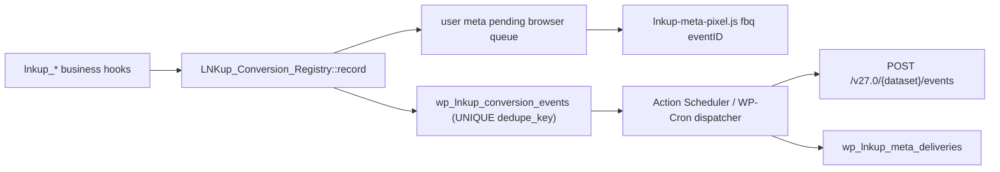

# Meta Measurement Foundation (Pixel, Conversions API, Dataset Quality, Attribution)

Plugin module: `wp-content/plugins/lnkup-marketplace/includes/meta/` (plugin v12.35.0).
Admin: **wp-admin → LNKup → Meta Integration** (`admin.php?page=lnkup-meta-health`, capability `lnkup_manage_settings`).

Scope of this release: Phases 1–6 of the paid-acquisition program (secure config, canonical conversion
registry/outbox, Pixel + CAPI with deduplication, Dataset Quality sync, health dashboard / debugger / alerts,
first-party attribution). Landing pages, campaign link builder, engagement journeys, retargeting audiences,
Marketing API reporting, native app SDK, supply/demand intelligence, experiments and SEO are deferred.

Official references used (verified Nov 2026): Graph API changelog (latest **v27.0**; Marketing API v24.0 expired
Oct 6 2026), Conversions API parameters, Pixel/CAPI deduplication, Dataset Quality API
(`GET /v27.0/dataset_quality?dataset_id=…&fields=web{…}`).

---

## 1. Implementation ledger

| Area | Before this release | Status now |
|---|---|---|
| Meta Pixel | Not in repo. Audit doc (`docs/audits/lnkup-master-audit/05-FINANCIAL-SECURITY-FINDINGS.md:87`) reports a Pixel injected in production by a **third-party plugin** | First-party loader implemented, **off by default**; detects the third-party Pixel and will not double-initialize. *Requires production cutover* |
| Conversions API | Missing | Implemented (outbox + background dispatcher). **Off by default**; *requires token + production verification* |
| Dataset Quality API | Missing | Implemented (daily snapshots). *Requires authorized response* |
| Marketing API / Insights | Missing; manual spend ledger exists (`lnkup_org_growth_spend`) | Access **check only** (ad account readable?). Reporting deferred (Phase 11) |
| Canonical event registry | Partial: `lnkup_*` business hooks, `lnkup_analytics_events` (no event IDs), comms `dedupe_key` | Implemented: `wp_lnkup_conversion_events` (UNIQUE `dedupe_key`, UUID `event_id`), mirrored into `lnkup_analytics_events`, `lnkup_conversion_recorded` action for other consumers |
| Registration hook | Only core `user_register` | Added `lnkup_user_registered( $user_id, $role, $context )` (web + app REST) |
| Profile completion hooks | None | Added `lnkup_vendor_profile_saved`, `lnkup_organizer_profile_saved` |
| Checkout hook | None | Added `lnkup_checkout_started( $payment_id, $mode )` (after a payable checkout is created) |
| Opportunity published | Only generic status change | Added `lnkup_opportunity_published( $opp_id, $organizer_id )` (once per slot) |
| Favorites | No hook | Added `lnkup_favorite_toggled( $user_id, $type, $id, $added )` |
| Purchase source of truth | `lnkup_payment_completed` from idempotent `finalize_payment` | Reused as-is (no Stripe changes) |
| UTM / fbclid persistence | Recognized only to clean canonical URLs (`class-seo.php`) | Implemented first-party first/last-touch attribution |
| Referral / City Connector attribution | Implemented (cookies + `LNKup_Attribution_Arbiter`) | **Unchanged**. Paid attribution never grants credit |
| Cookie consent | None | US opt-out model: GPC, opt-out cookie, account opt-out, `lnkup_meta_tracking_allowed` filter |
| Mobile app events | None (no SDK) | App-origin events recorded internally, **not sent** (`META_APP_EVENTS_ENABLED=false`). SDK needs a native build |
| Committed Meta credentials | None found (working tree + git history) | Tokens read only from env / wp-config |

Known limitations:
- Accounts have no personal phone field, so `ph` is never sent. Customer geography (`ct/st/zp/country`) is
  not sent because LNKup stores business/service locations, not personal addresses.
- Events created by staff (`lnkup_manage_all`) and excluded test accounts are recorded but never sent.
- Accounts created outside `LNKup_Registration::register_user` (imports, wp-admin) do not fire registration conversions.
- Payments marked paid outside `finalize_payment` (manual repair) do not fire `lnkup_payment_completed`; the
  `purchase_gap` alert flags this.

## 2. Conversion registry

Defined in `LNKup_Conversion_Registry::definitions()` (filter `lnkup_conversion_registry`).
Scope: **user** = once per account, **entity** = once per record, **item** = once per user+record, **none** = per event_id.
"Browser" = fired by the Pixel with the server's event_id. "Optimizable" = suitable for campaign optimization
once volume is sufficient.

| Event | Trigger (server hook) | Scope | Browser | Server | Optimizable |
|---|---|---|---|---|---|
| PageView | Pixel load | none | ✓ | – | – |
| ViewContent | Event / opportunity / market / tour / vendor profile page (browser + server twin) | none | ✓ | ✓ | – |
| Search | Find Events search submit (PII-like terms dropped) | none | ✓ | ✓ | – |
| AddToWishlist | `lnkup_favorite_toggled` (added, events/opportunities) | item | ✓ | ✓ | – |
| CompleteRegistration | `lnkup_user_registered` | user | ✓ | ✓ | ✓ |
| OrganizerRegistered / VendorRegistered | `lnkup_user_registered` | user | ✓ | ✓ | ✓ |
| Organizer/VendorRegistrationStarted | First focus in the sign-up form | none | ✓ | ✓ | – |
| VendorProfileCompleted | `lnkup_vendor_profile_saved` and strength ≥ threshold (default 70) | user | ✓ | ✓ | – |
| OrganizerProfileCompleted | `lnkup_organizer_profile_saved` with public name + city | user | ✓ | ✓ | – |
| EventCreated / FirstEventCreated | First status meta on a new organizer event | entity / user | ✓ | ✓ | – |
| EventPublished / FirstEventPublished | `lnkup_event_first_live` | entity / user | ✓ | ✓ | ✓ |
| RepeatOrganizerEvent | `lnkup_event_first_live` for 2nd+ live event | entity | ✓ | ✓ | – |
| OrganizerActivated | `lnkup_event_first_live` (a live listing always has an open slot) | user | ✓ | ✓ | ✓ |
| VendorOpportunityPublished | `lnkup_opportunity_published` (slots ≤ 30 days old) | entity | ✓ | ✓ | ✓ |
| VendorInvited / FirstVendorInvited | `lnkup_vendor_invite_created` | entity / user | ✓ | ✓ | – |
| SubmitApplication / FirstVendorApplication | `lnkup_application_submitted` | entity / user | ✓ | ✓ | ✓ |
| OrganizerFirstApplicationReceived | `lnkup_application_submitted` (organizer's first) | user | – | ✓ | – |
| VendorActivated | Profile ≥ threshold **and** ≥ N submitted applications (default 1) | user | ✓ | ✓ | ✓ |
| ApplicationApproved / FirstApplicationApproved | `lnkup_application_approved` or status `approved`/`payment_required` | entity / user | – | ✓ | – |
| InitiateCheckout | `lnkup_checkout_started` (amount due > 0) | entity | ✓ | ✓ | ✓ |
| Purchase | `lnkup_payment_completed`, status `paid`, amount > 0 | entity | ✓ | ✓ | ✓ |
| FirstVendorBooking / RepeatVendorBooking | `lnkup_payment_completed` (includes free booths) | user / entity | ✓ | ✓ | ✓ / – |
| OrganizerFirstVendorConfirmed / OrganizerFirstPaidBooking | Organizer's first paid booking | user | – | ✓ | – |
| VendorEventCompleted | `lnkup_application_event_completed` | entity | – | ✓ | – |
| PaymentRefunded | `lnkup_refund_completed` | entity | – | – (internal) | – |

Not implemented, because there is no qualifying LNKup action yet: AddToCart, AddPaymentInfo, Lead, Contact,
Schedule, StartTrial, Subscribe, FindLocation, OrganizerVerified, VendorVerified,
OpportunityPreferencesCompleted, VendorApplicationStarted, FirstEventFilled, EventCompleted (organizer level).

**Custom data allow-list** (`CUSTOM_KEYS`): content_ids, content_name, content_type, content_category, contents,
num_items, value, currency, order_id, search_string, status, marketplace_role, event_category, vendor_category,
campaign_market, event_series_id, opportunity_id, event_id. Anything else is dropped. Application answers,
documents, messages and payment details are never forwarded.

### Purchase value convention
- `value` = what the vendor actually paid for the booking (`_lnkup_amount_paid_cents / 100`). `currency` = the platform currency (`connect_platform_currency`, USD).
- LNKup platform revenue (`_lnkup_lnkup_fee`) is stored internally in `value_internal`. It is **never** sent as the Meta value, and gross booking value is never presented as LNKup revenue.
- Fires only after `finalize_payment` marks the payment `paid`. It never fires for pending, failed or ACH-processing payments, payouts or transfers. Duplicate webhooks collapse to one event (`Purchase:payment:{id}`).
- Free bookings fire FirstVendorBooking but no Purchase. Refunds are internal only; no negative Purchase is sent.

## 3. Data flow and deduplication



- One row per logical conversion: `INSERT IGNORE` on `dedupe_key`. Refreshes, REST retries, webhook retries and concurrent requests do not duplicate.
- The browser event uses the **server's** `event_id`. It is delivered on the user's next page render (or `lnkupMeta.flush()`) and fired with `fbq('track'|'trackCustom', name, data, {eventID})`. Meta deduplicates browser/server pairs within 48 hours; older queued events are dropped.
- Client events (ViewContent, Search, RegistrationStarted) generate a UUID in the browser and post it to `POST lnkup/v1/meta/event`, so the server twin uses the same ID.
- Dispatcher: claims rows atomically, sends batches of 50, keeps `event_id`/`event_time` across retries, backs off 1m → 5m → 30m → 2h → 12h (≥15 min or `Retry-After` when rate limited), and allows at most 6 attempts before dead-lettering. Events older than 7 days − 1 hour expire. A rejected batch is resent one event at a time to isolate the bad event. The HTTP timeout is 10 s (batch of 50).
- Website events require `client_user_agent`. If an event has none, it is skipped (`missing_user_agent`) instead of poisoning the batch. Webhook Purchases reuse the vendor's checkout context saved at InitiateCheckout.

## 4. Customer information (user_data)

| Field | Source | Sent as |
|---|---|---|
| em | Account login email | SHA-256 of trimmed lowercase |
| fn / ln | Account first/last name (full name split) | SHA-256, lowercase, no punctuation |
| external_id | `sha256(site salt | user ID)` (`lnkup_meta_external_id_salt`) | Already hashed (also passed to the Pixel) |
| client_ip_address | `REMOTE_ADDR` (filter `lnkup_meta_client_ip` behind a proxy) | Plain |
| client_user_agent | Request header | Plain |
| fbp / fbc | `_fbp` (Pixel), `_fbc` (Pixel or server on `fbclid` landings) | Plain |

Values that already look hashed are not hashed again. IP, user agent, fbp and fbc are kept in `request_context`
only until the event is sent, expired, or 8 days old. The debugger shows parameter presence, never values.

## 5. Consent and privacy

- Opt-out model: tracking is allowed unless the request sends `Sec-GPC: 1` / `navigator.globalPrivacyControl`, the visitor has the `lnkup_tracking_optout=1` cookie, or the account opted out (`_lnkup_tracking_optout`).
- A refusal blocks the Pixel, CAPI, attribution cookies and `_fbc`. The action is still recorded internally (`consent_state = denied`, status `skipped`). Opting out clears queued browser events.
- Controls: shortcode `[lnkup_tracking_preferences]` (privacy policy or account page), link `?lnkup_tracking=optout` (opt back in requires a nonce), REST `GET|POST lnkup/v1/meta/tracking-preference`.
- Limited Data Use: Configuration → *Limited Data Use* (`ldu_geo` or `ldu_all_us`) adds `data_processing_options` to both Pixel and CAPI.
- A consent management platform can take over via `add_filter( 'lnkup_meta_tracking_allowed', … )`.
- **Action for LNKup legal:** update the privacy policy to describe Meta Pixel/CAPI use and link the opt-out.

## 6. Attribution

- `lnkup_ft` (first touch, written once) and `lnkup_lt` (last non-direct touch) are first-party cookies (90 days). They are written by `lnkup-attribution.js`, which works on cached pages, and by the server on uncached hits.
- Captured: `utm_source/medium/campaign/content/term`, `campaign_id`, `adset_id`, `ad_id`, `placement`, `fbclid`, landing path (no query string) and referrer host. Values are sanitized and length-capped. URL-shaped values are rejected.
- Direct visits never overwrite `lnkup_lt`. Stripe, PayPal, Google/Apple sign-in and the site's own domain are not treated as acquisition referrers.
- On registration the touches are copied to `_lnkup_acq_first_touch`, `_lnkup_acq_last_touch` and `_lnkup_acq_registration`. The app can send `attribution` in `POST lnkup/v1/auth/register`.
- Every conversion row stores a compact snapshot (`attribution_json`), so applications, checkouts and bookings carry the campaign.
- Retention: account attribution meta is purged 24 months after registration; outbox rows after 180 days; delivery logs after 90 days.
- Referral/Connector commissions remain governed by their existing cookies and the Attribution Arbiter.

## 7. Credentials

Define secrets on the server only. SiteGround does not provide process env vars, so use `wp-config.php`:

```php
define( 'LNKUP_META_CAPI_ACCESS_TOKEN', '…' );            // required to send events
define( 'LNKUP_META_DATASET_QUALITY_ACCESS_TOKEN', '…' ); // optional; defaults to the CAPI token
define( 'LNKUP_META_MARKETING_API_ACCESS_TOKEN', '…' );   // optional; ads_read, used for access check only
define( 'LNKUP_META_TEST_EVENT_CODE', 'TEST12345' );       // optional, for Test events
define( 'LNKUP_META_CAPI_ENABLED', true );                 // flags may also be pinned here
```

Bare names (`META_CAPI_ACCESS_TOKEN`) and environment variables also work. See `wp-content/plugins/lnkup-marketplace/.env.example`.
Tokens are never stored in options, printed in HTML, returned by REST, sent to the app, or logged. All Graph
errors pass through `LNKup_Meta_Redactor`.

**Which token can do what.** Verify each with *Meta Integration → Overview → Check credentials*:
- An Events Manager-generated token (Settings → Conversions API → Generate access token) can send events, and after the Events Manager opt-in can also read the Dataset Quality API. Tokens generated before July 2025 need the opt-in.
- Dataset Quality needs the "Use events dataset" (partial access) permission on the dataset. A system-user token additionally needs `ads_read` and (`ads_management` or `business_management`) app permissions.
- "Dataset record read" commonly returns `(#100) Missing Permission` for Events Manager tokens. That is expected and does not affect sending.
- Ad account reads need `ads_read` and access to `act_405302106865918`. `(#200) Ad account owner has NOT grant ads_management or ads_read` means the token lacks that grant. Marketing API then stays "configuration required"; nothing else is affected.
- Sending ability can only be proven by **Send test event** or a successful delivery.

**Rotation:**
1. Generate a new token (Events Manager, or Business Settings → System users → Generate token).
2. Replace the constant in `wp-config.php`.
3. Run *Check credentials* and *Send test event*.
4. Revoke the old token in Meta.

Pending events retry automatically for up to 7 days, so a brief gap loses nothing.

## 8. Admin, alerts and monitoring

- **Overview:** connection IDs, environment, flags, masked credentials and their source, credential check, last delivery, the 7-day status mix, send-pending / retry-failed buttons, test event, third-party Pixel detection.
- **Conversion events:** per-event recorded/sent/failed/pending/not-sent counts, browser hand-offs, matching-parameter coverage, attribution share, and the latest official EMQ / coverage / event_id dedup.
- **Dataset Quality & trends:** sync status, the metrics Meta returned, 7/14/30/90-day snapshot tables (EMQ, coverage, dedup, delay), EMQ diagnostics, internal daily delivery volume. History starts when monitoring began.
- **Event debugger:** recent rows with event_id, action, source, status, attempts, presence chips, consent, attribution and sanitized error.
- **Alerts (hourly):** checks below; critical/high alerts email the site admin at most once per 24 hours. Alerts resolve automatically when the condition clears. Thresholds are on the Configuration tab.

| Alert | Fires when |
|---|---|
| `capi_auth` | Graph rejected the token (190/102/10/200/3) in the last 24 hours |
| `delivery_failure_rate` | Failed share of delivery requests (24h) ≥ threshold, with minimum volume |
| `failed_queue` | Dead-lettered events (7 days) ≥ threshold |
| `delivery_backlog` | Events pending longer than N minutes (cron not running) |
| `registration_gap` | ≥ 3 vendor/organizer signups in N hours with 0 CompleteRegistration |
| `purchase_gap` | Paid bookings (7 days) exceed Purchase events by ≥ 3 and ≥ 20% |
| `coverage_fbp` / `coverage_ua` / `coverage_ip` | Week-over-week drop on key conversions ≥ N points |
| `dq_access` / `dq_stale` | Dataset Quality auth failure / no successful sync in N hours |
| `emq_<event>` | Official EMQ fell ≥ N points across recent snapshots |
| `pixel_conflict` | Known Pixel plugin active, or a browser reported a second Pixel |

Cron hooks: `lnkup_meta_capi_sweep` (every 5 min), `lnkup_meta_alerts_eval` (hourly), `lnkup_meta_dq_sync` and
`lnkup_meta_purge` (daily). The worker is `lnkup_meta_capi_dispatch` (Action Scheduler group `lnkup-comms` when
the communications plugin is active, otherwise WP-Cron). On SiteGround, run a real server cron against `wp-cron.php`.

## 9. Rollout (production)

1. Deploy (the DB migration runs automatically: four new tables). All Meta features are **off**; internal recording starts immediately.
2. Add the token to `wp-config.php`. Run *Check credentials*.
3. Turn on **Test mode** + test event code + **CAPI**. Register a test vendor and organizer; confirm the events in Events Manager → Test events. Turn test mode off.
4. Turn on **CAPI** in production. Watch *Conversion events* and *Alerts* for 24–48 hours.
5. Cutover window: **deactivate the third-party Pixel plugin**, then turn on **Pixel**. Confirm *Third-party Pixel* shows none. Check Events Manager for one PageView per page and deduplicated browser + server events.
6. Turn on **Dataset Quality** and press *Sync now*; the daily sync continues after that.

**Rollback:** turn the flags off (Configuration tab or constants). No business flow depends on this module, and the tables are additive. Re-enable the third-party plugin if needed.

## 10. External Meta checklist

Menu names in Meta change frequently; confirm against current Meta help pages.

**Events Manager (dataset 2099891494063746)**
- [ ] Confirm the Pixel on thelnkup.com is this dataset (Pixel ID = dataset ID).
- [ ] Generate a CAPI access token (or system-user token) and store it in `wp-config.php`.
- [ ] Copy a test event code from *Test events*; verify browser and server events arrive and are marked deduplicated.
- [ ] After go-live: check *Event match quality*, *Event coverage* and *Deduplication* for CompleteRegistration, SubmitApplication, InitiateCheckout and Purchase.
- [ ] Confirm custom events (OrganizerRegistered, VendorRegistered, OrganizerActivated, VendorActivated, EventPublished, FirstVendorBooking …) are received.
- [ ] Create custom conversions from the dataset, e.g. CompleteRegistration where `marketplace_role = organizer` and where it is `vendor`.

**Ads Manager (act_405302106865918)**
- [ ] Confirm the dataset is connected to the ad account.
- [ ] Organizer campaigns: optimize on CompleteRegistration (organizer) / OrganizerRegistered first. Move to OrganizerActivated or EventPublished only once the volume and reliability shown in *Conversion events* support it.
- [ ] Vendor campaigns: CompleteRegistration (vendor) / VendorRegistered first, then SubmitApplication, VendorActivated, FirstVendorBooking or Purchase.
- [ ] URL parameters on ads: `utm_source=meta&utm_medium=paid_social&utm_campaign={{campaign.name}}&campaign_id={{campaign.id}}&adset_id={{adset.id}}&ad_id={{ad.id}}&utm_content={{ad.name}}&placement={{placement}}` (verify the macros in Ads Manager's URL parameter builder).
- [ ] No campaign settings are changed automatically by LNKup.

**Marketing API (later phase)**
- [ ] Optional read-only system-user token with `ads_read` on the ad account → `LNKUP_META_MARKETING_API_ACCESS_TOKEN`; verify with *Check credentials*.

**Mobile (later phase; needs a new native build, not OTA)**
- [ ] Meta app ID, `react-native-fbsdk-next` (or equivalent Expo config plugin), iOS App Tracking Transparency prompt and `NSUserTrackingUsageDescription`, Android manifest entries, privacy nutrition labels.
- [ ] Until then, app-origin actions are recorded internally only, and web events do not double count app actions.

## 11. Tests

- `php tests/php/meta-measurement-test.php` — 95 checks (normalization, hashing, redaction, config, dedupe keys, custom-data allow-list, backoff, consent, attribution sanitizing, Dataset Quality parsing).
- `wp eval-file tests/php/meta-integration-wp.php` — 64 checks in real WordPress with a mocked Graph API (schema, registration → outbox, Pixel hand-off, dispatch payload, 429/400/expiry, checkout/Purchase/duplicate webhook, consent, staff exclusion, beacon endpoint, Dataset Quality, alerts, admin rendering). **Disposable site only.**
- `tests/e2e/meta-measurement.spec.ts` (Playwright, Chromium + iPhone 13) — single Pixel init, campaign cookies and `_fbc`, browser CompleteRegistration sharing the server event_id, no re-fire on refresh, GPC blocking, admin page masking. Needs a site with Pixel + test mode on and no token; `fbevents.js` is stubbed.

Nothing in these tests contacts Meta. Production delivery, EMQ and deduplication must still be confirmed in
Events Manager after the rollout steps above.
