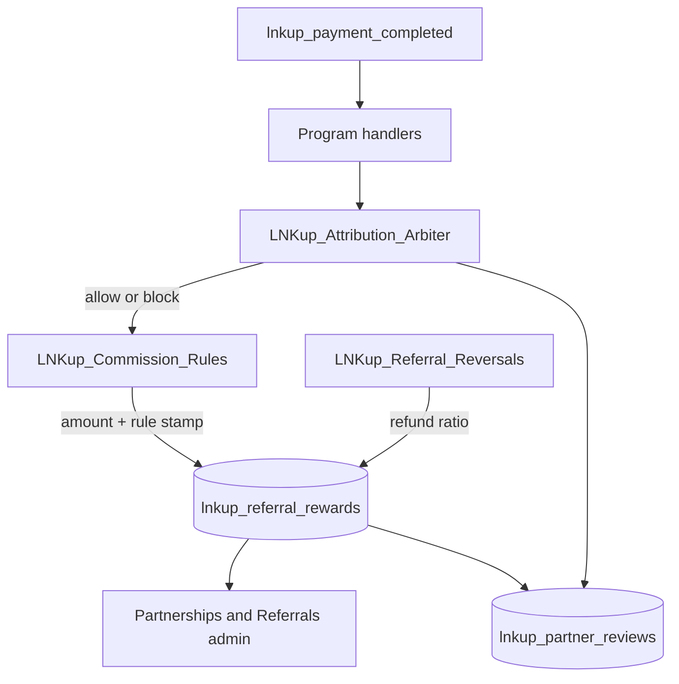

# Referral, Affiliate & Partnership OS — Foundation (plugin 12.28.0)

Stage 1–3 slice of the Partnership OS: audit, unified program/rule/attribution infrastructure, ledger
hardening, an admin hub, and City Connector lead submission + territories. Built on the existing
referral treasury tables, City Connector program and Organizer Acquisition OS — nothing was rebuilt
and no historical row is rewritten.

## A. Audit (what existed before this change)

| Area | Existing implementation |
|------|-------------------------|
| Shared referral ledger | `wp_lnkup_referral_codes`, `wp_lnkup_referrals`, `wp_lnkup_referral_rewards` (`LNKup_Treasury_Tables`), each row tagged with `program` |
| City Connector (`city_connector`) | `LNKup_Connector*` classes, 21 `connector/*` REST routes, dashboard, ranks + rank bonuses, content studio, wp-admin Connectors page |
| Connector commission | **10% of booth GMV** (`_lnkup_vendor_spot_fee`), optional per-booking cap, 12 months from the referral's first paid booking, 30-day hold, $50 minimum, manual approve / mark paid. `connector_rewards_enabled` defaults to **off** |
| Connector attribution | `?ref=` cookie (30 days) → referral row on `user_register`; organizer side wins over vendor side on a payment |
| Referral invites (`organizer_recruit`) | Vendors/organizers refer organizers or vendors; **20% of LNKup platform fee** for 12 months as wallet credit (not cash) |
| Vendor referral (`vendor_referral`) | One-time credit (credit rule `first_invoice_paid`, default $10) on the referred vendor's first paid booking |
| Refunds / disputes | `LNKup_Referral_Reversals` on `lnkup_payment_refund_synced` and `lnkup_payment_chargeback_lost` |
| Organizer Acquisition OS | Leads with `assigned_connector_id`, `referrer_user_id`, `referral_code`, `partner_id`, `is_house_affiliated` (Six Stars), `org_partners`, dedupe, suppression, milestones |
| Payout rail | None for partners. Connector payouts are manual; `payout_preference` is free text |

**Gaps fixed in this slice**

1. Cross-program stacking: each program attributed and paid independently, so one booking could pay a
   connector, an organizer referrer and a vendor referrer.
2. Any partial refund reversed 100% of unpaid connector rewards.
3. `mark_paid()` had no status guard (reversed/paid rows could be re-marked); `approve_reward()` was not atomic and ignored the hold period.
4. Paid-reward clawbacks only lived in post meta + audit log.
5. Rewards did not record which rule/rate produced them.

## B. Architecture

Module: `wp-content/plugins/lnkup-marketplace/includes/partnerships/`

| Class | Role |
|-------|------|
| `LNKup_Partner_Tables` | Schema (`lnkup_partner_schema` option), additive columns, idempotency backfill |
| `LNKup_Partner_Programs` | Registry: `city_connector`, `organizer_recruit`, `vendor_referral` (active) + `affiliate`, `strategic_partner`, `enterprise_partner` (disabled placeholders) |
| `LNKup_Commission_Rules` | Versioned, immutable rules; calculation; rule locking |
| `LNKup_Attribution_Arbiter` | One winner per referred account and per payment; conflicts; backfill cron |
| `LNKup_Partner_Reviews` | Review queue (conflicts, clawbacks), deduped by key |
| `LNKup_Partnerships` | Read models (overview, pipeline, ledger), territories, connector leads, settings |
| `LNKup_Partnerships_REST` | `lnkup/v1/partners/*` + `connector/leads`, `connector/territories` |
| `LNKup_Partnerships_Admin` | wp-admin → LNKup → Partnerships & Referrals |

## E. Database changes (additive only)

New tables: `lnkup_partner_programs`, `lnkup_commission_rules` (unique `program, version`),
`lnkup_connector_territories` (unique `connector_id, scope_type, value`), `lnkup_partner_reviews` (unique `dedupe_key`).

New columns:

- `lnkup_referrals`: `attribution_status` (`winning|superseded|conflict`), `rule_id`; indexes on `referred_user_id`, `attribution_status`.
- `lnkup_referral_rewards`: `reversed_amount`, `rule_id`, `rule_version`, `basis`, `basis_amount`, `currency`, `payout_reference`, `hold_reason`, `held_from_status`, `idempotency_key` (now **nullable** + **unique**), indexes on `payment_id`, `(program, reward_status)`.
- `lnkup_connectors`: `commission_rule_id`.

Idempotency backfill: every existing reward gets `program:user_id:referral_id:payment_id:event_type`;
true historical duplicates keep a `:legacy:<id>` suffix so the unique index can be created without
touching amounts or statuses. Rows written by code that sets no key stay `NULL` (never collide).

Migration runs on `init` when `lnkup_partner_schema` ≠ `1.0.0`. Seeding never overwrites existing rows.

## G. Commission rules

| Program | Version | Basis | Terms | Status |
|---------|---------|-------|-------|--------|
| City Connector | v1 (legacy settings) | booth GMV | `connector_booking_share_percent` (10%), cap, term, hold from settings | active — **every approved connector at migration is locked to v1** |
| City Connector | v2 | LNKup platform fee | rate unset | **draft** — publish in the admin hub after setting a rate |
| Referral invites | v1 (legacy settings) | LNKup platform fee | `organizer_recruit_percent` (20%), `organizer_recruit_months` (12) | active |
| Vendor referral | v1 (legacy credit rules) | fixed | credit rule amount (default $10), first paid booking, `payment_stackable` | active |

- **Immutability:** published rules are never edited. "Create draft" + "Publish" supersedes the previous
  version (`status = superseded`, `effective_to` set) — it keeps paying anyone locked to it.
- **Locking:** a connector locks the rule in force at `approved_at` (stamped on approval / first use).
  A referral locks the rule in force at its `created_at` (connector referrals use the connector's rule).
- **Legacy settings rules** (`source = settings`) keep reading the existing settings keys so the
  current Settings screen behaves exactly as before.
- **Basis:** `booth_gmv` = `_lnkup_vendor_spot_fee`; `platform_fee` = `_lnkup_application_fee_cents`
  → `_lnkup_platform_fee` → fee snapshot → `wp_lnkup_platform_fees` (same resolver the referral-invite
  program and its reversals already use). Gross booking value is never the basis for new rules unless an
  admin explicitly picks `booth_gmv`; the form warns that a GMV share can exceed LNKup's revenue.
- **Window:** connector term starts at the referral's first paid booking (unchanged); referral-invite
  window starts at attribution (unchanged).

## H. Attribution and stacking

- **Per account:** across all programs, the earliest referral row wins (`created_at`, then `id`); later rows are `superseded`.
- **Conflict:** a second, different referrer inside `partnerships_conflict_window_hours` (default 72)
  marks both claims `conflict` and opens one review. Rewards for conflicted claims are withheld and the
  payment IDs are recorded; resolving the review picks the winner and **replays only the idempotent
  reward step** of the winning program for those payments.
- **Per payment:** organizer-side winner first, then vendor-side. Only one `exclusive` rule pays per
  payment; `payment_stackable` rules (vendor referral credit) may also pay.
- **Rollout mode** (`lnkup_partnerships_settings.partnerships_arbiter_mode`): `shadow` (default — logs
  `partner_arbiter_shadow_block` to the financial audit log, never blocks), `enforce`, `off`.
- Self-referral prevention stays in each program's attribution code (unchanged).

## Ledger lifecycle

`pending` (hold → awaiting approval) → `approved` → `paid`, plus `on_hold` (review) and `reversed`.

- Approve requires the hold to have ended and a positive net amount; approve / mark-paid / hold /
  release are conditional updates (`WHERE reward_status = …`), so a second request gets `409 lnkup_reward_state`.
- Mark paid records an admin-entered `payout_reference`. It records that a payout was sent outside LNKup;
  it does not move money.
- Partial refunds raise `reversed_amount` proportionally (status unchanged); 100% sets `reversed`.
  Balances everywhere use **net** = `amount − reversed_amount`.
- Paid rewards are never changed; the owed share opens one `clawback` review (amount raised on later
  partial refunds). Admin records recovered / written off / not owed.
- Referral-invite and vendor-referral rewards remain automatic wallet credits; their reversals are unchanged.

## F. REST (`lnkup/v1`)

| Method | Route | Permission |
|--------|-------|-----------|
| GET | `/partners/overview` | `user_has_manage_all` |
| GET | `/partners/readiness` (go-live stages and checks, read-only) | manage_all |
| GET | `/partners/referrals?program&attribution_status&market&role&page&per_page` | manage_all |
| GET | `/partners/ledger?program&status&connector_id&page&per_page` | manage_all |
| POST | `/partners/ledger/{id}/approve\|hold\|release\|mark-paid` (`reason`, `payout_reference`) | manage_all |
| GET/POST | `/partners/rules` | manage_all |
| POST | `/partners/rules/{id}/publish` | manage_all |
| GET | `/partners/reviews?type&status` | manage_all |
| POST | `/partners/reviews/{id}/resolve` (`winner_referral_id` or `resolution`, `notes`) | manage_all |
| GET/POST/DELETE | `/partners/territories` | manage_all |
| GET/POST | `/connector/leads` | active connector (own leads only) |
| GET | `/connector/territories` | active connector |

Errors are `WP_Error` JSON with a status; 503 `lnkup_partners_not_ready` before migration.

**Connector lead submission:** requires a name and a public route (website, Instagram or business
email). Existing LNKup accounts, duplicate leads (dedupe on email/domain/Instagram/linked account) return
only `{ status: "already_in_pipeline" }`; suppressed contacts return `not_accepted`. New leads go into
Organizer Growth with `source = city_connector`, `assigned_connector_id`, `referrer_user_id` and the
connector's code. 20 submissions per connector per day. Connectors see only leads assigned to or
submitted by them, without contact data or scores.

## Surfaces

- wp-admin → LNKup → **Partnerships & Referrals**: Overview (real counts only; house vs independent via
  `org_growth_house_organizer_ids`; 10-minute cache flushed on ledger writes), Referral Pipeline,
  Commission Rules, Commission Ledger (+ CSV export with formula-injection guard), Reviews, City
  Connectors (territories; links to the existing Connectors page), Settings.
- Connector dashboard: new **Organizer Leads** and **My Cities** views (shortcode tabs + theme sidebar);
  earnings copy uses the connector's rule ("10% of the booth price…" vs "X% of LNKup fees…"); the
  planner/estimate uses the same rule and is hidden for non-GMV rules where a GMV estimate would mislead.
- Hooks for Communications OS: `lnkup_partner_commission_recorded`, `lnkup_partner_commission_approved`,
  `lnkup_partner_commission_paid`, `lnkup_partner_review_opened`.

## K. Testing (local wp-env, PHP 8.1)

- `scripts/e2e/php/partnerships-test.php` — **116 assertions, all passed** (schema, rules, ledger,
  reversals, clawback, arbiter per account/per payment, duplicate webhook, leads privacy, territories, REST permissions).
- Existing suites after the change: Organizer Growth PHP (3 suites) **passed**; financial PHP (14 suites) **passed**.
- `tests/e2e/partnerships.spec.ts` — **10/10 passed** on Chromium (seed a connector first with
  `scripts/e2e/php/partnerships-seed-connector.php`; env `PLAYWRIGHT_ADMIN_USER/PASS`, `PLAYWRIGHT_CONNECTOR_USER/PASS`).
- `node scripts/partnerships-foundation-verify.mjs` — 13 static checks passed.
- Not run: the `mobile` Playwright project (WebKit browser not installed locally). Pre-existing failure:
  `connector-program.spec.ts` "interest page renders form with market context" (strict-mode match on "Charlotte"; page not touched here).

Runners: `powershell -File scripts/e2e/run-partnerships-php.ps1`.

## L. Deployment

The staged go-live (deploy → shadow evidence → enforce → programs → notifications → mobile), with
entry criteria and a rollback per stage, is in **[PARTNERSHIP_ROLLOUT.md](PARTNERSHIP_ROLLOUT.md)**.
wp-admin → Partnerships & Referrals → **Go-live readiness** and the read-only
`scripts/prod/partnerships-preflight.php` report the same checks (`LNKup_Partnership_Readiness`,
also `GET /partners/readiness`). The notes below are the original foundation deploy steps.

1. Deploy plugin 12.28.0 or later + theme (`inc/dashboard.php` nav). Migration runs on first request.
2. Leave `partnerships_arbiter_mode = shadow`; review `partner_arbiter_shadow_block` audit rows and
   the Reviews tab (the backfill cron marks historical conflicts) before switching to `enforce`.
3. Publish City Connector v2 only after the fee-share rate and agreement are approved. Existing connectors stay on v1.
4. Rollback: deactivate/redeploy 12.27.x. New tables/columns are additive and ignored by older code;
   set arbiter mode `off` to disable all new gating without a redeploy.
5. `dist/lnkup-marketplace.zip` was **not** rebuilt in this change (the working tree also contains other
   in-progress work); rebuild with `scripts/build-plugin-zip.ps1` when releasing.

## Stages 4–5: Affiliate and strategic partner programs (plugin 12.30.0, schema 1.1.1)

**Model.** Affiliates and strategic-partner contacts are partner accounts in `lnkup_connectors`
(new `program` column: `city_connector` default, `affiliate`, `strategic_partner`). They reuse the
connector code, attribution (`?ref=`), referral rows, reward ledger, manual payout, arbiter, admin
actions and dashboard. City Connector behavior is unchanged.

| | City Connector | Affiliate | Strategic partner contact |
|---|---|---|---|
| Role | `lnkup_connector` | `lnkup_partner` | `lnkup_partner` |
| Code prefix | market (e.g. `CHA-`) | `AFF-` | `PTR-` |
| Applies via | `/connector-interest/` (unchanged) | `/affiliate-program/` | `/partner-with-lnkup/` |
| Earning | legacy settings / v1 rule | published `affiliate` rule only | org agreement rule, else published `strategic_partner` rule |
| Dashboard views | all | Overview, Referrals, Leads, Earnings, Resources, Profile | same as affiliate |
| Ranks / bonuses | yes | no | no |
| Lead source | `city_connector` | `partner` | `partner` + `partner_id` |

**Earning gate.** `affiliate` v1 and `strategic_partner` v1 are seeded as drafts with no rate.
Until a rule is published, `terms()['terms_pending']` is true, no reward is written, estimates are
hidden, and the dashboard shows "Your referrals are tracked. Commission terms are shared when your
agreement is finalized." Accounts approved while terms were a draft lock the first rule published after them.

**Agreement rules.** In the `strategic_partner` program, a rule with an `agreement_ref` is an
agreement rule: publishing it never supersedes the program rule and `active_rule()` never returns it.
It applies only to organizations that select it (Strategic Partners tab → Agreement rule).

**Applications** (`LNKup_Partner_Applications`): honeypot field, 5 submissions per hour per hashed IP
(HMAC with the site salt; raw IPs never stored), required disclosures checkbox (timestamp recorded),
duplicate emails get a generic "already on file". Statuses: Submitted (`pending`), Under review,
Additional information needed (`info_needed`, emails the note), Approved (`active`), Declined
(`rejected`), Suspended (`paused`, code deactivated, dashboard access removed), Closed. Every transition is a
conditional update and is audited (`partner_application_*`). City Connector applications stay on the Connectors page.

**Strategic organizations** (`LNKup_Partner_Organizations`, on the existing `lnkup_org_partners`
table): dedupe by domain (free-mail domains ignored) then normalized name; a matching Organizer Growth
lead is linked (`lead_id`), never duplicated. Pipeline: Prospect → Contacted → Meeting → Negotiation →
Agreement → Active → Performance review → Renewal → Closed (stage and rule changes audited). Performance
is read from contacts' referrals, rewards and `partner_id` leads.

**Public pages.** `[lnkup_partner_program_terms program="…"]` renders the published rule (basis, term,
cap, hold, "not guaranteed") or "Commission terms are shared during approval". `[lnkup_partner_application]`
renders the form. Theme template `page-templates/partner-program.php` (presentation only). The
hardcoded "10% commission" line on `/connector-interest/` now comes from the rule.

**REST additions:** `POST /partners/apply` (public; the only `__return_true` route, rate-limited),
`GET /partners/applications`, `POST /partners/applications/{id}/(review|request-info|approve|decline|suspend|close)`,
`GET|POST /partners/organizations`, `GET|POST /partners/organizations/{id}` (admin). `/connector/dashboard`
now returns `program`, `program_label`, `title`, `views`, `terms_pending`, `organization`.

**Tests:** `scripts/e2e/php/partnerships-programs-test.php` (all passing on wp-env), added to
`run-partnerships-php.ps1`; `partnerships-test.php` still passes. Playwright additions in
`tests/e2e/partnerships.spec.ts` (public pages, application → approval, affiliate dashboard); the seed
script now also creates `pw_affiliate` / `pw-affiliate-pass`.

## Partner and referral notifications (lnkup-communications, flag `flow_partners`, off by default)

Sent through the existing Communications engine (consent, unsubscribe, dedupe, quiet hours, audit),
never by the partnership code directly. Details: `wp-content/plugins/lnkup-communications/README.md`.

| Message | To | Channels | Re-checked at send time |
|---|---|---|---|
| Application approved | new partner | email, inbox, push | account active |
| Referral registered | partner | email, inbox, push | referral winning (not superseded or conflicted) |
| Referral first event / first paid booking | partner | email, inbox, push | referral winning |
| Commission recorded (15-minute delay) | partner | email, inbox, push (no amount) | reward pending/approved, net > 0, referral winning |
| Commission approved | partner | email, inbox, push (no amount) | reward still approved |
| Payout recorded (grouped per day) | partner | email, inbox, push | a reward was marked paid that day |
| Lead registered / progressed / closed | assigned partner | email, inbox, push | lead still assigned to them |
| Invite joined | vendor/organizer referrer | inbox, email, push | referral winning |
| Referral credit added (grouped per day) | vendor/organizer referrer | inbox, email | live (unreversed) credit that day |
| New partner application / partner review open | LNKup admins | email | still pending / still open |

Applicant emails (received, more information needed, declined) come from lnkup-marketplace's
mailer because applicants have no account; suppressed addresses are skipped and every outcome is
audited. New core hooks: `lnkup_partner_referral_attributed`, `lnkup_partner_referral_milestone`
(fires once, on the conditional first write), `lnkup_org_lead_stage_changed`, `lnkup_org_lead_outcome_changed`.

Tests: `scripts/e2e/php/comms-partners-test.php` (part of `run-comms-php.ps1`).

## Partner home in the mobile app (Expo)

A third home next to vendor and organizer, for City Connectors, affiliates and strategic partner
contacts. It reuses the existing `lnkup/v1/connector/*` routes; no new server routes were added.

- **Sign-in.** `LNKup_Auth_REST::user_may_use_mobile()` admits `lnkup_connector` / `lnkup_partner`
  users only while `LNKup_Roles::is_connector()` is true (active account). Suspended or pending
  accounts still get the "not set up" error.
- **Home resolution** (`lib/auth/roles.ts`). Partner-only accounts open `/(partner)`. Multi-role accounts
  use the saved home preference, else organizer, then vendor, then partner. Every More screen shows
  "Switch to …" rows for the other homes (`components/workspace-switch-group.tsx`).
- **Tabs** (`app/(partner)/`):
  - Home: referral code, share links, terms summary, referral counts, earnings snapshot.
  - Referrals: organizers and vendors, with their milestones.
  - Leads: list plus a submit sheet; same rules and daily limit as the web.
  - Earnings: balances and ledger.
  - More: inbox, notification settings, web resources, switch, sign out.
  - Data comes from `lib/api/partner.ts`, which reshapes the server's figures without recalculating them and has demo-mode mocks.
- **Money display.** Approved, pending (hold plus review) and paid are shown separately. Estimates are
  labeled and never added to a payable figure. No rate is quoted while terms are pending.
- **Navigation safety.** `/(partner)/*` is in the pending-destination allowlist with a `partner` scope,
  so vendor or organizer-only accounts can't open partner screens from a push, and partners can't open
  vendor or organizer screens.
- **Tests.** `lnk-up-marketplace-mobile/__tests__/partner-home.test.ts`; mobile sign-in gate in
  `partnerships-programs-test.php`; deep-link allowlist in `comms-security-test.php`.

## M. Remaining (not built)

- Enterprise / network partners (registry slot stays disabled); partner self-service editing of organization records.
- Stage 7 payout rail: partners are paid manually; no Stripe transfers. Paying affiliates/connectors
  through Stripe Connect needs a recipient-account, KYC and tax (1099) review first — **blocked on compliance/tax review**.
- Mobile: Content Studio, rank roadmap, onboarding steps and the resource library are web only (linked from Partner More).
- Partner application from inside the app (applicants still apply on the web pages).
- Campaigns, partner resource library expansion, geographic opportunity analytics, Communications templates.
- Tour-level reporting: attribution is per payment, so tours never double count, but no tour rollup view exists yet.
- Rank bonuses are still decided by `LNKup_Connector_Ranks` and are not gated by the arbiter.
- Nothing here establishes legal, tax or affiliate-disclosure compliance; program terms and disclosures need review.
