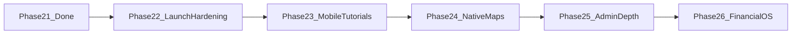

# App Phases 22–26 — Queued Roadmap

Canonical queue after Phase 21. Execute in order unless product explicitly reprioritizes.

**Entry plan:** Phases 22–26 **complete**. Further work is product-driven outside this queue.  
**Phase 26 (complete):** [PHASE_26_FINANCIAL_OS_EXPANSION.md](PHASE_26_FINANCIAL_OS_EXPANSION.md)  
**Phase 25 (complete):** [PHASE_25_ADMIN_LITE_DEPTH.md](PHASE_25_ADMIN_LITE_DEPTH.md)  
**Phase 24 (complete):** [PHASE_24_NATIVE_MAP_DISCOVERY.md](PHASE_24_NATIVE_MAP_DISCOVERY.md)  
**Phase 23 (complete):** [PHASE_23_MOBILE_TUTORIAL_PARITY.md](PHASE_23_MOBILE_TUTORIAL_PARITY.md)  
**Phase 22 (complete):** [PHASE_22_PRODUCTION_LAUNCH_HARDENING.md](PHASE_22_PRODUCTION_LAUNCH_HARDENING.md)  
**Architecture:** [SYSTEM_OVERVIEW.md §14.2](SYSTEM_OVERVIEW.md#142-app-roadmap-phases-126)

| Phase | Name | Status | Goal |
|-------|------|--------|------|
| **22** | Production Launch Hardening | **Built** | Live-API audit, honesty gates, cutover gate, Vercel/Expo operator checklists |
| **23** | Mobile Tutorial Parity + Push Onboarding | **Built** | Expo guided checklists mirroring web Phase 21; SecureStore dismiss; push preference CTAs |
| **24** | Native Map Discovery | **Built** | Expo map SDK over existing discovery APIs; permission/empty/error states |
| **25** | Admin Lite Depth | **Built** | Deeper ops queues + handoffs; not full wp-admin; reuse Phase 19 contracts |
| **26** | Financial OS Expansion | **Built** | ACH / Billing / Apple·Google Pay **in WordPress only**; apps stay read-only + handoff |

---

## Phase 23 — Mobile Tutorial Parity + Push Onboarding

**Status:** Built — [PHASE_23_MOBILE_TUTORIAL_PARITY.md](PHASE_23_MOBILE_TUTORIAL_PARITY.md) · [PHASE_23_RELEASE_CHECKLIST.md](PHASE_23_RELEASE_CHECKLIST.md)

**Goal:** Mirror Phase 21 web guided checklists on Expo for vendor and organizer.

**Scope:**

- Shared step IDs aligned with web `lib/tutorials/*` contracts where practical
- Guided checklist cards on `/(vendor)` and `/(organizer)` home
- Dismiss/complete state in SecureStore (not cookies)
- Non-PII events via existing mobile analytics pattern (`tutorial_viewed` / `step_clicked` / `step_completed`)
- Optional CTA into push preference card from an onboarding step

**Non-goals:** Redesigning web tutorials; Stripe in mobile.

**Shipped paths:** `lnk-up-marketplace-mobile/lib/tutorials/*`, `components/guided-tutorial-checklist.tsx`, `app/(vendor)/index.tsx`, `app/(organizer)/index.tsx`, `npm run phase23:verify`.

---

## Phase 24 — Native Map Discovery

**Status:** Built — [PHASE_24_NATIVE_MAP_DISCOVERY.md](PHASE_24_NATIVE_MAP_DISCOVERY.md) · [PHASE_24_RELEASE_CHECKLIST.md](PHASE_24_RELEASE_CHECKLIST.md)

**Goal:** Ship deferred map discovery on mobile (thin web map polish only if still fixture-only).

**Scope:**

- Expo map SDK on Find Events / near-me
- Pins from existing `lnkup/v1` discovery / maps APIs
- Loading, empty, error, and location-permission-denied states
- Analytics for map open / pin click (non-PII)

**Non-goals:** New opportunity SOR; map editor (stays WP).

**Shipped paths:** `lib/api/map-pins.ts`, `components/discovery-map*.tsx`, `components/map-pin-preview.tsx`, `app/(vendor)/find.tsx`, `npm run phase24:verify`.

---

## Phase 25 — Admin Lite Depth

**Status:** Built — [PHASE_25_ADMIN_LITE_DEPTH.md](PHASE_25_ADMIN_LITE_DEPTH.md) · [PHASE_25_RELEASE_CHECKLIST.md](PHASE_25_RELEASE_CHECKLIST.md)

**Goal:** Deepen Phase 15 ops cockpit without becoming wp-admin.

**Scope:**

- Queue drilldowns (external events, verification, connectors) with detail pages
- Safer actions **or** explicit LNKup web handoffs when writes lack REST
- Ops alert → recommendation linkage (Phase 19 experimentation contracts)
- Deterministic BFF `code` / partial meta

**Non-goals:** Full CRM/ops write surface in Next.js; financial writes.

**Shipped paths:** `lnk-up-marketplace-ui/app/admin/*`, `app/api/admin/*`, `lib/admin/*`, WP verification/external-events admin queue REST, `npm run phase25:verify`.

---

## Phase 26 — Financial OS Expansion (WordPress-only)

**Status:** Built — [PHASE_26_FINANCIAL_OS_EXPANSION.md](PHASE_26_FINANCIAL_OS_EXPANSION.md) · [PHASE_26_RELEASE_CHECKLIST.md](PHASE_26_RELEASE_CHECKLIST.md)

**Goal:** Promote documented Financial OS stubs to production-capable platform features.

**Scope:**

- ACH live path, Stripe Billing subscriptions, Apple/Google Pay
- All writes through `LNKup_Financial_Service` / Connect / Fee Engine
- Webhook idempotency evidence + admin settings
- App/mobile: read-only wallet + handoff cards only (no Stripe SDK as SOR)

**Non-goals:** Checkout UI in Expo/Next as system of record; changing settlement model without WP migration plan.

**Shipped paths:** `includes/financial/*` (provider, webhooks, subscriptions, fee engine), admin settings + Connect webhook evidence UI, mobile `stripe-checkout*.ts` handoff, `node scripts/phase26-verify.mjs` / `npm run phase26:verify`.

---

## Intentional non-phases

Unless product direction changes:

- Attendee ticketing / WooCommerce
- Embedded Stripe Payment Element in Next/Expo as primary checkout
- Full WordPress visual port of CRM/ops from the app

---

## How to advance

1. Phases 22–26 are **complete** — see [PHASE_26_FINANCIAL_OS_EXPANSION.md](PHASE_26_FINANCIAL_OS_EXPANSION.md).
2. Further financial depth (insurance/financing catalogs, BNPL, etc.) is product-driven outside this queue.
3. Keep this file and SYSTEM_OVERVIEW §14.2 status columns in sync when shipping follow-ons.
