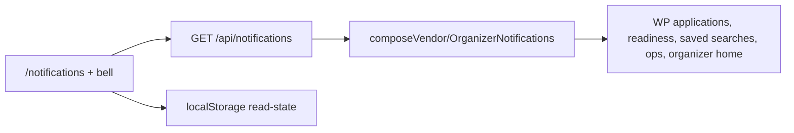

# Phase 13 — Retention + Notifications

Production Next.js app: `lnk-up-marketplace-ui/` (Vercel). WordPress remains source of truth for delivery, saved searches, and financial data.

## Overview

Phase 13 adds a composed notification center, bell badge, preferences handoff UI, saved-search alert controls, vendor/organizer home retention cards, and a PWA install nudge. Notifications are **composed in the BFF** from existing vendor/organizer data — there is no WordPress notification inbox REST API and no notification database in Next.js.

Mark-read state uses a **client read-state adapter** (`localStorage` keyed by user id) until WordPress exposes mark-read REST endpoints.

## Architecture

**Non-goals (web Phase 13):** Stripe, email/SMS sending, web push delivery, server-side read persistence, new WP inbox REST routes.

**Later (native):** Expo push device register + delivery on key marketplace events is built outside this phase — see [PUSH_NOTIFICATIONS_DEPTH.md](PUSH_NOTIFICATIONS_DEPTH.md). Phase 13’s composed feed + client read-state pattern still applies on mobile (Native Phase 7); there is still no WP notification inbox REST.

## Environment variables

| Variable | Required | Notes |
|----------|----------|-------|
| `NEXT_PUBLIC_LNKUP_LIVE_API` | Yes | `true` = BFF → WordPress; `false` = mock fixtures |
| `WORDPRESS_API_URL` | Yes (live) | WordPress REST base |
| `NEXT_PUBLIC_WORDPRESS_SITE_URL` | Yes | Dashboard handoff URLs |
| `SESSION_SECRET` | Yes (live auth) | Encrypts httpOnly session cookie |

## BFF routes

| Route | Method | Purpose |
|-------|--------|---------|
| `/api/notifications` | GET | Session auth; compose feed by role |
| `/api/notifications/count` | GET | Unread + action-required counts |
| `/api/notifications/[id]/read` | POST | Validates id; client persists read-state |
| `/api/notifications/read-all` | POST | Same adapter pattern |
| `/api/notifications/preferences` | GET/PATCH | Mock: full toggles; live: handoff + saved-search summary |
| `/api/marketplace/saved-searches/[id]/run` | POST | Proxy WP saved-search run |
| `/api/marketplace/saved-searches/[id]` | PATCH | `paused`, `frequency: none` → `alert_enabled: false` |

## Composition sources (live)

| Source | WP/BFF | Notification types |
|--------|--------|-------------------|
| Vendor applications | `/applications/vendor` | application_*, payment_required, payment_paid |
| Vendor wallet | wallet BFF | payment_required, payment_due_soon |
| Vendor readiness | `/vendor/readiness` | document_missing, document_expiring |
| Review eligibility | reputation dashboard | review_received, review_requested |
| Saved searches | `/marketplace/saved-searches` | saved_search_match |
| Vendor operations home | `/operations/vendor-home` | packet_unlocked, event_day_reminder, system |
| Organizer home | organizer home BFF | organizer_* types |
| Organizer requests | `/organizer/requests` | organizer_new_vendor_request |

## UI surfaces

| Surface | Path / component |
|---------|------------------|
| Notification center | `/notifications` — filters All / Unread / Action required |
| Preferences | `/notifications/preferences` — mock toggles or WP handoff |
| Bell | `NotificationBell` in app shell (mobile header + desktop sidebar) |
| Saved search alerts | `SavedSearchAlertCard` — favorites, preferences |
| Retention cards | Vendor/organizer home via `RetentionCardList` |
| PWA nudge | `PwaInstallNudge` on vendor/organizer home |

## Read-state adapter

**File:** `lib/notifications/read-state.ts`

- `getReadIds()`, `markRead()`, `markAllRead()`, `getUnreadCount()`
- Live mode only; mock uses in-memory merge in hooks
- Temporary until WP exposes `/notifications/*/read` REST

## Mock vs live

| Mode | Notifications | Preferences | Mark read |
|------|---------------|-------------|-----------|
| Mock | `mockVendorNotifications` + `mockOrganizerNotifications` | Full channel toggles in UI | Client adapter with mock user |
| Live | BFF parallel fetch + compose | `{ unavailable: true, handoffUrl }` for email/SMS; saved-search PATCH delegated | Client `localStorage` |

## Security

- All BFF routes require session auth in live mode
- Analytics metadata: `type`, `severity`, `role` only — never message bodies, amounts, payment IDs, or document URLs
- No Stripe SDK imports in `app/` or `lib/`
- No email/SMS provider integration in Next.js

## Analytics events

| Event | Trigger |
|-------|---------|
| `notifications_viewed` | Notification center loaded |
| `notification_clicked` | Notification CTA clicked |
| `notification_marked_read` | Single mark read |
| `notification_mark_all_read` | Mark all read |
| `notification_preferences_viewed` | Preferences page loaded |
| `notification_preference_changed` | Mock preference toggle |
| `saved_search_alert_frequency_changed` | Frequency select changed |
| `saved_search_paused` / `saved_search_resumed` | Pause/resume |
| `pwa_install_prompt_shown` / `pwa_install_clicked` / `pwa_install_dismissed` | PWA nudge |
| `wordpress_notification_settings_opened` | WP handoff CTA |

## QA checklist

- [ ] `/notifications` renders with loading, content, empty, error states
- [ ] Bell shows badge count and links to `/notifications`
- [ ] Unauthenticated users: bell hidden in live mode
- [ ] Preferences: mock toggles work; live shows WP handoff card
- [ ] Saved search alerts: pause/resume/run/frequency on favorites + preferences
- [ ] Vendor/organizer home retention cards use composed priority stack
- [ ] PWA nudge dismiss persists in `localStorage`
- [ ] `rg stripe lnk-up-marketplace-ui/app lnk-up-marketplace-ui/lib` — handoff strings only
- [ ] Phase 13 Playwright spec green

## Known gaps

- No WordPress notification inbox REST API (composed feed on web + native; mark-read is client-local)
- No server-side mark-read persistence
- Web Phase 13: no web/PWA push delivery (PWA install nudge only). Native Expo push exists separately — [PUSH_NOTIFICATIONS_DEPTH.md](PUSH_NOTIFICATIONS_DEPTH.md)
- `LNKup_Notifications` still sends email for most events; Expo `push_user()` covers only 7 lifecycle types
- Live email/SMS preferences require WordPress dashboard handoff

**Next:** [End-to-End Marketplace Journey](E2E_MARKETPLACE_JOURNEY.md) · [Phase 14A — Journey Handoffs](PHASE_14A_JOURNEY_HANDOFFS.md)
