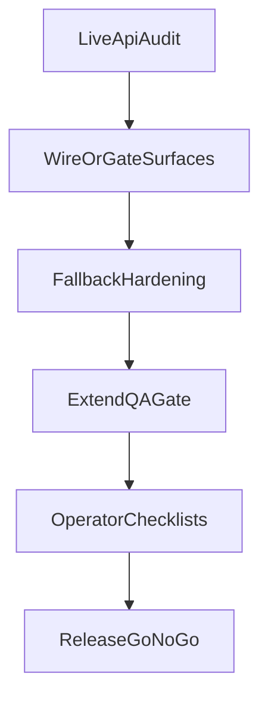

# Phase 22 — Production Launch Hardening

Production app: `lnk-up-marketplace-ui/` (Vercel) · Mobile: `lnk-up-marketplace-mobile/` (Expo OTA)  
WordPress remains system of record.

**Status:** Built (executed)  
**Depends on:** Phases 15–21 shipped  
**Roadmap:** [SYSTEM_OVERVIEW.md §14.2](SYSTEM_OVERVIEW.md#142-app-roadmap-phases-126) · Queue: [PHASES_22_26_ROADMAP.md](PHASES_22_26_ROADMAP.md)

**Audit artifact:** [artifacts/phase22-live-api-audit.md](../artifacts/phase22-live-api-audit.md)  
**Gate:** [PHASE_15_22_QA_GATE.md](PHASE_15_22_QA_GATE.md)  
**Operator:** [PHASE_22_OPERATOR_VERCEL.md](PHASE_22_OPERATOR_VERCEL.md) · [PHASE_22_OPERATOR_EXPO.md](PHASE_22_OPERATOR_EXPO.md)  
**Release checklist:** [PHASE_22_RELEASE_CHECKLIST.md](PHASE_22_RELEASE_CHECKLIST.md)

---

## Goal

Make Phases 15–21 safe to operate in production. Close or explicitly gate remaining mock/partial surfaces, sync release docs, extend the quality gate for cutover, and publish operator checklists for Vercel + Expo store submit.

This phase does **not** add a major new product surface.

---

## Non-goals

- Embedded Stripe Payment Element in Next.js or Expo
- Full wp-admin CRM/ops port
- Attendee ticketing / WooCommerce
- Shipping Phase 23–26 features (mobile tutorials, maps, admin depth, Financial OS expansion)

---

## Implementation slices

### 1) Live-API residual surface audit

Inventory BFF + page routes that still return fixtures when `NEXT_PUBLIC_LNKUP_LIVE_API=true`, or advertise live while silently mocking.

**Deliverable:** Table in this doc (or `artifacts/phase22-live-api-audit.md`) with:

| Surface | Route / BFF | Live? | Action |
|---------|-------------|-------|--------|
| … | … | yes / partial / mock | wire / gate / document intentional |

**Priority audit targets** (start from [APP_GAP_ANALYSIS.md](APP_GAP_ANALYSIS.md); refresh against current code):

- Vendor: wallet, growth, reviews, operations, profile tabs beyond documents/readiness
- Organizer: event workspace depth, Discover/Lists/Invites (post–Phase 17), money tabs
- Admin: `/admin/*` Admin Lite vs remaining mocks
- Ops: `/ops/analytics` (Phase 7 / 19 overlap — reconcile status)

**Actions per row:**

- **Wire** — map to existing `lnkup/v1` if REST already exists
- **Gate** — env flag or honest UI copy (“Available on LNKup web”) + deterministic BFF `code`
- **Document** — intentional mock/demo-only; update gap analysis

### 2) Deterministic fallback hardening

For audited critical paths, ensure:

- `code` + `meta.partial` / `unavailableReasons` on BFF failures
- UI loading / empty / error (no infinite skeletons)
- No raw WP/Stripe jargon in user copy

Critical paths: payment return (16), CRM review (17), readiness (18), intelligence (19–20), tutorials (21), admin lite (15).

### 3) Docs sync through Phase 21 + Phase 22 entry

Confirm (already started in roadmap sync):

- [SYSTEM_OVERVIEW.md](SYSTEM_OVERVIEW.md) §14.2 lists 15–21 **Built** and 22–26 planned
- [CURRENT_STATE.md](CURRENT_STATE.md) has Phase 15–21 snapshot
- [APP_GAP_ANALYSIS.md](APP_GAP_ANALYSIS.md) executive matrix no longer says 8–14 “Planned” / Phase 7 “Not started” if ops analytics shipped

### 4) Cutover quality gate extension

Extend [PHASE_15_20_QA_GATE.md](PHASE_15_20_QA_GATE.md) (or add `PHASE_15_22_QA_GATE.md`) to include:

- Phase 21 tutorial suite (`lnkup-app-phase21-tutorials.spec.ts`)
- Launch smoke: vendor home tutorial + organizer home tutorial + payment-return smoke under live or stubbed auth
- Operator go/no-go for **Vercel prod** and **Expo production channel**

Update CI: [.github/workflows/phase15-20-quality-gate.yml](../.github/workflows/phase15-20-quality-gate.yml) (rename or alias if scope becomes 15–22).

### 5) Operator launch checklists

#### Vercel (web)

| Check | Required |
|-------|----------|
| `NEXT_PUBLIC_APP_URL` production URL | Yes |
| `NEXT_PUBLIC_LNKUP_LIVE_API=true` | Yes for live |
| `WORDPRESS_API_URL` | Yes |
| `SESSION_SECRET` (≥16 chars) | Yes |
| `NEXT_PUBLIC_WORDPRESS_SITE_URL` | Yes (handoffs) |
| `ENABLE_OPS_ANALYTICS` / admin gates as intended | Confirm |
| Smoke `/vendor`, `/organizer`, payment return | Yes |

#### Expo (mobile)

| Check | Required |
|-------|----------|
| Production OTA channel publish after cutover | Yes |
| `EXPO_PUBLIC_LNKUP_LIVE_API=true` in production builds | Yes |
| `EXPO_PUBLIC_WORDPRESS_API_URL` | Yes |
| `eas submit` / store credentials operator-owned | Per [STORE_RELEASE.md](../lnk-up-marketplace-mobile/STORE_RELEASE.md) |
| `npm run phase20:verify` green | Yes |

### 6) Release checklist + playbook pointer

Add [PHASE_22_RELEASE_CHECKLIST.md](PHASE_22_RELEASE_CHECKLIST.md) during execution with:

- Audit table signed off
- Gate command results + artifact paths
- Vercel + Expo checklist completed
- 24h monitoring notes (reuse Phase 21 playbook matrix)

---

## Acceptance criteria

- [x] Live-API audit completed; every priority surface is wired, gated, or documented intentional
- [x] Critical BFF paths return deterministic codes and UI never infinite-spins on upstream failure
- [x] Docs (§14.2, CURRENT_STATE, gap analysis) reflect Phases 15–21 built and Phase 22 complete
- [x] Quality gate includes tutorials + launch smoke; CI updated
- [x] Operator Vercel + Expo checklists exist and are runnable
- [x] Phase 22 release checklist filled for go/no-go

---

## Suggested execution order

---

## Related docs

- [PHASES_22_26_ROADMAP.md](PHASES_22_26_ROADMAP.md)
- [PHASE_21_RELEASE_PLAYBOOK.md](PHASE_21_RELEASE_PLAYBOOK.md)
- [PHASE_15_20_QA_GATE.md](PHASE_15_20_QA_GATE.md)
- [APP_GAP_ANALYSIS.md](APP_GAP_ANALYSIS.md)
- [E2E_MARKETPLACE_JOURNEY.md](E2E_MARKETPLACE_JOURNEY.md)
