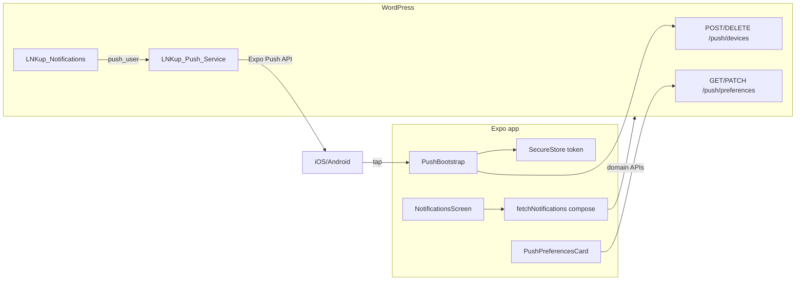

# Push notifications — depth assessment

**Verdict:** Medium-plus depth after Phase 1 email/push upgrade — production-capable for core journey + pass/ops/review siblings; still not a full notifications product.

| Layer | Depth |
|-------|--------|
| Device register + master toggle | Built |
| Real Expo push delivery from WP | Built (lifecycle + activation + retention discovery) |
| Richer branded emails + CTA | Built (core journey + pass/ops/review) |
| Tap / cold-start deep links | Built (aligned type names) |
| In-app notification center (both roles) | Built (client-composed) |
| Per-category preferences | Built (Phase 4) — [PHASE_PUSH_PREFS_BADGE.md](PHASE_PUSH_PREFS_BADGE.md) |
| App icon badge | Built (Phase 4) — synced to composed unread |
| Invites, saved search, favorites as push | Built (Phase 3) — [PHASE_RETENTION_PUSH.md](PHASE_RETENTION_PUSH.md) |
| Activation drip (welcome / profile / find / create event) | Built (Phase 2) — [PHASE_ACTIVATION_EMAILS.md](PHASE_ACTIVATION_EMAILS.md) |
| Server inbox / mark-read REST | Built — `LNKup_Inbox_REST` (`GET/POST /notifications/inbox*`) + web/Expo mark-read |

Cross-refs: [CURRENT_STATE.md](CURRENT_STATE.md) · [SYSTEM_OVERVIEW.md](SYSTEM_OVERVIEW.md) §14.3 · Native Phase 4/7 · [PHASE_13_RETENTION_NOTIFICATIONS.md](PHASE_13_RETENTION_NOTIFICATIONS.md) (web composed feed; push is native-era)

---

## Architecture

Two separate systems share the word “notifications”:

1. **Push pipe** — fire-and-forget Expo messages on WP lifecycle events.
2. **In-app center** — rebuilds a feed from current domain state + local SecureStore read IDs. Same pattern as Phase 13 web.

---

## What is built (mobile)

**Registration** — `lnk-up-marketplace-mobile/lib/push/notifications.ts` + `components/push-bootstrap.tsx` mounted from `app/_layout.tsx`:

- Permission request → Expo push token → SecureStore → `POST /lnkup/v1/push/devices`
- Unregister on logout / 401
- Skips web / simulator / missing EAS `projectId`
- Tap listener + cold-start `getLastNotificationResponseAsync` → deep link
- Deep-link map accepts aligned types (`payment_paid`, `organizer_payment_received`, `review_requested`, `system`) plus legacy aliases

**API client** — `lib/api/push.ts`: devices CRUD + master `pushEnabled` only.

**Shared UI (vendor + organizer parity on shell):**

- Bell on home → role notifications route
- `NotificationsScreen` — All / Unread / Action filters, mark read / mark all
- Prefs card: vendor on Profile, organizer on More
- Tutorial CTA to enable push (Phase 23)

**Inbox content** — clients still compose from domain APIs, then merge `GET /lnkup/v1/notifications/inbox` (persisted push events + `readIds`). Mark-read writes to WP so web and Expo share unread state. Local SecureStore remains an offline cache.

---

## What is built (WordPress)

**REST** (`includes/class-push-rest.php`):

- `POST|DELETE /lnkup/v1/push/devices`
- `GET|PATCH /lnkup/v1/push/preferences`

**Delivery** (`includes/class-push-service.php`): `https://exp.host/--/api/v2/push/send` (optional `expo_push_access_token`). Not direct FCM/APNs.

**Storage:** `{prefix}lnkup_push_devices`; user meta `lnkup_push_enabled` (default on).

**Emails** (`includes/class-notifications.php`): shared `application_context`, `email_paragraphs`, `email_cta_block`, `email_event_meta` — core journey emails include event/opportunity title + dashboard CTA.

**Methods that call `push_user()`:**

| Event | Role | Push `type` | Deep link |
|-------|------|-------------|-----------|
| New application | Organizer | `organizer_new_vendor_request` | `/(organizer)/vendors` |
| Vendor paid | Organizer | `organizer_payment_received` | `/(organizer)/money` |
| Post-event review prompt | Organizer | `review_requested` | `/(organizer)/vendors` |
| Payment required (after approve) | Vendor | `payment_required` | `/(vendor)/wallet` |
| Payment confirmed | Vendor | `payment_paid` | `/pass/{id}` |
| Packet unlocked | Vendor | `packet_unlocked` | `/pass/{id}` |
| Pass details updated | Vendor | `system` | `/pass/{id}` |
| Rejected | Vendor | `application_rejected` | `/(vendor)/requests` |
| Waitlisted | Vendor | `application_waitlisted` | `/(vendor)/requests` |
| Ops broadcast | Vendor | `system` | `/(vendor)/operations` |

Still **email-only** (no Expo push): doc pending admin, external-event outreach, platform outreach.

**Activation drip (Phase 2):** welcome + finish-profile / find-events / apply (vendors) and create-event / review-vendors (organizers). See [PHASE_ACTIVATION_EMAILS.md](PHASE_ACTIVATION_EMAILS.md).

**Retention push (Phase 3):** saved search, favorites deadlines / organizer posts, invites, almost-full, deadline, profile match. See [PHASE_RETENTION_PUSH.md](PHASE_RETENTION_PUSH.md).

---

## Vendor vs organizer depth

| Area | Vendor | Organizer |
|------|--------|-----------|
| Push triggers from WP | Lifecycle + retention discovery | 3 events (+ activation) |
| Composed inbox richness | Requests, readiness docs, reviews, event-day, ops | Home attention + pending requests + payment received |
| Prefs placement | Profile | More |
| Shell / bell / deep links | Shared components, role hrefs | Same |

---

## Gaps / thin edges

- No durable server notification history — push is fire-and-forget; inbox is a snapshot of current domain state
- `review_requested` is push-only (not composed in inbox — no pending-review REST yet)
- Legacy deep-link aliases kept for old payloads (`payment_confirmed`, `organizer_vendor_paid`)
- SMS not built; external-event / platform outreach remain email-only
- Category prefs apply to push only (not email)

---

## Honest depth score

Think of it as **Phase 1.5 notifications product**, not Phase 3:

1. **Delivery pipe** — solid for Expo + core lifecycle + pass/ops/review siblings
2. **Email quality** — branded context + CTA on core journey
3. **In-app center** — usable UX, local read-state, composed feed
4. **Product completeness** — category prefs + badge (Phase 4); still no inbox persistence; external outreach email-only

If the question is “can vendors/organizers get real push and open the right screen?” → **yes**. If it is “do we have a full notification system with history?” → **not yet**.
