# LNK Up Marketplace — System Overview

**Version:** Plugin v12.18.39 | Theme v1.4.19 (`LNKUP_THEME_VERSION`; `style.css` header synced)  
**Last updated:** August 2026  
**Audience:** Engineers, product, and operations stakeholders onboarding to the platform.

This document is the primary **architecture reference** for the LNK Up Marketplace monorepo. For a lighter feature inventory and production fix log, see [CURRENT_STATE.md](CURRENT_STATE.md).

### Platform release summary

| Release | Focus | Status |
|---------|-------|--------|
| v9.x | Financial platform foundation — SQL ledger, invoices, wallet, refunds | Built |
| v10.x | Vendor growth dashboard — KPIs, ROI, benchmarks, recommendations | Built |
| v11.x | Stripe-first financial OS — embedded checkout, webhooks, fee engine, payment timeline | Built |
| v12.1 | **Connect Marketplace Treasury** — Stripe Connect Express, destination charges, organizer wallet, cashouts, reserves, platform fees | Built |
| v12.1.5–12.1.7 | Vendor financial REST role fix, referral credits, growth markets, ops prefill, operations command-center UX, fee engine $5.99 model, checkout finalize / 3DS return | Built |
| v12.2.0–12.2.1 | **Event Weather Intelligence** (OpenWeather), ops/intelligence weather panels, daily cron | Built |
| v12.2.2–12.2.3 | **Organizer balance display** — `display_balances`, wallet-first UI, `/organizer-balances`, dashboard JSON hardening, payment reconcile | Built |
| v12.2.4 | **Prelaunch launch goals** — honest homepage trust/hero stats (no fake GMV/vendor counts); theme landing goal cards | Built |
| v12.2.5 | **Rank Math SEO** (`LNKup_SEO`), opportunity card SVG fallbacks | Built |
| v12.3.0 | **Platform Outreach** — mass invite by email (admin + organizer CRM), SQL queue, tracked sign-up | Built |
| v12.3.1 | **Outreach SMTP throttling** — hourly/daily caps, auto-resume next day (SiteGround-safe) | Built |
| v12.4.0 | **Trust & Verification** — vendor/organizer trust levels, document modes, admin verification queue | Built |
| v12.5.0 | **Saved Searches & Opportunity Alerts** — vendor saved searches, digest cron, deadline reminders | Built |
| v12.6.0 | **Organizer Vendor CSV Import** — CRM import wizard, prospect staging, list/invite integration | Built |
| v12.7.0 | **City Market Landing Pages** — `/markets/{slug}/`, registry, SEO, discovery cross-links | Built |
| v12.8.0 | **City Connector Program** — connector role, attribution, rewards, interest form, dashboard | Built |
| v12.18.39 | **In-app signup** — `POST /lnkup/v1/auth/register` + native Create account; Privacy URL `https://thelnkup.com/privacy` | Built |
| v12.18.38 | **Find Events category photos** — realistic JPG fallbacks per vendor category; organizer/Eventbrite photos still win | Built |
| v12.18.37 | **Content Studio UI polish** — builder sheet, platform/audience selects, LinkedIn hosts, readable performance cards | Built |
| v12.18.36 | **Connector launch plan + Content Studio** — three-phase onboarding, growth styles, template/post CPTs, `cc` click metadata | Built |
| v12.18.35 | **City Connector ranks** — five-tier cached ranks, booking-attr ledger, pending bonuses, roadmap / celebration / opt-in leaderboard | Built |
| v12.18.34 | **City Connector command center** — SPA `?view=` routing, mobile bottom nav, share sheet, next-best-action, funnel %, filterable referrals | Built |
| v12.18.33 | **City Connector Onboarding and Earnings Education** — Get Started IA, booth-GMV commission, hold/refund, calculator | Built |
| v12.9.0 | **Premium Craftsmanship Pass** — surface tiers, `lnkup_executive_hero()`, shared motion/chart helpers | Built |
| v12.10.0 | **Vendor Premium UI/UX** — public storefront, vendor home hero, payments/growth polish | Built |
| v12.11.0 | **Organizer Premium UI/UX** — command center overhaul, event card v4, intel SSR + expand load fixes | Built |
| v12.11.1 | **Financial dashboard fix** — sponsor payments JOIN query; treasury column alignment; organizer UI regressions | Built |
| v12.13.0 | **External Event Discovery V2 (Plugin Phase 13B)** — demand metrics/scores, follow-up emails, claim landing, URL import, review queue, dedup, analytics | Built |
| v12.12.0 | **External Event Discovery (Plugin Phase 13A)** — SQL-backed unclaimed Eventbrite-style listings, admin import, vendor interest, organizer claim flow | Built |
| v12.14.0 | **External Events Auto Sync (Plugin Phase 13C)** — Eventbrite city browse scrape, daily cron, admin Auto sync tab | Built |
| v12.15.0 | **Organizer Email Gap Workflow** — description email mining, deferred organizer notify, admin needs-email UI | Built |
| v12.16.0 | **Vendor-Focused Auto Sync** — vendor relevance gate, `vendor_fit_score`, sync timeout hardening | Built |
| v12.17.0 | **Review Queue V2** — triage table, bulk approve/reject, readiness badges, sort/filter KPIs | Built |

### Recent release detail (v12.1.5 → v12.17.0)

| Version | Highlights |
|---------|------------|
| **12.1.5** | Vendor Payments `?role=vendor`; referral credits + `?ref=` cookie; growth Markets tab fixes; Find Events filter rename; ops `bootstrap_from_event()` + defaults REST |
| **12.1.6** | Operations command center — 5 section pills, sticky sub-tabs, unified loaders, `lnkup-ops-panel-open` cross-module sync |
| **12.1.7** | Fee engine settings-first $5.99; pending fee refresh; checkout 3DS return + finalize; intelligence expand panel timeout/retry |
| **12.2.0** | Event Weather Intelligence — OpenWeather, risk engine, snapshots, REST `/weather/*`, daily cron |
| **12.2.1** | Weather activator + script order; ops/intelligence panel hydration; `weather-intelligence.spec.ts` |
| **12.2.2** | `organizer_balance_payload()`, `display_balances`, wallet-first hero; `payment_intent.processing` webhook; Sync payment |
| **12.2.3** | `GET /financial/organizer-balances`; dashboard hot-path hardening; UTF-8 REST sanitize; optional dashboard for KPIs only |
| **12.2.4** | `launch_goal_vendors`/`organizers`, `lnkup_get_launch_goals()`, `lnkup_get_marketplace_public_stats()`; theme trust/hero prelaunch cards |
| **12.2.5** | `LNKup_SEO` Rank Math hooks (title, OG, schema, sitemap); `lnkup_opportunity_illustration_url()`; `seo-rankmath.spec.ts` |
| **12.3.0** | Outreach SQL tables, `LNKup_Outreach` service, wp-admin Outreach page, CRM bulk invite REST, sign-up token tracking |
| **12.3.1** | Outreach rate limits (600/hr, 1500/day), transient counters, `schedule_next_day()` at 08:00, Settings → Outreach throttling |
| **12.4.0** | `LNKup_Verification` trust levels; REST `/verification/*`; admin Verification queue; trust UI on profiles and applications |
| **12.5.0** | `LNKup_Saved_Searches`; REST `/marketplace/saved-searches`; Find Events save modal; favorites digests + instant alerts cron |
| **12.6.0** | `LNKup_Vendor_Import`; SQL import/prospect tables; CRM 4-step wizard (`vendor-import.js`); outreach `mark_registered` handoff |
| **12.7.0** | `LNKup_Market_Pages` city registry; theme `market-landing.php`; Rank Math per-market SEO; `?market=` registration attribution |
| **12.8.0** | `lnkup_connector` role; `LNKup_Connector_*` services; cookie `lnkup_connector_ref`; REST `/connector/*`; connector dashboard |
| **12.9.0** | Surface tier CSS (`.lnkup-surface--hero/primary/secondary/quiet`); `lnkup_executive_hero()` on vendor + organizer sections; theme `components.css` compliance ring |
| **12.10.0** | Public vendor storefront (`/vendors?vendor=`); vendor home Action Center; premium invoice cards; growth funnel visual; `animateKpiCards` |
| **12.11.0** | Organizer command hero + 10 KPIs; payout strip; event card v4 horizontal layout + gradient fallback; intel SSR summary + expand dashboard load; wizard step gating; hero title dedupe via `:has()` |
| **12.11.1** | `LNKup_Sponsor_Payments` JOIN fix for dashboard JSON; sponsor invoice/payment schema alignment; event card + intelligence expand panel UI fixes |
| **12.13.0** | External events V2 demand engine — workflow/review queue, demand score, follow-up cron, claim landing page, Eventbrite URL import, dedup merge, analytics dashboard REST |
| **12.12.0** | External event discovery — `LNKup_External_Events` + SQL tables; admin CSV import; mixed Find Events feed; vendor interest email + claim tokens; organizer pending interest panel |
| **12.14.0** | Auto sync — `LNKup_External_Events_Sync`, Eventbrite city browse, daily cron, admin Auto sync tab, image URL validation |
| **12.15.0** | Organizer email gap — `extract_email_from_text()`, admin missing-email alerts, deferred notify on email add |
| **12.16.0** | Vendor sync filter — relevance gate, `vendor_fit_score`, full-description parsing, sync budget hardening |
| **12.17.0** | Review queue V2 — triage UI, bulk actions, readiness badges, `vendor_fit_score` default sort |

---

## Table of Contents

1. [Executive Summary](#1-executive-summary)
2. [Platform Vision & Scope](#2-platform-vision--scope)
3. [Architecture Overview](#3-architecture-overview)
4. [Monorepo Layout](#4-monorepo-layout)
5. [Technology Stack](#5-technology-stack)
6. [User Roles & Access Control](#6-user-roles--access-control)
7. [Domain Model](#7-domain-model)
8. [Plugin Bootstrap & Lifecycle](#8-plugin-bootstrap--lifecycle)
9. [Plugin Subsystems](#9-plugin-subsystems)
10. [Data Layer](#10-data-layer)
11. [API Reference Summary](#11-api-reference-summary)
12. [Core Workflows](#12-core-workflows)
13. [Financial System](#13-financial-system)
14. [Frontend Architecture](#14-frontend-architecture)
    - [14.1 Next.js App Architecture](#141-nextjs-app-architecture)
    - [14.2 App Roadmap Phases 1–26](#142-app-roadmap-phases-126)
    - [14.3 Native Mobile Architecture](#143-native-mobile-architecture)
15. [Integrations](#15-integrations)
16. [Security](#16-security)
17. [Background Jobs](#17-background-jobs)
18. [Testing Strategy](#18-testing-strategy)
19. [Deployment & Configuration](#19-deployment--configuration)
20. [Extension Points](#20-extension-points)
21. [Known Gaps & Stubs](#21-known-gaps--stubs)
22. [Glossary](#22-glossary)
23. [Related Documents](#23-related-documents)

---

## 1. Executive Summary

**LNK Up Marketplace** is a vendor opportunity marketplace built on WordPress. Vendors discover events, apply for booth or slot opportunities, pay fees, and unlock venue packets with operational details. Organizers create events, review applications, collect payments, manage vendor relationships, run day-of operations, and analyze performance.

**LNK Up is not attendee ticketing.** Consumer ticket sales remain on external platforms (Posh, Eventbrite, Universe, etc.). LNK Up owns the **vendor layer** only.

### Production vs Reference

> **Phase naming:** **App Phase N** (1–26) = Next.js `lnk-up-marketplace-ui/` (+ related mobile parity) rollout on Vercel/Expo. **Native Phase N** = Expo `lnk-up-marketplace-mobile/` iOS/Android. **Plugin release v12.x** = WordPress changelog. **Plugin build phase** (legacy) = e.g. Plugin Phase 8 = Interactive Maps (built), Plugin Phase 13A/B/C = External Events (built). Do not confuse **App Phase 8** (Search + Maps) with **Plugin Phase 8** (WP map editor).

| Layer | Technology | Role |
|-------|-----------|------|
| **Production** | WordPress 6.0+ + `lnkup-theme` v1.4.5 + `lnkup-marketplace` v12.17.0 | Live marketplace — system of record |
| **Premium web app** | Next.js 16 in `lnk-up-marketplace-ui/` on Vercel | Mobile-first vendor/organizer experience; BFF proxies `lnkup/v1` |
| **Native mobile** | Expo (React Native) in `lnk-up-marketplace-mobile/` | iOS/Android vendor + organizer lite; calls WordPress REST directly (SecureStore Basic auth) |
| **Design IA (mobile)** | Next.js mock in `lnkup-app-reference/` | v0 mobile-web IA for native screens — **not production**, not wired to WP |
| **Legacy reference** | Next.js in root `app/` + `components/` | Older v0 template; do not expand |

Production web app: https://lnkup-marketplace-ui.vercel.app · BFF architecture: [LIVE_API_INTEGRATION.md](LIVE_API_INTEGRATION.md) · Native: [§14.3](#143-native-mobile-architecture)

### Scale (v12.17.0)

| Metric | Count |
|--------|-------|
| PHP source files | ~200 |
| Financial submodule classes | 28 |
| Custom SQL tables | 78+ (financial + treasury + outreach + CRM import + connector + external events) |
| REST routes | ~210 (`/wp-json/lnkup/v1/*`) |
| Custom post types | 13 |
| Taxonomies | 3 |
| User roles | 5 (`lnkup_vendor`, `lnkup_organizer`, `lnkup_connector`, `lnkup_admin`, `administrator`) |
| Shortcodes | 13 (12 in `LNKup_Shortcodes` + `[lnkup_register_form]`) |
| WordPress E2E test specs | 26 |
| Next.js app routes | ~30 pages |
| Next.js BFF routes | 30 (`lnk-up-marketplace-ui/app/api/*`) |

---

## 2. Platform Vision & Scope

### In Scope (MVP+)

- Public marketplace discovery ("Find Events")
- Vendor profiles, applications, and compliance documents
- Organizer event and opportunity management
- Application review workflow with waitlist/reject paths
- Stripe-first payments with embedded checkout, invoices, wallet, refunds
- **Stripe Connect Express** onboarding with destination charges and organizer cashouts
- **Marketplace Treasury System** — organizer wallets, platform fees, reserves, escrow holds, treasury fallback
- Vendor packet lock/unlock after payment
- Organizer CRM (notes, tags, lists, invites, roster)
- Vendor reputation (reviews, badges, reliability scores)
- Day-of event operations (booths, parking, check-in, incidents)
- **Event weather intelligence** — OpenWeather forecasts, risk scoring, ops/intelligence panels (v12.2)
- Organizer intelligence (scores, funnels, risk engine)
- Interactive venue maps
- Vendor growth analytics (ROI, goals, benchmarks)
- Platform admin settings and financial center
- **Prelaunch / launch homepage** — launch bar + countdown while gated; after open, dismissible app-release bar until `app_release_datetime`; goal cards while prelaunch; marketplace gate until `platform_launch_date` when `platform_prelaunch_mode` is on
- **Platform outreach** — mass invite campaigns by email (admin + organizer CRM bulk)
- **Trust & verification** — vendor/organizer trust levels, document requirement modes, admin verification queue (v12.4)
- **Saved searches & alerts** — vendor saved searches, digest emails, deadline reminders (v12.5)
- **Organizer vendor CSV import** — prospect staging, duplicate handling, list/invite integration (v12.6)
- **City market landing pages** — SEO city pages at `/markets/{slug}/` with live discovery stats (v12.7)
- **City Connector program** — connector role, attribution, rewards, interest form (v12.8)
- **Premium dashboard UI** — executive heroes, surface tiers, KPI animation, mobile-first polish (v12.9–12.11)
- **SEO** — Rank Math integration via thin `LNKup_SEO` filter layer (Rank Math not bundled)

### Out of Scope

- Attendee ticket sales and scanning
- Headless WordPress replacing the plugin as system of record
- Treating Next.js or Expo as the financial write path (Stripe stays in WP)
- Block theme / Full Site Editing (FSE)
- WooCommerce integration
- Live third-party insurance/financing integrations (offer catalogs are placeholder CTAs)

### Design Principle

WordPress custom post types (CPTs) and post meta are the **canonical source of truth** for business records. Custom SQL tables provide denormalized search indexes, relational data, audit logs, and analytics snapshots. All financial traffic routes through `LNKup_Financial_Service` — no direct Stripe calls from UI layers.

---

## 3. Architecture Overview

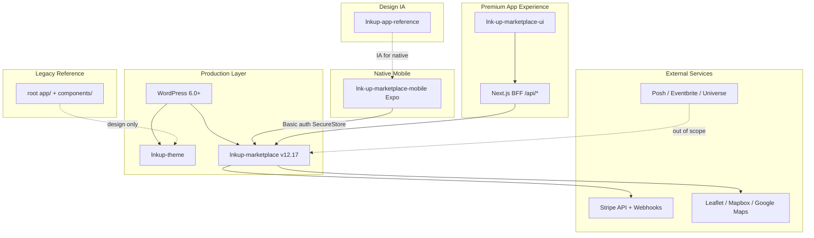

### Request Flow (Next.js App → WordPress)

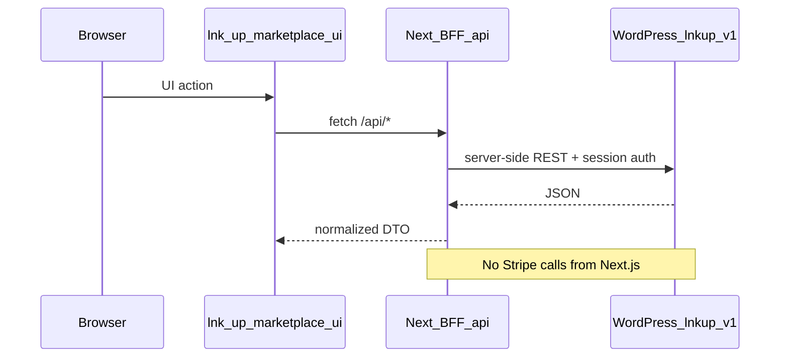

### Request Flow (Native Mobile → WordPress)

```mermaid
sequenceDiagram
  participant Device as Expo_iOS_Android
  participant Secure as SecureStore
  participant WP as WordPress_lnkup_v1
  Device->>Secure: load username + app password
  Device->>WP: REST + Basic auth
  WP-->>Device: JSON
  Note over Device,WP: No Next.js cookie BFF; no Stripe SDK
```

### Request Flow (Typical Dashboard Action)

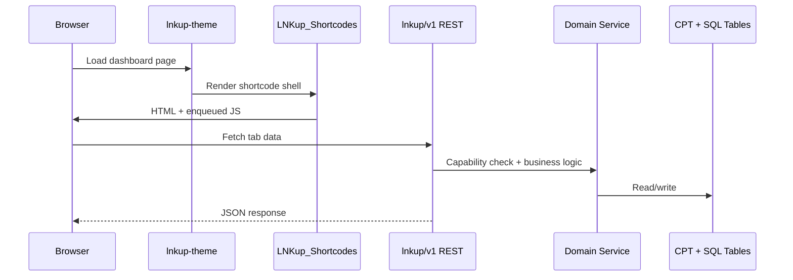

### Subsystem Map

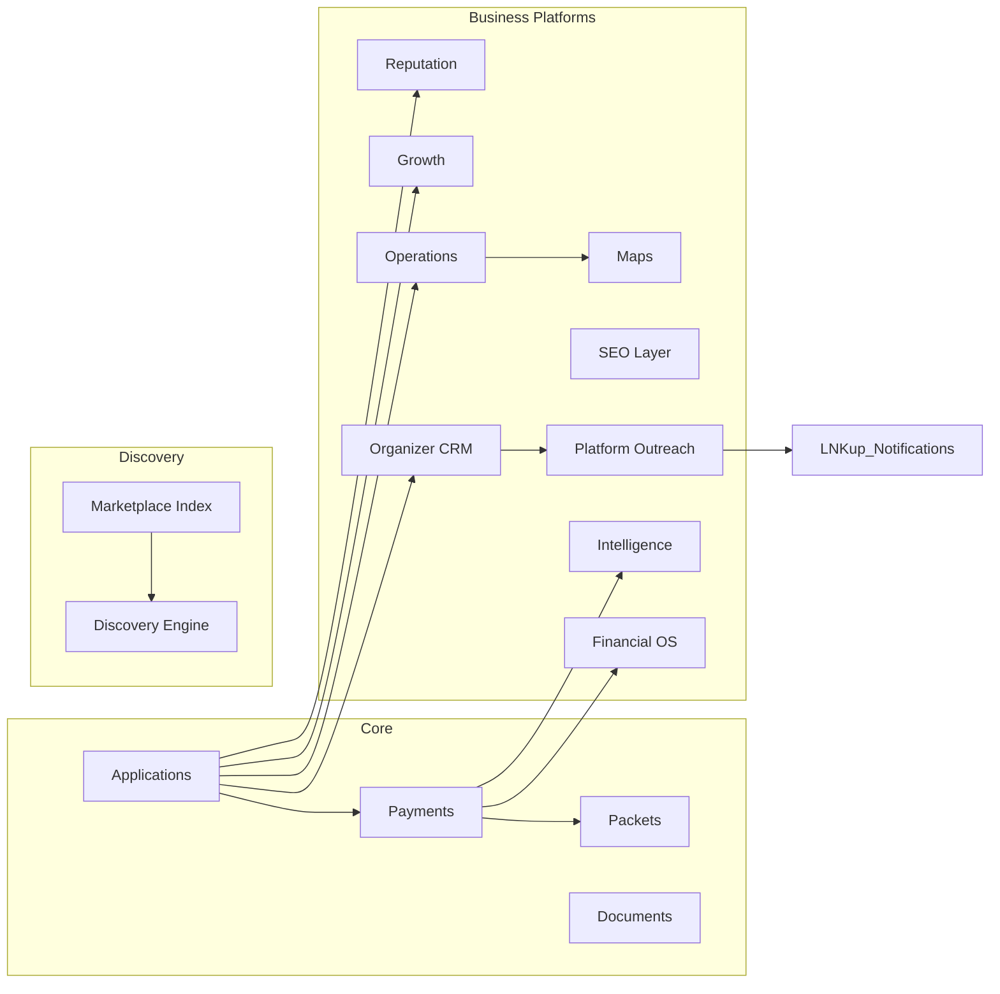

---

## 4. Monorepo Layout

```
lnk-up-marketplace-platform/
├── lnk-up-marketplace-ui/            # Premium Next.js app (Vercel) + BFF
├── lnk-up-marketplace-mobile/        # Expo iOS/Android native app
├── lnkup-app-reference/              # Mobile-web design IA (v0 mock; not production)
├── app/                              # Legacy Next.js 16 reference UI (do not expand)
├── components/                       # Legacy React/shadcn components (reference)
├── lib/                              # Legacy Next.js utilities, mock data
├── hooks/                            # Legacy React hooks
├── public/                           # Legacy Next.js static assets
├── tests/e2e/                        # Playwright specs (WordPress + app targets)
├── scripts/                          # Build utilities
│   └── build-plugin-zip.ps1            # Creates dist/lnkup-marketplace.zip
├── dist/                             # Plugin zip output (generated)
├── docs/
│   ├── SYSTEM_OVERVIEW.md            # This file
│   ├── CURRENT_STATE.md              # Inventory + changelog
│   ├── UI_UX.md                      # Design system + dashboard surfaces
│   ├── LIVE_API_INTEGRATION.md       # Web BFF + native client notes
│   └── CURSOR_CONTEXT.md             # AI onboarding context
├── package.json                      # Root Next.js + Playwright (pnpm)
├── playwright.config.ts              # E2E config (baseURL localhost:8888)
├── pnpm-workspace.yaml
└── wp-content/
    ├── themes/lnkup-theme/           # Production WordPress theme
    └── plugins/lnkup-marketplace/    # All marketplace business logic
```

### Deploy Model

This repository is a **monorepo**. Production WordPress on SiteGround (thelnkup.com) is an existing install — do not clone the repo over `public_html`.

**Preferred:** GitHub Action [`.github/workflows/deploy-wordpress.yml`](../.github/workflows/deploy-wordpress.yml) rsyncs only `wp-content/plugins/lnkup-marketplace` and `wp-content/themes/lnkup-theme` over SSH, then runs `composer install --no-dev` on the server. See [SITEGROUND_DEPLOY.md](SITEGROUND_DEPLOY.md).

**Fallback:** Copy those two folders, or upload `dist/lnkup-marketplace.zip` from `scripts/build-plugin-zip.ps1`.

WordPress core (`wp-admin`, `wp-includes`, `wp-config.php`) and `uploads` are not in this deploy. Next.js (Vercel) and Expo (EAS) stay on their own pipelines.

1. Configure GitHub secrets (`SG_SSH_*`, `SG_WP_ROOT`) and run **Deploy WordPress to SiteGround**.
2. Activate plugin and theme in wp-admin if this is a new install.
3. Build theme CSS locally when you change Sass: `cd wp-content/themes/lnkup-theme && npm run build` (commit `assets/dist`).
4. On first wp-admin visit after a version bump, deferred migrations run automatically (index rebuild, backfills).

---

## 5. Technology Stack

### Production (WordPress)

| Layer | Technology |
|-------|-----------|
| CMS | WordPress 6.0+ |
| Backend | PHP 7.4+ (plugin); PHP 8.0+ (theme) |
| Plugin | `lnkup-marketplace` v12.12.0 |
| Theme | Classic PHP theme `lnkup-theme` v1.4.5 (`LNKUP_THEME_VERSION`; not block/FSE) |
| PHP dependencies | Composer: `stripe/stripe-php` ^16, `dompdf/dompdf` ^3 |
| Frontend (WP) | Vanilla JS modules + per-feature CSS |
| Payments | Stripe Payment Element, Connect Express destination charges, webhooks |
| Maps | Leaflet (default); Mapbox/Google optional |
| Weather | OpenWeather API (server-side; key in settings only) |
| Email | `wp_mail` HTML notifications; outreach batch queue with SMTP throttling |
| Data | CPTs + post meta + 72+ custom SQL tables |

### Premium Web App (Next.js)

| Layer | Technology |
|-------|-----------|
| Framework | Next.js 16.2 (App Router) in `lnk-up-marketplace-ui/` |
| UI | React 19, Tailwind CSS 4, shadcn/ui, Lucide icons |
| Auth | Encrypted httpOnly session cookie (Application Password upstream) |
| Deploy | Vercel |
| Package manager | pnpm |

### Native Mobile (Expo)

| Layer | Technology |
|-------|-----------|
| Framework | Expo SDK 57 + Expo Router (React Native) in `lnk-up-marketplace-mobile/` |
| UI | React Native StyleSheet tokens (black / white / lime) |
| Auth | WordPress Application Password in Expo SecureStore; Basic auth to REST |
| Platforms | iOS + Android (Expo Go / EAS) |
| Package manager | npm (sibling app; not in pnpm workspace yet) |

### Legacy Reference UI (Next.js)

| Layer | Technology |
|-------|-----------|
| Framework | Next.js 16.2 (App Router) at monorepo root `app/` |
| UI | React 19, Tailwind CSS 4, shadcn/ui, Lucide icons |
| Charts | Recharts 3.8 |
| Analytics | `@vercel/analytics` |
| Package manager | pnpm |

### Theme Build

| Tool | Output |
|------|--------|
| Tailwind CSS 4 CLI | `wp-content/themes/lnkup-theme/assets/dist/lnkup.css` |
| Hand-written BEM | `assets/dist/components.css` |
| Design System 5.0 (`npm run build:public`) | `assets/dist/public.css` — public pages only (`lp-` prefix); see [PUBLIC_WEBSITE_5.md](PUBLIC_WEBSITE_5.md) |
| Responsive images (`npm run images`, sharp) | `assets/images/**/*-{640,1280,1920}w.webp` served by `lnkup_public_image()` |

### Testing

| Tool | Target |
|------|--------|
| Playwright 1.49+ | WordPress at `http://localhost:8888` |
| TypeScript 5.7 | Test specs in `tests/e2e/` |

---

## 6. User Roles & Access Control

### Roles

| Role | Slug | Persona |
|------|------|---------|
| Vendor | `lnkup_vendor` | Food trucks, artisans, service vendors seeking booth opportunities |
| Organizer | `lnkup_organizer` | Event producers managing vendor programs |
| Platform admin | `lnkup_admin` | LNKup staff with full platform access |
| City Connector | `lnkup_connector` | Local ambassadors earning rewards for vendor/organizer referrals (v12.8) |
| WordPress admin | `administrator` | Receives all LNKup capabilities on plugin activation |

### Capabilities by Role

**Vendor (`lnkup_vendor`):**

| Capability | Purpose |
|-----------|---------|
| `lnkup_manage_own_profile` | Edit vendor business profile |
| `lnkup_view_opportunities` | Browse marketplace |
| `lnkup_submit_applications` | Apply to opportunities |
| `lnkup_manage_own_documents` | Upload compliance documents |
| `lnkup_view_own_payments` | View payment history |
| `lnkup_view_own_financials` | Access financial hub |
| `lnkup_request_refunds` | Submit refund requests |
| `lnkup_view_own_growth` | Access growth dashboard |

**Organizer (`lnkup_organizer`):**

| Capability | Purpose |
|-----------|---------|
| `lnkup_manage_own_events` | Create and edit events |
| `lnkup_manage_own_opportunities` | Create vendor slots |
| `lnkup_review_applications` | Approve/waitlist/reject |
| `lnkup_manage_own_packets` | Configure vendor packets |
| `lnkup_manage_event_ops` | Operations console |
| `lnkup_view_own_financials` | Financial panel |
| `lnkup_manage_own_invoices` | Invoice management |
| `lnkup_approve_refunds` | Approve vendor refunds |
| `lnkup_manage_payouts` | Payout records |
| `lnkup_manage_promo_codes` | Promo code management |

**LNKup Admin (`lnkup_admin`):**

| Capability | Purpose |
|-----------|---------|
| `lnkup_manage_all` | Bypass ownership checks |
| `lnkup_verify_documents` | Verify compliance uploads |
| `lnkup_manage_settings` | Platform settings |
| `lnkup_manage_marketplace_financials` | Admin financial center |
| `lnkup_manage_marketplace_growth` | Admin growth aggregates |

### Registration & Guards

- Registration form: `[lnkup_register_form]` on `sign-up` page (`LNKup_Registration`); vendor/organizer role toggle; `user_register` hook assigns role (`class-roles.php`).
- **Outreach sign-up:** `/sign-up/?outreach={token}&role=vendor` — readonly email, locked role from campaign, hidden `lnkup_outreach_token`; server validates token TTL and email match on POST.
- Theme page templates enforce role gates via `inc/dashboard.php`.
- REST endpoints use capability callbacks + `LNKup_Capabilities` ownership helpers.
- Admin bypass uses `LNKup_Capabilities::user_has_manage_all()` — checks `$user->allcaps` directly to avoid `map_meta_cap` recursion (see CURRENT_STATE.md production fix log).

---

## 7. Domain Model

### Entity Relationships

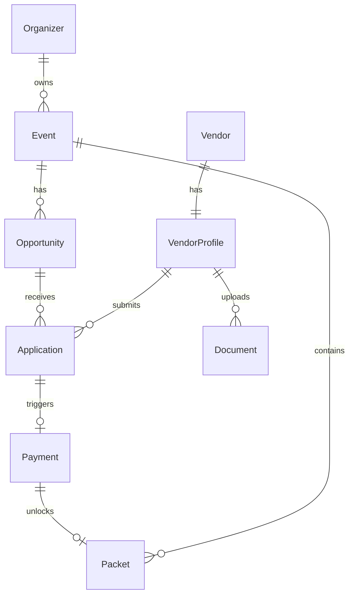

### Custom Post Types (13)

Registered in `includes/class-post-types.php`:

| CPT Slug | Label | Public | Purpose |
|----------|-------|--------|---------|
| `lnkup_vendor_profile` | Vendor Profile | No | Business profile per vendor user |
| `lnkup_event` | Event | Yes | Organizer event record |
| `lnkup_opportunity` | Opportunity | Yes | Vendor slot/booth listing for an event |
| `lnkup_application` | Application | No | Vendor application to an opportunity |
| `lnkup_document` | Document | No | Compliance upload (COI, permits, W9) |
| `lnkup_payment` | Payment | No | Payment record; checkout initiation source |
| `lnkup_packet` | Vendor Packet | No | Post-payment venue info (lock/unlock, QR) |
| `lnkup_vendor_note` | Vendor Note | No | CRM note on a vendor |
| `lnkup_vendor_list` | Vendor List | No | Organizer-curated vendor list |
| `lnkup_vendor_invite` | Vendor Invite | No | Organizer invitation to apply |
| `lnkup_vendor_flag` | Vendor Flag | No | CRM flag (watch, preferred, etc.) |
| `lnkup_review` | Review | No | Post-event vendor reputation review |
| `lnkup_dispute` | Dispute | No | Financial chargeback/dispute record |

**Note:** Platform outreach recipients are **not** a CPT — they live in SQL tables `lnkup_outreach_campaigns` and `lnkup_outreach_recipients` (see §9.11). The `lnkup_vendor_invite` CPT remains for organizer invites to **existing** vendor users to apply to an event.

### Taxonomies (3)

| Slug | Attached To | Notes |
|------|-------------|-------|
| `lnkup_vendor_category` | vendor profiles, opportunities | ~13 seeded terms (Food Vendor, Food Truck, etc.) |
| `lnkup_event_type` | events | Hierarchical: 10 parent categories (Festivals, Conferences, Markets & Pop-Ups, etc.) with subcategories (Block Party, Rodeo, Food Festival, etc.) |
| `lnkup_market` | events, opportunities | Hierarchical; no seed terms |

### Meta Linking Pattern

CPTs connect via post meta keys:

| Meta Key | Links |
|----------|-------|
| `_lnkup_event_id` | Opportunity, application, packet → event |
| `_lnkup_opportunity_id` | Application, payment → opportunity |
| `_lnkup_application_id` | Payment, packet → application |
| `_lnkup_vendor_profile_id` | Application, document → vendor profile |
| `_lnkup_application_status` | Application workflow state |
| `_lnkup_payment_status` | Payment state |

Schema registered in `includes/class-meta.php` with REST exposure where appropriate.

### Application Statuses

`submitted` → `under_review` → `approved` / `waitlisted` / `rejected` → `payment_required` → `paid` → `completed` / `cancelled`

### Payment Statuses (CPT)

`pending`, `paid`, `failed`, `refunded`, `disputed`

### Smart Financial Statuses (v11)

`awaiting_invoice`, `invoice_sent`, `awaiting_deposit`, `deposit_paid`, `balance_due`, `payment_due_soon`, `paid`, `refund_pending`, `refunded`, `chargeback`, `waived`, `cancelled`

### Document Types

`certificate_of_insurance`, `health_permit`, `business_license`, `w9`, `sales_tax_certificate`, `other`

---

## 8. Plugin Bootstrap & Lifecycle

**Entry file:** `wp-content/plugins/lnkup-marketplace/lnkup-marketplace.php`

### Constants

| Constant | Value |
|----------|-------|
| `LNKUP_VERSION` | `12.12.0` |
| `LNKUP_PLUGIN_DIR` | Plugin directory path |
| `LNKUP_PLUGIN_URL` | Plugin URL |
| `LNKUP_MIN_PHP` | `7.4` |

### Loading Sequence

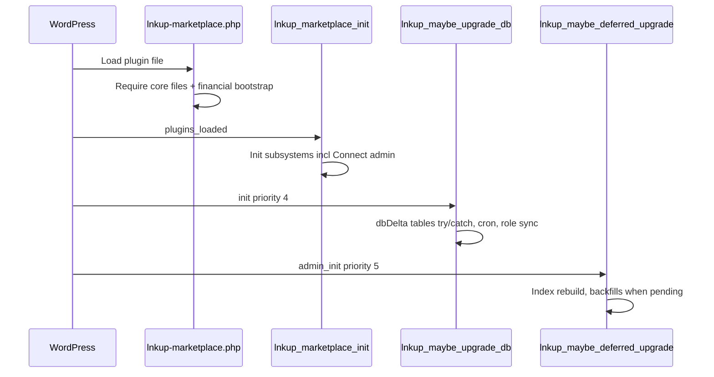

1. **PHP version guard** — exits with admin notice if PHP < 7.4.
2. **Sequential file load** — `$lnkup_core_files` array (includes `includes/weather/*` and `class-weather-*.php`) plus `includes/financial/bootstrap.php` (28 treasury/connect modules); `lnkup_require()` fails fast with admin notice on missing files.
3. **`plugins_loaded`** → `lnkup_marketplace_init()` registers all subsystem `::init()` hooks, including `LNKup_Financial_Connect_Admin`, `LNKup_Invoices`, `LNKup_Outreach` (+ tables/cron/admin), `LNKup_SEO`, and `LNKup_Registration`.
4. **`init` (priority 4)** → `lnkup_maybe_upgrade_db()` runs lightweight migrations with per-table try/catch; sets `lnkup_needs_deferred_upgrade` for heavy work.
5. **`admin_init` (priority 5)** → `lnkup_maybe_deferred_upgrade()` runs index rebuild, transaction backfills, CRM/reputation/growth backfills, showcase seed (admin only).
6. **`init` (priority 5)** → one-time marketplace index date cleanup.

### Activation (`LNKup_Activator::activate`)

1. Register roles, CPTs, taxonomies + seed taxonomy terms
2. Create SQL tables via domain table classes
3. Create pages with shortcodes and theme templates
4. Seed 5 sample events + opportunities (Charlotte, Atlanta, Miami, Raleigh, Greensboro)
5. Create demo user `lnkup_demo_organizer`
6. Set static front page if none configured
7. Schedule cron jobs (including `lnkup_weather_daily`)
8. Flush rewrite rules

### Auto-Created Pages

| Slug | Title | Shortcode | Template |
|------|-------|-----------|----------|
| `vendor-dashboard` | Vendor Dashboard | `[lnkup_vendor_dashboard]` | vendor-dashboard |
| `organizer-dashboard` | Organizer Dashboard | `[lnkup_organizer_dashboard]` | organizer-dashboard |
| `opportunities` | Find Events | `[lnkup_opportunities_feed]` | full-width |
| `vendor-profile` | Vendor Profile | `[lnkup_vendor_profile_form]` | default |
| `favorites` | Favorites | — | default |
| `vendors` | Vendor Directory | — | default |
| `sign-up` | Sign Up | `[lnkup_register_form]` | sign-up |

### Deactivation / Uninstall

- **Deactivation:** unschedule crons, flush rewrites (data persists).
- **Uninstall:** deletes `lnkup_settings` option only — CPT posts and roles remain.

### Settings (`lnkup_get_settings()`)

| Key | Default | Purpose |
|-----|---------|---------|
| `default_fee` | `5.99` | Legacy alias — synced to `vendor_checkout_fee` on migration (do not edit separately) |
| `vendor_checkout_fee` | `5.99` | **Canonical** flat fee bundled into vendor booth checkout |
| `organizer_commission_percent` | `6` | Percent of booth price retained as platform application fee |
| `application_fee_type` | `flat` | Fee rule type |
| `application_fee_flat` | `5.99` | Flat application fee component |
| `application_fee_percent` | `0` | Percent application fee component |
| `fee_payer_mode` | `vendor` | Who bears fee display logic |
| `stripe_public_key` | empty | Stripe publishable key |
| `stripe_secret_key` | empty | Stripe secret key |
| `stripe_webhook_secret` | empty | Webhook signature secret |
| `test_mode` | `true` | Use simulation when Stripe not configured |
| `payment_provider` | `stripe` | `stripe` or `manual` |
| `stripe_connect_enabled` | `false` | Enable Connect marketplace |
| `connect_platform_country` | `US` | Connect account country |
| `connect_platform_currency` | `usd` | Connect settlement currency |
| `connect_express_enabled` | `true` | Use Express accounts |
| `connect_manual_fallback` | `true` | Treasury path when organizer not onboarded |
| `connect_payout_schedule` | `manual` | Applied to Connect account `settings.payouts.schedule` on create; **manual** recommended for in-app Request cashout |
| `connect_instant_payouts_enabled` | `false` | When false, Instant is hidden in Money UI and rejected server-side |
| `connect_return_url` / `connect_refresh_url` | empty | Override Connect onboarding URLs |
| `escrow_enabled` | `true` | Escrow hold feature |
| `escrow_hold_percent` | `100` | Percent held in escrow |
| `escrow_release_days` | `7` | Days until escrow release |
| `reserve_percent` | `5` | Organizer reserve hold percent |
| `reserve_hold_days` | `30` | Reserve hold duration |
| `stripe_billing_enabled` | `false` | Stripe Billing subscriptions flag |
| `ach_enabled` | `false` | ACH payments flag |
| `default_packet_lock` | `true` | Lock packets until payment |
| `default_documents` | COI + business license | Required doc types |
| `notify_vendor` / `notify_organizer` / `notify_admin` | `true` | Email notification toggles |
| `support_email` | site admin email | Support contact |
| `marketplace_phase` | `1a` | Discovery rollout phase (1a/1b/1c) |
| `map_provider` | `leaflet` | Map engine selection |
| `mapbox_token` / `google_maps_key` | empty | Optional map API keys |
| `weather_intelligence_enabled` | `true` | Enable weather module |
| `openweather_api_key` | empty | OpenWeather API key (server-side only) |
| `openweather_api_mode` | `current_forecast` | OpenWeather API mode |
| `weather_units` | `imperial` | `imperial` or `metric` |
| `weather_refresh_minutes` | `30` | Snapshot cache TTL |
| `weather_historical_enabled` | `false` | Historical risk mode for far-future events |
| `weather_vendor_packet_note` | `true` | Show weather note in vendor packet when enabled |
| `platform_launch_date` | `2026-08-02` | Public marketplace open date |
| `platform_prelaunch_mode` | `false` | Gate Find Events; show launch UI on homepage when true |
| `app_release_datetime` | `2026-08-16 12:00:00` | Mobile app public release (wall clock in `app_release_tz`) |
| `app_release_tz` | `America/New_York` | Timezone for app release label / bar |
| `launch_goal_vendors` | `4000` | Homepage vendor goal card (prelaunch; not a live count) |
| `launch_goal_organizers` | `500` | Homepage organizer goal card (prelaunch) |
| `outreach_emails_enabled` | `true` | Master toggle for outreach campaign emails |
| `outreach_admin_max_per_campaign` | `500` | Max recipients per admin outreach campaign |
| `outreach_organizer_max_per_campaign` | `100` | Max recipients per organizer bulk invite |
| `outreach_token_ttl_days` | `30` | Outreach invite link expiry (days) |
| `outreach_rate_limit_enabled` | `true` | SMTP throttling for outreach sends only |
| `outreach_hourly_limit` | `600` | Max outreach emails per hour (SiteGround headroom) |
| `outreach_daily_limit` | `1500` | Max outreach emails per day; unsent roll over next day |
| `outreach_batch_size` | `20` | Recipients per outreach cron batch |
| `outreach_batch_interval_seconds` | `180` | Seconds between outreach batches when throttling on |
| `outreach_resume_time` | `08:00` | Site-local time to auto-resume after daily cap |

### Marketplace Phase Gating

| Phase | Features |
|-------|----------|
| `1a` | Basic search and filtering |
| `1b` | Trending sections, personalized recommendations |
| `1c` | Daily cron: saved search alerts, deadline reminders |

Checked via `lnkup_marketplace_phase_at_least( '1b' )`.

---

## 9. Plugin Subsystems

Each subsystem follows a consistent pattern: domain classes in `includes/`, REST in `class-*-rest.php`, admin in `admin/class-*-admin.php`, frontend assets in `public/js/` and `public/css/`. Subsections **9.11–9.19** cover outreach, SEO/prelaunch, verification, saved searches, vendor import, city markets, connector program, external event discovery, and the external demand engine. **§14** documents the v12.9–12.11 premium dashboard UI layer.

### 9.1 Marketplace Discovery ("Find Events")

**Purpose:** Public vendor opportunity discovery with fast indexed search, personalization, and analytics.

| Component | Class / File |
|-----------|-------------|
| Search index | `LNKup_Marketplace_Index` |
| Filter engine | `LNKup_Discovery` |
| Trending | `LNKup_Trending` |
| Recommendations | `LNKup_Recommendations` |
| Collections | `LNKup_Collections` |
| Personalization | `LNKup_Vendor_Personalization` |
| Analytics | `LNKup_Marketplace_Analytics` |
| Cron | `LNKup_Marketplace_Cron` |
| REST | `LNKup_Marketplace_REST` |
| Geocoding | `LNKup_Geocoder` |

**SQL tables:** `lnkup_marketplace_index`, `lnkup_analytics_events`

**Index sync:** `save_post_lnkup_opportunity` and `save_post_lnkup_event` hooks rebuild index rows; `before_delete_post` cleans up.

**REST routes (`/marketplace/*`):**

| Method | Route | Auth |
|--------|-------|------|
| GET | `/marketplace/search` | Public |
| GET | `/marketplace/suggestions` | Public |
| GET | `/marketplace/sections/trending` | Public |
| GET | `/marketplace/sections/recommended` | Public |
| GET | `/marketplace/collections` | Public |
| GET | `/marketplace/collections/{slug}` | Public |
| GET | `/marketplace/compare` | Public |
| GET | `/marketplace/map-pins` | Public |
| POST | `/marketplace/track/view` | Public |
| POST | `/marketplace/track/event` | Public |
| GET/POST | `/marketplace/favorites` | Logged-in |
| GET/POST | `/marketplace/saved-searches` | Logged-in |
| DELETE | `/marketplace/saved-searches/{id}` | Logged-in |
| GET | `/marketplace/analytics` | Admin |

**Frontend:** `[lnkup_opportunities_feed]` shortcode on `/opportunities/` page. SSR grid renders without JS; `marketplace-v2.js` enhances with URL param sync, filter chips, infinite scroll, AJAX fallback. Saved searches: `saved-searches.js` modal + `[lnkup_favorites]` alerts UI (see §9.14).

**Filter dimensions:** text query, event types, categories, markets, city, radius, date presets, fee buckets, availability flags, document requirements, environment, sort modes.

---

### 9.2 Application → Payment → Packet (Core Workflow)

**Purpose:** End-to-end vendor application lifecycle from submission through payment to packet unlock.

| Component | Class |
|-----------|-------|
| Applications | `LNKup_Applications` |
| Payments | `LNKup_Payments` |
| Packets | `LNKup_Packets` |
| Documents | `LNKup_Documents` |
| Notifications | `LNKup_Notifications` |
| Legacy AJAX | `LNKup_Ajax` |

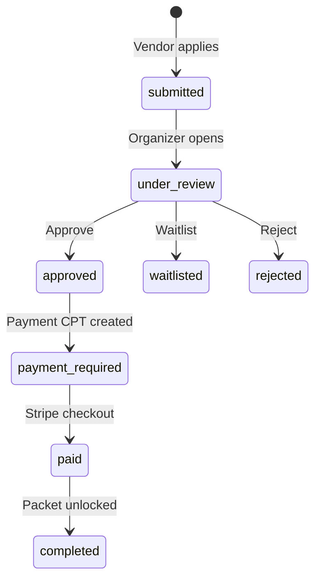

**Key hooks:**

| Hook | Fired When |
|------|-----------|
| `lnkup_application_submitted` | Vendor submits application |
| `lnkup_application_status_changed` | Any status transition |
| `lnkup_application_approved` | Organizer approves |
| `lnkup_invoice_created` | Payment CPT + invoice created |
| `lnkup_payment_completed` | Payment finalized |
| `lnkup_packet_unlocked` | Packet access granted |

**Legacy AJAX actions:** `lnkup_apply`, `lnkup_review_application`, `lnkup_create_checkout`, `lnkup_simulate_payment`, `lnkup_filter_opportunities` (public nopriv).

---

### 9.3 Financial OS & Connect Marketplace (v12.2)

**Purpose:** Production-grade financial operating system with embedded checkout, SQL ledger, and **Marketplace Treasury System** with Stripe Connect Express destination charges.

**Rule:** All financial operations route through `LNKup_Financial_Service`. UI, shortcodes, AJAX, and REST must not call Stripe directly.

#### Core financial classes

| Component | Class |
|-----------|-------|
| Service layer | `LNKup_Financial_Service` |
| Fee calculation | `LNKup_Fee_Engine` |
| Checkout wizard | `LNKup_Checkout` |
| Transactions | `LNKup_Transactions` |
| Invoices | `LNKup_Invoices` |
| Receipts | `LNKup_Receipts` |
| Vendor wallet | `LNKup_Wallet` |
| Credits | `LNKup_Credits` |
| Refunds | `LNKup_Refunds` |
| Legacy payouts | `LNKup_Payouts` |
| Disputes | `LNKup_Financial_Disputes` |
| Installments | `LNKup_Installments` |
| Deposits | `LNKup_Deposits` |
| Promo codes | `LNKup_Promo_Codes` |
| Payment methods | `LNKup_Payment_Methods` |
| Tax profiles | `LNKup_Tax_Profiles` |
| Timeline | `LNKup_Payment_Timeline` |
| Activity feed | `LNKup_Financial_Activity` |
| Audit | `LNKup_Financial_Audit` |
| Cron | `LNKup_Financial_Cron` |
| REST | `LNKup_Financial_REST` (~62 routes) |
| Render | `LNKup_Financial_Render` |
| Admin | `LNKup_Financial_Admin` |
| Connect admin | `LNKup_Financial_Connect_Admin` |

#### Treasury & Connect modules (`includes/financial/`)

| Module | Class | Responsibility |
|--------|-------|----------------|
| Stripe Connect | `LNKup_Stripe_Connect` | Express onboarding, destination charges, settlement mode |
| Organizer wallet | `LNKup_Organizer_Wallet` | Ledger mirror or treasury balances per organizer |
| Organizer payouts | `LNKup_Organizer_Payouts` | Cashout via Connect Payout API or treasury Transfer |
| Platform fees | `LNKup_Platform_Fees` | Records application fee components |
| Reserves | `LNKup_Reserves` | Hold percent of organizer net |
| Escrow | `LNKup_Escrow` | Configurable escrow holds |
| Referral credits | `LNKup_Referral_Credits` | Referral codes and rewards |
| Sponsor payments | `LNKup_Sponsor_Payments` | Sponsor invoice flows |
| Subscriptions | `LNKup_Subscriptions` | Stripe Billing subscription stubs |
| Premium listings | `LNKup_Premium_Listings` | Paid listing upgrades |
| Tax center | `LNKup_Tax_Center` | Tax document tracking and export |
| Budget center | `LNKup_Budget_Center` | Per-event budget tracking |
| Financial health | `LNKup_Financial_Health_Score` | Organizer financial health scoring |
| Approval workflows | `LNKup_Approval_Workflows` | Admin approval queue for sensitive actions |
| Refund rules | `LNKup_Refund_Rules` | Configurable refund calculation |
| Insurance marketplace | `LNKup_Insurance_Marketplace` | Placeholder offer catalog |
| Financing | `LNKup_Financing` | Placeholder offer catalog |
| Stripe client | `LNKup_Stripe_Client` | SDK wrapper, webhook verification |
| Stripe provider | `LNKup_Stripe_Provider` | PaymentIntents, Checkout Sessions |
| Manual provider | `LNKup_Manual_Provider` | Dev/test simulation |
| Webhooks | `LNKup_Stripe_Webhooks` | Idempotent event reconciliation |

#### Dual marketplace fee model (v12.1)

Vendors see a **single bundled booth reservation line** at checkout (booth price + vendor checkout fee). Platform take is via Stripe `application_fee_amount`:

| Component | Payer | Default |
|-----------|-------|---------|
| Booth price | Vendor → organizer portion | Per opportunity |
| Vendor checkout fee | Vendor | **$5.99** flat |
| Organizer commission | Organizer (from booth revenue) | **6%** of booth |

**Example ($8 booth):** bundled checkout **$13.99**; LNKup application fee **$6.47** ($5.99 + $0.48 commission); organizer net **$7.52** before reserve.

`LNKup_Fee_Engine::calculate()` is the source of truth and aligns Connect `application_fee_amount`. **Settings-first (v12.1.7+):** `vendor_checkout_fee` from LNKup Settings wins over legacy SQL flat rules; `migrate_fee_configuration()` syncs `default_fee` alias and deactivates conflicting global flat rules. `LNKup_Payments::refresh_pending_fees()` recalculates pending payment amounts at checkout open, settings save, and deferred upgrade.

#### Settlement modes

| Mode | When | Payment | Wallet | Cashout |
|------|------|---------|--------|---------|
| `destination` | Connect active + organizer ready | PI/Checkout with `application_fee_amount` + `transfer_data.destination` | Ledger tracking (`connect_settlement` entries) | Stripe Connect **Payouts** API |
| `platform_treasury` | Not onboarded / fallback enabled | Platform charge | Credits `available` / `pending` | Manual queue or Transfer when later onboarded |

#### Settlement pipeline (after `finalize_payment`)

1. `LNKup_Fee_Engine::calculate_for_payment()` — breakdown persisted on payment meta
2. `LNKup_Stripe_Connect::persist_payment_settlement_meta()` — `_lnkup_settlement_mode`
3. `LNKup_Platform_Fees::record()`
4. `LNKup_Escrow::maybe_hold()` — escrow before wallet credit when configured
5. `LNKup_Reserves::maybe_hold()`
6. `LNKup_Organizer_Wallet::credit_from_payment()` — branches on settlement mode
7. Timeline, activity, audit, transaction `settlement_mode` columns

#### Payment finalize & reconcile (v12.1.7+)

| Step | Behavior |
|------|----------|
| Checkout return | `checkout.js` handles Stripe return URL; auto-confirms after 3DS |
| Confirm endpoint | `LNKup_Financial_Service::confirm_checkout()` accepts PI `succeeded` or `processing` |
| Summary prefetch | `LNKup_Checkout` auto-confirms when summary loads and PI already paid |
| Webhook | `payment_intent.processing` and `payment_intent.succeeded` drive idempotent finalize |
| Reconcile | `reconcile_payment()` finalizes only when Stripe confirms paid; exposed via REST and **Sync payment** in Revenue tab |
| Stuck pending | Payments stay `pending` in CPT until finalize runs — gross revenue KPIs remain $0 until `paid` |

#### Organizer balance display (v12.2.2+)

Destination Connect organizers often have **$0 available** and **pending > $0** on Stripe for days after card capture — normal Connect settlement.

| Concept | Implementation |
|---------|----------------|
| `organizer_balance_payload()` | Shared PHP builder for dashboard, wallet, and slim balances route |
| `display_balances` | Merged ledger + live Stripe Connect for hero/overview |
| `stripe_balance` | Raw Connect pending/available from Stripe API |
| Wallet ledger | `connect_settlement` entries mirror destination charges |

`LNKup_Organizer_Wallet::get_balances()` shows Connect settlement as **pending** in destination mode when appropriate.

**Provider selection:**

| Provider | When Used |
|----------|-----------|
| `LNKup_Stripe_Provider` | Default when Stripe keys configured |
| `LNKup_Manual_Provider` | `payment_provider=manual` or missing keys |

**SQL tables — core financial (24):** `lnkup_transactions`, `lnkup_invoices`, `lnkup_invoice_items`, `lnkup_installment_plans`, `lnkup_installments`, `lnkup_deposits`, `lnkup_payment_methods`, `lnkup_wallets`, `lnkup_wallet_entries`, `lnkup_credits`, `lnkup_refunds`, `lnkup_payouts`, `lnkup_disputes`, `lnkup_receipts`, `lnkup_promo_codes`, `lnkup_promo_redemptions`, `lnkup_tax_profiles`, `lnkup_financial_audit`, `lnkup_fraud_flags`, `lnkup_webhook_events`, `lnkup_connected_accounts`, `lnkup_payment_timeline`, `lnkup_financial_activity`, `lnkup_fee_rules`

**SQL tables — treasury (20+):** `lnkup_organizer_wallets`, `lnkup_organizer_wallet_entries`, `lnkup_organizer_payout_accounts`, `lnkup_organizer_payouts`, `lnkup_platform_fees`, `lnkup_escrow_holds`, `lnkup_reserve_holds`, `lnkup_referral_codes`, `lnkup_referrals`, `lnkup_referral_rewards`, `lnkup_credit_rules`, `lnkup_sponsor_invoices`, `lnkup_sponsor_payments`, `lnkup_subscription_plans`, `lnkup_subscriptions`, `lnkup_premium_listings`, `lnkup_tax_documents`, `lnkup_tax_exports`, `lnkup_financial_reports`, `lnkup_event_budgets`, `lnkup_event_budget_items`, `lnkup_cashflow_forecasts`, `lnkup_financing_offers`, `lnkup_insurance_offers`, `lnkup_financial_approvals`, `lnkup_refund_rules`, `lnkup_financial_health_scores`

Treasury tables created via `LNKup_Treasury_Tables::create_tables()` called from `LNKup_Financial_Tables::create_tables()`.

**Connect REST routes:**

| Method | Route | Purpose |
|--------|-------|---------|
| GET | `/financial/connect/status` | Requirements, badges, `settlement_mode` |
| POST | `/financial/connect/onboarding-link` | Express onboarding URL |
| POST | `/financial/connect/refresh` | Sync account from Stripe |
| POST | `/financial/connect/deauthorize` | Disable local Connect row |
| GET | `/financial/organizer-balances` | **Slim** `organizer_balance_payload()` — hero/overview (v12.2.3) |
| GET | `/financial/organizer-wallet` | Wallet balances, entries, `display_balances`, `stripe_balance` |
| POST | `/financial/organizer-wallet/cashout` | Request cashout |
| GET | `/financial/organizer-payouts` | Payout history |
| POST | `/financial/organizer-payouts/{id}/cancel` | Cancel pending payout |
| GET | `/financial/dashboard` | Revenue KPIs, reports — balances always attached; reconcile **not** on hot path (v12.2.3) |
| POST | `/financial/payments/{id}/reconcile` | Sync stuck pending payment with Stripe PI |

Additional v12.1+ REST: `/financial/summary`, `/financial/referrals`, `/financial/sponsor-invoices`, `/financial/subscriptions`, `/financial/premium-listings`, `/financial/events/{id}/budget`, `/financial/forecast`, `/financial/tax-center`, `/financial/approvals`, `/financial/insurance-offers`, `/financial/financing-offers`, `/financial/refunds/calculate`.

**REST hardening (v12.2.3):** `sanitize_rest_data()` for UTF-8-safe JSON; try/catch around report/payout layers; health score avoids full `organizer_report()` recursion.

**Frontend assets:** `checkout.js`, `checkout.css`, `financial.js`, `financial.css`

**Vendor UI:** `?view=payments` — financial REST honors `?role=vendor` for dual-role users; 4-section nav (Pay / Wallet / Extras / Reports)  
**Organizer UI:** `#financial` panel — Connect banner (`#lnkup-fin-connect-banner`), wallet-first balance load (`fetchOrganizerMoneyBalances()` → `/organizer-balances` with wallet fallback), optional `/dashboard` for revenue KPIs; handles `?connect=return` and `?connect=refresh`; Overview warning when balances load but dashboard fails  
**Admin UI:** LNKup → Financial Center; **LNKup → Stripe Connect** (organizer Connect stats, webhook health)

See also: [FINANCIAL.md](../wp-content/plugins/lnkup-marketplace/FINANCIAL.md)

---

### 9.4 Organizer CRM

**Purpose:** Organizer-side vendor relationship management — directory, notes, tags, lists, flags, invites, roster, readiness.

| Component | Class |
|-----------|-------|
| Core CRM | `LNKup_Organizer_CRM` |
| Directory | `LNKup_Vendor_Directory` |
| Notes | `LNKup_Vendor_Notes` |
| Tags | `LNKup_Vendor_Tags` |
| Lists | `LNKup_Vendor_Lists` |
| Flags | `LNKup_Vendor_Flags` |
| Invites | `LNKup_Vendor_Invites` |
| Roster | `LNKup_Event_Roster` |
| Profile | `LNKup_Vendor_CRM_Profile` |
| Readiness | `LNKup_Vendor_Readiness` |
| Import | `LNKup_Vendor_Import` |
| Timeline | `LNKup_Vendor_Timeline` |
| REST | `LNKup_Organizer_CRM_REST` |
| Admin | `LNKup_Organizer_CRM_Admin` |

**SQL tables:** `lnkup_organizer_vendor_rel`, `lnkup_vendor_list_item`, `lnkup_organizer_vendor_tag`, `lnkup_crm_activity`, `lnkup_crm_import_job`, `lnkup_organizer_vendor_prospect`, `lnkup_vendor_list_prospect`

**Invite types:**

| Type | Storage | Recipient | Use case |
|------|---------|-----------|----------|
| **Vendor invite (CPT)** | `lnkup_vendor_invite` | Existing vendor user | Organizer invites registered vendor to apply/rebook for an event |
| **Bulk email outreach** | `lnkup_outreach_*` SQL (see §9.11) | Prospect email (may not have account) | Mass invite by email with tracked sign-up link |

**REST prefix:** `/crm/*` (~24 routes) — vendors, notes, tags, lists, invites, **outreach bulk/list**, roster, dashboard widgets, application intel.

| Method | Route | Purpose |
|--------|-------|---------|
| POST | `/crm/outreach/bulk` | Create campaign, import emails, queue send |
| GET | `/crm/outreach/list` | Organizer campaign stats (no public recipient emails) |
| POST/GET | `/crm/import/*` | CSV template, upload, preview, run, status (v12.6) |
| GET | `/crm/prospects` | Imported prospect directory scope |

**Frontend:** `organizer-crm.js`, `organizer-crm.css`, `vendor-import.js` — Vendor Invites panel includes **Bulk invite by email** expand section and outreach campaign progress cards. **Import vendors** 4-step wizard (upload → map → preview → run).

**Organizer dashboard CRM UI (v12.11):** Command center executive hero with launch checklist ring; 10 KPI stat cards with `animateKpiCards`; payout strip; quick-action row; apps snapshot; activity feed from widgets REST; readiness mini-cards; secondary module cards (Discover, Lists, Invites, Intelligence) with inline expand panels via `organizer-command.js`. Discover directory supports verified-only filter. CRM intel profile uses grouped timeline and premium metrics row.

---

### 9.5 Reputation

**Purpose:** Post-event vendor reviews, badges, reliability metrics, and public reputation profiles.

> **Phase 27 (Vendor Passport & Reputation OS):** the 0–100 score is now staff-only (admin + internal ranking). Public and organizer surfaces use `LNKup_Reputation_Summary` indicators (verification, experience, organizer feedback with review minimums, document readiness). Reviews gained an atomic `lnkup_review_index`, eligibility rules, vendor responses, moderation decisions and one appeal; participation comes from `LNKup_Participation_History` (evidence-based). See [PHASE_27_VENDOR_PASSPORT.md](PHASE_27_VENDOR_PASSPORT.md).

| Component | Class |
|-----------|-------|
| Reputation core | `LNKup_Vendor_Reputation` |
| Score engine | `LNKup_Reputation_Score` |
| Reliability | `LNKup_Reliability_Metrics` |
| Reviews | `LNKup_Vendor_Reviews` |
| Badges | `LNKup_Vendor_Badges` |
| Completed events | `LNKup_Completed_Events` |
| REST | `LNKup_Reputation_REST` |
| Render | `LNKup_Reputation_Render` |
| Admin | `LNKup_Reputation_Admin` |

**SQL tables:** `lnkup_vendor_badges`, `lnkup_reputation_activity`, `lnkup_reputation_snapshots`

**REST prefix:** `/reputation/*` — vendor profiles, reviews CRUD, summary, public slug, review eligibility.

**Frontend:** `reputation.js`, `reputation.css`

---

### 9.6 Event Operations (Day-of)

**Purpose:** Event-day command center — lifecycle stages, booths, parking, load-in, check-ins, incidents, broadcasts, staff.

| Component | Class |
|-----------|-------|
| Lifecycle | `LNKup_Event_Lifecycle` |
| Operations hub | `LNKup_Event_Operations` |
| Booths | `LNKup_Booths` |
| Parking | `LNKup_Parking` |
| Load-in | `LNKup_Loadin_Schedule` |
| Check-ins | `LNKup_Checkins` |
| Support | `LNKup_Support_Requests` |
| Incidents | `LNKup_Incidents` |
| Broadcasts | `LNKup_Broadcasts` |
| Staff | `LNKup_Event_Staff` |
| Analytics | `LNKup_Ops_Analytics` |
| Log | `LNKup_Operations_Log` |
| REST | `LNKup_Operations_REST` |
| Render | `LNKup_Operations_Render` |
| Admin | `LNKup_Operations_Admin` |

**14 lifecycle stages:**

`planning` → `applications_open` → `applications_closed` → `approvals` → `payments` → `vendor_packets_released` → `load_in` → `check_in` → `setup` → `live_event` → `breakdown` → `load_out` → `reviews` → `archived`

Auto-advance: when application status becomes `paid`, stage jumps to `vendor_packets_released`.

**SQL tables:** `lnkup_booths`, `lnkup_parking`, `lnkup_loadin_windows`, `lnkup_loadin_assignments`, `lnkup_checkins`, `lnkup_support_requests`, `lnkup_incidents`, `lnkup_operations_log`, `lnkup_event_staff`, `lnkup_packet_engagement`, `lnkup_broadcasts`

**REST prefix:** `/operations/*` (~24 routes)

**Frontend:** `operations.js`, `operations.css`

**Vendor readiness (v2):** `LNKup_Vendor_Readiness::checklist()` returns weighted percent, tier (`ready` / `on_track` / `at_risk`), grouped items (Application, Documents, Logistics, Day-of), and `next_action` CTA. Document checklist items are built from `default_documents` settings only. Organizer event summary via `event_readiness_summary()` powers the command center **Readiness** tab and portfolio KPI (avg checklist % across approved vendors).

**Vendor operations hub** (`?view=operations`): Overview (next steps, packet status), Packet (sidebar nav), Readiness (SVG ring + grouped checklist), Venue map, Support (history + new request). REST: `GET /operations/applications/{id}/support`, `GET /operations/vendor-home?application_id=`.

**Organizer command center (v12.1.6):** Five grouped section pills — **Command**, **Logistics**, **Maps**, **Field**, **Intel** — with sticky sub-tabs and `ops_tab` deep-link restore. Overview consolidates compliance alerts and live feed; logistics snapshot stats and quick jumps. Unified skeleton/empty/error per REST tab; `lnkup-ops-panel-open` event coordinates Financial/Insights/Maps lazy load.

**Event bootstrap (v12.1.5):** `bootstrap_from_event()` on create + first command-center load; `GET /operations/events/{id}/defaults` for slide-over forms (no `window.prompt`).

---

### 9.6.1 Event Weather Intelligence

**Purpose:** Operational weather readiness for organizers and vendors — forecast modes by days-to-event, risk scoring, planning recommendations, and snapshot history. Provider: **OpenWeather** behind `LNKup_Weather_Provider_Interface`.

| Component | Class |
|-----------|-------|
| Service | `LNKup_Weather_Service` |
| Provider interface | `LNKup_Weather_Provider_Interface` |
| OpenWeather client | `LNKup_Weather_Provider_OpenWeather` |
| Risk engine | `LNKup_Weather_Risk_Engine` |
| Snapshots | `LNKup_Weather_Tables` |
| REST | `LNKup_Weather_REST` |
| Cron | `LNKup_Weather_Cron` |
| Render | `LNKup_Weather_Render` |

**Modes:** `live_forecast` (0–7 days), `extended_forecast` (8–16), `historical_risk` (17+), `unavailable` (missing key/location/date).

**SQL table:** `lnkup_weather_snapshots`

**REST prefix:** `/weather/*` — `GET /weather/event/{id}`, `POST /weather/event/{id}/refresh`, `GET /weather/event/{id}/history`, `GET /weather/portfolio`, `GET /weather/admin/status`

**Settings:** LNKup → Settings → Weather Intelligence (`openweather_api_key`, units, cache TTL, historical toggle, vendor packet note).

**UI surfaces:** Organizer one-page Weather Readiness card; Event Operations overview + Insights tab; Event Intelligence DTO; optional vendor packet note.

**Frontend:** `weather.js`, `weather.css`

**Cron:** `lnkup_weather_daily` — refreshes events within 14 days.

---

### 9.7 Intelligence (Organizer Analytics)

**Purpose:** Event health scoring, funnel analytics, risk detection, recommended actions, post-event reports, market trends.

| Component | Class |
|-----------|-------|
| Event score | `LNKup_Event_Score` |
| Opportunity score | `LNKup_Opportunity_Score` |
| Funnels | `LNKup_Funnel_Analytics` |
| Market trends | `LNKup_Market_Trends` |
| Revenue intel | `LNKup_Revenue_Intelligence` |
| Vendor reliability | `LNKup_Vendor_Reliability_Intel` |
| Risk engine | `LNKup_Risk_Engine` |
| Actions | `LNKup_Recommended_Actions` |
| Post-event report | `LNKup_Post_Event_Report` |
| Organizer intel | `LNKup_Organizer_Intelligence` |
| Vendor intel | `LNKup_Vendor_Intelligence` |
| Cron | `LNKup_Intelligence_Cron` |
| REST | `LNKup_Intelligence_REST` |
| Admin | `LNKup_Intelligence_Admin` |

**SQL tables:** `lnkup_metric_snapshots`, `lnkup_event_scores`, `lnkup_opportunity_scores`, `lnkup_market_trends`, `lnkup_event_risks`, `lnkup_recommended_actions`, `lnkup_post_event_reports`

**REST prefix:** `/intelligence/*` (~20 routes)

**Organizer dashboard intelligence (v12.11):**

| Layer | Implementation |
|-------|----------------|
| Compact summary | SSR in `#lnkup-organizer-intel-summary` via `render_organizer_intel_summary_ssr()` — compliance ring score, health label, top recommended action |
| Expand trigger | `data-expand-panel="intelligence"` button + `#intelligence` hash deep link |
| Full dashboard | `#lnkup-organizer-intelligence` hydrated by `intelligence.js` → `GET /intelligence/dashboard` (8s timeout, AJAX fallback `lnkup_event_intelligence`) |
| Load hooks | `lnkup-intel-expand` event; `MutationObserver` on `#lnkup-organizer-expand-intelligence`; `window.lnkupLoadOrganizerDashboard(true)` |

**v12.11 fix:** Removed duplicate executive hero inside intelligence expand panel (was showing portfolio score `—` alongside SSR summary). Event card v4 media column no longer uses desktop `aspect-ratio: 16/10` (conflicted with 10rem horizontal sidebar grid).

**Frontend:** `intelligence.js`, `intelligence.css`

---

### 9.8 Interactive Maps

**Purpose:** Per-event interactive venue maps with booth zones, routes, parking, templates, and shareable tokens.

| Component | Class |
|-----------|-------|
| Maps core | `LNKup_Maps` |
| Elements | `LNKup_Map_Elements` |
| Parking zones | `LNKup_Parking_Zones` |
| Routes | `LNKup_Map_Routes` |
| Templates | `LNKup_Map_Templates` |
| Sharing | `LNKup_Map_Sharing` |
| Insights | `LNKup_Map_Insights` |
| Provider abstraction | `LNKup_Map_Provider` |
| Leaflet provider | `LNKup_Map_Provider_Leaflet` |
| Static provider | `LNKup_Map_Provider_Static` |
| REST | `LNKup_Map_REST` |
| Admin | `LNKup_Map_Admin` |

**SQL tables:** `lnkup_geocode_cache`, `lnkup_maps`, `lnkup_map_elements`, `lnkup_parking_zones`, `lnkup_map_routes`, `lnkup_map_templates`, `lnkup_map_shares`

**REST prefix:** `/maps/*` (~20 routes) — discovery pins, event maps, elements, layers, routes, templates, packet view, share tokens, geocode.

**Frontend:** `maps.js`, `maps.css`

---

### 9.9 Vendor Growth Platform (v10)

**Purpose:** Vendor success dashboard — KPIs, revenue analytics, match scores, goals, benchmarks, ROI, profile strength, recommendations.

| Component | Class |
|-----------|-------|
| Growth hub | `LNKup_Growth` |
| KPIs | `LNKup_Growth_Kpis` |
| Snapshots | `LNKup_Growth_Snapshots` |
| Analytics | `LNKup_Growth_Analytics` |
| Match scores | `LNKup_Growth_Match` |
| Profile strength | `LNKup_Growth_Profile_Strength` |
| Goals | `LNKup_Growth_Goals` |
| Recommendations | `LNKup_Growth_Recommendations` |
| Benchmarks | `LNKup_Growth_Benchmarks` |
| ROI | `LNKup_Growth_Roi` |
| Relationships | `LNKup_Growth_Relationships` |
| Journey | `LNKup_Growth_Journey` |
| Calendar | `LNKup_Growth_Calendar` |
| Achievements | `LNKup_Growth_Achievements` |
| Exports | `LNKup_Growth_Exports` |
| Cron | `LNKup_Growth_Cron` |
| REST | `LNKup_Growth_REST` |
| Admin | `LNKup_Growth_Admin` |

**SQL tables:** `lnkup_growth_snapshots`, `lnkup_marketplace_benchmarks`, `lnkup_vendor_goals`, `lnkup_vendor_roi`, `lnkup_vendor_profit_estimates`, `lnkup_vendor_milestones`, `lnkup_vendor_recommendations`

**REST prefix:** `/growth/*` (26 routes)

**Vendor UI:** `?view=growth` in vendor dashboard  
**Admin UI:** LNKup → Growth Center (marketplace aggregates only; no private vendor data)

**Frontend:** `growth.js`, `growth.css`

---

### 9.10 Admin, Shortcodes & Legacy AJAX

**Admin menu (`LNKup_Admin`):**

| Page | Capability | Content |
|------|-----------|---------|
| LNKup (top-level) | `lnkup_manage_all` | Platform stats: vendors, organizers, events, applications, GMV |
| Settings | `lnkup_manage_settings` | Fees, Stripe, Connect, escrow/reserve, notifications, weather, **outreach throttling**, map provider |
| Financial Center | `lnkup_manage_marketplace_financials` | Marketplace financial aggregates |
| Stripe Connect | `lnkup_manage_marketplace_financials` | Connect organizer counts, platform fees, webhook health |
| Growth Center | `lnkup_manage_marketplace_growth` | Growth aggregates |
| Outreach | `lnkup_manage_all` | Mass email campaigns, rate-limit status, recipient drill-down |
| Feature admin pages | varies | CRM, reputation, operations, intelligence, maps, verification, connectors, city markets |

**Shortcodes (13):**

| Shortcode | Purpose |
|-----------|---------|
| `[lnkup_vendor_dashboard]` | Vendor overview + tabbed views |
| `[lnkup_organizer_dashboard]` | Organizer command center + section panels |
| `[lnkup_opportunities_feed]` | Public Find Events marketplace |
| `[lnkup_vendor_profile_form]` | Vendor business profile CRUD |
| `[lnkup_organizer_events]` | Event list + opportunity creation |
| `[lnkup_applications_manager]` | Application review |
| `[lnkup_documents_manager]` | Document uploads |
| `[lnkup_payments_dashboard]` | Payment history + checkout entry |
| `[lnkup_favorites]` | Vendor favorites + saved searches |
| `[lnkup_vendor_public_profile]` | Public vendor storefront |
| `[lnkup_connector_dashboard]` | City Connector dashboard (v12.8) |
| `[lnkup_connector_interest_form]` | Connector interest form |
| `[lnkup_register_form]` | Branded sign-up with vendor/organizer role toggle; outreach token prefill |

**Legacy AJAX (logged-in unless noted):**

| Action | Purpose |
|--------|---------|
| `lnkup_apply` | Submit application |
| `lnkup_save_profile` | Create/update vendor profile |
| `lnkup_upload_document` | Upload compliance document |
| `lnkup_review_application` | Approve/waitlist/reject |
| `lnkup_create_event` | Create event |
| `lnkup_create_opportunity` | Create opportunity |
| `lnkup_download_document` | Secure document download |
| `lnkup_export_vendors` | CSV export |
| `lnkup_create_checkout` | Start checkout (legacy) |
| `lnkup_simulate_payment` | Test-mode payment completion |
| `lnkup_filter_opportunities` | Filter feed (also `nopriv`) |
| `lnkup_event_intelligence` | Intelligence data fetch |

---

### 9.11 Platform Outreach (v12.3)

**Purpose:** Mass invite prospects by email for pre-launch vendor/organizer acquisition. Uses SQL queue + WP-Cron batch `wp_mail` — separate from `lnkup_vendor_invite` CPT (registered-vendor event invites).

| Component | Class / file |
|-----------|--------------|
| Tables | `LNKup_Outreach_Tables` |
| Service | `LNKup_Outreach` |
| Cron | `LNKup_Outreach_Cron` — hook `lnkup_outreach_process_queue` |
| Admin UI | `LNKup_Outreach_Admin` — **LNKup → Outreach** |
| Email | `LNKup_Notifications::send_platform_outreach()` |
| Registration | `LNKup_Registration` — `/sign-up/?outreach={token}&role=vendor` |

**SQL tables:**

| Table | Key columns |
|-------|-------------|
| `lnkup_outreach_campaigns` | `name`, `target_role` (`lnkup_vendor` / `lnkup_organizer`), `message`, `source` (`admin` / `organizer`), `event_id`, `opportunity_id`, `status`, counters (`total`, `sent`, `skipped`, `failed`, `registered`) |
| `lnkup_outreach_recipients` | `campaign_id`, `email`, `name`, `token`, `status` (`pending` → `sent` → `opened` → `registered`), `sent_at`, `opened_at`, `registered_at` |

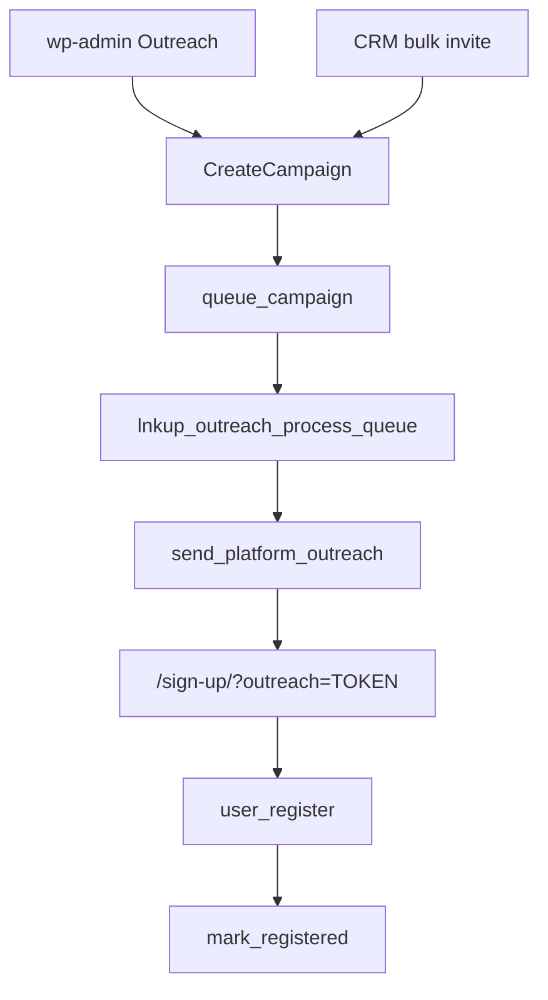

**Handoff:** If recipient email already exists as a vendor and organizer campaign has `event_id`, `LNKup_Vendor_Invites::create()` fires instead of sign-up email.

**SMTP throttling (v12.3.1):** Transient counters `lnkup_outreach_sent_hour_*` and `lnkup_outreach_sent_day_*`. Defaults: 600/hr, 1500/day, batch 20 every 180s, auto-resume at `outreach_resume_time` (08:00 site time). Transactional `wp_mail` is **not** throttled. Configure under **LNKup → Settings → Outreach throttling**.

**Limits:** Admin 500 recipients/campaign; organizer 100; token TTL 30 days.

---

### 9.12 SEO & Prelaunch (v12.2.4–12.2.5)

**SEO (`LNKup_SEO` in `includes/class-seo.php`):**

- **Rank Math not bundled** — install via wp-admin on each environment
- Filters when active: title, meta description, Open Graph, robots, JSON-LD schema (`Event`, `LocalBusiness`), sitemap exclusions for private CPTs and dashboard pages
- Default OG image from theme illustrated assets (`block-party.svg`)
- `lnkup_opportunity_illustration_url()` — SVG fallbacks on opportunity cards when no featured image

**Prelaunch / launch (plugin settings + theme landing):**

| Setting | Default | Purpose |
|---------|---------|---------|
| `platform_launch_date` | `2026-08-02` | Public marketplace open date |
| `platform_prelaunch_mode` | `false` | Gate Find Events; show launch UI when true |
| `app_release_datetime` | `2026-08-16 12:00:00` | Mobile app release wall time |
| `app_release_tz` | `America/New_York` | App release timezone (homepage bar) |
| `launch_goal_vendors` | `4000` | Homepage goal card (not a fake live count) |
| `launch_goal_organizers` | `500` | Homepage goal card |

Helpers: `lnkup_is_marketplace_open()`, `lnkup_get_launch_goals()`, `lnkup_get_marketplace_public_stats()`, `lnkup_get_app_release_datetime()`, `lnkup_is_app_released()`, `lnkup_get_app_release_label()` — post-launch trust section switches to real aggregates; app bar hides after app release.

**Theme landing (v1.4.x):** Illustrated event SVGs (`assets/images/events/*.svg`), hero canvas/orbs/floaters, category icons (`inc/landing-icons.php`), parallax (`assets/js/landing.js`), cache-busted assets via `lnkup_theme_asset()` in `inc/template-tags.php`. Template parts: `template-parts/landing/hero.php`, `trust.php`, `categories.php`. Shared dashboard components in `assets/dist/components.css` — compliance ring, executive hero, filter bar blur, empty-state icon, organizer section rhythm (v12.9–12.11).

---

### 9.13 Trust & Verification (v12.4)

**Purpose:** Context-aware trust levels for vendors and organizers — document requirements, badge aggregation, admin verification queue.

> **Phase 27:** vendor verification decisions are append-only `lnkup_vendor_verification` records (types, provenance, expiry, revocation) mirrored to `_lnkup_verification_status`; documents are versioned, reusable per event (suggestions only) and shared with organizers only by explicit per-application consent through signed, short-lived downloads (`LNKup_Document_Vault`). Expired or pending documents never count as "ready". See [PHASE_27_VENDOR_PASSPORT.md](PHASE_27_VENDOR_PASSPORT.md).

| Component | Class |
|-----------|-------|
| Verification service | `LNKup_Verification` |
| REST | `LNKup_Verification_REST` |
| Admin | `LNKup_Verification_Admin` |

**REST prefix:** `/verification/*` — vendor/organizer self + scoped reads, admin manual override.

**Document modes on opportunities:** `none` (default), platform defaults, or custom required documents via `_lnkup_document_mode`.

**UI:** Vendor home trust card; organizer trust strip; application review badges; opportunity card organizer trust chips.

---

### 9.14 Saved Searches & Opportunity Alerts (v12.5)

**Purpose:** Vendors save Find Events filter combinations and receive digest or instant email alerts.

| Component | Class |
|-----------|-------|
| Service | `LNKup_Saved_Searches` |
| Storage | User meta `lnkup_saved_searches` |
| REST | Routes under `/marketplace/saved-searches` |
| Cron | `lnkup_marketplace_daily` — daily/weekly digests, instant on publish, 48h/24h deadline reminders |

**Frontend:** Save-search modal on Find Events (`saved-searches.js`); Saved Searches section on Favorites page.

---

### 9.15 Organizer Vendor CSV Import (v12.6)

**Purpose:** Organizers import prospect vendors from CSV — map columns, preview duplicates, stage prospects, optionally add to lists and send invites.

| Component | Class |
|-----------|-------|
| Import service | `LNKup_Vendor_Import` |
| Tables | `LNKup_Vendor_Import_Tables` |
| REST | `/crm/import/*` on `LNKup_Organizer_CRM_REST` |

**SQL tables:** `lnkup_crm_import_job`, `lnkup_organizer_vendor_prospect`, `lnkup_vendor_list_prospect`

**Handoff:** When imported prospect registers, `LNKup_Outreach::mark_registered()` links prospect → CRM relationship and migrates list membership.

**Admin settings:** `crm_import_max_rows_organizer`, `crm_import_max_file_size_mb`, `crm_import_allow_invite`.

---

### 9.16 City Market Landing Pages (v12.7)

**Purpose:** SEO city landing pages with live marketplace stats and discovery cross-links.

| Component | Class / path |
|-----------|--------------|
| Registry | `LNKup_Market_Pages` — option-backed city registry (10 launch cities) |
| Rewrite | `/markets/{slug}/` |
| Theme | `page-templates/market-landing.php`, `template-parts/market/*` |
| Admin | LNKup → City Markets |

**Registration attribution:** `?market=` + `?interest=connector` → user meta `_lnkup_market_interest`, `_lnkup_signup_source`, `_lnkup_signup_city_page`.

**SEO:** Rank Math title/description, robots, OG image, canonical, JSON-LD WebPage/ItemList, sitemap URLs per market.

---

### 9.17 City Connector Program (v12.8)

**Purpose:** Local ambassadors refer vendors and organizers; manual reward workflow with optional platform credit mode.

| Component | Class |
|-----------|-------|
| Core | `LNKup_Connector` |
| Attribution | `LNKup_Connector_Attribution` — cookie `lnkup_connector_ref` |
| Tracking | `LNKup_Connector_Tracking` |
| Rewards | `LNKup_Connector_Rewards` |
| Ranks | `LNKup_Connector_Ranks` — cached metrics, booking attribution ledger, bonuses |
| Studio | `LNKup_Connector_Studio` — templates + submissions CPTs, weekly mission, content analytics |
| REST | `LNKup_Connector_REST` |
| Admin | `LNKup_Connector_Admin`, `LNKup_Connector_Content_Admin` |

**SQL tables:** `lnkup_connectors`, `lnkup_connector_events`, `lnkup_connector_booking_attr`; treasury `lnkup_referral_*` extended with `program=city_connector` and `idempotency_key`.

**Role:** `lnkup_connector` — dashboard at `/connector-dashboard/` via `[lnkup_connector_dashboard]`; interest form at `/connector-interest/` via `[lnkup_connector_interest_form]`.

**Command center (v12.18.34):** SPA `?view=` routing in `connector.js`; mobile bottom nav (Home / Referrals / Share sheet / Earnings / More); backend `next_best_action()` on `GET /connector/dashboard`; optional `bio` on `lnkup_connectors`. Attribution, tracking, and the GMV reward engine are unchanged.

**Ranks (v12.18.35):** `city_connector` → `market_builder` → `city_captain` → `city_director` → `regional_partner`. Cannot skip. Rank never auto-decreases except admin `override_rank()`. Founding City Partner is a separate badge, not a rank. Qualifying bookings use booth GMV (`_lnkup_vendor_spot_fee`, fallback `_lnkup_vendor_fee`) after the payout hold; refunds, disputes, chargebacks, and test/`sim_` payments do not count. Activated organizer = attributed + verified + published opportunity + ≥3 qualifying bookings. Recurring = activated + bookings on ≥2 opportunities. Rank bonuses insert as `event_type=connector_rank_bonus_{key}` and stay pending until admin approval. Dashboard reads cached columns (`GET /connector/rank`); recalc runs from hooks and `lnkup_marketplace_daily`. Commission stays the configured GMV share (default 10%). **Rank 1 onboarding (v12.18.36)** is Phase 1 complete only — Promote and Activate steps are not required.

**Launch plan + Content Studio (v12.18.36 / UI v12.18.37):** `GET /connector/onboarding` returns `phases[]`, `current_action`, `growth_styles`. Growth styles persist on `lnkup_connectors.growth_styles`. Content Studio uses CPTs `lnkup_cn_template` / `lnkup_cn_post` (no new ledger). REST: `GET /connector/studio`, `GET /connector/studio/templates/{id}`, `POST /connector/studio/posts`, `GET /connector/studio/analytics`. Optional `cc=` on referral URLs is stored on `content_click` metadata only. A published video never inserts a reward. Admin: LNKup → Connector Content. Mobile bottom nav Create opens `?view=studio`; the share sheet stays on Home / Get Started / sticky CTA. Studio publish form stores `instagram` / `tiktok` / `linkedin` / `facebook` (never `instagram_reels`); LinkedIn hosts are allowlisted; YouTube stays allowed on the server only.

**Attribution:** Parallel with outreach tokens; vendor `LNKup_Referral_Credits` unchanged for vendor program codes.

---

### 9.18 External Event Discovery (v12.12 — Phase 13A)

**Purpose:** Surface admin-imported unclaimed public event listings (Eventbrite-style) in Find Events without presenting them as official LNK vendor opportunities until an organizer claims the event.

| Component | Class / path |
|-----------|----------------|
| Tables | `LNKup_External_Events_Tables` — `lnkup_external_events`, `lnkup_external_event_interest`, `lnkup_external_event_claim_tokens` |
| Service | `LNKup_External_Events` |
| Import | `LNKup_External_Events_Import` |
| REST | `LNKup_External_Events_REST` |
| Admin | `LNKup_External_Events_Admin` |
| Feed UI | `lnkup_render_external_event_card()`, `lnkup_merge_marketplace_feed()` in `helpers.php` |
| Frontend | `public/js/external-events.js`, `public/css/external-events.css` |

**Feed behavior:** On page 1, up to 6 unclaimed external cards merge with official opportunities sorted by event date. Opportunity-only filters (fee, spots, docs, compare) exclude external rows. Cards use `.lnkup-event-card--external` with legal disclaimer footer.

**Vendor interest:** Modal POST `POST /external-events/{id}/interest` → email organizer with claim link `/sign-up/?role=organizer&claim_external_event={token}`.

**Organizer claim:** Sign-up or logged-in organizer completes `POST /external-events/{id}/claim` → creates `lnkup_event` CPT with `_lnkup_external_event_id` meta; pending vendor interests shown in organizer dashboard applications panel.

**REST routes (namespace `lnkup/v1`):** `GET external-events/search`, `GET external-events/{id}`, `POST external-events/{id}/interest`, `POST external-events/{id}/claim`, `GET external-events/organizer/pending-interests`, `POST external-events/admin/import|hide|unhide`, `POST external-events/track/view`.

---

### 9.19 External Event Demand Engine (v12.13 — Phase 13B)

**Purpose:** Convert unclaimed external listings into organizer demand signals — weighted scores, threshold emails, premium claim landing, admin review/import, and dedup — without replacing Phase 13A APIs.

| Component | Class / path |
|-----------|----------------|
| Demand | `LNKup_External_Events_Demand`, `LNKup_External_Events_Demand_Score` |
| Follow-up | `LNKup_External_Events_Followup`, `LNKup_External_Events_Cron` |
| Timeline | `LNKup_External_Events_Timeline` |
| Dedup | `LNKup_External_Events_Dedup` |
| Analytics | `LNKup_External_Events_Analytics` |
| Sources | `includes/external-sources/*` (manual, csv, Eventbrite, Posh, RSS) |
| Claim LP | `[lnkup_external_claim_landing]` at `/claim-event/` |

**Workflow:** `workflow_status` (`pending_review`, `published`, `hidden`, `rejected`) gates feed visibility alongside `claim_status=unclaimed`. Public feed filter: `workflow_status=published`.

**Follow-ups:** Threshold emails at 1/3/5/10 vendor interests; open/click tracking via `?ext_track=open|click&token=`. Claim CTA → `/claim-event/?token=`.

**Additional REST:** `GET external-events/dashboard`, `GET external-events/demand`, `POST external-events/import-url`, `POST external-events/organizer/import-url` (Create Event preview), `POST external-events/{id}/merge`, `GET external-events/{id}/timeline`, `GET external-events/{id}/recommendations`, `POST external-events/{id}/publish|reject|notify`.

### 9.20 Organizer Acquisition OS (v12.25 — Phases 0–3)

**Purpose:** Turn organizer prospects into active organizers with verified paid bookings. wp-admin → LNKup → **Organizer Growth** (`lnkup-organizer-growth`), capability `lnkup_manage_organizer_growth`, flags `organizer_growth_enabled` / `organizer_growth_outreach_enabled` (option `lnkup_org_growth_settings`, both off by default). Full audit, routes, tests and deployment notes: [ORGANIZER_ACQUISITION_AUDIT.md](ORGANIZER_ACQUISITION_AUDIT.md).

| Component | Class / path |
|-----------|----------------|
| Tables | `LNKup_Org_Growth_Tables` — `lnkup_org_leads` (one row per organization), `_lead_events`, `_lead_accounts` (lead ↔ organizer users), `_lead_activity`, `_lead_tasks`, `_lead_tags`, `_lead_saved_views`, `_lead_imports`, `_lead_import_rows`, `_lead_milestones`, `lnkup_org_partners`, `lnkup_org_outreach_templates`, `lnkup_contact_suppression` |
| Leads / pipeline | `LNKup_Org_Leads`, `LNKup_Org_Lead_Pipeline` (17 stages + 6 outcomes; stages from First Event Published on are milestone-only) |
| Dedupe | `LNKup_Org_Lead_Dedupe` (email / business domain / Instagram / linked account = hard; similar name = review flag; manual merge) |
| Import | `LNKup_Org_Lead_Import` (CSV/TSV, mapping, dry run, WP-Cron batches, rollback) |
| Scoring | `LNKup_Org_Lead_Scoring` (explainable, weights in `lnkup_org_lead_scoring_weights`) |
| Lifecycle | `LNKup_Org_Lead_Lifecycle` — links accounts (outreach token → referral code → verified email; domain = suggestion) and records milestones from `lnkup_event_first_live`, `lnkup_application_submitted`, `lnkup_payment_completed`, refund reversals |
| Outreach | `LNKup_Org_Outreach` on top of `LNKup_Outreach` (campaign source `growth`), `LNKup_Contact_Suppression` |
| Metrics | `LNKup_Org_Growth_Metrics` (house vs independent, net platform fees via `LNKup_Platform_Fees::sum_net_platform_fees()`) |
| REST / UI | `LNKup_Org_Growth_REST` (`lnkup/v1/growth/*`), `LNKup_Organizer_Growth_Admin`, `admin/js/organizer-growth.js` |

**New hooks:** `lnkup_event_first_live( $event_id, $organizer_id )` (once per event, from `_lnkup_event_status` → `live`), `lnkup_payment_refund_synced( $payment_id, $returned_cents, $is_full )` (every refund path, once per increase), `lnkup_payment_chargeback_lost( $payment_id, $amount_cents )`, `lnkup_referral_rewards_reversed( $payment_id, $ratio, $why )`. Connector rewards/ranks and organizer-recruit rewards reverse through `LNKup_Referral_Reversals`.

### 9.21 Organizer Onboarding & Activation (v12.29 — Phase 4)

**One activation model:** `LNKup_Organizer_Activation` (`includes/class-organizer-activation.php`) derives six stages from existing records — organization (profile meta), payouts (Stripe Connect status, done when LNKup pays out), first event (event + slot with categories, a price incl. $0, deadline), publication (a live event + share link), first applications (received → reviewed), first paid booking. Cached 2 min, flushed on event/opportunity/application/payment/profile hooks. `GET lnkup/v1/organizer/activation` (own; growth admins may pass `organizer_id`).

| Consumer | How it uses the model |
|---|---|
| Launch checklist (`crm/launch-checklist`) | Same 9 items/shape; uses all events (live first), free booths complete, payout via activation |
| Web **Get started** (`?view=start`) | `LNKup_Organizer_Dashboard_Views::render_start()` + `public/js/organizer-start.js`: stepper, %, missing items, next action, inline organization form, share link + embed code, saved setups, CSV import link |
| Communications | `LNKup_Comms_Context::organizer_next_step()` → `LNKup_Organizer_Activation::comms_next_step()` (same keys) |
| Expo home | `lib/api/organizer-home.ts` maps stages to checklist rows + `% set up`; falls back to the checklist |
| Organizer Growth | lead drawer shows each linked account's stages; overview "where setup is stuck" |

**Share & embed:** publish/create responses return `application_url` (`/opportunities/?apply={opp}`), `event_url`, `organizer_url`, `share_links` (old `find_events_url` kept). `GET lnkup/v1/public/opportunities/{id}/card` (public, rate-limited, open + live + not invite-only only) powers `public/js/embed.js` (`<div data-lnkup-apply="ID">`; link-out, no iframe).

**Saved setups:** `LNKup_Organizer_Setups` (user meta `_lnkup_organizer_event_setups`, max 20) — `GET/POST organizer/setups`, `GET/DELETE organizer/setups/{id}`; create/publish with `setup_id` (web `?view=create&setup=`) swaps in the saved booth rows and application questions. `duplicate_event()` now copies application questions and the documents gate.

**Guided setup (Onboarding v2, flag `organizer_onboarding_v2_enabled`, off by default):** `LNKup_Organizer_Onboarding_Flow` (`includes/class-organizer-onboarding-flow.php`) adds the organizer's choices on top of the activation model and never duplicates its status. User meta `_lnkup_onboarding_state` = `formats` (`single|recurring|series|tour|company`), `current_step`, `skipped` (`format`, `payouts` only), `dismissed`, `started_at`, `completed_at`. Steps `account → organization → format → first_event → payouts → share`. `for_user()` returns steps (status, missing, cta_url, skipped), percent, `next_step`, `resume_url`, draft events/tours, format routing (Tours & Series when `LNKup_Feature_Flags::portfolio()` allows it, else Create Event) and payout state. `GET/PATCH lnkup/v1/organizer/onboarding` (404 when off; read = activation permission, write = self + organizer). Hooks: `lnkup_organizer_onboarding_updated`, `lnkup_organizer_onboarding_completed` (once). Signup (`LNKup_Registration`, `/auth/register`, Expo) captures organization name, city/state, category through `save_signup()` (never overwrites). Login sends unfinished organizers to `?view=start`. `POST organizer/profile/cover` and profile `tiktok`/`category` support the organization step. Consumers: Get started v2, Overview setup banner (replaces the checklist when on), `LNKup_Org_Lead_Lifecycle` activity, `LNKup_Comms_Context::guided_setup_open()`, Next.js BFF `/api/organizer/onboarding`, Expo `ContinueSetupCard`. The legacy welcome modal was removed. The organizer drip/welcome in `LNKup_Activation_Emails` defer to Comms `flow_onboarding`/`flow_activation`.

**Import consent:** vendor CSV import refuses `send_invites` without `consent_basis` (`existing_relationship` | `public_business_contact` | `opted_in`), stored on `lnkup_crm_import_job.consent_basis`; preset `past_applicants` tags rows `past-applicant` (still prospects, never accounts).

### 9.22 Organizer Management OS — Wave 1 (review workspace, team roles, waitlist offers)

Audit: [ORGANIZER_MANAGEMENT_OS_AUDIT.md](ORGANIZER_MANAGEMENT_OS_AUDIT.md). Flags (all off by default, `lnkup_settings`, helper `LNKup_Feature_Flags`): `application_review_v2_enabled`, `waitlist_offers_enabled` (requires the first), plus the existing `trust_org_teams`.

**Who can do what:** every check resolves per event through `LNKup_Capabilities::staff_can()`. That is the event owner, then an organization team grant (`LNKup_Org_Teams`, scope all events / one tour / one event), then per-event staff (`LNKup_Event_Staff`). No new WordPress roles exist; team roles are rows in `wp_lnkup_org_members`.

| Team role | Review | Score | Decide (approve/decline/waitlist/offers) | Financials |
|---|---|---|---|---|
| Owner, Organization Admin | yes | yes | yes | yes |
| Event Manager | yes | yes | yes | no |
| Vendor Manager | yes | yes | yes | no |
| Application Reviewer | yes | yes | no | no |
| Finance, Operations Staff | no | no | no | Finance only |

`LNKup_Capabilities::can_access_org_workspace()` admits organizers, admins and active team members to the organizer dashboard. The theme gate goes through the `lnkup_require_roles_allowed` filter. Team-only members get `LNKup_Org_Workspace` (staff home, Review, Team, and the event roster/check-in/ops pages their grants allow).

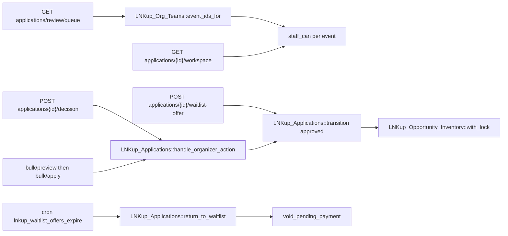

**Routes (`lnkup/v1`)**, all behind `application_review_v2_enabled`:

| Route | Capability on the event |
|---|---|
| `GET applications/review/queue` | rows limited to events with `review_applications` |
| `GET applications/{id}/workspace` | `review_applications` |
| `POST applications/{id}/decision` | `manage_applications` |
| `POST applications/{id}/score` | `score_applications` |
| `POST applications/{id}/reviewers`, `DELETE …/reviewers/{user}` | `manage_applications` |
| `GET\|PUT events/{id}/rubric` | read `review_applications`, write `manage_applications` |
| `GET events/{id}/reviewers` | `manage_applications` |
| `POST applications/bulk/preview`, `bulk/apply`, `GET bulk/jobs/{job}` | per-application `manage_applications` |
| `GET opportunities/{id}/waitlist`, `POST …/waitlist/reorder` | `review_applications` / `manage_applications` |
| `POST\|DELETE applications/{id}/waitlist-offer` | `manage_applications` + `waitlist_offers_enabled` |

Plus `GET org/team/audit` (owner or `manage_team`) and `GET operations/events/{id}/broadcasts/preview` (`broadcast`).

**Rules:**
- Status groups are a pure mapping over canonical statuses (`LNKup_Application_Review::status_groups()`), and payment state is reported separately.
- Scores are advisory and never change status.
- A bulk preview token is single-use, belongs to the user who created it, and expires after 10 minutes. Each application is re-checked when the bulk action is applied.
- A waitlist offer is an approval with a deadline (`payment_due_at` passed into `transition()`), so it holds a spot through `HOLD_STATUSES` and cannot oversell.
- Offer expiry only releases offers whose payment is pending or failed. Payments in flight keep the spot.
- Team activity (`application_reviewer_*`, `application_scored`, `application_bulk_decision`, `review_rubric_saved`, `waitlist_offer_*`) is written to `wp_lnkup_audit_log` with entity `org` / owner ID.

**Tables** (`LNKup_Organizer_OS_Tables`, schema option `lnkup_organizer_os_schema`): `lnkup_pass_tokens` (sha256 of the upper-cased QR token → application; `LNKup_Pass_Tokens`), `lnkup_app_review_assignments`, `lnkup_review_rubrics`, `lnkup_app_reviews`, `lnkup_waitlist_offers`. All additive; turning the flags off hides the features without touching data.

### 9.25 Organizer Management OS — Wave 2 (event tasks, readiness, document review, Overview)

Flags (off by default, `LNKup_Feature_Flags`): `organizer_ops_v2_enabled` covers tasks, readiness and the new Overview. `organizer_document_review_enabled` covers per-event document review, and only takes effect while Passport `document_vault_sharing` is on. Tables live in `LNKup_Organizer_OS_Tables` schema version 2. `ready( $min )` takes a minimum version, so Wave 1 keeps working mid-upgrade.

**Event tasks** (`LNKup_Event_Tasks`, `LNKup_Event_Tasks_REST`; tables `lnkup_event_tasks`, `lnkup_event_task_comments`, `lnkup_task_templates`):
- Tasks have an assignee, due date, priority, status (open, done or cancelled), source (manual, template or system) and comments.
- `view_roster` sees tasks. `edit_ops` creates, assigns, edits and cancels. The assignee may also mark their own task done or open.
- The assignee must already have `view_roster` on the event, so a task never grants access, including to financials.
- Templates belong to the organizer account. `apply_template()` sets due dates N days before `_lnkup_event_date` at 17:00 and skips items already applied (`template_item_key` = `t{id}_{key}`).
- Assignment sends an email and fires `lnkup_event_task_assigned`. The daily cron `lnkup_event_tasks_due` sends each assignee one digest of overdue tasks and tasks due within 48 hours.
- Status changes, assignments and template applies go to the team audit log.
- Routes: `GET|POST events/{id}/tasks`, `POST events/{id}/tasks/apply-template`, `GET events/{id}/task-assignees`, `GET|PATCH|DELETE tasks/{id}`, `POST tasks/{id}/comments`, `GET tasks?view=mine|due_soon|overdue|all|completed`, `GET|POST task-templates`, `PATCH|DELETE task-templates/{id}`.

**Event readiness** (`LNKup_Event_Readiness`):
- There are 11 items: event details, application settings, booth inventory, applications reviewed, payments collected, booth assignments, documents collected, packet prepared, setup instructions sent, check-in ready and team assigned.
- Each item's system result is pass, fail, unknown or n/a, and its state is derived from that:

| System result | State |
|---|---|
| pass | `verified` |
| fail | `incomplete`, even if someone confirmed it by hand |
| unknown | `confirmed` once a person confirms it (only setup instructions, check-in and team; otherwise `incomplete`) |
| n/a | `not_applicable` |

- `not_applicable` is a manual mark on items that may not apply. Marks are stored in `_lnkup_readiness_marks`, need `edit_ops`, and are audited.
- The checklist also returns days until the event, a percent that excludes not-applicable items, and `next_actions`.
- Results are cached for 60 seconds and flushed by application, booth, task, document and event-meta hooks.
- Routes: `GET events/{id}/readiness` (`view_roster`) and `POST events/{id}/readiness/{key}` (`edit_ops`, body `{state: confirmed|not_applicable|clear, note}`).

**Organizer document review** (`LNKup_Organizer_Documents`; table `lnkup_app_document_reviews`, unique on application + type):
- There is one row per approved, payment-required or paid application for each type `lnkup_get_opportunity_required_documents()` requires.
- Status priority:
  1. `waived`
  2. `expired` (overrides an earlier acceptance)
  3. the organizer's decision: `accepted`, `rejected` or `replacement_requested`
  4. `submitted`: an active Passport share, or the document is in the application snapshot
  5. `requested`
  6. `missing`
- Decisions never change the platform `_lnkup_verification_status`.
- Only the event owner gets a file link, and only through `LNKup_Document_Vault::shares_for_application()` signed URLs. `document_file_permission` is unchanged.
- A new Passport share resets a rejection or replacement request back to review.
- The new `review_documents` capability is held by Organization Admin, Event Manager and Vendor Manager. Waiving needs the owner or `manage_team`.
- Requests are throttled per application and type per day, fire `lnkup_organizer_document_requested`, and email the vendor.
- Routes: `GET events/{id}/documents` (`view_documents`), `GET applications/{id}/documents`, and `POST applications/{id}/documents/request|{type}/review|{type}/waive` (`review_documents`).
- When the flag is on:
  - the roster's "Documents needed" group uses these statuses;
  - the Wave 1 review drawer shows them with actions;
  - the classic "remind vendor" button sends a per-type request.

**Overview** (`LNKup_Organizer_Overview`, `GET organizer/overview`; `render_home_v2()` when the ops flag is on):
- "Needs attention" shows only non-zero counts from canonical records: pending reviews, approved but unpaid, documents (events within 60 days), overdue tasks, and events within 14 days that are under 100% ready.
- Upcoming event cards show countdown, readiness %, confirmed vs capacity, and the next step.
- The page also keeps recent activity and quick actions.

**UI:**
- Event workspace tabs Readiness, Tasks and Documents (`LNKup_Shortcodes::ops_tabs()` and `render_ops_panel()`), also reachable by team-only members at `?event={id}&tab=`.
- A **Tasks** view (`?view=tasks`) with My tasks and task templates.
- Scripts `public/js/organizer-ops-core.js` (shared helpers), `organizer-readiness.js`, `organizer-tasks.js` and `organizer-documents.js`, plus `public/css/organizer-ops.css`.
- The lifecycle bar on the operations page shows open and overdue task counts.

### 9.x Communications OS (separate plugin: `lnkup-communications`)

**lnkup-communications** depends on lnkup-marketplace and owns push, email, the in-app inbox, automations, campaigns and delivery health. lnkup-marketplace stays the system of record. The communications plugin stores only communication state, in the `wp_lnkup_comms_*` tables.

- **Engine:** `LNKup_Comms_Engine::dispatch()` deduplicates, authorizes, validates and stores, then Action Scheduler (group `lnkup-comms`) runs `deliver()`. Delivery re-validates canonical state and applies preferences, caps and quiet hours, then fans out to inbox, email and Expo push.
- **Delegation:** every legacy `LNKup_Notifications::send_*` checks the `lnkup_pre_send_notification` filter first. A flow is claimed only while its flag is on, so the legacy sends resume when a flag is off or the plugin is deactivated.
- **Lifecycle signals:**
  - `LNKup_Lifecycle_Hooks` turns canonical status-meta writes into `lnkup_{payment|event|opportunity|document|vendor_invite}_status_changed`.
  - Explicit hooks cover refunds, chargebacks, Connect status, payout status, check-ins, event completion, uploads and logistics changes.
- **Financial rule:** payment messages come only from verified server outcomes. Payout and payout-setup messages are behind `fin_payout_notifications`, which stays off until reconciliation sign-off.
- **New core features:**
  - Vendor withdrawal (`POST /applications/{id}/withdraw`, uses the existing `cancelled` status).
  - Organizer cancel/postpone (`POST /organizer/events/{id}/status`, `_lnkup_event_status` = `cancelled`/`postponed`). This closes slots and leaves payments to the Financial Service.
- **References:** trigger catalog in [COMMUNICATIONS_MATRIX.md](COMMUNICATIONS_MATRIX.md); audit in [COMMUNICATIONS_AUDIT.md](COMMUNICATIONS_AUDIT.md); deployment, cron, EAS and rollback in `wp-content/plugins/lnkup-communications/README.md`.

### 9.23 Organizer Acquisition Analytics & Activation Automations (Phase 7)

**Spend ledger:** `LNKup_Org_Growth_Spend` on `wp_lnkup_org_growth_spend` (organizer-growth schema `1.1.0`, self-migrating via `lnkup_org_growth_schema`). Admins enter what was actually spent (date, channel = lead `source` key, amount in cents, campaign, city/state, description) by form or CSV (`date, channel, amount` required, max 1000 rows). Rows are never deleted. A void requires a reason, and adds and voids are both audited (`org_growth_spend_added` / `org_growth_spend_voided`).

**Commission cost:** read-only from `wp_lnkup_referral_rewards`. It counts rewards in `approved`/`paid` status, net of `reversed_amount`, whose referral's `referred_user_id` is linked to a lead (`lnkup_org_lead_accounts`). Pending, on-hold and reversed rewards are excluded, and so are rewards for vendors who are not linked to a lead.

**Analytics** (`LNKup_Org_Growth_Analytics`, cached 15 min, flushed with the growth metrics cache):

| Report | Built from |
|---|---|
| Monthly cohorts (30/60/90-day + overall) | `registered` milestone month; active milestones only (refund-voided ones drop out) |
| Time to publish / first paid booking / activated | median + p75 days, with sample size |
| Conversion by dimension | source, campaign, city, state, category, connector, owner, frequency, affiliation (leads created in window) |
| Productivity | organizations with an active paid booking: events, applications, paid bookings, net platform fees, gross |
| Cost per acquired organizer | spend + commissions ÷ registered / activated per channel; `unavailable` (no cost records), `commissions_only`, `complete` |
| At risk | activated, no live/upcoming event, no paid booking in 60 days; shows open-task flag |

Every report filters by house (Six Stars) vs independent organizers. Spend is not split by affiliation, because spend entries are not tied to one organizer. REST (all `lnkup_manage_organizer_growth`): `GET growth/analytics`, `growth/analytics/cohorts`, `growth/analytics/at-risk`, `growth/analytics/export?section=cohorts|cac|at_risk|conversion` (CSV with formula guard, audited), `GET/POST growth/spend`, `POST growth/spend/{id}/void`, `POST growth/spend/import`. wp-admin **Organizer Growth → Analytics / Spend** tabs. The Overview shows cost cards once any cost exists.

**Activation automations** (`lnkup-communications` 1.2.0, `LNKup_Comms_Auto_Activation`, flag `flow_activation` default off):

| Trigger | When | Re-checked before send |
|---|---|---|
| `o_setup_profile` | organization stage incomplete; day 1, follow-up day 7 (registered ≤ 30 days); link `org_profile` opens `/(organizer)/profile` in the app and the Get started organization step on the web | `organizer_activation_stage` |
| `o_setup_payouts` | Connect on, payouts incomplete, and a live event or approved vendor exists; day 2, follow-up after 5+ days; skipped within 3 days of `o_payout_setup` | `organizer_activation_stage` |
| `o_publish_draft` | draft event with a slot, older than `draft_unpublished_days` (3), not past; once per event | `event_is_draft` |
| `o_first_booking` | `lnkup_payment_completed` when the organizer's paid count is exactly 1; once ever | — |

At most one daily nudge goes to an organizer per run. A shared cooldown (`activation_cooldown_days`, 3) applies across the three nudges and `o_onboarding`; the first-booking celebration is exempt. Each message stores `activation_stage`. `LNKup_Organizer_Activation::build()` records `_lnkup_activation_done_{stage}` (UTC, write-once) the first time it sees a stage complete. Comms analytics attributes a nudge when that time falls between `sent_at` and `sent_at + attribution_days`. The `o_no_applications` delay is now `no_applications_days` (5), and `o_publish_next` links to saved setups when the organizer has any.

**Tests:** `scripts/e2e/php/org-growth-analytics-test.php`, `scripts/e2e/php/comms-activation-test.php`; Playwright Analytics/Spend cases in `tests/e2e/organizer-growth.spec.ts`.

### 9.24 Vendor Supply Intelligence (Phase 6)

**Purpose:** show where LNKup has vendors but too few organizers (recruit organizers there) and where open booths outnumber vendors (recruit vendors there), per city and per vendor category.

**Snapshot:** `LNKup_Org_Supply_Intel` (`includes/organizer-growth/class-org-supply-intel.php`) builds `wp_lnkup_org_supply_snapshots` daily on `lnkup_marketplace_daily` (priority 45, before lead rescoring at 50). The organizer-growth schema is `1.2.0`. Each build is guarded by `GET_LOCK` and is idempotent per day (today's rows are replaced). Snapshots are kept 120 days. The city set is every city with indexed vendors, open opportunities or open leads, capped at 500. Each city has an all-categories row (`term_id` 0) plus one row per category with supply or demand. A separate `_national` row holds vendors willing to travel nationally.

| Column group | Source |
|---|---|
| `vendors_based` / `vendors_reach` / `vendors_active` / `vendors_verified` | Vendor match index. Reach = home city, or `cities_served` ("City, ST", or a bare city assumed to be in the vendor's state), `states_served`, or `radius_miles` from the city centroid (average of known vendor/opportunity coordinates). Active = index `status = active` and discoverable. |
| `vendors_applied_90d`, `vendors_paid_12m` | Applications and paid/partially refunded payments by vendor user |
| `saved_search_vendors` | Active saved searches naming the city; a saved search without a state counts toward every city of that name; categories are matched by name, slug or ID |
| `open_opportunities`, `spots_total`, `spots_remaining`, `live_organizers` | Marketplace index (future or undated events) + match opportunity categories |
| `applications_90d` | Applications submitted in 90 days to those opportunities |
| `open_leads`, `registered_orgs` | Organizer Growth leads in the city (all-categories row only) |

**Signals** (thresholds in Organizer Growth settings):
- `insufficient_data` when there are fewer than 3 active vendors and no open booths.
- `recruit_organizers` when active vendors are at least `org_growth_supply_min_active_vendors` (default 10) and active vendors per open booth are at least `org_growth_supply_surplus_ratio` (default 3).
- `recruit_vendors` when open booths are at least twice the active vendors.
- Otherwise `balanced`.

**Consumers:**
- Lead scoring's "existing vendor market" factor now counts active vendors who serve the city (`vendor_market_count()`), with a live home-city fallback before the first snapshot.
- wp-admin **Organizer Growth → Vendor Supply** has filters, a city table with 7-day change, a city drawer (categories, gaps with vendors but no booths, 90-day trend, open leads, "View leads in this city"), CSV export and Rebuild now.
- The lead drawer shows a supply card (`GET growth/leads/{id}` returns `supply`).
- The connector **My Cities** view adds a "Vendor supply in your cities" panel (web `connector.js`). On mobile, Expo `(partner)/cities` shows the same territories and supply, and the Partner Home has a "My cities" card naming the city that most needs organizers.

**REST:**
- `GET growth/supply` (`state`, `term_id`, `signal`, `min_active`, `sort`, `limit`), `GET growth/supply/city?key=`, `GET growth/supply/export` (audited), `POST growth/supply/rebuild` (audited, 429 within 10 minutes). All use the growth capability and require the flag.
- `GET connector/supply` uses the connector permission and returns the connector's city/state territories, or their home city when none are assigned. It is aggregates only, and counts of 1–2 are returned as `"<3"`.

**Tests:** `scripts/e2e/php/org-supply-intel-test.php`; Playwright Vendor Supply cases in `tests/e2e/organizer-growth.spec.ts`.

**Match liquidity (12.34.0):** matching adds its own per-city snapshot (`LNKup_Match_Market`, priority 44) of thin and unmatched booths, matched and idle vendors, and searches that found nothing. `LNKup_Org_Market_Need` combines it with the supply signal for the `market_need` scoring factor, the `market_signal` lead filter, optional research tasks and the lead drawer / connector figures. See [MATCHING_DISCOVERY.md](MATCHING_DISCOVERY.md) §12.

---

### 9.24 Organizer Portfolio OS (tours, recurring series, templates)

Flag: `LNKup_Feature_Flags::portfolio( $user_id )`. It is true when `portfolio_os_enabled` is on or the user is in `portfolio_os_user_ids`. Public pages check the tour owner.

```
Organizer user (organization owner)
  ├─ lnkup_brand (optional)
  └─ lnkup_tour  _lnkup_tour_type: tour | series | recurring
       │  _lnkup_tour_defaults (booth types, docs, questions, deadline offset)
       │  _lnkup_recurrence_rule, _lnkup_template_version_id, _lnkup_brand_id
       └─ lnkup_event (stop)  _lnkup_tour_id, _lnkup_occurrence_key, _lnkup_occurrence_state,
            │                 _lnkup_timezone, _lnkup_stop_overrides
            └─ lnkup_opportunity (one per booth type)  _lnkup_booth_type_key
                 └─ lnkup_application ─ lnkup_payment (one per application, per stop)
lnkup_event_template ─ wp_lnkup_template_versions (immutable)
```

| Class | Role |
|---|---|
| `LNKup_Portfolio_Tours` | Tour CRUD on top of `LNKup_Tours::save()`. Idempotent draft stops, readiness, publish (creates opportunities), cancel, archive, delete with stops detached, portfolio event list |
| `LNKup_Portfolio_Config` | Defaults and overrides resolution, bulk preview/apply (`update_opportunity_pricing()` for live stops) |
| `LNKup_Portfolio_Recurrence` | Bounded rules (weekly, biweekly, monthly weekday, monthly date, custom). Local-time-zone dates; skip, move, change remaining |
| `LNKup_Portfolio_Templates` / `_Brands` | Versioned templates; event brands |
| `LNKup_Portfolio_Jobs` | Chunked background stop creation (`lnkup_portfolio_run_job`). Status polling resumes stalled jobs |
| `LNKup_Portfolio_Reporting` | Tour summary from event-level payments (deduplicated, `reconciled` flag), cross-stop applications and bulk decisions |
| `LNKup_Portfolio_Interest` | Tour-wide interest and invites to stops (`LNKup_Vendor_Invites`) |
| `LNKup_Portfolio_Public` | `/tours/{slug}`, `/series/{slug}`, public data, "Part of tour" card link |
| `LNKup_Portfolio_REST` | `lnkup/v1/portfolio/*` |
| `LNKup_Portfolio_Tables` | Own schema version (`lnkup_portfolio_db_version`): `template_versions`, `portfolio_jobs`, `portfolio_audit`, `tour_interest` |

Rules:
- Stops are ordinary events created through `LNKup_Organizer_Onboarding::create_event_from_request()`. Drafts use `post_status = draft`, which the marketplace index already excludes.
- A tour never merges booking or payment records: approval, inventory locks, payments, packets and check-ins stay per stop. Multi-stop applications use `LNKup_Application_Groups`.
- Tour defaults apply only to draft stops. Live stops change only through the confirmed bulk editor.
- Team members reach tour stops through `LNKup_Org_Teams` `tour` scope. Portfolio write routes are owner-only, because stop creation assigns the current user as organizer.

Main routes (all have a `permission_callback`):

| Route | Purpose |
|---|---|
| `GET /portfolio/overview` | Tours, brands, templates, time zones |
| `GET\|POST /portfolio/tours`, `GET\|PATCH\|DELETE /portfolio/tours/{id}` | Tour CRUD |
| `POST /portfolio/tours/{id}/archive` | Archive or restore |
| `POST /portfolio/tours/{id}/cancel` | Cancel selected stops |
| `POST /portfolio/tours/{id}/stops` (`Idempotency-Key`) | Add stops (inline or background job) |
| `PATCH\|DELETE /portfolio/tours/{id}/stops/{event_id}`, `/detach`, `/duplicate`, `/stops/reorder` | Stop management |
| `POST /portfolio/tours/{id}/publish` | `event_ids[]` or `all`; returns a result per stop |
| `POST /portfolio/tours/{id}/recurrence/preview\|generate\|change-remaining` | Recurring schedule |
| `POST /portfolio/tours/{id}/occurrences/{event_id}/skip\|move` | One occurrence |
| `GET\|PUT /portfolio/tours/{id}/defaults`, `POST /bulk/preview`, `POST /bulk/apply` | Defaults and bulk pricing |
| `GET /portfolio/tours/{id}/summary\|applications\|interest\|audit` | Reporting |
| `POST /applications/bulk`, `/invite`, `/save-as-template` | Bulk decisions, invites, templates |
| `GET\|POST /portfolio/brands`, `GET\|POST\|PATCH\|DELETE /portfolio/templates[/{id}]`, `/templates/{id}/duplicate\|apply` | Brands and templates |
| `GET /portfolio/events`, `GET /portfolio/jobs/{id}` | Portfolio event list, job status |
| `GET /portfolio/public/tours/{slug}` (public), `GET\|POST\|DELETE /portfolio/tours/{id}/interest/me` (vendor) | Public data, tour interest |

### 9.25 Marketing, SEO & Distribution OS (12.37.0, comms 1.4.0)

Orchestration layer over existing systems, every part behind a flag in `LNKup_Marketing_Flags` (all default off). Full reference: [marketing-distribution-os/README.md](marketing-distribution-os/README.md).

- **SEO** (`includes/seo/`): `LNKup_Index_Policy` decides robots, sitemap and schema together; `/events/{slug}/` and `/organizers/{slug}/` canonicals with 301s; Event schema without booth-fee `offers`; `lnkup` core sitemap provider; diagnostics; read-only Search Console (credentials in `wp-config.php`).
- **Markets** (`includes/marketing/`): computed market status and live health, staff-enabled city + category pages (≥3 open events), weekly digests, per-event market alerts, anonymous demand taps, generated OG images.
- **Attribution**: extended first-party touches (click IDs, referral/link codes, market, device, app payload); tracked links `/l/{code}` with daily aggregates; analytics taxonomy over existing events with rollup/retention; consent- and host-gated GA4/Ads/TikTok; revenue attribution (GMV vs net platform fee, refunds, commissions, spend).
- **Toolkits**: organizer dashboard → Marketing (links, local QR, graphics, copy, embeds, performance); connector Share & Track; vendor acceptance share; partner pages `/with/{slug}/`; external demand → organizer leads and claim notifications.
- **Campaigns** (comms): two-person approval, scheduling, saved segments, new audience filters, A/B variants, outreach suppression bridge, role `lnkup_marketing`.
- **Retention & content**: market alert and tour stop messages (`flow_discovery`), consent records, `/resources/` + `/guides/` with editorial checklist, `/cohort/{slug}/`.
- **Mobile**: `lnkup/v1/public/resolve`, `/public/events/{id}`, `/app/share-link`; Expo `app/link.tsx`, `app/event/[eventId].tsx`, attribution at signup; extra AASA paths only with `deep_links_v2`.
- **Admin**: LNKup → Marketing (`LNKup_Marketing_Admin`, capability `lnkup_manage_marketing`).

## 10. Data Layer

### Dual-Storage Pattern

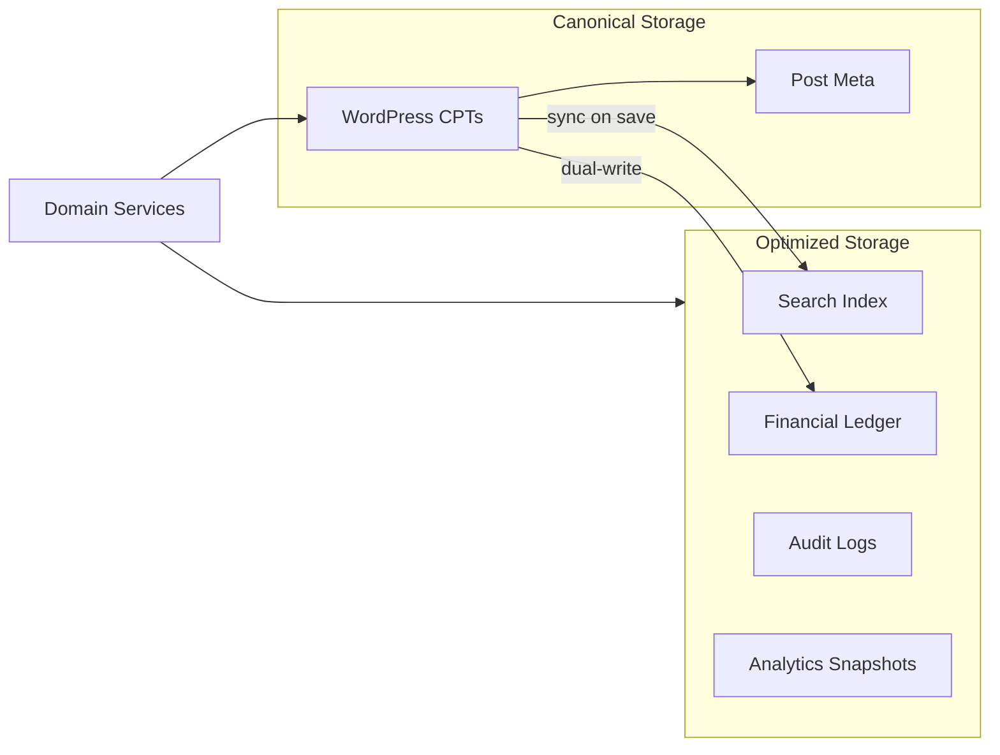

| Storage | Use Case |
|---------|----------|
| CPT + post meta | Canonical records, wp-admin editing, REST exposure |
| Custom SQL tables | Full-text/geo search, relational joins, audit trails, time-series snapshots |
| User meta | Stripe customer ID, favorites, saved searches |
| Options | `lnkup_settings`, `lnkup_db_version`, phase flags |
| Transients | Outreach hourly/daily SMTP send counters (`lnkup_outreach_sent_hour_*`, `lnkup_outreach_sent_day_*`) |

Outreach campaigns use **SQL only** (not CPT) for batch scale and status tracking.

### Tables by Domain

All tables use WordPress table prefix (typically `wp_lnkup_*`).

| Domain | Tables |
|--------|--------|
| **Discovery** | `marketplace_index`, `analytics_events` |
| **CRM** | `organizer_vendor_rel`, `vendor_list_item`, `organizer_vendor_tag`, `crm_activity` |
| **Reputation** | `vendor_badges`, `reputation_activity`, `reputation_snapshots` |
| **Operations** | `booths`, `parking`, `loadin_windows`, `loadin_assignments`, `checkins`, `support_requests`, `incidents`, `operations_log`, `event_staff`, `packet_engagement`, `broadcasts` |
| **Intelligence** | `metric_snapshots`, `event_scores`, `opportunity_scores`, `market_trends`, `event_risks`, `recommended_actions`, `post_event_reports` |
| **Maps** | `geocode_cache`, `maps`, `map_elements`, `parking_zones`, `map_routes`, `map_templates`, `map_shares` |
| **Financial** | 22 tables (see §9.3) + **treasury** 20+ tables |
| **Growth** | `growth_snapshots`, `marketplace_benchmarks`, `vendor_goals`, `vendor_roi`, `vendor_profit_estimates`, `vendor_milestones`, `vendor_recommendations` |
| **Weather** | `weather_snapshots` |
| **Outreach** | `outreach_campaigns`, `outreach_recipients` |
| **CRM Import** | `crm_import_job`, `organizer_vendor_prospect`, `vendor_list_prospect` |
| **Connector** | `connectors`, `connector_events`, `connector_booking_attr` |

### Migrations (v12.1 two-phase)

**Phase 1 — `lnkup_maybe_upgrade_db()` on `init` (priority 4)** when `lnkup_db_version` ≠ `LNKUP_VERSION`:

1. `dbDelta()` all domain + treasury table schemas (per-table try/catch)
2. Re-create/repair pages
3. Schedule cron jobs
4. Re-seed taxonomies if version changed
5. `LNKup_Roles::sync_role_capabilities()` — add new caps to existing roles
6. Set `lnkup_needs_deferred_upgrade` and update `lnkup_db_version`

**Phase 2 — `lnkup_maybe_deferred_upgrade()` on `admin_init` (priority 5)** when `lnkup_needs_deferred_upgrade` matches current version:

1. `LNKup_Transactions::backfill_from_payments()` and extended columns
2. `LNKup_Marketplace_Index::rebuild_all()`
3. CRM, reputation, and growth backfills
4. Showcase marketplace seed
5. `LNKup_Payments::backfill_pending_payment_fees()` and `LNKup_Fee_Engine::migrate_fee_configuration()` (admin_init hook)

### Marketplace Index Schema (Key Columns)

`lnkup_marketplace_index` denormalizes opportunity data for fast queries:

- Identity: `opportunity_id`, `event_id`, `organizer_id`
- Search: `search_blob` (FULLTEXT), `title`, `city`, `state`
- Geo: `lat`, `lng`
- Taxonomy: `event_types`, `categories`, `markets` (serialized)
- Business: `vendor_fee`, `attendance`, `deadline`, `spots_remaining`, `spots_total`
- Flags: `featured`, `organizer_verified`, `indoor`, `outdoor`, `required_documents`
- Scoring: `trending_score`, `created_at`, `event_date`

---

## 11. API Reference Summary

**Base URL:** `/wp-json/lnkup/v1/`

### Route Count by Module

| Module | REST Class | Routes (approx.) |
|--------|-----------|-----------------|
| Marketplace | `LNKup_Marketplace_REST` | 15 |
| CRM | `LNKup_Organizer_CRM_REST` | 24 |
| Operations | `LNKup_Operations_REST` | 24 |
| Intelligence | `LNKup_Intelligence_REST` | 20 |
| Maps | `LNKup_Map_REST` | 20 |
| Financial | `LNKup_Financial_REST` | 62 |
| Growth | `LNKup_Growth_REST` | 26 |
| Reputation | `LNKup_Reputation_REST` | 10 |
| Weather | `LNKup_Weather_REST` | 5 |
| Push (native) | `LNKup_Push_REST` | 4 |
| Stripe webhook | `LNKup_Stripe_Webhooks` | 1 |

**Total:** ~218 routes under `lnkup/v1` (v12.12.0).

### Auth Patterns

| Pattern | Used By |
|---------|---------|
| `__return_true` | Public discovery reads, analytics tracking |
| Logged-in + capability | Most write operations |
| Ownership check | Event/application/payment scoped data |
| `LNKup_Capabilities::user_has_manage_all()` | Admin bypass |
| Stripe signature | Webhook endpoint only |

### Financial REST Highlights

| Route | Method | Purpose |
|-------|--------|---------|
| `/financial/checkout/{id}/summary` | GET | Checkout line items |
| `/financial/checkout/{id}/prepare` | POST | Create PaymentIntent |
| `/financial/checkout/{id}/confirm` | POST | Finalize payment |
| `/financial/checkout/{id}/apply-credits` | POST | Apply wallet credits |
| `/financial/payments/{id}/timeline` | GET | Payment timeline steps |
| `/financial/activity` | GET | Unified activity feed |
| `/financial/invoices/{id}/pdf` | GET | Invoice PDF download |
| `/financial/invoices/{id}/email` | POST | Email invoice |
| `/financial/payment-methods/setup` | POST | SetupIntent for saved cards |
| `/financial/admin/summary` | GET | Admin financial aggregates |
| `/financial/connect/status` | GET | Connect account status, `settlement_mode` |
| `/financial/connect/onboarding-link` | POST | Express onboarding URL |
| `/financial/organizer-balances` | GET | Slim organizer balance payload (v12.2.3) |
| `/financial/organizer-wallet` | GET | Organizer wallet balances + Stripe sync |
| `/financial/organizer-wallet/cashout` | POST | Request cashout |
| `/financial/organizer-payouts` | GET | Payout history |
| `/financial/dashboard` | GET | Organizer/vendor dashboard KPIs |
| `/financial/payments/{id}/reconcile` | POST | Reconcile pending payment with Stripe |
| `/financial/summary` | GET | Role-scoped financial summary |
| `/financial/tax-center` | GET | Tax document center |
| `/financial/events/{id}/budget` | GET | Event budget (Budget Center) |

### Stripe Webhook

`POST /wp-json/lnkup/v1/stripe-webhook`

Events handled: `account.updated`, `checkout.session.completed`, `payment_intent.succeeded`, `payment_intent.payment_failed`, `transfer.created`, `transfer.failed`, `payout.created`, `payout.paid`, `payout.failed`, `charge.refunded`, `charge.dispute.created`, subscription events (audit logging).

Events logged in `lnkup_webhook_events` with retry via financial cron.

---

## 12. Core Workflows

### 12.1 Vendor Journey

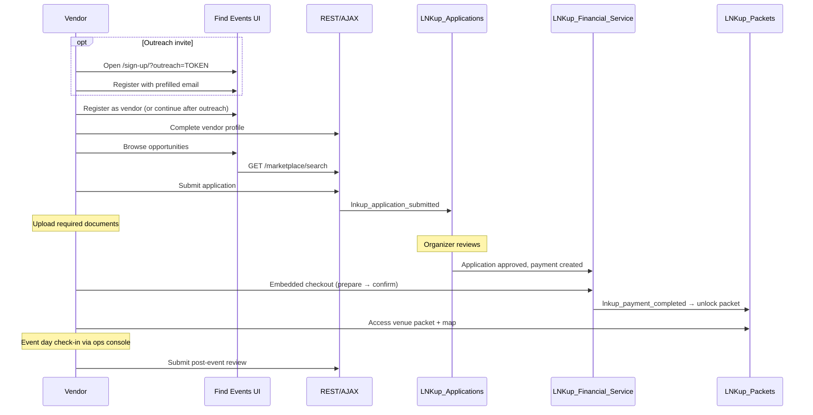

### 12.2 Organizer Journey

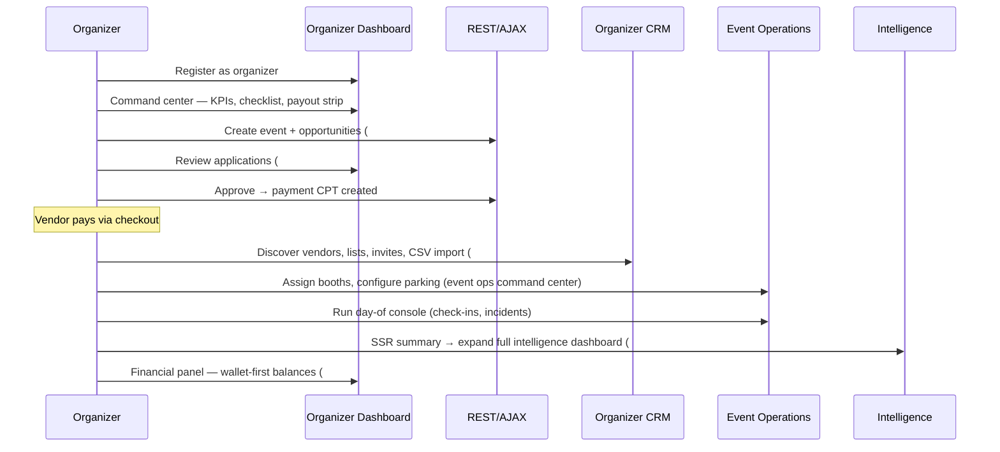

### 12.3 Discovery Data Flow

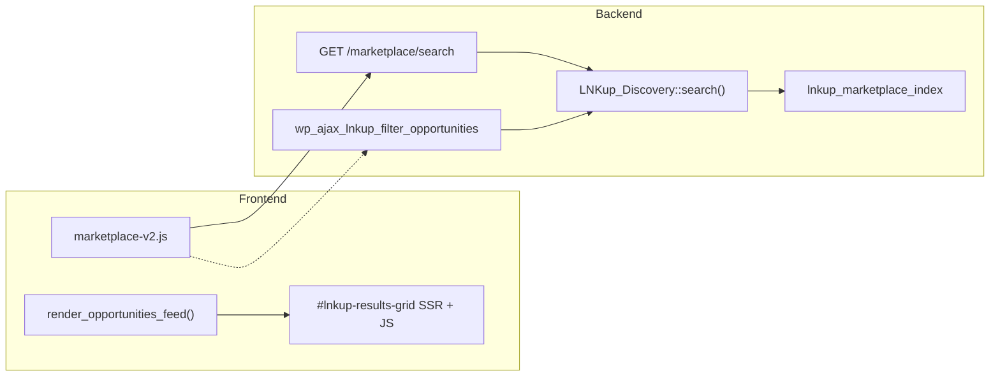

### 12.4 Event Lifecycle Workflow

When an organizer advances an event through operations stages, `lnkup_event_lifecycle_stage_changed` fires. Key transitions:

| Trigger | Auto-Transition |
|---------|----------------|
| Application approved | Payment CPT created; lifecycle may move to `payments` |
| Application paid | Stage → `vendor_packets_released` |
| Organizer manual advance | Any stage → next stage via ops REST |

### 12.5 Payment Timeline Steps

`lnkup_payment_timeline` records discrete steps per payment:

`application_approved` → `invoice_created` → `reminder_sent` → `payment_received` → `packet_unlocked` → `checked_in` → `completed` → `review_submitted`

### 12.6 Platform Outreach Journey (v12.3)

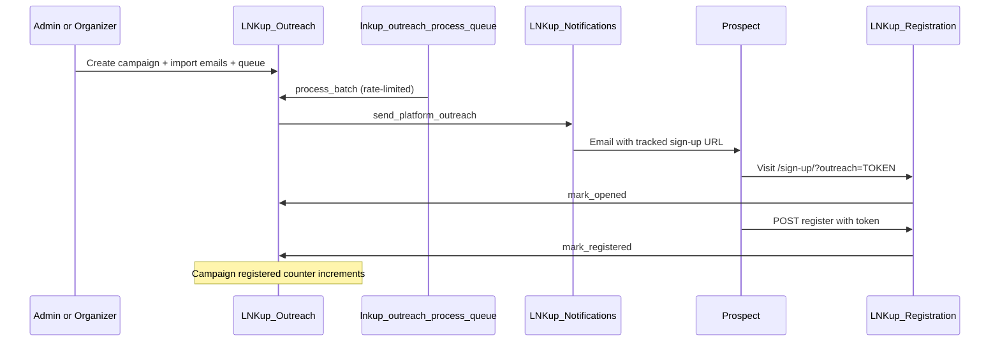

Daily/hourly SMTP caps pause the queue; pending recipients auto-resume next window (see §9.11).

---

## 13. Financial System

### Architecture (v12.2 Treasury + balance display)

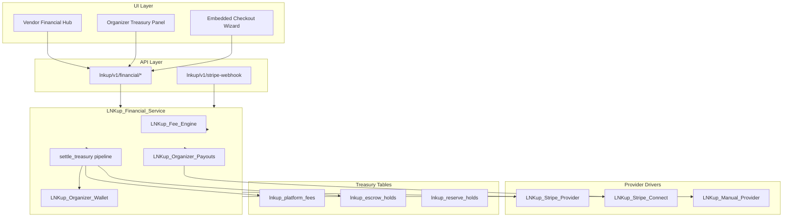

**Settlement rule:** Platform fee retained via Stripe `application_fee_amount`. Organizer net credited per settlement mode; destination-mode cashout uses Connect **Payouts** API (no platform Transfer). Treasury fallback organizers use `platform_treasury` wallet balances until onboarded.

### Connect onboarding sequence

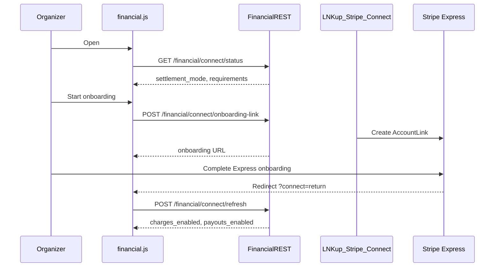

**Key modules:** `includes/financial/class-treasury-tables.php` plus 28 domain classes registered in `bootstrap.php`. Through v12.11.1: treasury migration, Connect schema, weather snapshots, financial dashboard hardening, sponsor payments schema alignment, outreach tables, CRM import, connector program, and premium dashboard UI assets.

### Organizer balance loading (v12.2.3)

```mermaid
sequenceDiagram
  participant O as Organizer
  participant UI as financial.js
  participant Bal as /organizer-balances
  participant Wal as /organizer-wallet
  participant Dash as /dashboard
  O->>UI: Open #financial Overview
  UI->>Bal: GET organizer-balances?role=organizer
  alt balances route OK
    Bal-->>UI: display_balances, stripe_balance
  else fallback
    UI->>Wal: GET organizer-wallet
    Wal-->>UI: display_balances, stripe_balance
  end
  UI->>UI: resolveOrganizerBalances() — hero + Overview
  UI->>Dash: GET dashboard (optional KPIs)
  alt dashboard JSON invalid
    Dash-->>UI: parse error (logged snippet)
    UI->>O: Overview warning; balances still shown
  else
    Dash-->>UI: revenue KPIs merged
  end
```

### Legacy note

v11 tables (`lnkup_wallets`, `lnkup_payouts`, `lnkup_transactions`) remain for vendor credits and backward-compatible reporting.

### Embedded Checkout Sequence

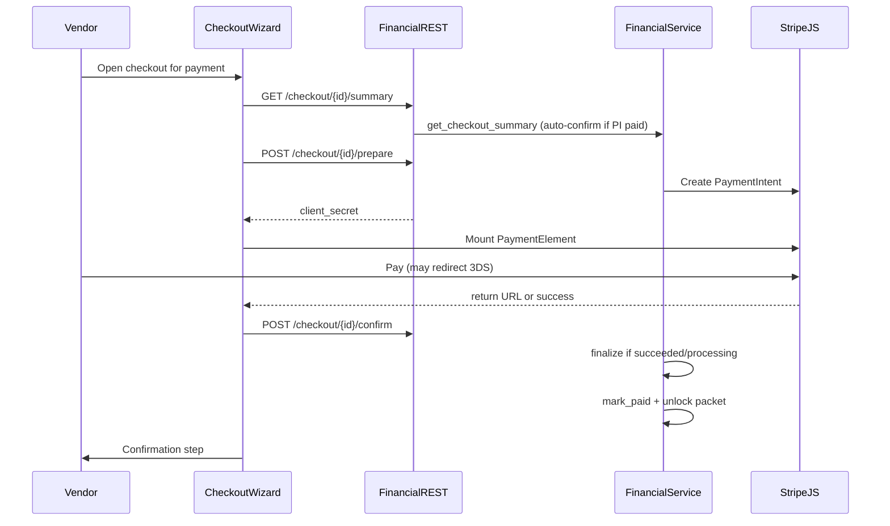

Webhook path: `payment_intent.processing` / `payment_intent.succeeded` → `LNKup_Stripe_Webhooks` → `reconcile_payment()` when browser confirm missed.

### Fee Engine

`LNKup_Fee_Engine` calculates the full payment breakdown from LNKup Settings (`vendor_checkout_fee`, `organizer_commission_percent`) plus scoped `lnkup_fee_rules` and Connect settings:

- Vendor checkout fee (default **$5.99** flat, bundled into booth line) — **settings-first**; legacy SQL global flat rules deactivated on migration
- Organizer commission (default **6%** of booth price)
- Processing fee (Stripe estimate)
- Tax, promo discounts, wallet credits
- Reserve hold (default **5%** for 30 days)
- Escrow hold (configurable percent/days)

`application_fee_amount` for Connect = vendor checkout fee + organizer commission. Results stored on payment meta and `lnkup_transactions` columns: `platform_fee`, `organizer_net`, `stripe_fee`, `gross_amount`, `settlement_mode`, `reserve_hold`. Pending payments refresh via `LNKup_Payments::refresh_pending_fees()` when checkout opens or settings change.

### Provider Selection

```
if payment_provider == 'manual' OR stripe_secret_key empty:
    → LNKup_Manual_Provider (simulation)
else:
    → LNKup_Stripe_Provider (live/test Stripe keys)
```

### Credit Types

`refund`, `referral`, `promotional`, `manual`, `marketplace`

### Backward Compatibility

- `lnkup_payment` CPT remains checkout initiation source
- `LNKup_Transactions::backfill_from_payments()` bridges legacy CPT data into SQL ledger
- Legacy AJAX `lnkup_create_checkout` delegates to `LNKup_Financial_Service`

---

## 14. Frontend Architecture

### WordPress Theme (Production)

**Path:** `wp-content/themes/lnkup-theme/`

| File | Purpose |
|------|---------|
| `front-page.php` | Landing page composing all sections |
| `page-templates/vendor-dashboard.php` | Vendor shell + shortcode |
| `page-templates/organizer-dashboard.php` | Organizer shell + shortcode |
| `page-templates/market-landing.php` | City market landing pages (v12.7) |
| `page-templates/full-width.php` | Find Events and full-width pages |
| `page-templates/sign-up.php` | Branded registration shell |
| `template-parts/landing/*` | Hero, categories, featured, trust, CTA |
| `assets/images/events/*.svg` | Illustrated event thumbnails (hero, featured cards) |
| `inc/landing-icons.php` | Category icon SVG helpers |
| `assets/js/landing.js` | Landing parallax and hero interactions |
| `inc/setup.php` | Theme supports, nav menus |
| `inc/enqueue.php` | Google Fonts (Sora + Inter), CSS/JS |
| `inc/template-tags.php` | Logo, URLs, dashboard detection, `lnkup_theme_asset()` cache-bust |
| `inc/dashboard.php` | Login guards, sidebar nav, shell markup |

**Design system:** Black/white/lime accent, Sora headings, Inter body text. Matches Next.js reference aesthetic. Full UI/UX reference: [UI_UX.md](UI_UX.md).

**Shared UI primitives (v12.9+):**

| Primitive | Location | Purpose |
|-----------|----------|---------|
| `lnkup_executive_hero()` | `includes/helpers.php` | Section hero with KPI, metrics row, optional checklist ring, primary CTA |
| `LNKupUI` | `public/js/lnkup-ui.js` | `panelEmpty`, `panelError`, `panelSkeleton`, `animateKpiCards`, copy via `LNKupUI.t()` |
| Surface tiers | Plugin + theme CSS | `.lnkup-surface--hero`, `--primary`, `--secondary`, `--quiet` |
| Copy keys | `includes/class-ui-copy.php` | Centralized dashboard strings via `lnkup_copy()` |
| Compliance ring | Theme `components.css` | SVG/CSS progress ring for checklist and intel score |

**Theme gaps (intentional):** No `single.php`, block theme, Customizer, or widget areas.

### Plugin Public UI

**Shortcodes:** `public/class-shortcodes.php` (~4300 lines) — renders all dashboard views, marketplace feed, connector dashboards, and prelaunch landing data.

**Admin outreach UI:** `admin/class-outreach-admin.php` — mass campaigns, rate-limit status card, recipient drill-down.

**Vendor dashboard routing:** `?view=` query parameter:

| View | Feature |
|------|---------|
| (default) | Overview — executive hero, Action Center, business health KPIs |
| `applications` | Application list |
| `documents` | Document manager |
| `payments` | Financial hub — wallet-first, premium invoice cards |
| `growth` | Growth dashboard — funnel visual, sticky tabs |
| `reputation` | Reputation profile |
| `operations` | Event operations (vendor home) |

**Organizer dashboard architecture (v12.11):**

Single-page command center rendered by `[lnkup_organizer_dashboard]` inside `#lnkup-organizer-crm`. Hash-based section nav with IntersectionObserver sync.

| Section ID | Content |
|------------|---------|
| `#overview` | Executive hero, launch checklist, 10 KPIs, payout strip, quick actions, apps snapshot, activity feed, readiness mini-cards |
| `#events` | Executive hero, event card grid (v4 horizontal layout), ops anchor |
| `#applications` | Executive hero, vendor request cards with progressive disclosure |
| `#vendors` | Discover module — directory, filters, verified checkbox, CRM profile |
| `#lists` / `#invites` | Secondary module cards with expand panels |
| `#intelligence` | SSR intel summary + expand → full dashboard |
| `#create` | Launch wizard with true step gating (`organizer-create.js`) |
| `#financial` | Financial center expand panel |

**JS orchestration:**

| Script | Role |
|--------|------|
| `organizer-command.js` | Expand panels, hash deep links, section nav, create wizard open, intel expand event |
| `organizer-crm.js` | Directory search, app layout toggle, KPI animation, widgets REST |
| `organizer-create.js` | Event/opportunity creation wizard |
| `intelligence.js` | Organizer dashboard load, vendor intel, ops insights tab |
| `financial.js` | Organizer financial panel — hero dedupe when executive hero present |
| `vendor-import.js` | CRM CSV import wizard |

**Event cards (v4):** Desktop horizontal grid — 10rem media column + body. Gradient fallback shows initial letter + type badge overlay (not duplicated long category text). Capacity bar color thresholds (warn ≥70%, full ≥90%).

**Hero dedupe:** `.lnkup-organizer-section-card:has(.lnkup-executive-hero)` hides duplicate section titles; duplicate Launch event CTA in header actions hidden when hero provides primary CTA.

**Per-feature assets (`public/js/` + `public/css/`):**

| Asset Pair | Feature |
|-----------|---------|
| `marketplace-v2.js/css` | Find Events discovery |
| `checkout.js/css` | Embedded checkout wizard |
| `financial.js/css` | Financial hub — wallet-first balances, Connect banner, reconcile |
| `growth.js/css` | Growth dashboard |
| `operations.js/css` | Operations console |
| `weather.js/css` | Weather intelligence panels and readiness cards |
| `intelligence.js/css` | Intelligence panels |
| `maps.js/css` | Interactive maps |
| `organizer-crm.js/css` | CRM features + import wizard |
| `organizer-command.js` | Organizer expand panels, hash nav, wizard open |
| `organizer-create.js` | Event/opportunity launch wizard |
| `vendor-import.js` | CRM CSV import wizard |
| `saved-searches.js` | Saved search modal + favorites alerts |
| `connector.js/css` | City Connector command center (SPA views, launch plan, studio, share sheet) |
| `reputation.js/css` | Reputation UI |

Assets enqueued conditionally by shortcode/view to avoid loading unused JS.

### 14.1 Next.js App Architecture

**Path:** `lnk-up-marketplace-ui/` · **Deploy:** Vercel · **Production URL:** https://lnkup-marketplace-ui.vercel.app

The canonical Next.js experience for vendors and organizers. WordPress remains the system of record; the app is a premium mobile/front-end layer with a **BFF (Backend-for-Frontend)** proxy — the browser never calls WordPress directly.

**Stack:** Next.js 16 App Router, TypeScript, Tailwind CSS 4, shadcn/ui + Base UI, Lucide icons.

**Architecture rules:**

- No Stripe SDK, PaymentIntents, or financial write operations in Next.js
- Financial data is **read-only** via BFF → `LNKup_Financial_Service` REST; checkout is a **handoff** to WordPress URLs
- WordPress wp-admin is not ported wholesale into the app
- Application Password auth stored encrypted in httpOnly session cookies (server-side only)

**Environment:**

| Variable | Scope | Purpose |
|----------|-------|---------|
| `WORDPRESS_API_URL` | Server | WordPress site base URL for BFF upstream |
| `SESSION_SECRET` | Server | Encrypts login session |
| `NEXT_PUBLIC_LNKUP_LIVE_API` | Client | `true` = live BFF + WP; `false` = mock fixtures |
| `NEXT_PUBLIC_WORDPRESS_SITE_URL` | Client | Registration, app-password help links |
| `ENABLE_QA_TOOLS` | Server | Gates `/qa` and `/api/qa/health` |

See [LIVE_API_INTEGRATION.md](LIVE_API_INTEGRATION.md) for auth flow, prelaunch gate behavior, and troubleshooting.

**App route map:**

| Area | Routes | Live API |
|------|--------|----------|
| Vendor primary | `/vendor`, `/vendor/find`, `/vendor/requests`, `/vendor/wallet`, `/vendor/profile` | Partial |
| Vendor secondary | `/vendor/more`, `/vendor/documents`, `/vendor/growth`, `/vendor/reviews`, `/vendor/favorites`, `/vendor/operations`, `/vendor/pass/[id]`, `/vendor/onboarding` | Partial |
| Organizer | `/organizer`, `/organizer/events`, `/organizer/events/[id]`, `/organizer/vendors`, `/organizer/money`, `/organizer/more` | Partial |
| Admin | `/admin`, `/admin/users`, `/admin/events`, `/admin/money`, `/admin/more` | Mock only |
| Marketing | `/`, `/vendors`, `/markets/[slug]`, `/login` | Partial |
| QA / PWA | `/qa`, `/offline` | QA gated by env |

**BFF routes (`app/api/`):**

| Domain | Routes |
|--------|--------|
| Auth | `POST /api/auth/login`, `GET /api/auth/me`, `POST /api/auth/logout` |
| Marketplace | `GET /api/marketplace/search`, `recommended`, `trending`, `favorites`, `saved-searches`, `markets/[slug]` |
| Applications | `GET /api/applications/apply-context/[id]`, `POST /api/applications/apply` |
| Vendor | `GET /api/vendor/requests`, `documents`, `readiness`, `onboarding`, `referrals`; `POST documents/upload`, `referrals/invite`, `onboarding`; `GET/POST requests/[id]/payment`, `payment-link`, `packet` |
| Organizer | `GET /api/organizer/home`, `events`, `requests`, `financial`; `GET vendors/[id]`; `POST requests/[id]/review` |
| Analytics | `POST /api/analytics/track` |
| QA | `GET /api/qa/health` |

**Mock vs live:** Controlled by `NEXT_PUBLIC_LNKUP_LIVE_API`. When false, fixtures in `lib/data.ts` and domain mocks drive the UI. Full parity matrix: [APP_GAP_ANALYSIS.md](APP_GAP_ANALYSIS.md).

### 14.2 App Roadmap Phases 1–26

Rollout plan for `lnk-up-marketplace-ui/` (and related mobile parity). Distinct from WordPress plugin release versions and legacy plugin build phases.

Queued post-21 roadmap: [PHASES_22_26_ROADMAP.md](PHASES_22_26_ROADMAP.md). Next execute: [PHASE_22_PRODUCTION_LAUNCH_HARDENING.md](PHASE_22_PRODUCTION_LAUNCH_HARDENING.md).

| App Phase | Name | Status | Key deliverables | Doc |
|-----------|------|--------|------------------|-----|
| **1** | Core Vendor Shell + Live Discovery | **Built** | 5-item nav, Find Events live search, vendor auth BFF, apply modal, panel states | [LIVE_API_INTEGRATION.md](LIVE_API_INTEGRATION.md), [PHASE_2_APP_QA.md](PHASE_2_APP_QA.md) |
| **2** | App Shell + Secondary Routes | **Built** | More hub, documents/growth/reviews/favorites/operations/pass routes, organizer/admin shells | [PHASE_2_APP_QA.md](PHASE_2_APP_QA.md), [PHASE_2_UI_PORT_MAP.md](PHASE_2_UI_PORT_MAP.md) |
| **3** | Approved → Payment → Packet | **Mostly built** | Payment drawer, `payment-link` + `packet` BFF, pass page, WP checkout handoff | [PHASE_3_PAYMENT_PACKET.md](PHASE_3_PAYMENT_PACKET.md) |
| **4** | Organizer Lite + Launch Ops | **Partial** | Live organizer home/events/requests/financial snapshot; event workspace depth varies | [PHASE_4_ORGANIZER_LITE.md](PHASE_4_ORGANIZER_LITE.md) |
| **5** | PWA + Launch QA Hardening | **Mostly built** | `manifest.webmanifest`, `/qa`, Playwright app specs, error normalization | [PHASE_5_LAUNCH_QA.md](PHASE_5_LAUNCH_QA.md) |
| **6** | Launch Growth + Vendor Conversion | **Mostly built** | `/vendors`, onboarding, city markets, referrals, analytics track, recommended/trending rails | [PHASE_6_VENDOR_GROWTH.md](PHASE_6_VENDOR_GROWTH.md) |
| **7** | Launch Analytics + Optimization | **Built (ops + experiments)** | `/ops/analytics` funnel/activation/insights; Phase 19 experiment panels | [PHASE_7_ANALYTICS.md](PHASE_7_ANALYTICS.md), [PHASE_19_INTELLIGENCE_EXPERIMENTATION.md](PHASE_19_INTELLIGENCE_EXPERIMENTATION.md) |
| **8** | Search, Maps + Market Discovery | **Built** | Map/list toggle, discovery pins, geo filters, saved-search UX, market pages | [PHASE_8_DISCOVERY.md](PHASE_8_DISCOVERY.md) |
| **9** | Organizer Conversion + Event Launch | **Built** | Organizer auth, `/organizers` landing, onboarding, launch wizard, live event workspace, WP publish REST | [PHASE_9_ORGANIZER_LAUNCH.md](PHASE_9_ORGANIZER_LAUNCH.md) |
| **10** | Vendor Operations + Event Day Pass | **Built** | Live operations list, pass polish (QR, logistics, calendar, directions, support), home CTAs | [PHASE_10_VENDOR_OPERATIONS.md](PHASE_10_VENDOR_OPERATIONS.md) |
| **11** | Reviews + Reputation | **Built** | Live reputation BFF, reviews page, home snapshot, organizer preview, eligibility banners | [PHASE_11_REVIEWS_REPUTATION.md](PHASE_11_REVIEWS_REPUTATION.md) |
| **12** | Financial Read-Only Expansion | **Built** | Live vendor wallet BFF, payment detail drawer, organizer money tabs, event money snapshot; handoff only | [PHASE_12_FINANCIAL_READ_ONLY.md](PHASE_12_FINANCIAL_READ_ONLY.md) |
| **13** | Retention + Notifications | **Built** | Composed notification center, bell badge, preferences handoff, saved-search alerts, retention cards, PWA nudge | [PHASE_13_RETENTION_NOTIFICATIONS.md](PHASE_13_RETENTION_NOTIFICATIONS.md) |
| **14** | End-to-End Marketplace Journey | **Built (hardening complete)** | Connected organizer → vendor → money loop; sub-phases 14A–14C | [E2E_MARKETPLACE_JOURNEY.md](E2E_MARKETPLACE_JOURNEY.md) |
| **14A** | Journey Handoffs | **Built + gated** | Stripe return URLs, `?payment=success`, refetch, deep opportunity share links | [PHASE_14A_JOURNEY_HANDOFFS.md](PHASE_14A_JOURNEY_HANDOFFS.md) |
| **14B** | Organizer Loop Completion | **Built + gated** | In-app approve, launch nav, add opportunity, request queue filter/sort polish | [PHASE_14B_ORGANIZER_LOOP.md](PHASE_14B_ORGANIZER_LOOP.md) |
| **14C** | Wallet Polish | **Built + gated** | Tappable activity, receipt links, organizer payment status on requests | [PHASE_14C_WALLET_POLISH.md](PHASE_14C_WALLET_POLISH.md) |
| **15** | Admin Lite / Internal Ops | **Built** | Env-gated `/admin` KPIs, external-events, verification, connectors, health | [PHASE_15_ADMIN_LITE_INTERNAL_OPS.md](PHASE_15_ADMIN_LITE_INTERNAL_OPS.md) |
| **16** | Checkout Return Reliability | **Built** | Unified return states, reconcile backoff, processing/timeout UX, analytics | [PHASE_16_CHECKOUT_RETURN_RELIABILITY.md](PHASE_16_CHECKOUT_RETURN_RELIABILITY.md) |
| **17** | Organizer CRM Depth | **Built** | Live directory/lists/invites, queues, timeline/notes, bulk review | [PHASE_17_ORGANIZER_CRM_DEPTH.md](PHASE_17_ORGANIZER_CRM_DEPTH.md) |
| **18** | Vendor Reliability / Readiness | **Built** | Shared readiness contract, risk buckets, urgency, organizer visibility | [PHASE_18_VENDOR_RELIABILITY_READINESS.md](PHASE_18_VENDOR_RELIABILITY_READINESS.md) |
| **19** | Intelligence / Experimentation | **Built** | Experiment contracts, ops + organizer recommendation UX, telemetry | [PHASE_19_INTELLIGENCE_EXPERIMENTATION.md](PHASE_19_INTELLIGENCE_EXPERIMENTATION.md) |
| **20** | Mobile Organizer Intelligence Parity | **Built** | Expo intelligence card, recommendation actions, `phase20:verify` | [PHASE_20_RELEASE_CHECKLIST.md](PHASE_20_RELEASE_CHECKLIST.md) |
| **21** | QA Gate + Web On-Site Tutorials | **Built** | Phase 15–20 gate/CI/report; vendor/organizer guided tutorial cards | [PHASE_21_RELEASE_PLAYBOOK.md](PHASE_21_RELEASE_PLAYBOOK.md), [PHASE_15_20_QA_GATE.md](PHASE_15_20_QA_GATE.md) |
| **22** | Production Launch Hardening | **Built** | Live-API audit, honesty gates, cutover gate, Vercel/Expo operator checklists | [PHASE_22_PRODUCTION_LAUNCH_HARDENING.md](PHASE_22_PRODUCTION_LAUNCH_HARDENING.md) |
| **23** | Mobile Tutorial Parity + Push Onboarding | **Built** | Expo guided checklists + push preference CTAs | [PHASE_23_MOBILE_TUTORIAL_PARITY.md](PHASE_23_MOBILE_TUTORIAL_PARITY.md) |
| **24** | Native Map Discovery | **Built** | Expo map SDK over discovery APIs | [PHASE_24_NATIVE_MAP_DISCOVERY.md](PHASE_24_NATIVE_MAP_DISCOVERY.md) |
| **25** | Admin Lite Depth | **Built** | Deeper ops queues + handoffs (not wp-admin) | [PHASE_25_ADMIN_LITE_DEPTH.md](PHASE_25_ADMIN_LITE_DEPTH.md) |
| **26** | Financial OS Expansion | **Built** | ACH / Billing / Apple·Google Pay in WP Financial OS only | [PHASE_26_FINANCIAL_OS_EXPANSION.md](PHASE_26_FINANCIAL_OS_EXPANSION.md) |

**Policy (not a phase):** Embedded Stripe Payment Element in Next.js/Expo as primary checkout remains **not recommended** — see [E2E_MARKETPLACE_JOURNEY.md](E2E_MARKETPLACE_JOURNEY.md).

**Phases 8–21 notes:**

- **8–14:** Shipped as previously documented (discovery through E2E journey stabilization).
- **15–21:** Shipped Jul 2026 — Admin Lite → return reliability → CRM depth → readiness → intelligence → mobile intelligence parity → QA gate + web tutorials. Consolidated gate: [PHASE_15_20_QA_GATE.md](PHASE_15_20_QA_GATE.md).
- **22–26:** Phases 22–26 **Built** — [PHASES_22_26_ROADMAP.md](PHASES_22_26_ROADMAP.md). Phase 26: [PHASE_26_FINANCIAL_OS_EXPANSION.md](PHASE_26_FINANCIAL_OS_EXPANSION.md).

Gap analysis (may lag code — refresh during Phase 22 audit): [APP_GAP_ANALYSIS.md](APP_GAP_ANALYSIS.md).

### Legacy Reference UI (`app/`)

**Path:** root `app/` + `components/` — **do not expand.**

| Area | Routes |
|------|--------|
| Landing | `/` |
| Vendor | `/dashboard`, `/dashboard/find-events`, `/dashboard/applications`, `/dashboard/documents`, `/dashboard/payments`, `/dashboard/profile`, `/dashboard/reviews` |
| Organizer | `/organizer`, `/organizer/create`, `/organizer/import`, `/organizer/applications`, `/organizer/vendors`, `/organizer/payouts` |
| Admin | `/admin`, `/admin/events`, `/admin/vendors`, `/admin/organizers`, `/admin/analytics` |

**Data:** Static mock in `lib/mock-data.ts`. No API calls to WordPress. Superseded by `lnk-up-marketplace-ui/`.

**Run (legacy only):** `pnpm install && pnpm dev` from monorepo root — prefer `cd lnk-up-marketplace-ui && pnpm dev` instead.

### 14.3 Native Mobile Architecture

**Path:** `lnk-up-marketplace-mobile/` · **Stack:** Expo SDK 57, Expo Router, TypeScript, React Native · **Design IA:** `lnkup-app-reference/` (web mock only)

Native iOS/Android vendor + organizer-lite client. WordPress remains the system of record. Unlike the Vercel web app, **native does not use the Next.js cookie BFF** — the device calls `lnkup/v1` (and `wp/v2/users/me`) with Application Password Basic auth stored in Expo SecureStore.

**Architecture rules:**

- No Stripe SDK, PaymentIntents, or financial write operations in the mobile app
- Checkout / payments stay a **handoff** to WordPress (Native Phase 2+)
- Organizer create/ops deep work and Financial writes stay WordPress handoffs via `Linking`
- Role gate: `lnkup_organizer` | `lnkup_admin` | `administrator` → `/(organizer)`; dual-role preference in SecureStore
- Do not reuse `lnkup_wp_session` httpOnly cookies — those are browser/same-site only
- Mock fixtures when `EXPO_PUBLIC_LNKUP_LIVE_API` is not `true`
- PWA install on the web app is **not** a substitute for this native layer

**Environment:**

| Variable | Purpose |
|----------|---------|
| `EXPO_PUBLIC_WORDPRESS_API_URL` | WordPress site base (e.g. `https://thelnkup.com`) |
| `EXPO_PUBLIC_LNKUP_LIVE_API` | `true` = live WP REST; `false` = fixtures + demo login |

**Native Phase 1–2 screens (built):**

| Area | Route | Live API |
|------|-------|----------|
| Login | `/login` | `GET /wp/v2/users/me` |
| Vendor Home | `/(vendor)` | Requests summary + marketplace search rail |
| Find | `/(vendor)/find` | `GET /lnkup/v1/marketplace/search` (+ filters / near-me / saved searches — Phase 8) |
| Requests | `/(vendor)/requests` | `GET /lnkup/v1/applications/vendor` → pass stack |
| Wallet | `/(vendor)/wallet` | `GET /financial/summary|dashboard|activity|invoices?role=vendor`; Pay → checkout redirect URL |
| Event Pass | `/pass/[applicationId]` | `GET /packets/pass/{id}` (locked/unlocked) |
| Apply | `/apply/[opportunityId]` | `GET /applications/apply-context/{id}` + `POST /applications/apply-with-profile` |
| Profile | `/(vendor)/profile` | Readiness KPIs + documents CTA + push prefs; dual-role switch; WP profile handoff |

**Mobile Vendor OS 2.0 contracts** (`docs/mobile-vendor-v2/`; all additive, so older app builds keep the old shapes):

| Route | Purpose |
|-------|---------|
| `GET /marketplace/search?group_by=event` | One `GroupedEventSummary` per event (`LNKup_Event_Groups`), paginated by event. Adds `grouped`, `total_events`, `total_options`. Each item keeps `options[]` with its own fee, spaces, deadline and status. Without `group_by` the response is unchanged. |
| `GET /marketplace/sections/recommended\|trending?group_by=event` | The same grouping for Home rails |
| `GET /marketplace/events/{event_id}` | One event with every listed option, including full or closed options marked `is_open: false` |
| `GET /applications/vendor` | Each item adds `event_resolution` (live, opportunity, snapshot, unrecoverable), `event_state` (end-date aware), `application_state`, `booking_state`, `payment_state`, `credential_state` and `payment_context` (`has_balance`, `past_event_invoice`, `collectible`), from `LNKup_Vendor_Booking_Contract` |
| `GET /applications/vendor/{id}` | One booking (vendor-owned only) with a `timeline` built from stored timestamps |
| `GET /financial/transactions/{id}` | One vendor ledger row with stored invoice `line_items` and its receipt |
| `GET /financial/receipts` | Each receipt adds `payment_status` (from the payment post), `document_status`, and snapshot-aware event title, date and place |
| `GET /packets/pass/{id}` | Adds `event_state` and `credential_state` (locked, active, ended, revoked). Unlock rules are unchanged. |

Repair CLI: `wp lnkup bookings repair-events [--dry-run]`. Tests: `scripts/e2e/php/mobile-vendor-contract-test.php`, `lnk-up-marketplace-mobile/__tests__/vendor-os-v2.test.ts`, `tests/mobile/vendor-os-v2.spec.ts`.

**Native Phase 3 screens (built — organizer lite):**

| Area | Route | Live API |
|------|-------|----------|
| Organizer Home | `/(organizer)` | Intelligence summary + CRM widgets + launch checklist + financial peek |
| Events | `/(organizer)/events` | `GET /crm/events/invite-options` (+ thin detail) |
| Event detail | `/(organizer)/events/[eventId]` | Thin summary + WP ops handoff |
| Vendors (requests) | `/(organizer)/vendors` | `GET /applications/organizer`; `POST /crm/events/{id}/roster/bulk` (approve / waitlist / reject) |
| Money | `/(organizer)/money` | `GET /financial/organizer-balances`, `/financial/dashboard|activity?role=organizer` (read-only) |
| More | `/(organizer)/more` | Logout, dual-role switch to vendor, WP dashboard links, push prefs |

**Native Phase 4 (built — push + EAS scaffold):**

| Area | Detail |
|------|--------|
| Device register | `POST /lnkup/v1/push/devices` (Expo token); `DELETE` on logout |
| Preferences | `GET/PATCH /lnkup/v1/push/preferences` (`pushEnabled`) |
| Delivery | `LNKup_Push_Service` → Expo Push API on key email events (approve/reject/waitlist, payment, packet, organizer new app / paid) |
| Mobile | `expo-notifications` + Profile/More toggle; deep-link `data.href` / type map |
| EAS | `eas.json` profiles + README build/submit checklist; `projectId` set via operator `eas init` (not committed secrets) |
| Depth | Vendor vs organizer coverage, gaps, and honest score — [PUSH_NOTIFICATIONS_DEPTH.md](PUSH_NOTIFICATIONS_DEPTH.md) |

**Native roadmap:**

| Native Phase | Focus | Status |
|--------------|-------|--------|
| **1** | Scaffold, SecureStore auth, vendor Home / Find / Requests | **Built** |
| **2** | Wallet (read-only), Event Pass, apply handoff | **Built** |
| **3** | Organizer lite shell (Home / Events / Vendors requests / Money / More) | **Built** |
| **4** | Push notifications + EAS/TestFlight scaffolding | **Built** (store submit is operator-run) |
| **5** | Vendor Profile readiness + Documents (WP REST) | **Built** |
| **6** | Vendor More hub (Favorites / Growth / Reviews / Operations) | **Built** |
| **7** | Notification center (composed feed + SecureStore mark-read) | **Built** |
| **8** | Find discovery polish (filters, near-me, saved searches) | **Built** |
| **9** | Organizer Launch lite (create + publish) | **Built** |
| **10** | Store release hardening (metadata + operator checklist) | **Built** (submit remains operator-run) |

**Native Phase 5 screens (built — profile + documents):**

| Area | Route | Live API |
|------|-------|----------|
| Profile readiness | `/(vendor)/profile` | `GET /verification/vendor` + `GET /growth/profile-strength`; edit → WP vendor-profile handoff |
| Documents | `/(vendor)/documents` | `GET /documents/vendor`; multipart `POST /documents/upload` |

**Native Phase 6 screens (built — More hub):**

| Area | Route | Live API |
|------|-------|----------|
| More | `/(vendor)/more` | Hub links (5th tab) |
| Favorites | `/(vendor)/favorites` | `GET/POST /marketplace/favorites` |
| Growth | `/(vendor)/growth` | `GET /growth/dashboard` (KPI lite) |
| Reviews | `/(vendor)/reviews` | `GET /reputation/vendor-dashboard` |
| Operations | `/(vendor)/operations` | `/applications/vendor` + `/operations/vendor-home` → Pass |

**Native Phase 7 screens (built — notification center):**

| Area | Route | Live API |
|------|-------|----------|
| Vendor notifications | `/(vendor)/notifications` | Composed from applications, readiness, reputation, ops broadcasts; mark-read in SecureStore |
| Organizer notifications | `/(organizer)/notifications` | Composed from organizer home + pending requests; mark-read in SecureStore |
| Entry | Home bell + More links | Unread badge; filters All / Unread / Action |

**Native Phase 8 screens (built — Find discovery):**

| Area | Route | Live API |
|------|-------|----------|
| Find (filters + near-me) | `/(vendor)/find` | `GET /marketplace/search` with city/state/category/fee/verified/lat/lng/radius/sort; `expo-location` |
| Saved searches | `/(vendor)/saved-searches` | `GET/POST/DELETE /marketplace/saved-searches`; `POST …/run` |
| Map discovery | — | Deferred (no map SDK in this phase) |

**Native Phase 9 screens (built — organizer launch):**

| Area | Route | Live API |
|------|-------|----------|
| Launch wizard | `/(organizer)/launch` | `POST /organizer/launch/publish`; AsyncStorage draft |
| Home / Events / More CTAs | `/(organizer)`, events, more | Checklist `create_event` → Launch; other items → WP Linking |

**Native Phase 10 (built — store release hardening):**

| Area | Detail |
|------|--------|
| Store metadata | `app.json` privacy/support/terms URLs; `usesNonExemptEncryption` / ITSAppUsesNonExemptEncryption false; splash brand black |
| EAS submit scaffold | `eas.json` production submit placeholders (no credentials); Android `track: internal` default |
| Operator checklist | [`STORE_RELEASE.md`](../lnk-up-marketplace-mobile/STORE_RELEASE.md) — assets, versioning, build, submit, review notes |
| Submit | Remains operator-run (`eas submit`); not automated in CI |

**Run:** `cd lnk-up-marketplace-mobile && npm install && npx expo start` — see [README](../lnk-up-marketplace-mobile/README.md). Auth troubleshooting and WAF notes: [LIVE_API_INTEGRATION.md](LIVE_API_INTEGRATION.md).

---

## 15. Integrations

| Service | Integration Point | Status |
|---------|------------------|--------|
| **Stripe** | `stripe/stripe-php` via Composer; Payment Element, PaymentIntents, SetupIntents, Checkout Sessions, webhooks | Production-ready |
| **Stripe Connect** | `LNKup_Stripe_Connect` — Express onboarding, destination charges, organizer wallet, cashouts | Production-ready (requires Stripe Connect enabled in Dashboard) |
| **dompdf** | Invoice PDF generation via `LNKup_Invoices` | Integrated |
| **Leaflet** | Default map provider via `LNKup_Map_Provider_Leaflet` | Active |
| **Mapbox / Google Maps** | Optional providers via settings tokens | Configurable |
| **wp_mail** | `LNKup_Notifications` HTML email templates; outreach uses queued batch sends | Active |
| **Expo Push** | `LNKup_Push_Service` → `exp.host/--/api/v2/push/send`; device tokens in `lnkup_push_devices` | Active (Native Phase 4) |
| **Rank Math SEO** | `LNKup_SEO` filters when plugin active | External dependency; install via wp-admin |
| **WP Cron** | Marketplace, financial, intelligence, growth, weather daily hooks; outreach single-event queue | Active |
| **External ticketing** | Posh, Eventbrite, Universe | Out of scope |
| **WooCommerce** | — | Explicitly excluded |

**SiteGround SMTP:** Shared hosting limits (~400–800 emails/hour by plan). Outreach throttling (v12.3.1) caps campaign sends separately from transactional notifications. For very large lists, consider SiteGround Email Marketing or a dedicated ESP — not implemented in v1.

### Stripe Webhook Configuration

1. Enable **Connect → Express** in Stripe Dashboard; complete platform profile.
2. Create webhook pointing to `https://{domain}/wp-json/lnkup/v1/stripe-webhook`
3. Copy signing secret to **LNKup → Settings → Stripe Webhook Secret**
4. Enable events:
   - `account.updated`
   - `checkout.session.completed`
   - `payment_intent.succeeded`
   - `payment_intent.processing`
   - `payment_intent.payment_failed`
   - `transfer.created` / `transfer.failed`
   - `payout.created` / `payout.paid` / `payout.failed`
   - `charge.refunded`
   - `charge.dispute.created`
5. Configure Connect return/refresh URLs (default: organizer dashboard `#financial`)

### User Meta

`_lnkup_stripe_customer_id` — stored per user for saved payment methods and repeat checkout.

---

## 16. Security

| Layer | Implementation |
|-------|---------------|
| Input sanitization | `LNKup_Security` — status validation, MIME allowlist for uploads |
| CSRF | WordPress nonces on all AJAX and form submissions |
| REST auth | Capability callbacks + ownership checks per route |
| Admin bypass | `user_has_manage_all()` direct cap check (no `map_meta_cap` recursion) |
| Document access | Secure download via AJAX with capability + ownership verification |
| Packet access | Lock/unlock tied to payment status (`default_packet_lock` setting) |
| Stripe webhooks | Signature verification via `LNKup_Stripe_Client` |
| Financial audit | `lnkup_financial_audit` table logs sensitive operations |
| Fraud flags | `lnkup_fraud_flags` table for manual review markers |
| Invoice verification | QR code on invoice PDFs; `template_redirect` handler for scan verification |

### Ownership Model

`LNKup_Capabilities` provides helpers:

- `organizer_owns_event( $user_id, $event_id )`
- `vendor_owns_application( $user_id, $app_id )`
- `vendor_owns_profile( $user_id, $profile_id )`

Used by REST permission callbacks before returning or mutating data.

---

## 17. Background Jobs

All jobs use WordPress Cron (`wp_schedule_event`).

| Hook | Class | Schedule | Tasks |
|------|-------|----------|-------|
| `lnkup_marketplace_daily` | `LNKup_Marketplace_Cron` | Daily (phase 1c+) | Index rebuild, saved search alerts, deadline reminders |
| `lnkup_financial_daily` | `LNKup_Financial_Cron` | Daily | Payment reminders (7d/3d/24h/overdue), installment/deposit due notices, webhook retry |
| `lnkup_intelligence_daily` | `LNKup_Intelligence_Cron` | Daily | Metric snapshots, event/opportunity score recalculation |
| `lnkup_growth_daily` | `LNKup_Growth_Cron` | Daily | Growth snapshots, recommendation generation, benchmark updates |
| `lnkup_weather_daily` | `LNKup_Weather_Cron` | Daily | Refresh weather snapshots for events within 14 days |
| `lnkup_outreach_process_queue` | `LNKup_Outreach_Cron` | Single-event (reschedules) | Batch outreach emails; pauses on hourly/daily SMTP cap; auto-resumes |
| `lnkup_match_process_queue` | `LNKup_Match_Cron` | Single-event (reschedules) | Recompute dirty vendor/opportunity matches (bounded batches); geocode vendor city centroids |
| `lnkup_match_backfill` | `LNKup_Match_Cron` | Single-event (pages) | Rebuild vendor matching index, then queue all open opportunities |
| `lnkup_match_daily` | `LNKup_Match_Cron` | Daily 04:30 | Prune stale match results, requeue open opportunities |
| `lnkup_recruitment_process_job` | `LNKup_Recruitment` | Single-event per job | Send organizer-approved batch invites, revalidating each recipient |

Matching & Discovery OS (v12.24.0) is documented in [MATCHING_DISCOVERY.md](MATCHING_DISCOVERY.md).

**Financial reminder hooks:** `lnkup_financial_reminder` with types: `payment_reminder_7d`, `payment_reminder_3d`, `payment_reminder_24h`, `overdue_invoice`, `installment_due`, `deposit_due`, `payment_past_due`.

Cron jobs scheduled during `lnkup_maybe_upgrade_db()` and on activation; unscheduled on deactivation.

---

## 18. Testing Strategy

### Playwright E2E

**Config:** `playwright.config.ts` — base URL `http://localhost:8888` (WordPress, not Next.js).

**Run:**

```bash
pnpm test:e2e
```

| Spec File | Coverage |
|-----------|----------|
| `marketplace-v2.spec.ts` | Discovery SSR, filter chips, error retry, mobile drawer |
| `checkout-embedded.spec.ts` | 3-step embedded checkout flow |
| `vendor-financial.spec.ts` | Vendor financial hub tabs |
| `organizer-financial.spec.ts` | Organizer financial panel + command hero smoke |
| `vendor-growth.spec.ts` | Growth dashboard KPIs and tabs |
| `organizer-crm.spec.ts` | CRM vendor directory, notes, lists |
| `vendor-dashboard-ui.spec.ts` | Vendor dashboard navigation |
| `vendor-operations.spec.ts` | Operations console |
| `event-intelligence.spec.ts` | Intelligence dashboards |
| `weather-intelligence.spec.ts` | Weather readiness card, operations panel, insights block |
| `interactive-maps.spec.ts` | Map editor and viewer |
| `vendor-reputation.spec.ts` | Reputation reviews and badges |
| `stripe-connect.spec.ts` | Connect REST status, onboarding link, organizer financial shell, wallet endpoints |
| `landing-launch.spec.ts` | Launch bar, countdown, goal cards, prelaunch marketplace gate |
| `seo-rankmath.spec.ts` | Meta tags and schema when Rank Math active |
| `outreach-invite.spec.ts` | Sign-up with/without outreach token |
| `verification-trust.spec.ts` | Trust badges and verification REST (v12.4) |
| `saved-searches.spec.ts` | Save search modal and favorites alerts (v12.5) |
| `vendor-import.spec.ts` | CRM CSV import wizard (v12.6) |
| `market-pages.spec.ts` | City market landing pages (v12.7) |
| `connector-program.spec.ts` | Connector interest, attribution, dashboard (v12.8) |
| `organizer-launch-checklist.spec.ts` | Launch checklist states |
| `organizer-event-create.spec.ts` | Event creation wizard |
| `apply-with-profile.spec.ts` | Apply flow with vendor profile |
| `vendor-profile-strength.spec.ts` | Profile strength indicators |
| `vendor-event-pass.spec.ts` | Vendor event pass / QR |

### Test environment variables

Connect and role-scoped tests use optional env vars:

- `PLAYWRIGHT_ORGANIZER_USER` / `PLAYWRIGHT_ORGANIZER_PASS`
- `PLAYWRIGHT_VENDOR_USER` / `PLAYWRIGHT_VENDOR_PASS`

### Test Conventions

- Role-based locators (`getByRole`, `getByLabel`, `getByTestId`)
- No hardcoded timeouts; web-first assertions
- Tests run against live WordPress instance with plugin + theme activated

### Not Yet Built

- CI/CD pipeline for automated test runs
- Unit tests for PHP domain classes
- Next.js component tests

---

## 19. Deployment & Configuration

### Prerequisites

- WordPress 6.0+
- PHP 7.4+ (plugin), PHP 8.0+ recommended (theme)
- MySQL 5.7+ / MariaDB 10.3+
- Composer (for plugin dependencies)
- Node.js (for theme CSS build and Playwright)

### Setup Checklist

1. Install WordPress locally (Local WP, Docker, or hosted).
2. Copy `wp-content/themes/lnkup-theme` and `wp-content/plugins/lnkup-marketplace` into WordPress `wp-content/`.
3. Run `composer install` in plugin directory.
4. Activate **LNKup Marketplace** plugin.
5. Activate **LNKup Theme**.
6. Build theme CSS: `cd wp-content/themes/lnkup-theme && npm install && npm run build`.
7. Confirm **Settings → Reading** uses static front page.
8. Configure Stripe under **LNKup → Settings** (or use test-mode simulation).
9. Create test users with `lnkup_vendor` and `lnkup_organizer` roles.
10. Install **Rank Math** (or compatible SEO plugin); verify sitemap at `/sitemap_index.xml` after launch.
11. Configure **LNKup → Settings → Outreach throttling** for SiteGround (defaults: 600/hr, 1500/day).
12. Confirm `sign-up` page exists with `[lnkup_register_form]`; test outreach flow on staging with low caps before production campaigns.

### Stripe Configuration

| Setting | Source |
|---------|--------|
| Publishable key | Stripe Dashboard → Developers → API keys |
| Secret key | Same |
| Webhook secret | Stripe Dashboard → Developers → Webhooks |
| Test mode | Enable in LNKup Settings for simulation without live charges |

### Plugin zip build

```powershell
.\scripts\build-plugin-zip.ps1
```

Outputs `dist/lnkup-marketplace.zip` for upload via **Plugins → Add New → Upload Plugin**. Excludes `.git`, `node_modules`, `tests`, `.cursor`.

### Connect production checklist (v12.11)

1. Run DB migration on staging (activate plugin or bump to 12.11.1); visit wp-admin once for deferred backfills.
2. Configure Connect settings under **LNKup → Settings**; confirm `vendor_checkout_fee` = **$5.99** (not legacy `default_fee` alone).
3. Register Stripe webhooks including `payment_intent.processing`; verify delivery in Dashboard and **LNKup → Stripe Connect** health.
4. Onboard test organizer Express account end-to-end.
5. Vendor test payment — confirm application fee on platform balance, net on connected account; hero **Pending in Stripe** matches Wallet tab.
6. Verify `/wp-json/lnkup/v1/financial/organizer-balances?role=organizer` returns valid JSON (no PHP notices prepended).
7. Hard-refresh or purge minify/CDN cache so `financial.js` serves current `LNKUP_VERSION`.
8. Verify destination-mode cashout uses Connect Payouts API (no platform Transfer).
9. Test treasury fallback organizer (no Connect) — payment succeeds, `platform_treasury` wallet path.
10. Test refund on destination charge; test **Sync payment** for stuck pending rows.
11. Promote to live keys only after checklist passes.

### Production Deployment Notes

- **SiteGround:** SSH rsync via GitHub Actions ([SITEGROUND_DEPLOY.md](SITEGROUND_DEPLOY.md)). Zip upload remains a fallback (`scripts/build-plugin-zip.ps1`).
- Ensure `wp_cron` runs reliably (system cron recommended for high traffic).
- Set `test_mode` to `false` and configure live Stripe + Connect keys for production.
- Plugin `vendor/` is not rsynced; `composer install --no-dev` runs on the server after each deploy.

---

## 20. Extension Points

### Custom Actions (`do_action`)

| Hook | Arguments | Fired From |
|------|-----------|-----------|
| `lnkup_application_submitted` | `$app_id` | `LNKup_Applications::submit` |
| `lnkup_application_status_changed` | `$app_id`, `$prev`, `$new` | `LNKup_Applications::transition` |
| `lnkup_application_approved` | `$app_id` | `LNKup_Payments` |
| `lnkup_invoice_created` | `$payment_id`, `$invoice_id` | `LNKup_Payments` |
| `lnkup_payment_completed` | `$payment_id` | `LNKup_Financial_Service::finalize_payment` |
| `lnkup_packet_unlocked` | `$app_id`, `$payment_id` | `LNKup_Packets` |
| `lnkup_refund_completed` | `$refund_id` | `LNKup_Refunds` |
| `lnkup_receipt_issued` | `$receipt_id`, `$payment_id` | `LNKup_Receipts` |
| `lnkup_dispute_updated` | `$dispute_id` | `LNKup_Financial_Disputes` |
| `lnkup_financial_reminder` | `$type`, `$row` | `LNKup_Financial_Cron` |
| `lnkup_event_lifecycle_stage_changed` | `$event_id`, `$stage` | `LNKup_Event_Lifecycle::set_stage` |
| `lnkup_booth_assigned` | `$booth_id`, `$app_id`, `$event_id` | `LNKup_Booths` |
| `lnkup_vendor_review_submitted` | `$review_id`, `$profile_id` | `LNKup_Vendor_Reviews` |
| `lnkup_reputation_score_changed` | `$profile_id`, `$result` | `LNKup_Vendor_Reputation` |
| `lnkup_growth_recommendation_generated` | `$user_id`, `$rules` | `LNKup_Growth_Recommendations` |

### Custom Filters (`apply_filters`)

| Filter | Arguments | Purpose |
|--------|-----------|---------|
| `lnkup_reputation_score_result` | `$result`, `$profile_id` | Modify reputation score calculation |
| `lnkup_vendor_profile_data` | `$data`, `$context` | Shape vendor profile for `crm` or `public` context |

### Integration Pattern

Third-party plugins or custom code should:

1. Hook into `do_action` events above for side effects (notifications, external sync).
2. Use `apply_filters` to customize scoring and profile data.
3. Call REST API (`/wp-json/lnkup/v1/*`) for read/write from external systems.
4. Never bypass `LNKup_Financial_Service` for payment operations.

---

## 21. Known Gaps & Stubs

### Built in v12.1–v12.3 (previously listed as gaps)

| Feature | Status |
|---------|--------|
| Stripe Connect Express onboarding | Built — REST onboarding link, status, refresh; admin Connect dashboard |
| Organizer wallet & cashouts | Built — `LNKup_Organizer_Wallet`, `LNKup_Organizer_Payouts`, REST cashout |
| Organizer payouts UI | Built in organizer `#financial` panel + `stripe-connect.spec.ts` coverage |
| Marketplace treasury / platform fees | Built — dual fee model, reserves, escrow tables |
| Vendor reputation reviews | Built — `LNKup_Vendor_Reviews`, reputation REST |
| Vendor checkout fee $5.99 settings-first | Built v12.1.7 — `vendor_checkout_fee`, pending fee refresh |
| Payment finalize after 3DS / processing webhook | Built v12.1.7+ — checkout return, `payment_intent.processing` |
| Organizer hero balance vs wallet mismatch | Fixed v12.2.2–12.2.3 — `display_balances`, wallet-first JS, `/organizer-balances` |
| Financial dashboard JSON parse errors | Hardened v12.2.3 — isolated reports, UTF-8 sanitize, optional dashboard load |
| Event Weather Intelligence | Built v12.2.0 — OpenWeather provider, REST, cron, ops/intelligence UI |
| Operations command center UX | Built v12.1.6 — grouped nav, sticky sub-tabs, unified loaders |
| Prelaunch launch goals + honest homepage stats | Built v12.2.4 — goal cards, no fake GMV/vendor counts |
| Rank Math SEO layer | Built v12.2.5 — `LNKup_SEO` filters; Rank Math installed separately |
| Platform mass outreach | Built v12.3.0 — admin + CRM bulk email, SQL queue, tracked sign-up |
| Outreach SMTP rate limiting | Built v12.3.1 — hourly/daily caps, auto-resume next day |

### Still incomplete or placeholder

| Feature | Status |
|---------|--------|
| Attendee ticketing | Out of scope |
| Next.js app as headless WP replacement | App is live on Vercel (`lnk-up-marketplace-ui/`) but WordPress remains system of record; many app routes still mock — see [APP_GAP_ANALYSIS.md](APP_GAP_ANALYSIS.md) |
| Native mobile parity (notification center, store submit) | Native Phase 10 built (store hardening + STORE_RELEASE.md); App Store / Play submit remains operator-run — see [§14.3](#143-native-mobile-architecture) |
| App Store / Play Store submission | EAS profiles scaffolded; credentials + `eas submit` are operator-owned (not automated in repo) |
| App Phase 7 — Launch Analytics | Built — `/ops/analytics` + Phase 19 experiments; residual polish via Phase 22 audit |
| App Phases 8–21 | **Built** — see [§14.2](#142-app-roadmap-phases-126) |
| App Phases 22–26 | **Built** — [PHASES_22_26_ROADMAP.md](PHASES_22_26_ROADMAP.md); Phase 26 [PHASE_26_FINANCIAL_OS_EXPANSION.md](PHASE_26_FINANCIAL_OS_EXPANSION.md) |
| Block theme / FSE | Classic PHP theme only |
| CI/CD pipeline | WordPress E2E + app Playwright; Phase 15–20 quality gate workflow + gate report script |
| AI revenue forecast | `/financial/forecast` and `/growth/forecast` placeholders |
| AI recommendations | Rule-based; `source` field ready for AI swap |
| ACH live payments | **Built (Phase 26)** — `ach_enabled`; processing ≠ paid unlock; Dashboard must enable ACH |
| Stripe Billing subscriptions | **Built (Phase 26)** — `stripe_billing_enabled` + plan `stripe_price_id`; simulated when off |
| Insurance / financing marketplaces | Placeholder offer catalogs (`LNKup_Insurance_Marketplace`, `LNKup_Financing`) |
| BNPL | Not implemented |
| SMS / push notifications | Email via `wp_mail`; native Expo push; WP inbox + mark-read REST built; SMS not built — depth: [PUSH_NOTIFICATIONS_DEPTH.md](PUSH_NOTIFICATIONS_DEPTH.md) |
| 1099/W-9 PDF generation | Built — LNKup W-9 / 1099 summary PDFs via Dompdf (`/financial/tax-center/w9/pdf`, `/1099/pdf`); not official IRS forms |
| Event import flow | **Built** — organizer Create Event import (Eventbrite/Posh/RSS); see [PHASE_EXTERNAL_EVENT_IMPORT.md](PHASE_EXTERNAL_EVENT_IMPORT.md) |
| WP nav menu integration | Hardcoded links in theme header/footer |
| Full `map_meta_cap` CPT mapping | Ownership via plugin helpers only |
| Admin analytics in Next.js app | Admin Lite (Phase 15) read cockpit; deeper ops = Phase 25; WP remains full admin |

---

## 22. Glossary

| Term | Definition |
|------|-----------|
| **Opportunity** | A vendor slot or booth listing attached to an event |
| **Application** | A vendor's request to participate in an opportunity |
| **Packet** | Post-payment bundle of venue details (load-in times, map, contacts) |
| **Marketplace Index** | Denormalized SQL table for fast opportunity search |
| **Financial Service** | `LNKup_Financial_Service` — single entry point for all payment operations |
| **Settlement Mode** | `destination` (Connect) or `platform_treasury` (fallback) — determines payment routing and wallet behavior |
| **Application Fee** | Stripe Connect fee retained by platform = vendor checkout fee + organizer commission |
| **Treasury System** | v12 organizer wallet, platform fees, reserves, escrow — `LNKup_Treasury_Tables` |
| **Deferred Upgrade** | Heavy migrations (index rebuild, backfills) run on first wp-admin visit after version bump |
| **Phase (marketplace rollout)** | Marketplace rollout level (1a/1b/1c) controlling discovery features |
| **App Phase** | Next.js `lnk-up-marketplace-ui/` rollout phase (1–26); see [§14.2](#142-app-roadmap-phases-126) |
| **Native Phase** | Expo `lnk-up-marketplace-mobile/` iOS/Android rollout phase; see [§14.3](#143-native-mobile-architecture) |
| **PWA** | Web progressive install on `lnk-up-marketplace-ui/` — not a native store app |
| **Plugin build phase** | Legacy WordPress feature build label (e.g. Plugin Phase 8 = Interactive Maps, Plugin Phase 13A/B/C = External Events) |
| **Lifecycle Stage** | Event operations phase from planning through archived |
| **Smart Status** | Granular payment status beyond simple paid/pending (v11+) |
| **Match Score** | Growth engine score indicating vendor-opportunity fit |
| **Packet Lock** | Security control preventing packet access until payment completes |
| **Provider** | Payment driver abstraction (Stripe or Manual) |
| **CPT** | WordPress Custom Post Type |
| **GMV** | Gross Merchandise Value — total payment volume on platform |
| **Display Balances** | UI-facing merge of LNKup ledger + live Stripe Connect pending/available |
| **Connect Settlement** | Destination charge net tracked as `connect_settlement` wallet entries until Stripe payout |
| **Platform outreach campaign** | SQL-queued mass email invite with tracked sign-up token (`lnkup_outreach_*` tables) |
| **Vendor invite (CPT)** | Organizer invite for an **existing** vendor user to apply to an event (`lnkup_vendor_invite`) |
| **Prelaunch mode** | When `platform_prelaunch_mode` is on, marketplace discovery gated until `platform_launch_date`; homepage shows launch goals / countdown |
| **App release** | `app_release_datetime` + `app_release_tz` drive homepage app bar only; web browse/apply stays open independently |
| **Executive hero** | Reusable section header component (`lnkup_executive_hero()`) with KPI, metrics, optional ring |
| **City Connector** | Local ambassador role (`lnkup_connector`) with attribution cookie and reward workflow |
| **Saved search** | Vendor-stored Find Events filter set with optional email alert frequency |
| **Vendor prospect** | CSV-imported contact staged in SQL before vendor registration |
| **Trust level** | Verification tier aggregating documents, reputation, Connect, and profile strength |

---

## 23. Related Documents

| Document | Path | Purpose |
|----------|------|---------|
| Current State Inventory | [docs/CURRENT_STATE.md](CURRENT_STATE.md) | Feature inventory, production fixes, file counts |
| Marketing, SEO & Distribution OS | [docs/marketing-distribution-os/README.md](marketing-distribution-os/README.md) | SEO policy, markets, attribution, toolkits, campaigns, deep links, Command Center (20 deliverables) |
| App Gap Analysis | [docs/APP_GAP_ANALYSIS.md](APP_GAP_ANALYSIS.md) | App vs WordPress parity matrix, mock/live routes, upcoming BFF gaps |
| Live API Integration | [docs/LIVE_API_INTEGRATION.md](LIVE_API_INTEGRATION.md) | Web BFF + native client auth notes, prelaunch gate |
| Native mobile README | [lnk-up-marketplace-mobile/README.md](../lnk-up-marketplace-mobile/README.md) | Expo setup, env, Native Phases 1–10; [STORE_RELEASE.md](../lnk-up-marketplace-mobile/STORE_RELEASE.md) |
| App Phase QA / specs | [docs/PHASE_2_APP_QA.md](PHASE_2_APP_QA.md) … [PHASE_21_RELEASE_PLAYBOOK.md](PHASE_21_RELEASE_PLAYBOOK.md), [PHASE_22_PRODUCTION_LAUNCH_HARDENING.md](PHASE_22_PRODUCTION_LAUNCH_HARDENING.md), [PHASES_22_26_ROADMAP.md](PHASES_22_26_ROADMAP.md), [PHASE_15_20_QA_GATE.md](PHASE_15_20_QA_GATE.md) | Per-phase deliverables, QA gates, and queued roadmap |
| UI/UX Design System | [docs/UI_UX.md](UI_UX.md) | Design tokens, components, dashboard surfaces, copy guidelines |
| AI Context | [docs/CURSOR_CONTEXT.md](CURSOR_CONTEXT.md) | Human-readable AI onboarding + prompt templates |
| Setup Guide | [README.md](../README.md) | Quick-start WordPress setup |
| Financial Platform | [wp-content/plugins/lnkup-marketplace/FINANCIAL.md](../wp-content/plugins/lnkup-marketplace/FINANCIAL.md) | Connect setup, dual fees, settlement, balance display, production checklist |
| Plugin zip build | [scripts/build-plugin-zip.ps1](../scripts/build-plugin-zip.ps1) | Creates `dist/lnkup-marketplace.zip` |
| Stripe-First Financial OS Plan | [.cursor/plans/stripe-first_financial_os_64e36ca0.plan.md](../.cursor/plans/stripe-first_financial_os_64e36ca0.plan.md) | v11 financial upgrade roadmap |
| Find Events Plan | [.cursor/plans/find_events_marketplace_0764722c.plan.md](../.cursor/plans/find_events_marketplace_0764722c.plan.md) | Discovery UX expansion |
| Platform Inventory Plan | [.cursor/plans/lnkup_platform_inventory_4850976e.plan.md](../.cursor/plans/lnkup_platform_inventory_4850976e.plan.md) | Baseline platform snapshot |

---

*This document reflects plugin v12.18.34 and theme v1.4.16. When `LNKUP_VERSION` changes, review §8 (bootstrap/migrations), §9.3 (financial/connect), §9.4–9.7 (CRM/ops/intel UI), §9.11–9.19 (outreach through external demand engine), §9.12 (SEO/prelaunch), §14 (frontend + app + native roadmap), and §21 (gaps) for updates.*
