# LNK Up Marketplace — System Overview

**Version:** Plugin v12.12.0 | Theme v1.4.5 (`LNKUP_THEME_VERSION`; `style.css` header synced)  
**Last updated:** June 2026  
**Audience:** Engineers, product, and operations stakeholders onboarding to the platform.

This document is the primary **architecture reference** for the LNK Up Marketplace monorepo. For a lighter feature inventory and production fix log, see [CURRENT_STATE.md](CURRENT_STATE.md).

### Platform release summary

| Release | Focus | Status |
|---------|-------|--------|
| v9.x | Financial platform foundation — SQL ledger, invoices, wallet, refunds | Built |
| v10.x | Vendor growth dashboard — KPIs, ROI, benchmarks, recommendations | Built |
| v11.x | Stripe-first financial OS — embedded checkout, webhooks, fee engine, payment timeline | Built |
| v12.1 | **Connect Marketplace Treasury** — Stripe Connect Express, destination charges, organizer wallet, cashouts, reserves, platform fees | Built |
| v12.1.5–12.1.7 | Vendor financial REST role fix, referral credits, growth markets, ops prefill, operations command-center UX, fee engine $5.99 model, checkout finalize / 3DS return | Built |
| v12.2.0–12.2.1 | **Event Weather Intelligence** (OpenWeather), ops/intelligence weather panels, daily cron | Built |
| v12.2.2–12.2.3 | **Organizer balance display** — `display_balances`, wallet-first UI, `/organizer-balances`, dashboard JSON hardening, payment reconcile | Built |
| v12.2.4 | **Prelaunch launch goals** — honest homepage trust/hero stats (no fake GMV/vendor counts); theme landing goal cards | Built |
| v12.2.5 | **Rank Math SEO** (`LNKup_SEO`), opportunity card SVG fallbacks | Built |
| v12.3.0 | **Platform Outreach** — mass invite by email (admin + organizer CRM), SQL queue, tracked sign-up | Built |
| v12.3.1 | **Outreach SMTP throttling** — hourly/daily caps, auto-resume next day (SiteGround-safe) | Built |
| v12.4.0 | **Trust & Verification** — vendor/organizer trust levels, document modes, admin verification queue | Built |
| v12.5.0 | **Saved Searches & Opportunity Alerts** — vendor saved searches, digest cron, deadline reminders | Built |
| v12.6.0 | **Organizer Vendor CSV Import** — CRM import wizard, prospect staging, list/invite integration | Built |
| v12.7.0 | **City Market Landing Pages** — `/markets/{slug}/`, registry, SEO, discovery cross-links | Built |
| v12.8.0 | **City Connector Program** — connector role, attribution, rewards, interest form, dashboard | Built |
| v12.9.0 | **Premium Craftsmanship Pass** — surface tiers, `lnkup_executive_hero()`, shared motion/chart helpers | Built |
| v12.10.0 | **Vendor Premium UI/UX** — public storefront, vendor home hero, payments/growth polish | Built |
| v12.11.0 | **Organizer Premium UI/UX** — command center overhaul, event card v4, intel SSR + expand load fixes | Built |
| v12.11.1 | **Financial dashboard fix** — sponsor payments JOIN query; treasury column alignment; organizer UI regressions | Built |
| v12.13.0 | **External Event Discovery V2 (Demand Engine — Phase 13B)** — demand metrics/scores, follow-up emails, claim landing, URL import, review queue, dedup, analytics | Built |
| v12.12.0 | **External Event Discovery (Phase 13A)** — SQL-backed unclaimed Eventbrite-style listings, admin import, vendor interest, organizer claim flow | Built |

### Recent release detail (v12.1.5 → v12.12.0)

| Version | Highlights |
|---------|------------|
| **12.1.5** | Vendor Payments `?role=vendor`; referral credits + `?ref=` cookie; growth Markets tab fixes; Find Events filter rename; ops `bootstrap_from_event()` + defaults REST |
| **12.1.6** | Operations command center — 5 section pills, sticky sub-tabs, unified loaders, `lnkup-ops-panel-open` cross-module sync |
| **12.1.7** | Fee engine settings-first $5.99; pending fee refresh; checkout 3DS return + finalize; intelligence expand panel timeout/retry |
| **12.2.0** | Event Weather Intelligence — OpenWeather, risk engine, snapshots, REST `/weather/*`, daily cron |
| **12.2.1** | Weather activator + script order; ops/intelligence panel hydration; `weather-intelligence.spec.ts` |
| **12.2.2** | `organizer_balance_payload()`, `display_balances`, wallet-first hero; `payment_intent.processing` webhook; Sync payment |
| **12.2.3** | `GET /financial/organizer-balances`; dashboard hot-path hardening; UTF-8 REST sanitize; optional dashboard for KPIs only |
| **12.2.4** | `launch_goal_vendors`/`organizers`, `lnkup_get_launch_goals()`, `lnkup_get_marketplace_public_stats()`; theme trust/hero prelaunch cards |
| **12.2.5** | `LNKup_SEO` Rank Math hooks (title, OG, schema, sitemap); `lnkup_opportunity_illustration_url()`; `seo-rankmath.spec.ts` |
| **12.3.0** | Outreach SQL tables, `LNKup_Outreach` service, wp-admin Outreach page, CRM bulk invite REST, sign-up token tracking |
| **12.3.1** | Outreach rate limits (600/hr, 1500/day), transient counters, `schedule_next_day()` at 08:00, Settings → Outreach throttling |
| **12.4.0** | `LNKup_Verification` trust levels; REST `/verification/*`; admin Verification queue; trust UI on profiles and applications |
| **12.5.0** | `LNKup_Saved_Searches`; REST `/marketplace/saved-searches`; Find Events save modal; favorites digests + instant alerts cron |
| **12.6.0** | `LNKup_Vendor_Import`; SQL import/prospect tables; CRM 4-step wizard (`vendor-import.js`); outreach `mark_registered` handoff |
| **12.7.0** | `LNKup_Market_Pages` city registry; theme `market-landing.php`; Rank Math per-market SEO; `?market=` registration attribution |
| **12.8.0** | `lnkup_connector` role; `LNKup_Connector_*` services; cookie `lnkup_connector_ref`; REST `/connector/*`; connector dashboard |
| **12.9.0** | Surface tier CSS (`.lnkup-surface--hero/primary/secondary/quiet`); `lnkup_executive_hero()` on vendor + organizer sections; theme `components.css` compliance ring |
| **12.10.0** | Public vendor storefront (`/vendors?vendor=`); vendor home Action Center; premium invoice cards; growth funnel visual; `animateKpiCards` |
| **12.11.0** | Organizer command hero + 10 KPIs; payout strip; event card v4 horizontal layout + gradient fallback; intel SSR summary + expand dashboard load; wizard step gating; hero title dedupe via `:has()` |
| **12.11.1** | `LNKup_Sponsor_Payments` JOIN fix for dashboard JSON; sponsor invoice/payment schema alignment; event card + intelligence expand panel UI fixes |
| **12.13.0** | External events V2 demand engine — workflow/review queue, demand score, follow-up cron, claim landing page, Eventbrite URL import, dedup merge, analytics dashboard REST |
| **12.12.0** | External event discovery — `LNKup_External_Events` + SQL tables; admin CSV import; mixed Find Events feed; vendor interest email + claim tokens; organizer pending interest panel |

---

## Table of Contents

1. [Executive Summary](#1-executive-summary)
2. [Platform Vision & Scope](#2-platform-vision--scope)
3. [Architecture Overview](#3-architecture-overview)
4. [Monorepo Layout](#4-monorepo-layout)
5. [Technology Stack](#5-technology-stack)
6. [User Roles & Access Control](#6-user-roles--access-control)
7. [Domain Model](#7-domain-model)
8. [Plugin Bootstrap & Lifecycle](#8-plugin-bootstrap--lifecycle)
9. [Plugin Subsystems](#9-plugin-subsystems)
10. [Data Layer](#10-data-layer)
11. [API Reference Summary](#11-api-reference-summary)
12. [Core Workflows](#12-core-workflows)
13. [Financial System](#13-financial-system)
14. [Frontend Architecture](#14-frontend-architecture)
15. [Integrations](#15-integrations)
16. [Security](#16-security)
17. [Background Jobs](#17-background-jobs)
18. [Testing Strategy](#18-testing-strategy)
19. [Deployment & Configuration](#19-deployment--configuration)
20. [Extension Points](#20-extension-points)
21. [Known Gaps & Stubs](#21-known-gaps--stubs)
22. [Glossary](#22-glossary)
23. [Related Documents](#23-related-documents)

---

## 1. Executive Summary

**LNK Up Marketplace** is a vendor opportunity marketplace built on WordPress. Vendors discover events, apply for booth or slot opportunities, pay fees, and unlock venue packets with operational details. Organizers create events, review applications, collect payments, manage vendor relationships, run day-of operations, and analyze performance.

**LNK Up is not attendee ticketing.** Consumer ticket sales remain on external platforms (Posh, Eventbrite, Universe, etc.). LNK Up owns the **vendor layer** only.

### Production vs Reference

| Layer | Technology | Role |
|-------|-----------|------|
| **Production** | WordPress 6.0+ + `lnkup-theme` v1.4.5 + `lnkup-marketplace` v12.12.0 | Live marketplace |
| **Reference** | Next.js 16 App Router in `app/` | Design mock; not wired to WordPress |

### Scale (v12.12.0)

| Metric | Count |
|--------|-------|
| PHP source files | ~200 |
| Financial submodule classes | 28 |
| Custom SQL tables | 78+ (financial + treasury + outreach + CRM import + connector) |
| REST routes | ~210 (`/wp-json/lnkup/v1/*`) |
| Custom post types | 13 |
| Taxonomies | 3 |
| User roles | 5 (`lnkup_vendor`, `lnkup_organizer`, `lnkup_connector`, `lnkup_admin`, `administrator`) |
| Shortcodes | 13 (12 in `LNKup_Shortcodes` + `[lnkup_register_form]`) |
| E2E test specs | 26 |

---

## 2. Platform Vision & Scope

### In Scope (MVP+)

- Public marketplace discovery ("Find Events")
- Vendor profiles, applications, and compliance documents
- Organizer event and opportunity management
- Application review workflow with waitlist/reject paths
- Stripe-first payments with embedded checkout, invoices, wallet, refunds
- **Stripe Connect Express** onboarding with destination charges and organizer cashouts
- **Marketplace Treasury System** — organizer wallets, platform fees, reserves, escrow holds, treasury fallback
- Vendor packet lock/unlock after payment
- Organizer CRM (notes, tags, lists, invites, roster)
- Vendor reputation (reviews, badges, reliability scores)
- Day-of event operations (booths, parking, check-in, incidents)
- **Event weather intelligence** — OpenWeather forecasts, risk scoring, ops/intelligence panels (v12.2)
- Organizer intelligence (scores, funnels, risk engine)
- Interactive venue maps
- Vendor growth analytics (ROI, goals, benchmarks)
- Platform admin settings and financial center
- **Prelaunch homepage** — launch bar, countdown, goal cards, marketplace gate until `platform_launch_date`
- **Platform outreach** — mass invite campaigns by email (admin + organizer CRM bulk)
- **Trust & verification** — vendor/organizer trust levels, document requirement modes, admin verification queue (v12.4)
- **Saved searches & alerts** — vendor saved searches, digest emails, deadline reminders (v12.5)
- **Organizer vendor CSV import** — prospect staging, duplicate handling, list/invite integration (v12.6)
- **City market landing pages** — SEO city pages at `/markets/{slug}/` with live discovery stats (v12.7)
- **City Connector program** — connector role, attribution, rewards, interest form (v12.8)
- **Premium dashboard UI** — executive heroes, surface tiers, KPI animation, mobile-first polish (v12.9–12.11)
- **SEO** — Rank Math integration via thin `LNKup_SEO` filter layer (Rank Math not bundled)

### Out of Scope

- Attendee ticket sales and scanning
- Headless WordPress / Next.js production frontend
- Block theme / Full Site Editing (FSE)
- WooCommerce integration
- Live third-party insurance/financing integrations (offer catalogs are placeholder CTAs)

### Design Principle

WordPress custom post types (CPTs) and post meta are the **canonical source of truth** for business records. Custom SQL tables provide denormalized search indexes, relational data, audit logs, and analytics snapshots. All financial traffic routes through `LNKup_Financial_Service` — no direct Stripe calls from UI layers.

---

## 3. Architecture Overview

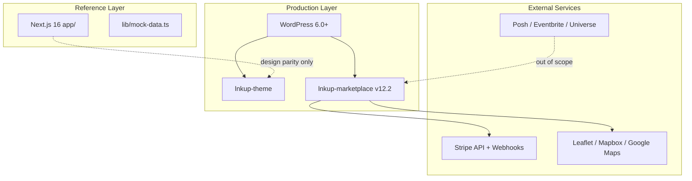

### Request Flow (Typical Dashboard Action)

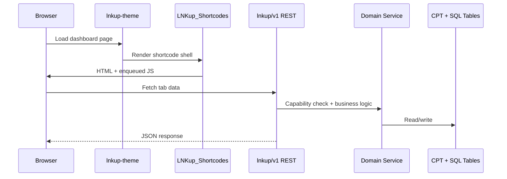

### Subsystem Map

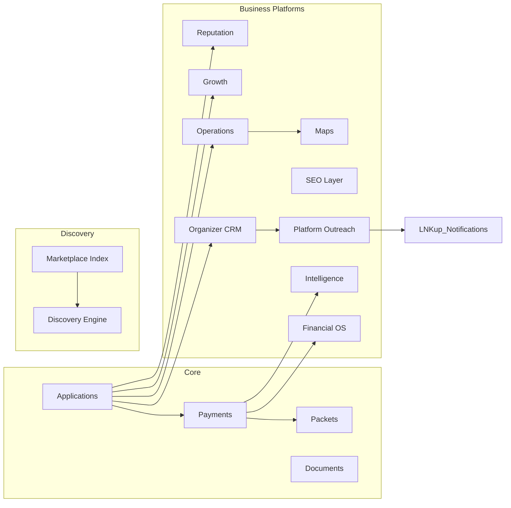

---

## 4. Monorepo Layout

```
lnk-up-marketplace-platform/
├── app/                              # Next.js 16 reference UI (24 routes)
├── components/                       # React/shadcn components (reference)
├── lib/                              # Next.js utilities, mock data
├── hooks/                            # React hooks
├── public/                           # Next.js static assets
├── tests/e2e/                        # Playwright specs (WordPress target)
├── scripts/                          # Build utilities
│   └── build-plugin-zip.ps1            # Creates dist/lnkup-marketplace.zip
├── dist/                             # Plugin zip output (generated)
├── docs/
│   ├── SYSTEM_OVERVIEW.md            # This file
│   ├── CURRENT_STATE.md              # Inventory + changelog
│   ├── UI_UX.md                      # Design system + dashboard surfaces
│   └── CURSOR_CONTEXT.md             # AI onboarding context
├── package.json                      # Next.js + Playwright (pnpm)
├── playwright.config.ts              # E2E config (baseURL localhost:8888)
├── pnpm-workspace.yaml
└── wp-content/
    ├── themes/lnkup-theme/           # Production WordPress theme
    └── plugins/lnkup-marketplace/    # All marketplace business logic
```

### Deploy Model

This repository contains **only** the `wp-content` slice. WordPress core (`wp-admin`, `wp-includes`, `wp-config.php`) is not included.

1. Copy `wp-content/themes/lnkup-theme` into a WordPress install.
2. Copy `wp-content/plugins/lnkup-marketplace` into the same install **or** build and upload `dist/lnkup-marketplace.zip` via `scripts/build-plugin-zip.ps1`.
3. Run `composer install` inside the plugin directory (Stripe SDK, dompdf).
4. Activate plugin and theme in wp-admin.
5. Build theme CSS: `cd wp-content/themes/lnkup-theme && npm run build`.
6. On first wp-admin visit after version bump, deferred migrations run automatically (index rebuild, backfills).

---

## 5. Technology Stack

### Production (WordPress)

| Layer | Technology |
|-------|-----------|
| CMS | WordPress 6.0+ |
| Backend | PHP 7.4+ (plugin); PHP 8.0+ (theme) |
| Plugin | `lnkup-marketplace` v12.12.0 |
| Theme | Classic PHP theme `lnkup-theme` v1.4.5 (`LNKUP_THEME_VERSION`; not block/FSE) |
| PHP dependencies | Composer: `stripe/stripe-php` ^16, `dompdf/dompdf` ^3 |
| Frontend (WP) | Vanilla JS modules + per-feature CSS |
| Payments | Stripe Payment Element, Connect Express destination charges, webhooks |
| Maps | Leaflet (default); Mapbox/Google optional |
| Weather | OpenWeather API (server-side; key in settings only) |
| Email | `wp_mail` HTML notifications; outreach batch queue with SMTP throttling |
| Data | CPTs + post meta + 72+ custom SQL tables |

### Reference UI (Next.js)

| Layer | Technology |
|-------|-----------|
| Framework | Next.js 16.2 (App Router) |
| UI | React 19, Tailwind CSS 4, shadcn/ui, Lucide icons |
| Charts | Recharts 3.8 |
| Analytics | `@vercel/analytics` |
| Package manager | pnpm |

### Theme Build

| Tool | Output |
|------|--------|
| Tailwind CSS 4 CLI | `wp-content/themes/lnkup-theme/assets/dist/lnkup.css` |
| Hand-written BEM | `assets/dist/components.css` |

### Testing

| Tool | Target |
|------|--------|
| Playwright 1.49+ | WordPress at `http://localhost:8888` |
| TypeScript 5.7 | Test specs in `tests/e2e/` |

---

## 6. User Roles & Access Control

### Roles

| Role | Slug | Persona |
|------|------|---------|
| Vendor | `lnkup_vendor` | Food trucks, artisans, service vendors seeking booth opportunities |
| Organizer | `lnkup_organizer` | Event producers managing vendor programs |
| Platform admin | `lnkup_admin` | LNKup staff with full platform access |
| City Connector | `lnkup_connector` | Local ambassadors earning rewards for vendor/organizer referrals (v12.8) |
| WordPress admin | `administrator` | Receives all LNKup capabilities on plugin activation |

### Capabilities by Role

**Vendor (`lnkup_vendor`):**

| Capability | Purpose |
|-----------|---------|
| `lnkup_manage_own_profile` | Edit vendor business profile |
| `lnkup_view_opportunities` | Browse marketplace |
| `lnkup_submit_applications` | Apply to opportunities |
| `lnkup_manage_own_documents` | Upload compliance documents |
| `lnkup_view_own_payments` | View payment history |
| `lnkup_view_own_financials` | Access financial hub |
| `lnkup_request_refunds` | Submit refund requests |
| `lnkup_view_own_growth` | Access growth dashboard |

**Organizer (`lnkup_organizer`):**

| Capability | Purpose |
|-----------|---------|
| `lnkup_manage_own_events` | Create and edit events |
| `lnkup_manage_own_opportunities` | Create vendor slots |
| `lnkup_review_applications` | Approve/waitlist/reject |
| `lnkup_manage_own_packets` | Configure vendor packets |
| `lnkup_manage_event_ops` | Operations console |
| `lnkup_view_own_financials` | Financial panel |
| `lnkup_manage_own_invoices` | Invoice management |
| `lnkup_approve_refunds` | Approve vendor refunds |
| `lnkup_manage_payouts` | Payout records |
| `lnkup_manage_promo_codes` | Promo code management |

**LNKup Admin (`lnkup_admin`):**

| Capability | Purpose |
|-----------|---------|
| `lnkup_manage_all` | Bypass ownership checks |
| `lnkup_verify_documents` | Verify compliance uploads |
| `lnkup_manage_settings` | Platform settings |
| `lnkup_manage_marketplace_financials` | Admin financial center |
| `lnkup_manage_marketplace_growth` | Admin growth aggregates |

### Registration & Guards

- Registration form: `[lnkup_register_form]` on `sign-up` page (`LNKup_Registration`); vendor/organizer role toggle; `user_register` hook assigns role (`class-roles.php`).
- **Outreach sign-up:** `/sign-up/?outreach={token}&role=vendor` — readonly email, locked role from campaign, hidden `lnkup_outreach_token`; server validates token TTL and email match on POST.
- Theme page templates enforce role gates via `inc/dashboard.php`.
- REST endpoints use capability callbacks + `LNKup_Capabilities` ownership helpers.
- Admin bypass uses `LNKup_Capabilities::user_has_manage_all()` — checks `$user->allcaps` directly to avoid `map_meta_cap` recursion (see CURRENT_STATE.md production fix log).

---

## 7. Domain Model

### Entity Relationships

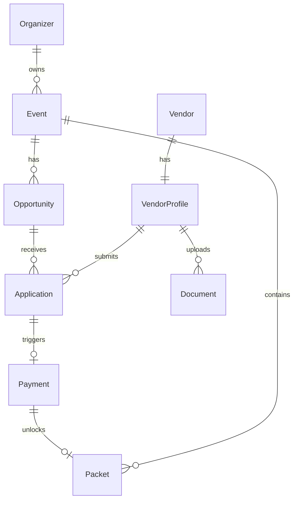

### Custom Post Types (13)

Registered in `includes/class-post-types.php`:

| CPT Slug | Label | Public | Purpose |
|----------|-------|--------|---------|
| `lnkup_vendor_profile` | Vendor Profile | No | Business profile per vendor user |
| `lnkup_event` | Event | Yes | Organizer event record |
| `lnkup_opportunity` | Opportunity | Yes | Vendor slot/booth listing for an event |
| `lnkup_application` | Application | No | Vendor application to an opportunity |
| `lnkup_document` | Document | No | Compliance upload (COI, permits, W9) |
| `lnkup_payment` | Payment | No | Payment record; checkout initiation source |
| `lnkup_packet` | Vendor Packet | No | Post-payment venue info (lock/unlock, QR) |
| `lnkup_vendor_note` | Vendor Note | No | CRM note on a vendor |
| `lnkup_vendor_list` | Vendor List | No | Organizer-curated vendor list |
| `lnkup_vendor_invite` | Vendor Invite | No | Organizer invitation to apply |
| `lnkup_vendor_flag` | Vendor Flag | No | CRM flag (watch, preferred, etc.) |
| `lnkup_review` | Review | No | Post-event vendor reputation review |
| `lnkup_dispute` | Dispute | No | Financial chargeback/dispute record |

**Note:** Platform outreach recipients are **not** a CPT — they live in SQL tables `lnkup_outreach_campaigns` and `lnkup_outreach_recipients` (see §9.11). The `lnkup_vendor_invite` CPT remains for organizer invites to **existing** vendor users to apply to an event.

### Taxonomies (3)

| Slug | Attached To | Notes |
|------|-------------|-------|
| `lnkup_vendor_category` | vendor profiles, opportunities | ~13 seeded terms (Food Vendor, Food Truck, etc.) |
| `lnkup_event_type` | events | Hierarchical: 10 parent categories (Festivals, Conferences, Markets & Pop-Ups, etc.) with subcategories (Block Party, Rodeo, Food Festival, etc.) |
| `lnkup_market` | events, opportunities | Hierarchical; no seed terms |

### Meta Linking Pattern

CPTs connect via post meta keys:

| Meta Key | Links |
|----------|-------|
| `_lnkup_event_id` | Opportunity, application, packet → event |
| `_lnkup_opportunity_id` | Application, payment → opportunity |
| `_lnkup_application_id` | Payment, packet → application |
| `_lnkup_vendor_profile_id` | Application, document → vendor profile |
| `_lnkup_application_status` | Application workflow state |
| `_lnkup_payment_status` | Payment state |

Schema registered in `includes/class-meta.php` with REST exposure where appropriate.

### Application Statuses

`submitted` → `under_review` → `approved` / `waitlisted` / `rejected` → `payment_required` → `paid` → `completed` / `cancelled`

### Payment Statuses (CPT)

`pending`, `paid`, `failed`, `refunded`, `disputed`

### Smart Financial Statuses (v11)

`awaiting_invoice`, `invoice_sent`, `awaiting_deposit`, `deposit_paid`, `balance_due`, `payment_due_soon`, `paid`, `refund_pending`, `refunded`, `chargeback`, `waived`, `cancelled`

### Document Types

`certificate_of_insurance`, `health_permit`, `business_license`, `w9`, `sales_tax_certificate`, `other`

---

## 8. Plugin Bootstrap & Lifecycle

**Entry file:** `wp-content/plugins/lnkup-marketplace/lnkup-marketplace.php`

### Constants

| Constant | Value |
|----------|-------|
| `LNKUP_VERSION` | `12.12.0` |
| `LNKUP_PLUGIN_DIR` | Plugin directory path |
| `LNKUP_PLUGIN_URL` | Plugin URL |
| `LNKUP_MIN_PHP` | `7.4` |

### Loading Sequence

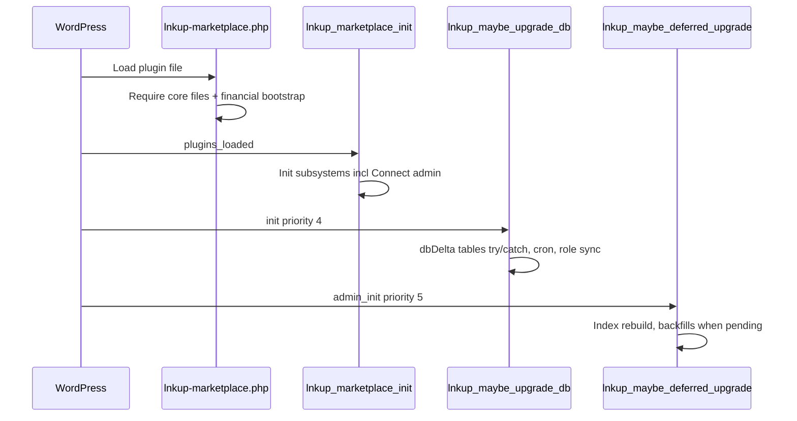

1. **PHP version guard** — exits with admin notice if PHP < 7.4.
2. **Sequential file load** — `$lnkup_core_files` array (includes `includes/weather/*` and `class-weather-*.php`) plus `includes/financial/bootstrap.php` (28 treasury/connect modules); `lnkup_require()` fails fast with admin notice on missing files.
3. **`plugins_loaded`** → `lnkup_marketplace_init()` registers all subsystem `::init()` hooks, including `LNKup_Financial_Connect_Admin`, `LNKup_Invoices`, `LNKup_Outreach` (+ tables/cron/admin), `LNKup_SEO`, and `LNKup_Registration`.
4. **`init` (priority 4)** → `lnkup_maybe_upgrade_db()` runs lightweight migrations with per-table try/catch; sets `lnkup_needs_deferred_upgrade` for heavy work.
5. **`admin_init` (priority 5)** → `lnkup_maybe_deferred_upgrade()` runs index rebuild, transaction backfills, CRM/reputation/growth backfills, showcase seed (admin only).
6. **`init` (priority 5)** → one-time marketplace index date cleanup.

### Activation (`LNKup_Activator::activate`)

1. Register roles, CPTs, taxonomies + seed taxonomy terms
2. Create SQL tables via domain table classes
3. Create pages with shortcodes and theme templates
4. Seed 5 sample events + opportunities (Charlotte, Atlanta, Miami, Raleigh, Greensboro)
5. Create demo user `lnkup_demo_organizer`
6. Set static front page if none configured
7. Schedule cron jobs (including `lnkup_weather_daily`)
8. Flush rewrite rules

### Auto-Created Pages

| Slug | Title | Shortcode | Template |
|------|-------|-----------|----------|
| `vendor-dashboard` | Vendor Dashboard | `[lnkup_vendor_dashboard]` | vendor-dashboard |
| `organizer-dashboard` | Organizer Dashboard | `[lnkup_organizer_dashboard]` | organizer-dashboard |
| `opportunities` | Find Events | `[lnkup_opportunities_feed]` | full-width |
| `vendor-profile` | Vendor Profile | `[lnkup_vendor_profile_form]` | default |
| `favorites` | Favorites | — | default |
| `vendors` | Vendor Directory | — | default |
| `sign-up` | Sign Up | `[lnkup_register_form]` | sign-up |

### Deactivation / Uninstall

- **Deactivation:** unschedule crons, flush rewrites (data persists).
- **Uninstall:** deletes `lnkup_settings` option only — CPT posts and roles remain.

### Settings (`lnkup_get_settings()`)

| Key | Default | Purpose |
|-----|---------|---------|
| `default_fee` | `5.99` | Legacy alias — synced to `vendor_checkout_fee` on migration (do not edit separately) |
| `vendor_checkout_fee` | `5.99` | **Canonical** flat fee bundled into vendor booth checkout |
| `organizer_commission_percent` | `6` | Percent of booth price retained as platform application fee |
| `application_fee_type` | `flat` | Fee rule type |
| `application_fee_flat` | `5.99` | Flat application fee component |
| `application_fee_percent` | `0` | Percent application fee component |
| `fee_payer_mode` | `vendor` | Who bears fee display logic |
| `stripe_public_key` | empty | Stripe publishable key |
| `stripe_secret_key` | empty | Stripe secret key |
| `stripe_webhook_secret` | empty | Webhook signature secret |
| `test_mode` | `true` | Use simulation when Stripe not configured |
| `payment_provider` | `stripe` | `stripe` or `manual` |
| `stripe_connect_enabled` | `false` | Enable Connect marketplace |
| `connect_platform_country` | `US` | Connect account country |
| `connect_platform_currency` | `usd` | Connect settlement currency |
| `connect_express_enabled` | `true` | Use Express accounts |
| `connect_manual_fallback` | `true` | Treasury path when organizer not onboarded |
| `connect_payout_schedule` | `daily` | Connect payout schedule hint |
| `connect_return_url` / `connect_refresh_url` | empty | Override Connect onboarding URLs |
| `connect_instant_payouts_enabled` | `false` | Instant payout flag |
| `escrow_enabled` | `true` | Escrow hold feature |
| `escrow_hold_percent` | `100` | Percent held in escrow |
| `escrow_release_days` | `7` | Days until escrow release |
| `reserve_percent` | `5` | Organizer reserve hold percent |
| `reserve_hold_days` | `30` | Reserve hold duration |
| `stripe_billing_enabled` | `false` | Stripe Billing subscriptions flag |
| `ach_enabled` | `false` | ACH payments flag |
| `default_packet_lock` | `true` | Lock packets until payment |
| `default_documents` | COI + business license | Required doc types |
| `notify_vendor` / `notify_organizer` / `notify_admin` | `true` | Email notification toggles |
| `support_email` | site admin email | Support contact |
| `marketplace_phase` | `1a` | Discovery rollout phase (1a/1b/1c) |
| `map_provider` | `leaflet` | Map engine selection |
| `mapbox_token` / `google_maps_key` | empty | Optional map API keys |
| `weather_intelligence_enabled` | `true` | Enable weather module |
| `openweather_api_key` | empty | OpenWeather API key (server-side only) |
| `openweather_api_mode` | `current_forecast` | OpenWeather API mode |
| `weather_units` | `imperial` | `imperial` or `metric` |
| `weather_refresh_minutes` | `30` | Snapshot cache TTL |
| `weather_historical_enabled` | `false` | Historical risk mode for far-future events |
| `weather_vendor_packet_note` | `true` | Show weather note in vendor packet when enabled |
| `platform_launch_date` | `2026-08-01` | Public marketplace open date |
| `platform_prelaunch_mode` | `true` | Gate Find Events; show launch UI on homepage |
| `launch_goal_vendors` | `4000` | Homepage vendor goal card (prelaunch; not a live count) |
| `launch_goal_organizers` | `500` | Homepage organizer goal card (prelaunch) |
| `outreach_emails_enabled` | `true` | Master toggle for outreach campaign emails |
| `outreach_admin_max_per_campaign` | `500` | Max recipients per admin outreach campaign |
| `outreach_organizer_max_per_campaign` | `100` | Max recipients per organizer bulk invite |
| `outreach_token_ttl_days` | `30` | Outreach invite link expiry (days) |
| `outreach_rate_limit_enabled` | `true` | SMTP throttling for outreach sends only |
| `outreach_hourly_limit` | `600` | Max outreach emails per hour (SiteGround headroom) |
| `outreach_daily_limit` | `1500` | Max outreach emails per day; unsent roll over next day |
| `outreach_batch_size` | `20` | Recipients per outreach cron batch |
| `outreach_batch_interval_seconds` | `180` | Seconds between outreach batches when throttling on |
| `outreach_resume_time` | `08:00` | Site-local time to auto-resume after daily cap |

### Marketplace Phase Gating

| Phase | Features |
|-------|----------|
| `1a` | Basic search and filtering |
| `1b` | Trending sections, personalized recommendations |
| `1c` | Daily cron: saved search alerts, deadline reminders |

Checked via `lnkup_marketplace_phase_at_least( '1b' )`.

---

## 9. Plugin Subsystems

Each subsystem follows a consistent pattern: domain classes in `includes/`, REST in `class-*-rest.php`, admin in `admin/class-*-admin.php`, frontend assets in `public/js/` and `public/css/`. Subsections **9.11–9.19** cover outreach, SEO/prelaunch, verification, saved searches, vendor import, city markets, connector program, external event discovery, and the external demand engine. **§14** documents the v12.9–12.11 premium dashboard UI layer.

### 9.1 Marketplace Discovery ("Find Events")

**Purpose:** Public vendor opportunity discovery with fast indexed search, personalization, and analytics.

| Component | Class / File |
|-----------|-------------|
| Search index | `LNKup_Marketplace_Index` |
| Filter engine | `LNKup_Discovery` |
| Trending | `LNKup_Trending` |
| Recommendations | `LNKup_Recommendations` |
| Collections | `LNKup_Collections` |
| Personalization | `LNKup_Vendor_Personalization` |
| Analytics | `LNKup_Marketplace_Analytics` |
| Cron | `LNKup_Marketplace_Cron` |
| REST | `LNKup_Marketplace_REST` |
| Geocoding | `LNKup_Geocoder` |

**SQL tables:** `lnkup_marketplace_index`, `lnkup_analytics_events`

**Index sync:** `save_post_lnkup_opportunity` and `save_post_lnkup_event` hooks rebuild index rows; `before_delete_post` cleans up.

**REST routes (`/marketplace/*`):**

| Method | Route | Auth |
|--------|-------|------|
| GET | `/marketplace/search` | Public |
| GET | `/marketplace/suggestions` | Public |
| GET | `/marketplace/sections/trending` | Public |
| GET | `/marketplace/sections/recommended` | Public |
| GET | `/marketplace/collections` | Public |
| GET | `/marketplace/collections/{slug}` | Public |
| GET | `/marketplace/compare` | Public |
| GET | `/marketplace/map-pins` | Public |
| POST | `/marketplace/track/view` | Public |
| POST | `/marketplace/track/event` | Public |
| GET/POST | `/marketplace/favorites` | Logged-in |
| GET/POST | `/marketplace/saved-searches` | Logged-in |
| DELETE | `/marketplace/saved-searches/{id}` | Logged-in |
| GET | `/marketplace/analytics` | Admin |

**Frontend:** `[lnkup_opportunities_feed]` shortcode on `/opportunities/` page. SSR grid renders without JS; `marketplace-v2.js` enhances with URL param sync, filter chips, infinite scroll, AJAX fallback. Saved searches: `saved-searches.js` modal + `[lnkup_favorites]` alerts UI (see §9.14).

**Filter dimensions:** text query, event types, categories, markets, city, radius, date presets, fee buckets, availability flags, document requirements, environment, sort modes.

---

### 9.2 Application → Payment → Packet (Core Workflow)

**Purpose:** End-to-end vendor application lifecycle from submission through payment to packet unlock.

| Component | Class |
|-----------|-------|
| Applications | `LNKup_Applications` |
| Payments | `LNKup_Payments` |
| Packets | `LNKup_Packets` |
| Documents | `LNKup_Documents` |
| Notifications | `LNKup_Notifications` |
| Legacy AJAX | `LNKup_Ajax` |

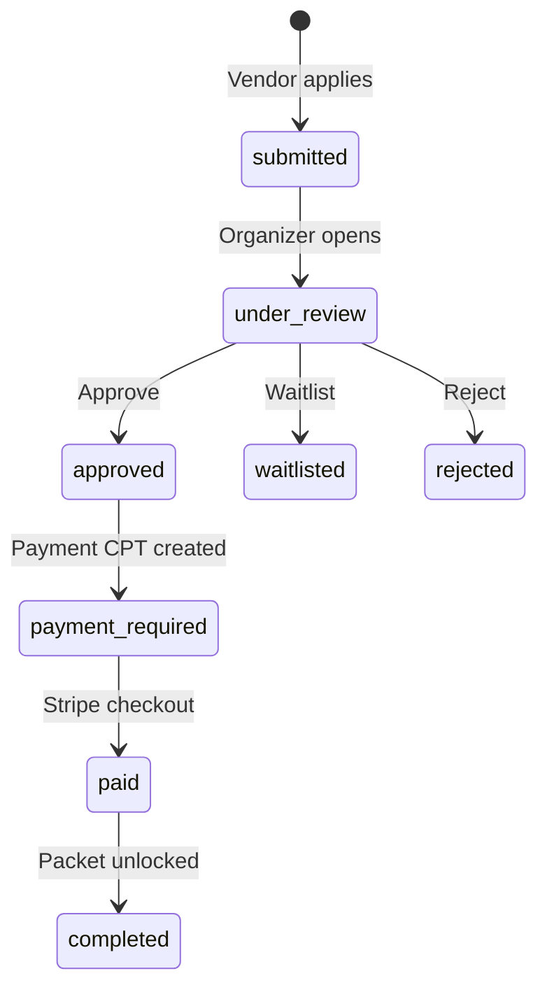

**Key hooks:**

| Hook | Fired When |
|------|-----------|
| `lnkup_application_submitted` | Vendor submits application |
| `lnkup_application_status_changed` | Any status transition |
| `lnkup_application_approved` | Organizer approves |
| `lnkup_invoice_created` | Payment CPT + invoice created |
| `lnkup_payment_completed` | Payment finalized |
| `lnkup_packet_unlocked` | Packet access granted |

**Legacy AJAX actions:** `lnkup_apply`, `lnkup_review_application`, `lnkup_create_checkout`, `lnkup_simulate_payment`, `lnkup_filter_opportunities` (public nopriv).

---

### 9.3 Financial OS & Connect Marketplace (v12.2)

**Purpose:** Production-grade financial operating system with embedded checkout, SQL ledger, and **Marketplace Treasury System** with Stripe Connect Express destination charges.

**Rule:** All financial operations route through `LNKup_Financial_Service`. UI, shortcodes, AJAX, and REST must not call Stripe directly.

#### Core financial classes

| Component | Class |
|-----------|-------|
| Service layer | `LNKup_Financial_Service` |
| Fee calculation | `LNKup_Fee_Engine` |
| Checkout wizard | `LNKup_Checkout` |
| Transactions | `LNKup_Transactions` |
| Invoices | `LNKup_Invoices` |
| Receipts | `LNKup_Receipts` |
| Vendor wallet | `LNKup_Wallet` |
| Credits | `LNKup_Credits` |
| Refunds | `LNKup_Refunds` |
| Legacy payouts | `LNKup_Payouts` |
| Disputes | `LNKup_Financial_Disputes` |
| Installments | `LNKup_Installments` |
| Deposits | `LNKup_Deposits` |
| Promo codes | `LNKup_Promo_Codes` |
| Payment methods | `LNKup_Payment_Methods` |
| Tax profiles | `LNKup_Tax_Profiles` |
| Timeline | `LNKup_Payment_Timeline` |
| Activity feed | `LNKup_Financial_Activity` |
| Audit | `LNKup_Financial_Audit` |
| Cron | `LNKup_Financial_Cron` |
| REST | `LNKup_Financial_REST` (~62 routes) |
| Render | `LNKup_Financial_Render` |
| Admin | `LNKup_Financial_Admin` |
| Connect admin | `LNKup_Financial_Connect_Admin` |

#### Treasury & Connect modules (`includes/financial/`)

| Module | Class | Responsibility |
|--------|-------|----------------|
| Stripe Connect | `LNKup_Stripe_Connect` | Express onboarding, destination charges, settlement mode |
| Organizer wallet | `LNKup_Organizer_Wallet` | Ledger mirror or treasury balances per organizer |
| Organizer payouts | `LNKup_Organizer_Payouts` | Cashout via Connect Payout API or treasury Transfer |
| Platform fees | `LNKup_Platform_Fees` | Records application fee components |
| Reserves | `LNKup_Reserves` | Hold percent of organizer net |
| Escrow | `LNKup_Escrow` | Configurable escrow holds |
| Referral credits | `LNKup_Referral_Credits` | Referral codes and rewards |
| Sponsor payments | `LNKup_Sponsor_Payments` | Sponsor invoice flows |
| Subscriptions | `LNKup_Subscriptions` | Stripe Billing subscription stubs |
| Premium listings | `LNKup_Premium_Listings` | Paid listing upgrades |
| Tax center | `LNKup_Tax_Center` | Tax document tracking and export |
| Budget center | `LNKup_Budget_Center` | Per-event budget tracking |
| Financial health | `LNKup_Financial_Health_Score` | Organizer financial health scoring |
| Approval workflows | `LNKup_Approval_Workflows` | Admin approval queue for sensitive actions |
| Refund rules | `LNKup_Refund_Rules` | Configurable refund calculation |
| Insurance marketplace | `LNKup_Insurance_Marketplace` | Placeholder offer catalog |
| Financing | `LNKup_Financing` | Placeholder offer catalog |
| Stripe client | `LNKup_Stripe_Client` | SDK wrapper, webhook verification |
| Stripe provider | `LNKup_Stripe_Provider` | PaymentIntents, Checkout Sessions |
| Manual provider | `LNKup_Manual_Provider` | Dev/test simulation |
| Webhooks | `LNKup_Stripe_Webhooks` | Idempotent event reconciliation |

#### Dual marketplace fee model (v12.1)

Vendors see a **single bundled booth reservation line** at checkout (booth price + vendor checkout fee). Platform take is via Stripe `application_fee_amount`:

| Component | Payer | Default |
|-----------|-------|---------|
| Booth price | Vendor → organizer portion | Per opportunity |
| Vendor checkout fee | Vendor | **$5.99** flat |
| Organizer commission | Organizer (from booth revenue) | **6%** of booth |

**Example ($8 booth):** bundled checkout **$13.99**; LNKup application fee **$6.47** ($5.99 + $0.48 commission); organizer net **$7.52** before reserve.

`LNKup_Fee_Engine::calculate()` is the source of truth and aligns Connect `application_fee_amount`. **Settings-first (v12.1.7+):** `vendor_checkout_fee` from LNKup Settings wins over legacy SQL flat rules; `migrate_fee_configuration()` syncs `default_fee` alias and deactivates conflicting global flat rules. `LNKup_Payments::refresh_pending_fees()` recalculates pending payment amounts at checkout open, settings save, and deferred upgrade.

#### Settlement modes

| Mode | When | Payment | Wallet | Cashout |
|------|------|---------|--------|---------|
| `destination` | Connect active + organizer ready | PI/Checkout with `application_fee_amount` + `transfer_data.destination` | Ledger tracking (`connect_settlement` entries) | Stripe Connect **Payouts** API |
| `platform_treasury` | Not onboarded / fallback enabled | Platform charge | Credits `available` / `pending` | Manual queue or Transfer when later onboarded |

#### Settlement pipeline (after `finalize_payment`)

1. `LNKup_Fee_Engine::calculate_for_payment()` — breakdown persisted on payment meta
2. `LNKup_Stripe_Connect::persist_payment_settlement_meta()` — `_lnkup_settlement_mode`
3. `LNKup_Platform_Fees::record()`
4. `LNKup_Escrow::maybe_hold()` — escrow before wallet credit when configured
5. `LNKup_Reserves::maybe_hold()`
6. `LNKup_Organizer_Wallet::credit_from_payment()` — branches on settlement mode
7. Timeline, activity, audit, transaction `settlement_mode` columns

#### Payment finalize & reconcile (v12.1.7+)

| Step | Behavior |
|------|----------|
| Checkout return | `checkout.js` handles Stripe return URL; auto-confirms after 3DS |
| Confirm endpoint | `LNKup_Financial_Service::confirm_checkout()` accepts PI `succeeded` or `processing` |
| Summary prefetch | `LNKup_Checkout` auto-confirms when summary loads and PI already paid |
| Webhook | `payment_intent.processing` and `payment_intent.succeeded` drive idempotent finalize |
| Reconcile | `reconcile_payment()` finalizes only when Stripe confirms paid; exposed via REST and **Sync payment** in Revenue tab |
| Stuck pending | Payments stay `pending` in CPT until finalize runs — gross revenue KPIs remain $0 until `paid` |

#### Organizer balance display (v12.2.2+)

Destination Connect organizers often have **$0 available** and **pending > $0** on Stripe for days after card capture — normal Connect settlement.

| Concept | Implementation |
|---------|----------------|
| `organizer_balance_payload()` | Shared PHP builder for dashboard, wallet, and slim balances route |
| `display_balances` | Merged ledger + live Stripe Connect for hero/overview |
| `stripe_balance` | Raw Connect pending/available from Stripe API |
| Wallet ledger | `connect_settlement` entries mirror destination charges |

`LNKup_Organizer_Wallet::get_balances()` shows Connect settlement as **pending** in destination mode when appropriate.

**Provider selection:**

| Provider | When Used |
|----------|-----------|
| `LNKup_Stripe_Provider` | Default when Stripe keys configured |
| `LNKup_Manual_Provider` | `payment_provider=manual` or missing keys |

**SQL tables — core financial (24):** `lnkup_transactions`, `lnkup_invoices`, `lnkup_invoice_items`, `lnkup_installment_plans`, `lnkup_installments`, `lnkup_deposits`, `lnkup_payment_methods`, `lnkup_wallets`, `lnkup_wallet_entries`, `lnkup_credits`, `lnkup_refunds`, `lnkup_payouts`, `lnkup_disputes`, `lnkup_receipts`, `lnkup_promo_codes`, `lnkup_promo_redemptions`, `lnkup_tax_profiles`, `lnkup_financial_audit`, `lnkup_fraud_flags`, `lnkup_webhook_events`, `lnkup_connected_accounts`, `lnkup_payment_timeline`, `lnkup_financial_activity`, `lnkup_fee_rules`

**SQL tables — treasury (20+):** `lnkup_organizer_wallets`, `lnkup_organizer_wallet_entries`, `lnkup_organizer_payout_accounts`, `lnkup_organizer_payouts`, `lnkup_platform_fees`, `lnkup_escrow_holds`, `lnkup_reserve_holds`, `lnkup_referral_codes`, `lnkup_referrals`, `lnkup_referral_rewards`, `lnkup_credit_rules`, `lnkup_sponsor_invoices`, `lnkup_sponsor_payments`, `lnkup_subscription_plans`, `lnkup_subscriptions`, `lnkup_premium_listings`, `lnkup_tax_documents`, `lnkup_tax_exports`, `lnkup_financial_reports`, `lnkup_event_budgets`, `lnkup_event_budget_items`, `lnkup_cashflow_forecasts`, `lnkup_financing_offers`, `lnkup_insurance_offers`, `lnkup_financial_approvals`, `lnkup_refund_rules`, `lnkup_financial_health_scores`

Treasury tables created via `LNKup_Treasury_Tables::create_tables()` called from `LNKup_Financial_Tables::create_tables()`.

**Connect REST routes:**

| Method | Route | Purpose |
|--------|-------|---------|
| GET | `/financial/connect/status` | Requirements, badges, `settlement_mode` |
| POST | `/financial/connect/onboarding-link` | Express onboarding URL |
| POST | `/financial/connect/refresh` | Sync account from Stripe |
| POST | `/financial/connect/deauthorize` | Disable local Connect row |
| GET | `/financial/organizer-balances` | **Slim** `organizer_balance_payload()` — hero/overview (v12.2.3) |
| GET | `/financial/organizer-wallet` | Wallet balances, entries, `display_balances`, `stripe_balance` |
| POST | `/financial/organizer-wallet/cashout` | Request cashout |
| GET | `/financial/organizer-payouts` | Payout history |
| POST | `/financial/organizer-payouts/{id}/cancel` | Cancel pending payout |
| GET | `/financial/dashboard` | Revenue KPIs, reports — balances always attached; reconcile **not** on hot path (v12.2.3) |
| POST | `/financial/payments/{id}/reconcile` | Sync stuck pending payment with Stripe PI |

Additional v12.1+ REST: `/financial/summary`, `/financial/referrals`, `/financial/sponsor-invoices`, `/financial/subscriptions`, `/financial/premium-listings`, `/financial/events/{id}/budget`, `/financial/forecast`, `/financial/tax-center`, `/financial/approvals`, `/financial/insurance-offers`, `/financial/financing-offers`, `/financial/refunds/calculate`.

**REST hardening (v12.2.3):** `sanitize_rest_data()` for UTF-8-safe JSON; try/catch around report/payout layers; health score avoids full `organizer_report()` recursion.

**Frontend assets:** `checkout.js`, `checkout.css`, `financial.js`, `financial.css`

**Vendor UI:** `?view=payments` — financial REST honors `?role=vendor` for dual-role users; 4-section nav (Pay / Wallet / Extras / Reports)  
**Organizer UI:** `#financial` panel — Connect banner (`#lnkup-fin-connect-banner`), wallet-first balance load (`fetchOrganizerMoneyBalances()` → `/organizer-balances` with wallet fallback), optional `/dashboard` for revenue KPIs; handles `?connect=return` and `?connect=refresh`; Overview warning when balances load but dashboard fails  
**Admin UI:** LNKup → Financial Center; **LNKup → Stripe Connect** (organizer Connect stats, webhook health)

See also: [FINANCIAL.md](../wp-content/plugins/lnkup-marketplace/FINANCIAL.md)

---

### 9.4 Organizer CRM

**Purpose:** Organizer-side vendor relationship management — directory, notes, tags, lists, flags, invites, roster, readiness.

| Component | Class |
|-----------|-------|
| Core CRM | `LNKup_Organizer_CRM` |
| Directory | `LNKup_Vendor_Directory` |
| Notes | `LNKup_Vendor_Notes` |
| Tags | `LNKup_Vendor_Tags` |
| Lists | `LNKup_Vendor_Lists` |
| Flags | `LNKup_Vendor_Flags` |
| Invites | `LNKup_Vendor_Invites` |
| Roster | `LNKup_Event_Roster` |
| Profile | `LNKup_Vendor_CRM_Profile` |
| Readiness | `LNKup_Vendor_Readiness` |
| Import | `LNKup_Vendor_Import` |
| Timeline | `LNKup_Vendor_Timeline` |
| REST | `LNKup_Organizer_CRM_REST` |
| Admin | `LNKup_Organizer_CRM_Admin` |

**SQL tables:** `lnkup_organizer_vendor_rel`, `lnkup_vendor_list_item`, `lnkup_organizer_vendor_tag`, `lnkup_crm_activity`, `lnkup_crm_import_job`, `lnkup_organizer_vendor_prospect`, `lnkup_vendor_list_prospect`

**Invite types:**

| Type | Storage | Recipient | Use case |
|------|---------|-----------|----------|
| **Vendor invite (CPT)** | `lnkup_vendor_invite` | Existing vendor user | Organizer invites registered vendor to apply/rebook for an event |
| **Bulk email outreach** | `lnkup_outreach_*` SQL (see §9.11) | Prospect email (may not have account) | Mass invite by email with tracked sign-up link |

**REST prefix:** `/crm/*` (~24 routes) — vendors, notes, tags, lists, invites, **outreach bulk/list**, roster, dashboard widgets, application intel.

| Method | Route | Purpose |
|--------|-------|---------|
| POST | `/crm/outreach/bulk` | Create campaign, import emails, queue send |
| GET | `/crm/outreach/list` | Organizer campaign stats (no public recipient emails) |
| POST/GET | `/crm/import/*` | CSV template, upload, preview, run, status (v12.6) |
| GET | `/crm/prospects` | Imported prospect directory scope |

**Frontend:** `organizer-crm.js`, `organizer-crm.css`, `vendor-import.js` — Vendor Invites panel includes **Bulk invite by email** expand section and outreach campaign progress cards. **Import vendors** 4-step wizard (upload → map → preview → run).

**Organizer dashboard CRM UI (v12.11):** Command center executive hero with launch checklist ring; 10 KPI stat cards with `animateKpiCards`; payout strip; quick-action row; apps snapshot; activity feed from widgets REST; readiness mini-cards; secondary module cards (Discover, Lists, Invites, Intelligence) with inline expand panels via `organizer-command.js`. Discover directory supports verified-only filter. CRM intel profile uses grouped timeline and premium metrics row.

---

### 9.5 Reputation

**Purpose:** Post-event vendor reviews, badges, reliability metrics, and public reputation profiles.

| Component | Class |
|-----------|-------|
| Reputation core | `LNKup_Vendor_Reputation` |
| Score engine | `LNKup_Reputation_Score` |
| Reliability | `LNKup_Reliability_Metrics` |
| Reviews | `LNKup_Vendor_Reviews` |
| Badges | `LNKup_Vendor_Badges` |
| Completed events | `LNKup_Completed_Events` |
| REST | `LNKup_Reputation_REST` |
| Render | `LNKup_Reputation_Render` |
| Admin | `LNKup_Reputation_Admin` |

**SQL tables:** `lnkup_vendor_badges`, `lnkup_reputation_activity`, `lnkup_reputation_snapshots`

**REST prefix:** `/reputation/*` — vendor profiles, reviews CRUD, summary, public slug, review eligibility.

**Frontend:** `reputation.js`, `reputation.css`

---

### 9.6 Event Operations (Day-of)

**Purpose:** Event-day command center — lifecycle stages, booths, parking, load-in, check-ins, incidents, broadcasts, staff.

| Component | Class |
|-----------|-------|
| Lifecycle | `LNKup_Event_Lifecycle` |
| Operations hub | `LNKup_Event_Operations` |
| Booths | `LNKup_Booths` |
| Parking | `LNKup_Parking` |
| Load-in | `LNKup_Loadin_Schedule` |
| Check-ins | `LNKup_Checkins` |
| Support | `LNKup_Support_Requests` |
| Incidents | `LNKup_Incidents` |
| Broadcasts | `LNKup_Broadcasts` |
| Staff | `LNKup_Event_Staff` |
| Analytics | `LNKup_Ops_Analytics` |
| Log | `LNKup_Operations_Log` |
| REST | `LNKup_Operations_REST` |
| Render | `LNKup_Operations_Render` |
| Admin | `LNKup_Operations_Admin` |

**14 lifecycle stages:**

`planning` → `applications_open` → `applications_closed` → `approvals` → `payments` → `vendor_packets_released` → `load_in` → `check_in` → `setup` → `live_event` → `breakdown` → `load_out` → `reviews` → `archived`

Auto-advance: when application status becomes `paid`, stage jumps to `vendor_packets_released`.

**SQL tables:** `lnkup_booths`, `lnkup_parking`, `lnkup_loadin_windows`, `lnkup_loadin_assignments`, `lnkup_checkins`, `lnkup_support_requests`, `lnkup_incidents`, `lnkup_operations_log`, `lnkup_event_staff`, `lnkup_packet_engagement`, `lnkup_broadcasts`

**REST prefix:** `/operations/*` (~24 routes)

**Frontend:** `operations.js`, `operations.css`

**Vendor readiness (v2):** `LNKup_Vendor_Readiness::checklist()` returns weighted percent, tier (`ready` / `on_track` / `at_risk`), grouped items (Application, Documents, Logistics, Day-of), and `next_action` CTA. Document checklist items are built from `default_documents` settings only. Organizer event summary via `event_readiness_summary()` powers the command center **Readiness** tab and portfolio KPI (avg checklist % across approved vendors).

**Vendor operations hub** (`?view=operations`): Overview (next steps, packet status), Packet (sidebar nav), Readiness (SVG ring + grouped checklist), Venue map, Support (history + new request). REST: `GET /operations/applications/{id}/support`, `GET /operations/vendor-home?application_id=`.

**Organizer command center (v12.1.6):** Five grouped section pills — **Command**, **Logistics**, **Maps**, **Field**, **Intel** — with sticky sub-tabs and `ops_tab` deep-link restore. Overview consolidates compliance alerts and live feed; logistics snapshot stats and quick jumps. Unified skeleton/empty/error per REST tab; `lnkup-ops-panel-open` event coordinates Financial/Insights/Maps lazy load.

**Event bootstrap (v12.1.5):** `bootstrap_from_event()` on create + first command-center load; `GET /operations/events/{id}/defaults` for slide-over forms (no `window.prompt`).

---

### 9.6.1 Event Weather Intelligence

**Purpose:** Operational weather readiness for organizers and vendors — forecast modes by days-to-event, risk scoring, planning recommendations, and snapshot history. Provider: **OpenWeather** behind `LNKup_Weather_Provider_Interface`.

| Component | Class |
|-----------|-------|
| Service | `LNKup_Weather_Service` |
| Provider interface | `LNKup_Weather_Provider_Interface` |
| OpenWeather client | `LNKup_Weather_Provider_OpenWeather` |
| Risk engine | `LNKup_Weather_Risk_Engine` |
| Snapshots | `LNKup_Weather_Tables` |
| REST | `LNKup_Weather_REST` |
| Cron | `LNKup_Weather_Cron` |
| Render | `LNKup_Weather_Render` |

**Modes:** `live_forecast` (0–7 days), `extended_forecast` (8–16), `historical_risk` (17+), `unavailable` (missing key/location/date).

**SQL table:** `lnkup_weather_snapshots`

**REST prefix:** `/weather/*` — `GET /weather/event/{id}`, `POST /weather/event/{id}/refresh`, `GET /weather/event/{id}/history`, `GET /weather/portfolio`, `GET /weather/admin/status`

**Settings:** LNKup → Settings → Weather Intelligence (`openweather_api_key`, units, cache TTL, historical toggle, vendor packet note).

**UI surfaces:** Organizer one-page Weather Readiness card; Event Operations overview + Insights tab; Event Intelligence DTO; optional vendor packet note.

**Frontend:** `weather.js`, `weather.css`

**Cron:** `lnkup_weather_daily` — refreshes events within 14 days.

---

### 9.7 Intelligence (Organizer Analytics)

**Purpose:** Event health scoring, funnel analytics, risk detection, recommended actions, post-event reports, market trends.

| Component | Class |
|-----------|-------|
| Event score | `LNKup_Event_Score` |
| Opportunity score | `LNKup_Opportunity_Score` |
| Funnels | `LNKup_Funnel_Analytics` |
| Market trends | `LNKup_Market_Trends` |
| Revenue intel | `LNKup_Revenue_Intelligence` |
| Vendor reliability | `LNKup_Vendor_Reliability_Intel` |
| Risk engine | `LNKup_Risk_Engine` |
| Actions | `LNKup_Recommended_Actions` |
| Post-event report | `LNKup_Post_Event_Report` |
| Organizer intel | `LNKup_Organizer_Intelligence` |
| Vendor intel | `LNKup_Vendor_Intelligence` |
| Cron | `LNKup_Intelligence_Cron` |
| REST | `LNKup_Intelligence_REST` |
| Admin | `LNKup_Intelligence_Admin` |

**SQL tables:** `lnkup_metric_snapshots`, `lnkup_event_scores`, `lnkup_opportunity_scores`, `lnkup_market_trends`, `lnkup_event_risks`, `lnkup_recommended_actions`, `lnkup_post_event_reports`

**REST prefix:** `/intelligence/*` (~20 routes)

**Organizer dashboard intelligence (v12.11):**

| Layer | Implementation |
|-------|----------------|
| Compact summary | SSR in `#lnkup-organizer-intel-summary` via `render_organizer_intel_summary_ssr()` — compliance ring score, health label, top recommended action |
| Expand trigger | `data-expand-panel="intelligence"` button + `#intelligence` hash deep link |
| Full dashboard | `#lnkup-organizer-intelligence` hydrated by `intelligence.js` → `GET /intelligence/dashboard` (8s timeout, AJAX fallback `lnkup_event_intelligence`) |
| Load hooks | `lnkup-intel-expand` event; `MutationObserver` on `#lnkup-organizer-expand-intelligence`; `window.lnkupLoadOrganizerDashboard(true)` |

**v12.11 fix:** Removed duplicate executive hero inside intelligence expand panel (was showing portfolio score `—` alongside SSR summary). Event card v4 media column no longer uses desktop `aspect-ratio: 16/10` (conflicted with 10rem horizontal sidebar grid).

**Frontend:** `intelligence.js`, `intelligence.css`

---

### 9.8 Interactive Maps

**Purpose:** Per-event interactive venue maps with booth zones, routes, parking, templates, and shareable tokens.

| Component | Class |
|-----------|-------|
| Maps core | `LNKup_Maps` |
| Elements | `LNKup_Map_Elements` |
| Parking zones | `LNKup_Parking_Zones` |
| Routes | `LNKup_Map_Routes` |
| Templates | `LNKup_Map_Templates` |
| Sharing | `LNKup_Map_Sharing` |
| Insights | `LNKup_Map_Insights` |
| Provider abstraction | `LNKup_Map_Provider` |
| Leaflet provider | `LNKup_Map_Provider_Leaflet` |
| Static provider | `LNKup_Map_Provider_Static` |
| REST | `LNKup_Map_REST` |
| Admin | `LNKup_Map_Admin` |

**SQL tables:** `lnkup_geocode_cache`, `lnkup_maps`, `lnkup_map_elements`, `lnkup_parking_zones`, `lnkup_map_routes`, `lnkup_map_templates`, `lnkup_map_shares`

**REST prefix:** `/maps/*` (~20 routes) — discovery pins, event maps, elements, layers, routes, templates, packet view, share tokens, geocode.

**Frontend:** `maps.js`, `maps.css`

---

### 9.9 Vendor Growth Platform (v10)

**Purpose:** Vendor success dashboard — KPIs, revenue analytics, match scores, goals, benchmarks, ROI, profile strength, recommendations.

| Component | Class |
|-----------|-------|
| Growth hub | `LNKup_Growth` |
| KPIs | `LNKup_Growth_Kpis` |
| Snapshots | `LNKup_Growth_Snapshots` |
| Analytics | `LNKup_Growth_Analytics` |
| Match scores | `LNKup_Growth_Match` |
| Profile strength | `LNKup_Growth_Profile_Strength` |
| Goals | `LNKup_Growth_Goals` |
| Recommendations | `LNKup_Growth_Recommendations` |
| Benchmarks | `LNKup_Growth_Benchmarks` |
| ROI | `LNKup_Growth_Roi` |
| Relationships | `LNKup_Growth_Relationships` |
| Journey | `LNKup_Growth_Journey` |
| Calendar | `LNKup_Growth_Calendar` |
| Achievements | `LNKup_Growth_Achievements` |
| Exports | `LNKup_Growth_Exports` |
| Cron | `LNKup_Growth_Cron` |
| REST | `LNKup_Growth_REST` |
| Admin | `LNKup_Growth_Admin` |

**SQL tables:** `lnkup_growth_snapshots`, `lnkup_marketplace_benchmarks`, `lnkup_vendor_goals`, `lnkup_vendor_roi`, `lnkup_vendor_profit_estimates`, `lnkup_vendor_milestones`, `lnkup_vendor_recommendations`

**REST prefix:** `/growth/*` (26 routes)

**Vendor UI:** `?view=growth` in vendor dashboard  
**Admin UI:** LNKup → Growth Center (marketplace aggregates only; no private vendor data)

**Frontend:** `growth.js`, `growth.css`

---

### 9.10 Admin, Shortcodes & Legacy AJAX

**Admin menu (`LNKup_Admin`):**

| Page | Capability | Content |
|------|-----------|---------|
| LNKup (top-level) | `lnkup_manage_all` | Platform stats: vendors, organizers, events, applications, GMV |
| Settings | `lnkup_manage_settings` | Fees, Stripe, Connect, escrow/reserve, notifications, weather, **outreach throttling**, map provider |
| Financial Center | `lnkup_manage_marketplace_financials` | Marketplace financial aggregates |
| Stripe Connect | `lnkup_manage_marketplace_financials` | Connect organizer counts, platform fees, webhook health |
| Growth Center | `lnkup_manage_marketplace_growth` | Growth aggregates |
| Outreach | `lnkup_manage_all` | Mass email campaigns, rate-limit status, recipient drill-down |
| Feature admin pages | varies | CRM, reputation, operations, intelligence, maps, verification, connectors, city markets |

**Shortcodes (13):**

| Shortcode | Purpose |
|-----------|---------|
| `[lnkup_vendor_dashboard]` | Vendor overview + tabbed views |
| `[lnkup_organizer_dashboard]` | Organizer command center + section panels |
| `[lnkup_opportunities_feed]` | Public Find Events marketplace |
| `[lnkup_vendor_profile_form]` | Vendor business profile CRUD |
| `[lnkup_organizer_events]` | Event list + opportunity creation |
| `[lnkup_applications_manager]` | Application review |
| `[lnkup_documents_manager]` | Document uploads |
| `[lnkup_payments_dashboard]` | Payment history + checkout entry |
| `[lnkup_favorites]` | Vendor favorites + saved searches |
| `[lnkup_vendor_public_profile]` | Public vendor storefront |
| `[lnkup_connector_dashboard]` | City Connector dashboard (v12.8) |
| `[lnkup_connector_interest_form]` | Connector interest form |
| `[lnkup_register_form]` | Branded sign-up with vendor/organizer role toggle; outreach token prefill |

**Legacy AJAX (logged-in unless noted):**

| Action | Purpose |
|--------|---------|
| `lnkup_apply` | Submit application |
| `lnkup_save_profile` | Create/update vendor profile |
| `lnkup_upload_document` | Upload compliance document |
| `lnkup_review_application` | Approve/waitlist/reject |
| `lnkup_create_event` | Create event |
| `lnkup_create_opportunity` | Create opportunity |
| `lnkup_download_document` | Secure document download |
| `lnkup_export_vendors` | CSV export |
| `lnkup_create_checkout` | Start checkout (legacy) |
| `lnkup_simulate_payment` | Test-mode payment completion |
| `lnkup_filter_opportunities` | Filter feed (also `nopriv`) |
| `lnkup_event_intelligence` | Intelligence data fetch |

---

### 9.11 Platform Outreach (v12.3)

**Purpose:** Mass invite prospects by email for pre-launch vendor/organizer acquisition. Uses SQL queue + WP-Cron batch `wp_mail` — separate from `lnkup_vendor_invite` CPT (registered-vendor event invites).

| Component | Class / file |
|-----------|--------------|
| Tables | `LNKup_Outreach_Tables` |
| Service | `LNKup_Outreach` |
| Cron | `LNKup_Outreach_Cron` — hook `lnkup_outreach_process_queue` |
| Admin UI | `LNKup_Outreach_Admin` — **LNKup → Outreach** |
| Email | `LNKup_Notifications::send_platform_outreach()` |
| Registration | `LNKup_Registration` — `/sign-up/?outreach={token}&role=vendor` |

**SQL tables:**

| Table | Key columns |
|-------|-------------|
| `lnkup_outreach_campaigns` | `name`, `target_role` (`lnkup_vendor` / `lnkup_organizer`), `message`, `source` (`admin` / `organizer`), `event_id`, `opportunity_id`, `status`, counters (`total`, `sent`, `skipped`, `failed`, `registered`) |
| `lnkup_outreach_recipients` | `campaign_id`, `email`, `name`, `token`, `status` (`pending` → `sent` → `opened` → `registered`), `sent_at`, `opened_at`, `registered_at` |

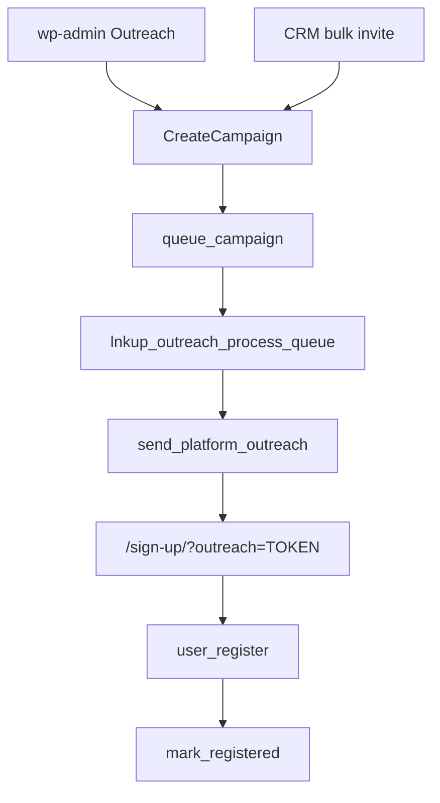

**Handoff:** If recipient email already exists as a vendor and organizer campaign has `event_id`, `LNKup_Vendor_Invites::create()` fires instead of sign-up email.

**SMTP throttling (v12.3.1):** Transient counters `lnkup_outreach_sent_hour_*` and `lnkup_outreach_sent_day_*`. Defaults: 600/hr, 1500/day, batch 20 every 180s, auto-resume at `outreach_resume_time` (08:00 site time). Transactional `wp_mail` is **not** throttled. Configure under **LNKup → Settings → Outreach throttling**.

**Limits:** Admin 500 recipients/campaign; organizer 100; token TTL 30 days.

---

### 9.12 SEO & Prelaunch (v12.2.4–12.2.5)

**SEO (`LNKup_SEO` in `includes/class-seo.php`):**

- **Rank Math not bundled** — install via wp-admin on each environment
- Filters when active: title, meta description, Open Graph, robots, JSON-LD schema (`Event`, `LocalBusiness`), sitemap exclusions for private CPTs and dashboard pages
- Default OG image from theme illustrated assets (`block-party.svg`)
- `lnkup_opportunity_illustration_url()` — SVG fallbacks on opportunity cards when no featured image

**Prelaunch (plugin settings + theme landing):**

| Setting | Default | Purpose |
|---------|---------|---------|
| `platform_launch_date` | `2026-08-01` | Public marketplace open date |
| `platform_prelaunch_mode` | `true` | Gate Find Events; show launch UI |
| `launch_goal_vendors` | `4000` | Homepage goal card (not a fake live count) |
| `launch_goal_organizers` | `500` | Homepage goal card |

Helpers: `lnkup_is_prelaunch()`, `lnkup_get_launch_goals()`, `lnkup_get_marketplace_public_stats()` — post-launch trust section switches to real aggregates.

**Theme landing (v1.4.x):** Illustrated event SVGs (`assets/images/events/*.svg`), hero canvas/orbs/floaters, category icons (`inc/landing-icons.php`), parallax (`assets/js/landing.js`), cache-busted assets via `lnkup_theme_asset()` in `inc/template-tags.php`. Template parts: `template-parts/landing/hero.php`, `trust.php`, `categories.php`. Shared dashboard components in `assets/dist/components.css` — compliance ring, executive hero, filter bar blur, empty-state icon, organizer section rhythm (v12.9–12.11).

---

### 9.13 Trust & Verification (v12.4)

**Purpose:** Context-aware trust levels for vendors and organizers — document requirements, badge aggregation, admin verification queue.

| Component | Class |
|-----------|-------|
| Verification service | `LNKup_Verification` |
| REST | `LNKup_Verification_REST` |
| Admin | `LNKup_Verification_Admin` |

**REST prefix:** `/verification/*` — vendor/organizer self + scoped reads, admin manual override.

**Document modes on opportunities:** `none` (default), platform defaults, or custom required documents via `_lnkup_document_mode`.

**UI:** Vendor home trust card; organizer trust strip; application review badges; opportunity card organizer trust chips.

---

### 9.14 Saved Searches & Opportunity Alerts (v12.5)

**Purpose:** Vendors save Find Events filter combinations and receive digest or instant email alerts.

| Component | Class |
|-----------|-------|
| Service | `LNKup_Saved_Searches` |
| Storage | User meta `lnkup_saved_searches` |
| REST | Routes under `/marketplace/saved-searches` |
| Cron | `lnkup_marketplace_daily` — daily/weekly digests, instant on publish, 48h/24h deadline reminders |

**Frontend:** Save-search modal on Find Events (`saved-searches.js`); Saved Searches section on Favorites page.

---

### 9.15 Organizer Vendor CSV Import (v12.6)

**Purpose:** Organizers import prospect vendors from CSV — map columns, preview duplicates, stage prospects, optionally add to lists and send invites.

| Component | Class |
|-----------|-------|
| Import service | `LNKup_Vendor_Import` |
| Tables | `LNKup_Vendor_Import_Tables` |
| REST | `/crm/import/*` on `LNKup_Organizer_CRM_REST` |

**SQL tables:** `lnkup_crm_import_job`, `lnkup_organizer_vendor_prospect`, `lnkup_vendor_list_prospect`

**Handoff:** When imported prospect registers, `LNKup_Outreach::mark_registered()` links prospect → CRM relationship and migrates list membership.

**Admin settings:** `crm_import_max_rows_organizer`, `crm_import_max_file_size_mb`, `crm_import_allow_invite`.

---

### 9.16 City Market Landing Pages (v12.7)

**Purpose:** SEO city landing pages with live marketplace stats and discovery cross-links.

| Component | Class / path |
|-----------|--------------|
| Registry | `LNKup_Market_Pages` — option-backed city registry (10 launch cities) |
| Rewrite | `/markets/{slug}/` |
| Theme | `page-templates/market-landing.php`, `template-parts/market/*` |
| Admin | LNKup → City Markets |

**Registration attribution:** `?market=` + `?interest=connector` → user meta `_lnkup_market_interest`, `_lnkup_signup_source`, `_lnkup_signup_city_page`.

**SEO:** Rank Math title/description, robots, OG image, canonical, JSON-LD WebPage/ItemList, sitemap URLs per market.

---

### 9.17 City Connector Program (v12.8)

**Purpose:** Local ambassadors refer vendors and organizers; manual reward workflow with optional platform credit mode.

| Component | Class |
|-----------|-------|
| Core | `LNKup_Connector` |
| Attribution | `LNKup_Connector_Attribution` — cookie `lnkup_connector_ref` |
| Tracking | `LNKup_Connector_Tracking` |
| Rewards | `LNKup_Connector_Rewards` |
| REST | `LNKup_Connector_REST` |
| Admin | `LNKup_Connector_Admin` |

**SQL tables:** `lnkup_connectors`, `lnkup_connector_events`; treasury `lnkup_referral_*` extended with `program=city_connector`.

**Role:** `lnkup_connector` — dashboard at `/connector-dashboard/` via `[lnkup_connector_dashboard]`; interest form at `/connector-interest/` via `[lnkup_connector_interest_form]`.

**Attribution:** Parallel with outreach tokens; vendor `LNKup_Referral_Credits` unchanged for vendor program codes.

---

### 9.18 External Event Discovery (v12.12 — Phase 13A)

**Purpose:** Surface admin-imported unclaimed public event listings (Eventbrite-style) in Find Events without presenting them as official LNK vendor opportunities until an organizer claims the event.

| Component | Class / path |
|-----------|----------------|
| Tables | `LNKup_External_Events_Tables` — `lnkup_external_events`, `lnkup_external_event_interest`, `lnkup_external_event_claim_tokens` |
| Service | `LNKup_External_Events` |
| Import | `LNKup_External_Events_Import` |
| REST | `LNKup_External_Events_REST` |
| Admin | `LNKup_External_Events_Admin` |
| Feed UI | `lnkup_render_external_event_card()`, `lnkup_merge_marketplace_feed()` in `helpers.php` |
| Frontend | `public/js/external-events.js`, `public/css/external-events.css` |

**Feed behavior:** On page 1, up to 6 unclaimed external cards merge with official opportunities sorted by event date. Opportunity-only filters (fee, spots, docs, compare) exclude external rows. Cards use `.lnkup-event-card--external` with legal disclaimer footer.

**Vendor interest:** Modal POST `POST /external-events/{id}/interest` → email organizer with claim link `/sign-up/?role=organizer&claim_external_event={token}`.

**Organizer claim:** Sign-up or logged-in organizer completes `POST /external-events/{id}/claim` → creates `lnkup_event` CPT with `_lnkup_external_event_id` meta; pending vendor interests shown in organizer dashboard applications panel.

**REST routes (namespace `lnkup/v1`):** `GET external-events/search`, `GET external-events/{id}`, `POST external-events/{id}/interest`, `POST external-events/{id}/claim`, `GET external-events/organizer/pending-interests`, `POST external-events/admin/import|hide|unhide`, `POST external-events/track/view`.

---

### 9.19 External Event Demand Engine (v12.13 — Phase 13B)

**Purpose:** Convert unclaimed external listings into organizer demand signals — weighted scores, threshold emails, premium claim landing, admin review/import, and dedup — without replacing Phase 13A APIs.

| Component | Class / path |
|-----------|----------------|
| Demand | `LNKup_External_Events_Demand`, `LNKup_External_Events_Demand_Score` |
| Follow-up | `LNKup_External_Events_Followup`, `LNKup_External_Events_Cron` |
| Timeline | `LNKup_External_Events_Timeline` |
| Dedup | `LNKup_External_Events_Dedup` |
| Analytics | `LNKup_External_Events_Analytics` |
| Sources | `includes/external-sources/*` (manual, csv, Eventbrite URL) |
| Claim LP | `[lnkup_external_claim_landing]` at `/claim-event/` |

**Workflow:** `workflow_status` (`pending_review`, `published`, `hidden`, `rejected`) gates feed visibility alongside `claim_status=unclaimed`. Public feed filter: `workflow_status=published`.

**Follow-ups:** Threshold emails at 1/3/5/10 vendor interests; open/click tracking via `?ext_track=open|click&token=`. Claim CTA → `/claim-event/?token=`.

**Additional REST:** `GET external-events/dashboard`, `GET external-events/demand`, `POST external-events/import-url`, `POST external-events/{id}/merge`, `GET external-events/{id}/timeline`, `GET external-events/{id}/recommendations`, `POST external-events/{id}/publish|reject|notify`.

---

## 10. Data Layer

### Dual-Storage Pattern

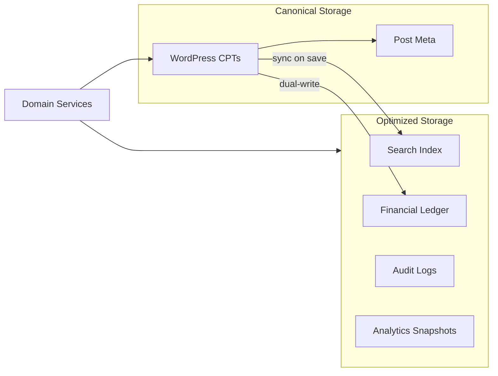

| Storage | Use Case |
|---------|----------|
| CPT + post meta | Canonical records, wp-admin editing, REST exposure |
| Custom SQL tables | Full-text/geo search, relational joins, audit trails, time-series snapshots |
| User meta | Stripe customer ID, favorites, saved searches |
| Options | `lnkup_settings`, `lnkup_db_version`, phase flags |
| Transients | Outreach hourly/daily SMTP send counters (`lnkup_outreach_sent_hour_*`, `lnkup_outreach_sent_day_*`) |

Outreach campaigns use **SQL only** (not CPT) for batch scale and status tracking.

### Tables by Domain

All tables use WordPress table prefix (typically `wp_lnkup_*`).

| Domain | Tables |
|--------|--------|
| **Discovery** | `marketplace_index`, `analytics_events` |
| **CRM** | `organizer_vendor_rel`, `vendor_list_item`, `organizer_vendor_tag`, `crm_activity` |
| **Reputation** | `vendor_badges`, `reputation_activity`, `reputation_snapshots` |
| **Operations** | `booths`, `parking`, `loadin_windows`, `loadin_assignments`, `checkins`, `support_requests`, `incidents`, `operations_log`, `event_staff`, `packet_engagement`, `broadcasts` |
| **Intelligence** | `metric_snapshots`, `event_scores`, `opportunity_scores`, `market_trends`, `event_risks`, `recommended_actions`, `post_event_reports` |
| **Maps** | `geocode_cache`, `maps`, `map_elements`, `parking_zones`, `map_routes`, `map_templates`, `map_shares` |
| **Financial** | 22 tables (see §9.3) + **treasury** 20+ tables |
| **Growth** | `growth_snapshots`, `marketplace_benchmarks`, `vendor_goals`, `vendor_roi`, `vendor_profit_estimates`, `vendor_milestones`, `vendor_recommendations` |
| **Weather** | `weather_snapshots` |
| **Outreach** | `outreach_campaigns`, `outreach_recipients` |
| **CRM Import** | `crm_import_job`, `organizer_vendor_prospect`, `vendor_list_prospect` |
| **Connector** | `connectors`, `connector_events` |

### Migrations (v12.1 two-phase)

**Phase 1 — `lnkup_maybe_upgrade_db()` on `init` (priority 4)** when `lnkup_db_version` ≠ `LNKUP_VERSION`:

1. `dbDelta()` all domain + treasury table schemas (per-table try/catch)
2. Re-create/repair pages
3. Schedule cron jobs
4. Re-seed taxonomies if version changed
5. `LNKup_Roles::sync_role_capabilities()` — add new caps to existing roles
6. Set `lnkup_needs_deferred_upgrade` and update `lnkup_db_version`

**Phase 2 — `lnkup_maybe_deferred_upgrade()` on `admin_init` (priority 5)** when `lnkup_needs_deferred_upgrade` matches current version:

1. `LNKup_Transactions::backfill_from_payments()` and extended columns
2. `LNKup_Marketplace_Index::rebuild_all()`
3. CRM, reputation, and growth backfills
4. Showcase marketplace seed
5. `LNKup_Payments::backfill_pending_payment_fees()` and `LNKup_Fee_Engine::migrate_fee_configuration()` (admin_init hook)

### Marketplace Index Schema (Key Columns)

`lnkup_marketplace_index` denormalizes opportunity data for fast queries:

- Identity: `opportunity_id`, `event_id`, `organizer_id`
- Search: `search_blob` (FULLTEXT), `title`, `city`, `state`
- Geo: `lat`, `lng`
- Taxonomy: `event_types`, `categories`, `markets` (serialized)
- Business: `vendor_fee`, `attendance`, `deadline`, `spots_remaining`, `spots_total`
- Flags: `featured`, `organizer_verified`, `indoor`, `outdoor`, `required_documents`
- Scoring: `trending_score`, `created_at`, `event_date`

---

## 11. API Reference Summary

**Base URL:** `/wp-json/lnkup/v1/`

### Route Count by Module

| Module | REST Class | Routes (approx.) |
|--------|-----------|-----------------|
| Marketplace | `LNKup_Marketplace_REST` | 15 |
| CRM | `LNKup_Organizer_CRM_REST` | 24 |
| Operations | `LNKup_Operations_REST` | 24 |
| Intelligence | `LNKup_Intelligence_REST` | 20 |
| Maps | `LNKup_Map_REST` | 20 |
| Financial | `LNKup_Financial_REST` | 62 |
| Growth | `LNKup_Growth_REST` | 26 |
| Reputation | `LNKup_Reputation_REST` | 10 |
| Weather | `LNKup_Weather_REST` | 5 |
| Stripe webhook | `LNKup_Stripe_Webhooks` | 1 |

**Total:** ~218 routes under `lnkup/v1` (v12.12.0).

### Auth Patterns

| Pattern | Used By |
|---------|---------|
| `__return_true` | Public discovery reads, analytics tracking |
| Logged-in + capability | Most write operations |
| Ownership check | Event/application/payment scoped data |
| `LNKup_Capabilities::user_has_manage_all()` | Admin bypass |
| Stripe signature | Webhook endpoint only |

### Financial REST Highlights

| Route | Method | Purpose |
|-------|--------|---------|
| `/financial/checkout/{id}/summary` | GET | Checkout line items |
| `/financial/checkout/{id}/prepare` | POST | Create PaymentIntent |
| `/financial/checkout/{id}/confirm` | POST | Finalize payment |
| `/financial/checkout/{id}/apply-credits` | POST | Apply wallet credits |
| `/financial/payments/{id}/timeline` | GET | Payment timeline steps |
| `/financial/activity` | GET | Unified activity feed |
| `/financial/invoices/{id}/pdf` | GET | Invoice PDF download |
| `/financial/invoices/{id}/email` | POST | Email invoice |
| `/financial/payment-methods/setup` | POST | SetupIntent for saved cards |
| `/financial/admin/summary` | GET | Admin financial aggregates |
| `/financial/connect/status` | GET | Connect account status, `settlement_mode` |
| `/financial/connect/onboarding-link` | POST | Express onboarding URL |
| `/financial/organizer-balances` | GET | Slim organizer balance payload (v12.2.3) |
| `/financial/organizer-wallet` | GET | Organizer wallet balances + Stripe sync |
| `/financial/organizer-wallet/cashout` | POST | Request cashout |
| `/financial/organizer-payouts` | GET | Payout history |
| `/financial/dashboard` | GET | Organizer/vendor dashboard KPIs |
| `/financial/payments/{id}/reconcile` | POST | Reconcile pending payment with Stripe |
| `/financial/summary` | GET | Role-scoped financial summary |
| `/financial/tax-center` | GET | Tax document center |
| `/financial/events/{id}/budget` | GET | Event budget (Budget Center) |

### Stripe Webhook

`POST /wp-json/lnkup/v1/stripe-webhook`

Events handled: `account.updated`, `checkout.session.completed`, `payment_intent.succeeded`, `payment_intent.payment_failed`, `transfer.created`, `transfer.failed`, `payout.created`, `payout.paid`, `payout.failed`, `charge.refunded`, `charge.dispute.created`, subscription events (audit logging).

Events logged in `lnkup_webhook_events` with retry via financial cron.

---

## 12. Core Workflows

### 12.1 Vendor Journey

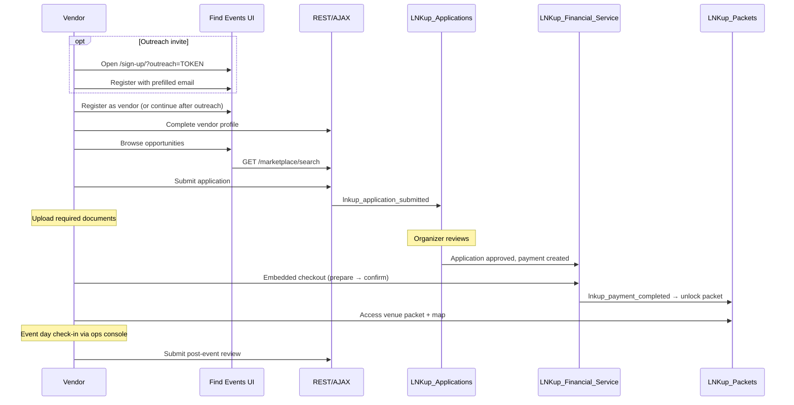

### 12.2 Organizer Journey

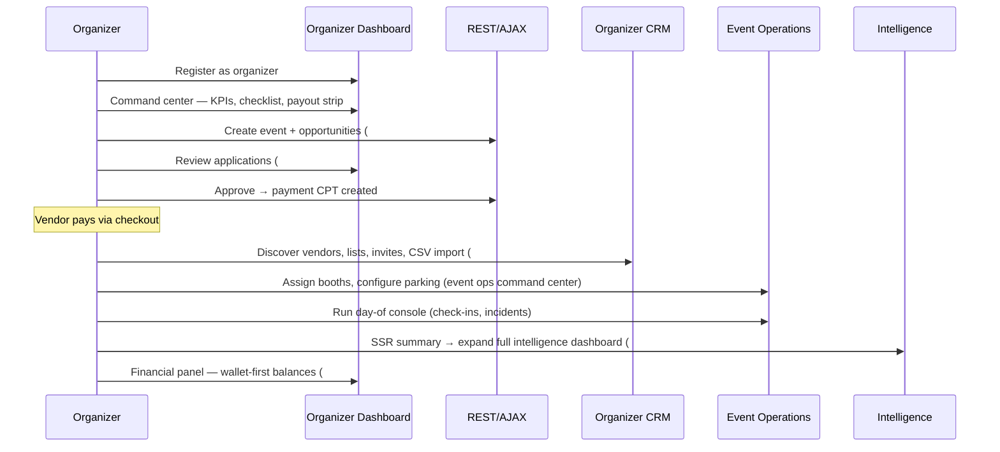

### 12.3 Discovery Data Flow

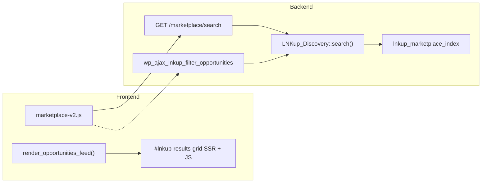

### 12.4 Event Lifecycle Workflow

When an organizer advances an event through operations stages, `lnkup_event_lifecycle_stage_changed` fires. Key transitions:

| Trigger | Auto-Transition |
|---------|----------------|
| Application approved | Payment CPT created; lifecycle may move to `payments` |
| Application paid | Stage → `vendor_packets_released` |
| Organizer manual advance | Any stage → next stage via ops REST |

### 12.5 Payment Timeline Steps

`lnkup_payment_timeline` records discrete steps per payment:

`application_approved` → `invoice_created` → `reminder_sent` → `payment_received` → `packet_unlocked` → `checked_in` → `completed` → `review_submitted`

### 12.6 Platform Outreach Journey (v12.3)

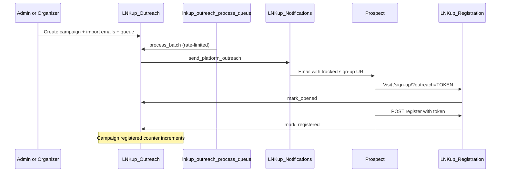

Daily/hourly SMTP caps pause the queue; pending recipients auto-resume next window (see §9.11).

---

## 13. Financial System

### Architecture (v12.2 Treasury + balance display)

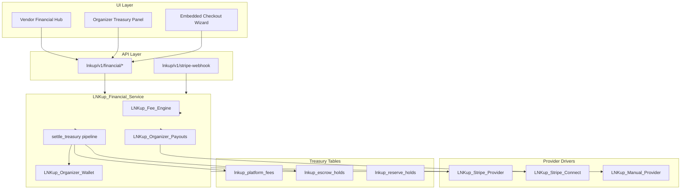

**Settlement rule:** Platform fee retained via Stripe `application_fee_amount`. Organizer net credited per settlement mode; destination-mode cashout uses Connect **Payouts** API (no platform Transfer). Treasury fallback organizers use `platform_treasury` wallet balances until onboarded.

### Connect onboarding sequence

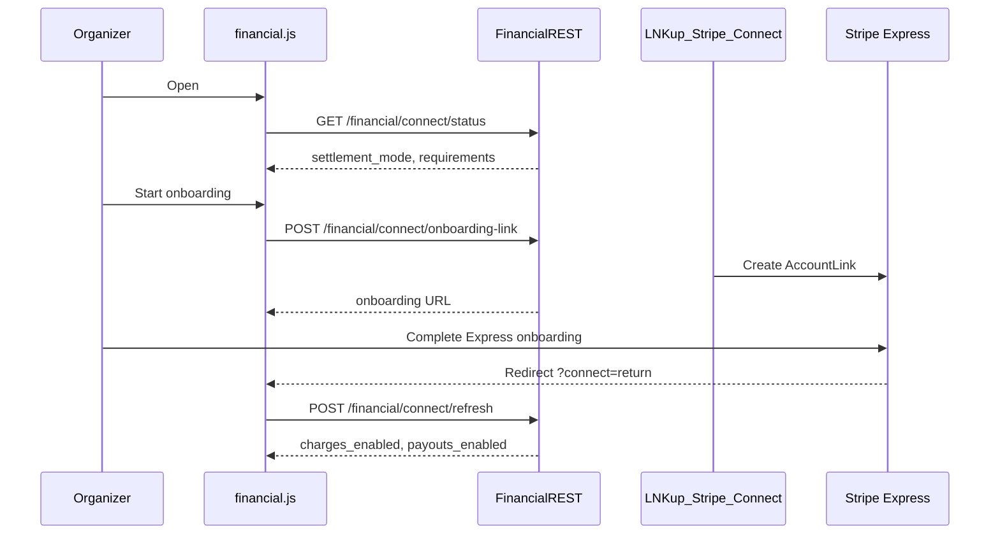

**Key modules:** `includes/financial/class-treasury-tables.php` plus 28 domain classes registered in `bootstrap.php`. Through v12.11.1: treasury migration, Connect schema, weather snapshots, financial dashboard hardening, sponsor payments schema alignment, outreach tables, CRM import, connector program, and premium dashboard UI assets.

### Organizer balance loading (v12.2.3)

```mermaid
sequenceDiagram
  participant O as Organizer
  participant UI as financial.js
  participant Bal as /organizer-balances
  participant Wal as /organizer-wallet
  participant Dash as /dashboard
  O->>UI: Open #financial Overview
  UI->>Bal: GET organizer-balances?role=organizer
  alt balances route OK
    Bal-->>UI: display_balances, stripe_balance
  else fallback
    UI->>Wal: GET organizer-wallet
    Wal-->>UI: display_balances, stripe_balance
  end
  UI->>UI: resolveOrganizerBalances() — hero + Overview
  UI->>Dash: GET dashboard (optional KPIs)
  alt dashboard JSON invalid
    Dash-->>UI: parse error (logged snippet)
    UI->>O: Overview warning; balances still shown
  else
    Dash-->>UI: revenue KPIs merged
  end
```

### Legacy note

v11 tables (`lnkup_wallets`, `lnkup_payouts`, `lnkup_transactions`) remain for vendor credits and backward-compatible reporting.

### Embedded Checkout Sequence

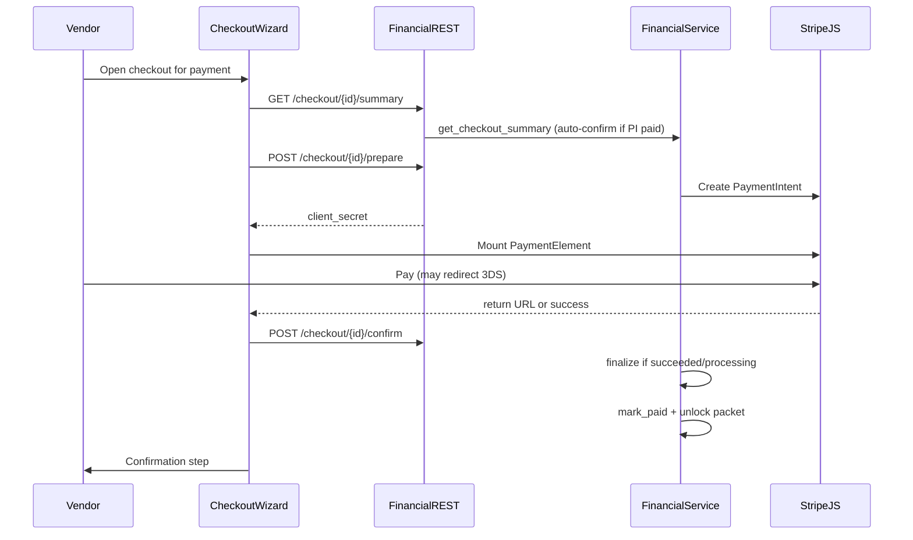

Webhook path: `payment_intent.processing` / `payment_intent.succeeded` → `LNKup_Stripe_Webhooks` → `reconcile_payment()` when browser confirm missed.

### Fee Engine

`LNKup_Fee_Engine` calculates the full payment breakdown from LNKup Settings (`vendor_checkout_fee`, `organizer_commission_percent`) plus scoped `lnkup_fee_rules` and Connect settings:

- Vendor checkout fee (default **$5.99** flat, bundled into booth line) — **settings-first**; legacy SQL global flat rules deactivated on migration
- Organizer commission (default **6%** of booth price)
- Processing fee (Stripe estimate)
- Tax, promo discounts, wallet credits
- Reserve hold (default **5%** for 30 days)
- Escrow hold (configurable percent/days)

`application_fee_amount` for Connect = vendor checkout fee + organizer commission. Results stored on payment meta and `lnkup_transactions` columns: `platform_fee`, `organizer_net`, `stripe_fee`, `gross_amount`, `settlement_mode`, `reserve_hold`. Pending payments refresh via `LNKup_Payments::refresh_pending_fees()` when checkout opens or settings change.

### Provider Selection

```
if payment_provider == 'manual' OR stripe_secret_key empty:
    → LNKup_Manual_Provider (simulation)
else:
    → LNKup_Stripe_Provider (live/test Stripe keys)
```

### Credit Types

`refund`, `referral`, `promotional`, `manual`, `marketplace`

### Backward Compatibility

- `lnkup_payment` CPT remains checkout initiation source
- `LNKup_Transactions::backfill_from_payments()` bridges legacy CPT data into SQL ledger
- Legacy AJAX `lnkup_create_checkout` delegates to `LNKup_Financial_Service`

---

## 14. Frontend Architecture

### WordPress Theme (Production)

**Path:** `wp-content/themes/lnkup-theme/`

| File | Purpose |
|------|---------|
| `front-page.php` | Landing page composing all sections |
| `page-templates/vendor-dashboard.php` | Vendor shell + shortcode |
| `page-templates/organizer-dashboard.php` | Organizer shell + shortcode |
| `page-templates/market-landing.php` | City market landing pages (v12.7) |
| `page-templates/full-width.php` | Find Events and full-width pages |
| `page-templates/sign-up.php` | Branded registration shell |
| `template-parts/landing/*` | Hero, categories, featured, trust, CTA |
| `assets/images/events/*.svg` | Illustrated event thumbnails (hero, featured cards) |
| `inc/landing-icons.php` | Category icon SVG helpers |
| `assets/js/landing.js` | Landing parallax and hero interactions |
| `inc/setup.php` | Theme supports, nav menus |
| `inc/enqueue.php` | Google Fonts (Sora + Inter), CSS/JS |
| `inc/template-tags.php` | Logo, URLs, dashboard detection, `lnkup_theme_asset()` cache-bust |
| `inc/dashboard.php` | Login guards, sidebar nav, shell markup |

**Design system:** Black/white/lime accent, Sora headings, Inter body text. Matches Next.js reference aesthetic. Full UI/UX reference: [UI_UX.md](UI_UX.md).

**Shared UI primitives (v12.9+):**

| Primitive | Location | Purpose |
|-----------|----------|---------|
| `lnkup_executive_hero()` | `includes/helpers.php` | Section hero with KPI, metrics row, optional checklist ring, primary CTA |
| `LNKupUI` | `public/js/lnkup-ui.js` | `panelEmpty`, `panelError`, `panelSkeleton`, `animateKpiCards`, copy via `LNKupUI.t()` |
| Surface tiers | Plugin + theme CSS | `.lnkup-surface--hero`, `--primary`, `--secondary`, `--quiet` |
| Copy keys | `includes/class-ui-copy.php` | Centralized dashboard strings via `lnkup_copy()` |
| Compliance ring | Theme `components.css` | SVG/CSS progress ring for checklist and intel score |

**Theme gaps (intentional):** No `single.php`, block theme, Customizer, or widget areas.

### Plugin Public UI

**Shortcodes:** `public/class-shortcodes.php` (~4300 lines) — renders all dashboard views, marketplace feed, connector dashboards, and prelaunch landing data.

**Admin outreach UI:** `admin/class-outreach-admin.php` — mass campaigns, rate-limit status card, recipient drill-down.

**Vendor dashboard routing:** `?view=` query parameter:

| View | Feature |
|------|---------|
| (default) | Overview — executive hero, Action Center, business health KPIs |
| `applications` | Application list |
| `documents` | Document manager |
| `payments` | Financial hub — wallet-first, premium invoice cards |
| `growth` | Growth dashboard — funnel visual, sticky tabs |
| `reputation` | Reputation profile |
| `operations` | Event operations (vendor home) |

**Organizer dashboard architecture (v12.11):**

Single-page command center rendered by `[lnkup_organizer_dashboard]` inside `#lnkup-organizer-crm`. Hash-based section nav with IntersectionObserver sync.

| Section ID | Content |
|------------|---------|
| `#overview` | Executive hero, launch checklist, 10 KPIs, payout strip, quick actions, apps snapshot, activity feed, readiness mini-cards |
| `#events` | Executive hero, event card grid (v4 horizontal layout), ops anchor |
| `#applications` | Executive hero, vendor request cards with progressive disclosure |
| `#vendors` | Discover module — directory, filters, verified checkbox, CRM profile |
| `#lists` / `#invites` | Secondary module cards with expand panels |
| `#intelligence` | SSR intel summary + expand → full dashboard |
| `#create` | Launch wizard with true step gating (`organizer-create.js`) |
| `#financial` | Financial center expand panel |

**JS orchestration:**

| Script | Role |
|--------|------|
| `organizer-command.js` | Expand panels, hash deep links, section nav, create wizard open, intel expand event |
| `organizer-crm.js` | Directory search, app layout toggle, KPI animation, widgets REST |
| `organizer-create.js` | Event/opportunity creation wizard |
| `intelligence.js` | Organizer dashboard load, vendor intel, ops insights tab |
| `financial.js` | Organizer financial panel — hero dedupe when executive hero present |
| `vendor-import.js` | CRM CSV import wizard |

**Event cards (v4):** Desktop horizontal grid — 10rem media column + body. Gradient fallback shows initial letter + type badge overlay (not duplicated long category text). Capacity bar color thresholds (warn ≥70%, full ≥90%).

**Hero dedupe:** `.lnkup-organizer-section-card:has(.lnkup-executive-hero)` hides duplicate section titles; duplicate Launch event CTA in header actions hidden when hero provides primary CTA.

**Per-feature assets (`public/js/` + `public/css/`):**

| Asset Pair | Feature |
|-----------|---------|
| `marketplace-v2.js/css` | Find Events discovery |
| `checkout.js/css` | Embedded checkout wizard |
| `financial.js/css` | Financial hub — wallet-first balances, Connect banner, reconcile |
| `growth.js/css` | Growth dashboard |
| `operations.js/css` | Operations console |
| `weather.js/css` | Weather intelligence panels and readiness cards |
| `intelligence.js/css` | Intelligence panels |
| `maps.js/css` | Interactive maps |
| `organizer-crm.js/css` | CRM features + import wizard |
| `organizer-command.js` | Organizer expand panels, hash nav, wizard open |
| `organizer-create.js` | Event/opportunity launch wizard |
| `vendor-import.js` | CRM CSV import wizard |
| `saved-searches.js` | Saved search modal + favorites alerts |
| `connector.js/css` | City Connector dashboard |
| `reputation.js/css` | Reputation UI |

Assets enqueued conditionally by shortcode/view to avoid loading unused JS.

### Next.js Reference UI

**Path:** `app/` + `components/`

| Area | Routes |
|------|--------|
| Landing | `/` |
| Vendor | `/dashboard`, `/dashboard/find-events`, `/dashboard/applications`, `/dashboard/documents`, `/dashboard/payments`, `/dashboard/profile`, `/dashboard/reviews` |
| Organizer | `/organizer`, `/organizer/create`, `/organizer/import`, `/organizer/applications`, `/organizer/vendors`, `/organizer/payouts` |
| Admin | `/admin`, `/admin/events`, `/admin/vendors`, `/admin/organizers`, `/admin/analytics` |

**Data:** Static mock in `lib/mock-data.ts`. No API calls to WordPress.

**Run:** `pnpm install && pnpm dev`

---

## 15. Integrations

| Service | Integration Point | Status |
|---------|------------------|--------|
| **Stripe** | `stripe/stripe-php` via Composer; Payment Element, PaymentIntents, SetupIntents, Checkout Sessions, webhooks | Production-ready |
| **Stripe Connect** | `LNKup_Stripe_Connect` — Express onboarding, destination charges, organizer wallet, cashouts | Production-ready (requires Stripe Connect enabled in Dashboard) |
| **dompdf** | Invoice PDF generation via `LNKup_Invoices` | Integrated |
| **Leaflet** | Default map provider via `LNKup_Map_Provider_Leaflet` | Active |
| **Mapbox / Google Maps** | Optional providers via settings tokens | Configurable |
| **wp_mail** | `LNKup_Notifications` HTML email templates; outreach uses queued batch sends | Active |
| **Rank Math SEO** | `LNKup_SEO` filters when plugin active | External dependency; install via wp-admin |
| **WP Cron** | Marketplace, financial, intelligence, growth, weather daily hooks; outreach single-event queue | Active |
| **External ticketing** | Posh, Eventbrite, Universe | Out of scope |
| **WooCommerce** | — | Explicitly excluded |

**SiteGround SMTP:** Shared hosting limits (~400–800 emails/hour by plan). Outreach throttling (v12.3.1) caps campaign sends separately from transactional notifications. For very large lists, consider SiteGround Email Marketing or a dedicated ESP — not implemented in v1.

### Stripe Webhook Configuration

1. Enable **Connect → Express** in Stripe Dashboard; complete platform profile.
2. Create webhook pointing to `https://{domain}/wp-json/lnkup/v1/stripe-webhook`
3. Copy signing secret to **LNKup → Settings → Stripe Webhook Secret**
4. Enable events:
   - `account.updated`
   - `checkout.session.completed`
   - `payment_intent.succeeded`
   - `payment_intent.processing`
   - `payment_intent.payment_failed`
   - `transfer.created` / `transfer.failed`
   - `payout.created` / `payout.paid` / `payout.failed`
   - `charge.refunded`
   - `charge.dispute.created`
5. Configure Connect return/refresh URLs (default: organizer dashboard `#financial`)

### User Meta

`_lnkup_stripe_customer_id` — stored per user for saved payment methods and repeat checkout.

---

## 16. Security

| Layer | Implementation |
|-------|---------------|
| Input sanitization | `LNKup_Security` — status validation, MIME allowlist for uploads |
| CSRF | WordPress nonces on all AJAX and form submissions |
| REST auth | Capability callbacks + ownership checks per route |
| Admin bypass | `user_has_manage_all()` direct cap check (no `map_meta_cap` recursion) |
| Document access | Secure download via AJAX with capability + ownership verification |
| Packet access | Lock/unlock tied to payment status (`default_packet_lock` setting) |
| Stripe webhooks | Signature verification via `LNKup_Stripe_Client` |
| Financial audit | `lnkup_financial_audit` table logs sensitive operations |
| Fraud flags | `lnkup_fraud_flags` table for manual review markers |
| Invoice verification | QR code on invoice PDFs; `template_redirect` handler for scan verification |

### Ownership Model

`LNKup_Capabilities` provides helpers:

- `organizer_owns_event( $user_id, $event_id )`
- `vendor_owns_application( $user_id, $app_id )`
- `vendor_owns_profile( $user_id, $profile_id )`

Used by REST permission callbacks before returning or mutating data.

---

## 17. Background Jobs

All jobs use WordPress Cron (`wp_schedule_event`).

| Hook | Class | Schedule | Tasks |
|------|-------|----------|-------|
| `lnkup_marketplace_daily` | `LNKup_Marketplace_Cron` | Daily (phase 1c+) | Index rebuild, saved search alerts, deadline reminders |
| `lnkup_financial_daily` | `LNKup_Financial_Cron` | Daily | Payment reminders (7d/3d/24h/overdue), installment/deposit due notices, webhook retry |
| `lnkup_intelligence_daily` | `LNKup_Intelligence_Cron` | Daily | Metric snapshots, event/opportunity score recalculation |
| `lnkup_growth_daily` | `LNKup_Growth_Cron` | Daily | Growth snapshots, recommendation generation, benchmark updates |
| `lnkup_weather_daily` | `LNKup_Weather_Cron` | Daily | Refresh weather snapshots for events within 14 days |
| `lnkup_outreach_process_queue` | `LNKup_Outreach_Cron` | Single-event (reschedules) | Batch outreach emails; pauses on hourly/daily SMTP cap; auto-resumes |

**Financial reminder hooks:** `lnkup_financial_reminder` with types: `payment_reminder_7d`, `payment_reminder_3d`, `payment_reminder_24h`, `overdue_invoice`, `installment_due`, `deposit_due`, `payment_past_due`.

Cron jobs scheduled during `lnkup_maybe_upgrade_db()` and on activation; unscheduled on deactivation.

---

## 18. Testing Strategy

### Playwright E2E

**Config:** `playwright.config.ts` — base URL `http://localhost:8888` (WordPress, not Next.js).

**Run:**

```bash
pnpm test:e2e
```

| Spec File | Coverage |
|-----------|----------|
| `marketplace-v2.spec.ts` | Discovery SSR, filter chips, error retry, mobile drawer |
| `checkout-embedded.spec.ts` | 3-step embedded checkout flow |
| `vendor-financial.spec.ts` | Vendor financial hub tabs |
| `organizer-financial.spec.ts` | Organizer financial panel + command hero smoke |
| `vendor-growth.spec.ts` | Growth dashboard KPIs and tabs |
| `organizer-crm.spec.ts` | CRM vendor directory, notes, lists |
| `vendor-dashboard-ui.spec.ts` | Vendor dashboard navigation |
| `vendor-operations.spec.ts` | Operations console |
| `event-intelligence.spec.ts` | Intelligence dashboards |
| `weather-intelligence.spec.ts` | Weather readiness card, operations panel, insights block |
| `interactive-maps.spec.ts` | Map editor and viewer |
| `vendor-reputation.spec.ts` | Reputation reviews and badges |
| `stripe-connect.spec.ts` | Connect REST status, onboarding link, organizer financial shell, wallet endpoints |
| `landing-launch.spec.ts` | Launch bar, countdown, goal cards, prelaunch marketplace gate |
| `seo-rankmath.spec.ts` | Meta tags and schema when Rank Math active |
| `outreach-invite.spec.ts` | Sign-up with/without outreach token |
| `verification-trust.spec.ts` | Trust badges and verification REST (v12.4) |
| `saved-searches.spec.ts` | Save search modal and favorites alerts (v12.5) |
| `vendor-import.spec.ts` | CRM CSV import wizard (v12.6) |
| `market-pages.spec.ts` | City market landing pages (v12.7) |
| `connector-program.spec.ts` | Connector interest, attribution, dashboard (v12.8) |
| `organizer-launch-checklist.spec.ts` | Launch checklist states |
| `organizer-event-create.spec.ts` | Event creation wizard |
| `apply-with-profile.spec.ts` | Apply flow with vendor profile |
| `vendor-profile-strength.spec.ts` | Profile strength indicators |
| `vendor-event-pass.spec.ts` | Vendor event pass / QR |

### Test environment variables

Connect and role-scoped tests use optional env vars:

- `PLAYWRIGHT_ORGANIZER_USER` / `PLAYWRIGHT_ORGANIZER_PASS`
- `PLAYWRIGHT_VENDOR_USER` / `PLAYWRIGHT_VENDOR_PASS`

### Test Conventions

- Role-based locators (`getByRole`, `getByLabel`, `getByTestId`)
- No hardcoded timeouts; web-first assertions
- Tests run against live WordPress instance with plugin + theme activated

### Not Yet Built

- CI/CD pipeline for automated test runs
- Unit tests for PHP domain classes
- Next.js component tests

---

## 19. Deployment & Configuration

### Prerequisites

- WordPress 6.0+
- PHP 7.4+ (plugin), PHP 8.0+ recommended (theme)
- MySQL 5.7+ / MariaDB 10.3+
- Composer (for plugin dependencies)
- Node.js (for theme CSS build and Playwright)

### Setup Checklist

1. Install WordPress locally (Local WP, Docker, or hosted).
2. Copy `wp-content/themes/lnkup-theme` and `wp-content/plugins/lnkup-marketplace` into WordPress `wp-content/`.
3. Run `composer install` in plugin directory.
4. Activate **LNKup Marketplace** plugin.
5. Activate **LNKup Theme**.
6. Build theme CSS: `cd wp-content/themes/lnkup-theme && npm install && npm run build`.
7. Confirm **Settings → Reading** uses static front page.
8. Configure Stripe under **LNKup → Settings** (or use test-mode simulation).
9. Create test users with `lnkup_vendor` and `lnkup_organizer` roles.
10. Install **Rank Math** (or compatible SEO plugin); verify sitemap at `/sitemap_index.xml` after launch.
11. Configure **LNKup → Settings → Outreach throttling** for SiteGround (defaults: 600/hr, 1500/day).
12. Confirm `sign-up` page exists with `[lnkup_register_form]`; test outreach flow on staging with low caps before production campaigns.

### Stripe Configuration

| Setting | Source |
|---------|--------|
| Publishable key | Stripe Dashboard → Developers → API keys |
| Secret key | Same |
| Webhook secret | Stripe Dashboard → Developers → Webhooks |
| Test mode | Enable in LNKup Settings for simulation without live charges |

### Plugin zip build

```powershell
.\scripts\build-plugin-zip.ps1
```

Outputs `dist/lnkup-marketplace.zip` for upload via **Plugins → Add New → Upload Plugin**. Excludes `.git`, `node_modules`, `tests`, `.cursor`.

### Connect production checklist (v12.11)

1. Run DB migration on staging (activate plugin or bump to 12.11.1); visit wp-admin once for deferred backfills.
2. Configure Connect settings under **LNKup → Settings**; confirm `vendor_checkout_fee` = **$5.99** (not legacy `default_fee` alone).
3. Register Stripe webhooks including `payment_intent.processing`; verify delivery in Dashboard and **LNKup → Stripe Connect** health.
4. Onboard test organizer Express account end-to-end.
5. Vendor test payment — confirm application fee on platform balance, net on connected account; hero **Pending in Stripe** matches Wallet tab.
6. Verify `/wp-json/lnkup/v1/financial/organizer-balances?role=organizer` returns valid JSON (no PHP notices prepended).
7. Hard-refresh or purge minify/CDN cache so `financial.js` serves current `LNKUP_VERSION`.
8. Verify destination-mode cashout uses Connect Payouts API (no platform Transfer).
9. Test treasury fallback organizer (no Connect) — payment succeeds, `platform_treasury` wallet path.
10. Test refund on destination charge; test **Sync payment** for stuck pending rows.
11. Promote to live keys only after checklist passes.

### Production Deployment Notes

- Upload plugin via zip (`scripts/build-plugin-zip.ps1`) or copy `wp-content/plugins/lnkup-marketplace` (see CURRENT_STATE.md for critical `map_meta_cap` fix).
- Ensure `wp_cron` runs reliably (system cron recommended for high traffic).
- Set `test_mode` to `false` and configure live Stripe + Connect keys for production.
- Run `composer install --no-dev` in plugin directory on server.

---

## 20. Extension Points

### Custom Actions (`do_action`)

| Hook | Arguments | Fired From |
|------|-----------|-----------|
| `lnkup_application_submitted` | `$app_id` | `LNKup_Applications::submit` |
| `lnkup_application_status_changed` | `$app_id`, `$prev`, `$new` | `LNKup_Applications::transition` |
| `lnkup_application_approved` | `$app_id` | `LNKup_Payments` |
| `lnkup_invoice_created` | `$payment_id`, `$invoice_id` | `LNKup_Payments` |
| `lnkup_payment_completed` | `$payment_id` | `LNKup_Financial_Service::finalize_payment` |
| `lnkup_packet_unlocked` | `$app_id`, `$payment_id` | `LNKup_Packets` |
| `lnkup_refund_completed` | `$refund_id` | `LNKup_Refunds` |
| `lnkup_receipt_issued` | `$receipt_id`, `$payment_id` | `LNKup_Receipts` |
| `lnkup_dispute_updated` | `$dispute_id` | `LNKup_Financial_Disputes` |
| `lnkup_financial_reminder` | `$type`, `$row` | `LNKup_Financial_Cron` |
| `lnkup_event_lifecycle_stage_changed` | `$event_id`, `$stage` | `LNKup_Event_Lifecycle::set_stage` |
| `lnkup_booth_assigned` | `$booth_id`, `$app_id`, `$event_id` | `LNKup_Booths` |
| `lnkup_vendor_review_submitted` | `$review_id`, `$profile_id` | `LNKup_Vendor_Reviews` |
| `lnkup_reputation_score_changed` | `$profile_id`, `$result` | `LNKup_Vendor_Reputation` |
| `lnkup_growth_recommendation_generated` | `$user_id`, `$rules` | `LNKup_Growth_Recommendations` |

### Custom Filters (`apply_filters`)

| Filter | Arguments | Purpose |
|--------|-----------|---------|
| `lnkup_reputation_score_result` | `$result`, `$profile_id` | Modify reputation score calculation |
| `lnkup_vendor_profile_data` | `$data`, `$context` | Shape vendor profile for `crm` or `public` context |

### Integration Pattern

Third-party plugins or custom code should:

1. Hook into `do_action` events above for side effects (notifications, external sync).
2. Use `apply_filters` to customize scoring and profile data.
3. Call REST API (`/wp-json/lnkup/v1/*`) for read/write from external systems.
4. Never bypass `LNKup_Financial_Service` for payment operations.

---

## 21. Known Gaps & Stubs

### Built in v12.1–v12.3 (previously listed as gaps)

| Feature | Status |
|---------|--------|
| Stripe Connect Express onboarding | Built — REST onboarding link, status, refresh; admin Connect dashboard |
| Organizer wallet & cashouts | Built — `LNKup_Organizer_Wallet`, `LNKup_Organizer_Payouts`, REST cashout |
| Organizer payouts UI | Built in organizer `#financial` panel + `stripe-connect.spec.ts` coverage |
| Marketplace treasury / platform fees | Built — dual fee model, reserves, escrow tables |
| Vendor reputation reviews | Built — `LNKup_Vendor_Reviews`, reputation REST |
| Vendor checkout fee $5.99 settings-first | Built v12.1.7 — `vendor_checkout_fee`, pending fee refresh |
| Payment finalize after 3DS / processing webhook | Built v12.1.7+ — checkout return, `payment_intent.processing` |
| Organizer hero balance vs wallet mismatch | Fixed v12.2.2–12.2.3 — `display_balances`, wallet-first JS, `/organizer-balances` |
| Financial dashboard JSON parse errors | Hardened v12.2.3 — isolated reports, UTF-8 sanitize, optional dashboard load |
| Event Weather Intelligence | Built v12.2.0 — OpenWeather provider, REST, cron, ops/intelligence UI |
| Operations command center UX | Built v12.1.6 — grouped nav, sticky sub-tabs, unified loaders |
| Prelaunch launch goals + honest homepage stats | Built v12.2.4 — goal cards, no fake GMV/vendor counts |
| Rank Math SEO layer | Built v12.2.5 — `LNKup_SEO` filters; Rank Math installed separately |
| Platform mass outreach | Built v12.3.0 — admin + CRM bulk email, SQL queue, tracked sign-up |
| Outreach SMTP rate limiting | Built v12.3.1 — hourly/daily caps, auto-resume next day |

### Still incomplete or placeholder

| Feature | Status |
|---------|--------|
| Attendee ticketing | Out of scope |
| Next.js production frontend | Reference only; no headless API consumer |
| Block theme / FSE | Classic PHP theme only |
| CI/CD pipeline | 16 E2E specs exist; no automated runner in repo |
| AI revenue forecast | `/financial/forecast` and `/growth/forecast` placeholders |
| AI recommendations | Rule-based; `source` field ready for AI swap |
| ACH live payments | `ach_enabled` flag; not fully wired |
| Stripe Billing subscriptions | `LNKup_Subscriptions` stub; `stripe_billing_enabled` off by default |
| Insurance / financing marketplaces | Placeholder offer catalogs (`LNKup_Insurance_Marketplace`, `LNKup_Financing`) |
| BNPL | Not implemented |
| SMS / push notifications | Email only via `wp_mail`; outreach uses queued batch sends (not SendGrid/Mailchimp) |
| 1099/W-9 PDF generation | Tax center tracks documents; full PDF gen placeholder |
| Event import flow | AJAX stub; no full import UI |
| WP nav menu integration | Hardcoded links in theme header/footer |
| Full `map_meta_cap` CPT mapping | Ownership via plugin helpers only |
| Admin analytics (Next.js `/admin/analytics`) | No WordPress equivalent beyond LNKup overview + Financial/Growth/Connect centers |

---

## 22. Glossary

| Term | Definition |
|------|-----------|
| **Opportunity** | A vendor slot or booth listing attached to an event |
| **Application** | A vendor's request to participate in an opportunity |
| **Packet** | Post-payment bundle of venue details (load-in times, map, contacts) |
| **Marketplace Index** | Denormalized SQL table for fast opportunity search |
| **Financial Service** | `LNKup_Financial_Service` — single entry point for all payment operations |
| **Settlement Mode** | `destination` (Connect) or `platform_treasury` (fallback) — determines payment routing and wallet behavior |
| **Application Fee** | Stripe Connect fee retained by platform = vendor checkout fee + organizer commission |
| **Treasury System** | v12 organizer wallet, platform fees, reserves, escrow — `LNKup_Treasury_Tables` |
| **Deferred Upgrade** | Heavy migrations (index rebuild, backfills) run on first wp-admin visit after version bump |
| **Phase** | Marketplace rollout level (1a/1b/1c) controlling discovery features |
| **Lifecycle Stage** | Event operations phase from planning through archived |
| **Smart Status** | Granular payment status beyond simple paid/pending (v11+) |
| **Match Score** | Growth engine score indicating vendor-opportunity fit |
| **Packet Lock** | Security control preventing packet access until payment completes |
| **Provider** | Payment driver abstraction (Stripe or Manual) |
| **CPT** | WordPress Custom Post Type |
| **GMV** | Gross Merchandise Value — total payment volume on platform |
| **Display Balances** | UI-facing merge of LNKup ledger + live Stripe Connect pending/available |
| **Connect Settlement** | Destination charge net tracked as `connect_settlement` wallet entries until Stripe payout |
| **Platform outreach campaign** | SQL-queued mass email invite with tracked sign-up token (`lnkup_outreach_*` tables) |
| **Vendor invite (CPT)** | Organizer invite for an **existing** vendor user to apply to an event (`lnkup_vendor_invite`) |
| **Prelaunch mode** | Marketplace discovery gated until `platform_launch_date`; homepage shows launch goals |
| **Executive hero** | Reusable section header component (`lnkup_executive_hero()`) with KPI, metrics, optional ring |
| **City Connector** | Local ambassador role (`lnkup_connector`) with attribution cookie and reward workflow |
| **Saved search** | Vendor-stored Find Events filter set with optional email alert frequency |
| **Vendor prospect** | CSV-imported contact staged in SQL before vendor registration |
| **Trust level** | Verification tier aggregating documents, reputation, Connect, and profile strength |

---

## 23. Related Documents

| Document | Path | Purpose |
|----------|------|---------|
| Current State Inventory | [docs/CURRENT_STATE.md](CURRENT_STATE.md) | Feature inventory, production fixes, file counts |
| UI/UX Design System | [docs/UI_UX.md](UI_UX.md) | Design tokens, components, dashboard surfaces, copy guidelines |
| AI Context | [docs/CURSOR_CONTEXT.md](CURSOR_CONTEXT.md) | Human-readable AI onboarding + prompt templates |
| Setup Guide | [README.md](../README.md) | Quick-start WordPress setup |
| Financial Platform | [wp-content/plugins/lnkup-marketplace/FINANCIAL.md](../wp-content/plugins/lnkup-marketplace/FINANCIAL.md) | Connect setup, dual fees, settlement, balance display, production checklist |
| Plugin zip build | [scripts/build-plugin-zip.ps1](../scripts/build-plugin-zip.ps1) | Creates `dist/lnkup-marketplace.zip` |
| Stripe-First Financial OS Plan | [.cursor/plans/stripe-first_financial_os_64e36ca0.plan.md](../.cursor/plans/stripe-first_financial_os_64e36ca0.plan.md) | v11 financial upgrade roadmap |
| Find Events Plan | [.cursor/plans/find_events_marketplace_0764722c.plan.md](../.cursor/plans/find_events_marketplace_0764722c.plan.md) | Discovery UX expansion |
| Platform Inventory Plan | [.cursor/plans/lnkup_platform_inventory_4850976e.plan.md](../.cursor/plans/lnkup_platform_inventory_4850976e.plan.md) | Baseline platform snapshot |

---

*This document reflects plugin v12.13.0 and theme v1.4.5. When `LNKUP_VERSION` changes, review §8 (bootstrap/migrations), §9.3 (financial/connect), §9.4–9.7 (CRM/ops/intel UI), §9.11–9.19 (outreach through external demand engine), §9.12 (SEO/prelaunch), §14 (frontend/dashboard UI), and §21 (gaps) for updates.*
