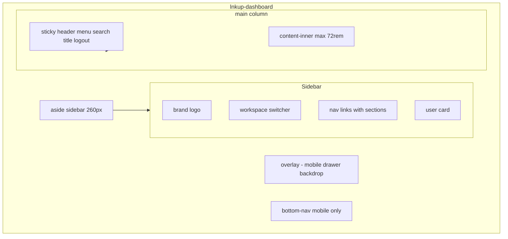
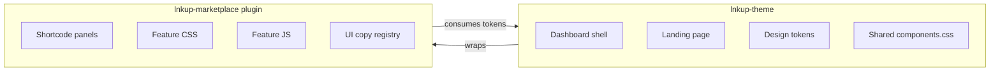
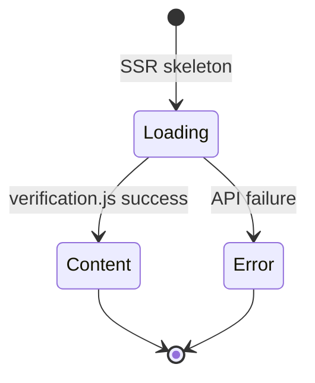
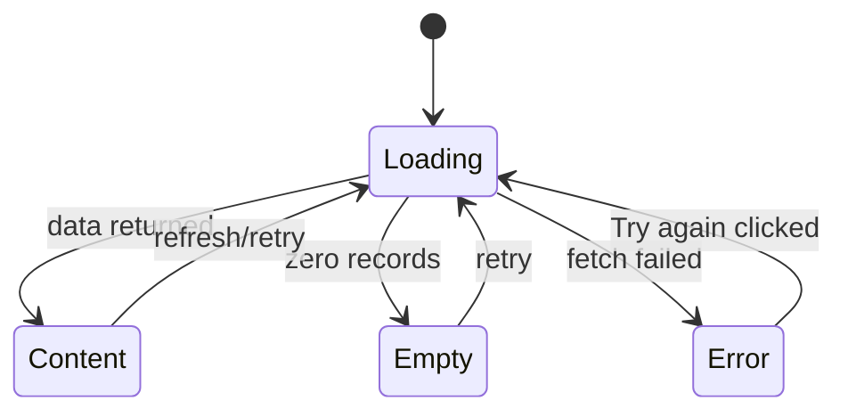

# LNK Marketplace — UI/UX Reference

**Version:** 1.0  
**Last updated:** June 2026  
**Audience:** Design, product, and engineering  
**Production stack:** WordPress theme + plugin (not Next.js)

This document is the canonical UI/UX source of truth for LNK Marketplace. It consolidates design language, component patterns, surface catalogs, copy guidelines, and implementation rules that were previously scattered across Cursor rules, architecture docs, and code comments.

**Related docs:**

- [SYSTEM_OVERVIEW.md](SYSTEM_OVERVIEW.md) — full platform architecture
- [CURRENT_STATE.md](CURRENT_STATE.md) — feature inventory and changelog
- [CURSOR_CONTEXT.md](CURSOR_CONTEXT.md) — AI workflow context

---

## Table of Contents

1. [Introduction and Brand Principles](#1-introduction-and-brand-principles)
2. [Design Tokens](#2-design-tokens)
3. [Component Library](#3-component-library)
4. [Layout and Navigation](#4-layout-and-navigation)
5. [Surface Catalog](#5-surface-catalog)
6. [Loading, Empty, and Error States](#6-loading-empty-and-error-states)
7. [Copy and Voice Guidelines](#7-copy-and-voice-guidelines)
8. [Mobile and Responsive](#8-mobile-and-responsive)
9. [Accessibility](#9-accessibility)
10. [Reference Parity Matrix](#10-reference-parity-matrix)
11. [Implementation Guide](#11-implementation-guide)
12. [UI Verification Checklist](#12-ui-verification-checklist)

---

## 1. Introduction and Brand Principles

### What LNKup Is

LNK Marketplace is a **two-sided vendor opportunity marketplace** for the event economy:

- **Vendors** discover events, apply, pay fees, upload documents, unlock packets, and track growth and reputation.
- **Organizers** create events and opportunities, review applications, manage vendors, handle payments, and run operations.
- **LNKup** captures marketplace value through fees, subscriptions, referrals, and financial services.

LNKup is **not** attendee ticketing. Attendee sales remain outside the platform (Posh, Eventbrite, Universe, etc.).

### Design Identity

| Attribute | Value |
|-----------|-------|
| Palette | Black, white, electric lime accent |
| Feel | Premium SaaS marketplace — clean, confident, modern |
| Typography | Sora (display/headings), Inter (body/UI) |
| Shape language | Rounded cards (`0.9rem` base radius), soft shadows, generous whitespace |
| Motion | Subtle hover lifts, 0.15s transitions; respects `prefers-reduced-motion` |

**Canonical design sentence:**

> Black / white / electric lime accent · Sora headings · Inter body · premium SaaS marketplace · rounded cards · mobile-first · loading + empty + error on every panel.

### Production vs Reference

| Layer | Path | Role |
|-------|------|------|
| **Production theme** | `wp-content/themes/lnkup-theme/` | Dashboard shell, landing page, layout, shared CSS |
| **Production plugin** | `wp-content/plugins/lnkup-marketplace/` | Business UI, shortcodes, feature CSS/JS, copy registry |
| **Reference UI** | `app/`, `components/`, `lib/` | Next.js 16 design mock — visual parity target, **not wired to WordPress** |

Unless explicitly requested, all feature work belongs in the WordPress theme and plugin. The reference app uses static mock data and happy-path screens only.

### Core UX Rules

Every dashboard panel must follow this lifecycle:

```
loading (skeleton) → content → empty OR error
```

**Required behaviors:**

1. **Three states minimum** — loading, empty, and error on every data-driven panel.
2. **Hide empty sections** — especially Explore More rails on Find Events; never show floating empty headings.
3. **No infinite spinners** — skeletons must be removed in `finally` / `catch` blocks.
4. **Friendly errors** — user-facing copy only; technical details go to `console.error`.
5. **No Stripe jargon** — use "Payouts active" and "Finish payout setup", never "Stripe Connect · destination".
6. **Role separation** — vendor Payments never calls organizer Connect endpoints; organizer Financial never calls vendor wallet endpoints.
7. **Prelaunch honesty** — landing and marketing copy must not inflate stats; locked nav items show clear hints.

### Anti-Patterns

Avoid:

- Giant emojis and oversized icons
- Raw default browser buttons
- Cramped text and empty section headings
- Infinite skeleton loaders
- Technical Stripe or API error strings in UI
- Duplicated dashboard sections
- Mismatched colors outside the token system
- Icons floating in the top-right on mobile
- Apply buttons that silently do nothing

---

## 2. Design Tokens

### Source Files

| File | Role |
|------|------|
| `wp-content/themes/lnkup-theme/assets/src/main.css` | Tailwind v4 source + `:root` color tokens (compiled to `assets/dist/lnkup.css`) |
| `wp-content/themes/lnkup-theme/assets/dist/components.css` | Hand-maintained BEM component library + `--lnkup-*` bridge variables |
| `app/globals.css` | Reference-only tokens (Geist fonts, dark-mode variants) |

**Build:** Run `pnpm build` in the theme directory to compile `main.css` → `lnkup.css`. `components.css` is edited directly.

### Color Tokens (Production)

Defined in `assets/src/main.css`:

```css
:root {
  --radius: 0.9rem;
  --background: oklch(0.985 0.005 120);
  --foreground: oklch(0.18 0.012 260);
  --card: oklch(1 0 0);
  --primary: oklch(0.2 0.012 260);          /* ink black */
  --primary-foreground: oklch(0.985 0.01 120);
  --accent: oklch(0.88 0.19 128);           /* electric lime */
  --accent-foreground: oklch(0.22 0.04 140);
  --destructive: oklch(0.62 0.21 25);
  --muted: oklch(0.965 0.006 120);
  --muted-foreground: oklch(0.52 0.012 260);
  --border: oklch(0.91 0.006 120);
  --ring: oklch(0.78 0.16 128);
}
```

**Plugin bridge** (`components.css`):

| Token | Value | Use |
|-------|-------|-----|
| `--lnkup-accent` | `var(--accent)` | Lime highlights, badges, CTAs |
| `--lnkup-primary` | `var(--primary)` | Dark UI surfaces, active nav |
| `--lnkup-lime` | `#c8f542` | Trust progress, strength badges (plugin fallback) |
| `--lnkup-success` | `#047857` | Approved, paid, complete |
| `--lnkup-warning` | `#b45309` | Pending, payment required |
| `--lnkup-info` | `#4f46e5` | Informational alerts |
| `--lnkup-danger` | `var(--destructive)` | Errors, rejected, destructive actions |
| `--lnkup-muted` | `var(--muted-foreground)` | Secondary text |
| `--lnkup-card` | `var(--card)` | Card backgrounds |

### Color Usage Matrix

| Situation | Token / class | Example |
|-----------|---------------|---------|
| Primary CTA on light background | `.lnkup-btn--primary` | Submit, Publish event |
| High-emphasis positive action | `.lnkup-btn--accent` | Find Events, Save |
| Secondary action | `.lnkup-btn--outline` or `--ghost` | Cancel, Try again |
| Destructive action | `.lnkup-btn--danger` | Reject, Delete |
| Active sidebar nav item | `background: var(--primary)` | Current page highlight |
| Notification badge | `background: var(--accent)` | Unread application count |
| Application approved | `.lnkup-status--approved` | Orange-tinted pill |
| Application paid | `.lnkup-status--paid` | Lime-tinted pill |
| Application rejected | `.lnkup-status--rejected` | Red-tinted pill |
| Inline error | `.lnkup-alert--error` | Panel load failure |
| Low spots warning | `.lnkup-badge--destructive` | Event card urgency |

### Typography

| Role | Font | Weight | Class / pattern |
|------|------|--------|-----------------|
| Display / hero | Sora | 800 | `.lnkup-heading--hero` — `clamp(2.5rem, 6vw, 4.5rem)` |
| Section heading | Sora | 800 | `.lnkup-heading--section` — `clamp(1.75rem, 3vw, 2.25rem)` |
| Page title (dashboard) | Sora | 700 | `.lnkup-dash-header__title`, `.lnkup-heading--page` |
| Eyebrow / label | Inter | 600 uppercase | `.lnkup-eyebrow`, `.lnkup-dashboard__nav-label` |
| Body | Inter | 400 | Default `body` |
| UI labels | Inter | 500–600 | Form labels, nav links |
| Stat values | Sora | 700–800 | `.lnkup-stat-card__value` |
| Caption / helper | Inter | 400 | `.lnkup-muted`, `font-size: 0.8125rem` |

Fonts load from Google Fonts via `inc/enqueue.php` (Sora 500–800, Inter 400–700).

### Spacing Scale

| Token | Value |
|-------|-------|
| `--lnkup-space-1` | 0.25rem |
| `--lnkup-space-2` | 0.5rem |
| `--lnkup-space-3` | 0.75rem |
| `--lnkup-space-4` | 1rem |
| `--lnkup-space-5` | 1.25rem |
| `--lnkup-space-6` | 1.5rem |
| `--lnkup-space-8` | 2rem |

### Radius and Shadow

| Token | Value |
|-------|-------|
| `--radius` | 0.9rem (base) |
| `--lnkup-radius-lg` | 1.125rem |
| `--lnkup-radius-xl` | 1.5rem |
| `--lnkup-shadow-card` | Layered subtle shadow on cards |

### Container

`.lnkup-container` — `max-width: 80rem`, responsive padding (1rem → 1.5rem @640px → 2rem @1024px).

Dashboard content inner max-width: **72rem** (`.lnkup-dashboard__content-inner`).

### Reference vs Production Token Divergence

| Aspect | Reference (`app/globals.css`) | Production |
|--------|------------------------------|------------|
| Body font | Geist Sans | Inter |
| Display font | Geist / Sora mix | Sora |
| Dark mode | CSS tokens + `.dark` variant | **Not implemented** — light-only UI |
| Dark surfaces | Theme toggle | Section-level only (footer, CTA banner, vendor pass hero) |

Production sets `<meta name="theme-color" content="#0c0d10">` for mobile browser chrome; this does not enable a dark UI theme.

### Visual Assets

Figma or screenshot library: **TBD**. Use the Next.js reference app (`pnpm dev` in repo root) and production WordPress at `http://localhost:8888` for visual comparison.

---

## 3. Component Library

All production components use the `lnkup-` BEM prefix. Reference components use shadcn/ui + Tailwind in `components/`.

### Reference ↔ Production Mapping

| Reference (`components/`) | Production class | File |
|---------------------------|------------------|------|
| `dashboard/shell.tsx` | `.lnkup-dashboard` | `themes/lnkup-theme/inc/dashboard.php` |
| `dashboard/stat-card.tsx` | `.lnkup-stat-card` | `components.css` |
| `dashboard/event-card.tsx` | `.lnkup-event-card`, `.lnkup-event-card--v2` | `plugins/.../css/marketplace-v2.css` |
| `dashboard/app-status-badge.tsx` | `.lnkup-status--*`, `.lnkup-badge--*` | `components.css` |
| shadcn `Button` | `.lnkup-btn--*` | `components.css` |
| shadcn `Card` | `.lnkup-card`, `.lnkup-panel` | `components.css` |
| Empty state pattern | `.lnkup-empty-state` | `components.css` + `lnkup-ui.js` |
| Skeleton | `.lnkup-skeleton--*` | `components.css` |
| Alert | `.lnkup-alert--*` | `components.css` |
| `landing/hero.tsx` | `.lnkup-hero` | `components.css` + `template-parts/landing/hero.php` |

### Buttons (`.lnkup-btn`)

| Variant | Class | Use |
|---------|-------|-----|
| Primary | `lnkup-btn--primary` | Main action — dark fill |
| Accent | `lnkup-btn--accent` | Lime fill — high-emphasis positive |
| Outline | `lnkup-btn--outline` | Secondary bordered |
| Ghost | `lnkup-btn--ghost` | Tertiary, low emphasis |
| Soft | `lnkup-btn--soft` | Muted background |
| Danger | `lnkup-btn--danger` | Destructive actions |
| Success | `lnkup-btn--success` | Confirm / approved actions |
| On dark | `lnkup-btn--on-dark` | Footer, CTA banner |
| Large | `lnkup-btn--lg` | Hero CTAs, min-height 3rem |
| Small | `lnkup-btn--sm` | Inline panel actions |
| Block | `lnkup-btn--block` | Full-width mobile CTAs |
| Loading | `.is-loading` | Spinner overlay, pointer-events none |
| Disabled | `:disabled`, `.is-disabled` | 50% opacity |

PHP helper: `lnkup_button_link()` in `inc/template-tags.php`.

### Cards and Panels

| Class | Use |
|-------|-----|
| `.lnkup-card` | Base card with shadow and padding |
| `.lnkup-card--interactive` | Hover lift (`translateY(-2px)`) |
| `.lnkup-panel` | Dashboard section container |
| `.lnkup-stat-card` | KPI tile — label, value, optional trend |
| `.lnkup-event-card` / `--v2` | Marketplace opportunity cards |
| `.lnkup-event-card--external` | Unclaimed third-party event listings in Find Events (muted border, outline badge, no Apply/fee UI; CTA = request vendor opportunity) |
| `.lnkup-event-card--external-hot` | High demand external card (lime ring shadow) |
| `.lnkup-demand-ring` | Circular demand score indicator on cards and claim landing |
| `.lnkup-claim-landing` | Premium organizer claim page at `/claim-event/` — hero, demand block, benefits, CTA |
| `.lnkup-badge--demand` | High demand / trending / recently requested badges on external cards |
| `.lnkup-vendor-card` | CRM vendor directory cards |
| `.lnkup-attention-item` | "Needs your attention" list rows |
| `.lnkup-organizer-hero` | Organizer overview gradient hero |

### Badges and Status Pills

**Badges** (`.lnkup-badge--*`): `accent`, `success`, `warning`, `danger`, `info`, `muted`, `outline`, `destructive`, `secondary`.

**Application status** (`.lnkup-status--*`):

| Status | Class | Visual |
|--------|-------|--------|
| Submitted, under review | `--submitted`, `--under_review` | Secondary gray |
| Approved, payment required | `--approved`, `--payment_required` | Orange tint |
| Paid, completed | `--paid`, `--completed` | Lime tint |
| Rejected, cancelled | `--rejected`, `--cancelled` | Red tint |
| Waitlisted | `--waitlisted` | Muted |

### Forms

| Pattern | Class | Use |
|---------|-------|-----|
| Dashboard form | `.lnkup-form` | Labels, inputs, selects, textareas |
| Sign-up | `.lnkup-signup-form__*` | Role toggle, registration fields |
| Chip multi-select | `.lnkup-chip-select` | Category picker on profile |
| Filter row | `.lnkup-filters` | Find Events, directory search |
| Create event | `#lnkup-create-event-form` | Organizer event launcher |

Focus: `outline: 2px solid` ring using `--ring` token. Inputs use `border-radius: calc(var(--radius) * 0.8)`.

### Dashboard Chrome

| Class | Use |
|-------|-----|
| `.lnkup-dash-header` | In-page title block (hides shell header title when present) |
| `.lnkup-dash-tabs` | Segmented tab control |
| `.lnkup-dash-subnav` | Horizontal scroll sub-navigation |
| `.lnkup-dash-table` | Responsive data table |
| `.lnkup-dash-table-wrap--cards` | Mobile: stacks rows as labeled cards |

### Alerts and Empty States

| Class | Use |
|-------|-----|
| `.lnkup-alert--success` | Confirmation, saved |
| `.lnkup-alert--warning` | Caution, incomplete setup |
| `.lnkup-alert--error` | Load failure, validation error |
| `.lnkup-alert--info` | Neutral information |
| `.lnkup-empty-state` | Zero-state with title, desc, optional CTA |
| `.lnkup-empty-state--compact` | In-panel empty (smaller padding) |
| `.lnkup-panel-state--error` | Error card wrapper (reuses empty-state typography) |

### Skeletons

| Class | Use |
|-------|-----|
| `.lnkup-skeleton` | Base shimmer block |
| `.lnkup-skeleton--card` | Card-shaped placeholder |
| `.lnkup-skeleton--title` | Heading line |
| `.lnkup-skeleton--line` | Body text line |
| `.lnkup-skeleton--media` | Image/thumbnail block |

Feature-specific skeletons live in plugin CSS: `lnkup-fin-skeleton`, `lnkup-growth-skeleton`, `lnkup-intel-skeleton`, `lnkup-crm-skeleton`, `lnkup-map-skeleton`.

### Modals and Overlays

- Backdrop: `rgba(0,0,0,0.45)` + `backdrop-filter: blur(4px)`
- Apply modal, checkout dialog, save-search modal, vendor import wizard
- Use `role="dialog"`, `aria-modal="true"`, `aria-labelledby` on modal titles

### Landing / Marketing Components

| Class | Use |
|-------|-----|
| `.lnkup-hero` | Radial lime gradient, orb animations, trust bullets |
| `.lnkup-pill` | Eyebrow badge |
| `.lnkup-steps` | How-it-works sequence |
| `.lnkup-category` | Category grid tiles |
| `.lnkup-audience-card` | Vendor vs organizer value props |
| `.lnkup-cta-banner` | Dark primary background CTA strip |
| `.lnkup-footer` | Dark footer with lime accents |

---

## 4. Layout and Navigation

### Dashboard Shell Anatomy



**DOM structure:**

```
.lnkup-dashboard
├── .lnkup-dashboard__overlay
├── aside.lnkup-dashboard__sidebar
│   ├── .lnkup-dashboard__brand
│   ├── .lnkup-dashboard__sidebar-body
│   │   ├── .lnkup-dashboard__workspace
│   │   └── nav.lnkup-dashboard__nav
│   └── .lnkup-dashboard__sidebar-footer
├── .lnkup-dashboard__main
│   ├── header.lnkup-dashboard__header
│   └── .lnkup-dashboard__content
│       └── .lnkup-dashboard__content-inner
└── nav.lnkup-dashboard__bottom-nav
```

Shell functions in `wp-content/themes/lnkup-theme/inc/dashboard.php`:

- `lnkup_dashboard_shell_open( $role, $title )`
- `lnkup_dashboard_shell_close()`
- `lnkup_get_dashboard_nav( $role )`
- `lnkup_dashboard_nav_icon( $icon )` — enforces **18px** SVG icons

### Routing Conventions

| Role | Mechanism | Examples |
|------|-----------|----------|
| Vendor dashboard views | `?view=` query param | `?view=payments`, `?view=growth` |
| Vendor standalone pages | Page slug | `opportunities`, `vendor-profile`, `favorites` |
| Organizer sections | Hash anchors on one page | `#overview`, `#financial`, `#events` |
| Find Events | Dedicated page + shortcode | `[lnkup_opportunities_feed]` |
| Deep links | Query params | `?event=123&ops=1`, `?vendor=456` |

### Vendor Navigation

Defined in `lnkup_get_dashboard_nav( 'vendor' )`:

| Section | Item | Route |
|---------|------|-------|
| — | Home | Vendor dashboard (default view) |
| **Discover** | Find Events | `/opportunities` page |
| **Discover** | Favorites | `/favorites` page |
| **Work** | Vendor requests | `?view=applications` |
| **Work** | Documents | `?view=documents` |
| **Work** | Event Operations | `?view=operations` |
| **Business** | Growth | `?view=growth` |
| **Business** | Payments | `?view=payments` |
| **Business** | Reviews | `?view=reviews` |
| **Business** | Business Profile | `/vendor-profile` page |

Prelaunch: Find Events, Favorites, and Applications may show `locked` state with hint "Opens on launch day".

### Organizer Navigation

| Section | Item | Hash |
|---------|------|------|
| — | Overview | `#overview` |
| **Command** | Events | `#events` |
| **Command** | Vendor requests | `#applications` |
| **Command** | Discover vendors | `#vendors` |
| **Command** | Launch event | `#create` |
| **Revenue** | Financial center | `#financial` |
| **Network** | Vendor Lists | `#lists` |
| **Network** | Invites | `#invites` |
| **Network** | Operations | `#operations` |
| **Network** | Intelligence | `#intelligence` |

Use **"Launch event"** / **"Create event"** — not "Import Event" unless import is explicitly in scope.

### Mobile Bottom Navigation (≤768px)

Five items: Home, Find Events/Events, Applications, Payments/Financial, More (opens drawer).

Content receives `padding-bottom: 4.5rem` plus safe-area inset so it does not sit under the bottom nav.

### Theme vs Plugin Responsibility



- **Theme:** layout shell, nav, landing, shared design system
- **Plugin:** all business panels, feature-specific styles, REST-driven UI, copy strings

---

## 5. Surface Catalog

Each surface documents: purpose, key UI blocks, asset files, data source, and required states.

### Vendor Surfaces

Rendered by `LNKup_Shortcodes::render_vendor_dashboard()` → `LNKup_Vendor_Dashboard_Views`.

| View | `?view=` | CSS | JS | Key UI blocks | REST / data |
|------|----------|-----|-----|---------------|-------------|
| **Home** | (default) | `vendor-dashboard.css` | `verification.js` (trust card) | Welcome header, profile strength, trust card, KPI stat cards, attention list, upcoming events, recommendations | SSR + hydration |
| **Find Events** | separate page | `marketplace-v2.css`, `saved-searches.css` | `marketplace-v2.js`, `saved-searches.js` | Filter bar, card grid, Apply modal, Explore More rails, save/favorite | `lnkup/v1/marketplace/*` |
| **Applications** | `applications` | theme | — | Application list, status badges | CPT query |
| **Documents** | `documents` | theme | — | Upload list, review states | CPT + AJAX |
| **Payments** | `payments` | `financial.css` | `financial.js` | Wallet-first tabs: Overview, Invoices, Payment Methods, Wallet & Credits, etc. | `lnkup/v1/financial/*` (vendor routes only) |
| **Growth** | `growth` | `growth.css` | `growth.js` | KPI strip, rings, checklist, calendar, achievements | `lnkup/v1/growth/dashboard` |
| **Reviews** | `reviews` | `reputation.css` | — | Score, tier badges (elite/trusted/risk), review list | `lnkup/v1/reputation/*` |
| **Operations** | `operations` | `operations.css`, `vendor-event-pass.css`, `weather.css` | `operations.js`, `weather.js` | Event selector, vendor pass (locked/unlocked), QR, load-in, weather | `lnkup/v1/operations/*` |
| **Business Profile** | separate page | `vendor-profile.css` | — | Resume layout, section progress, preview | Profile CPT meta |

**Vendor Payments tabs** (never show organizer Financial or Connect cashout UI):

Overview · Invoices · Payment Methods · Wallet & Credits · Referral Credits · Subscriptions · Premium Listings · Tax Center · Receipts · Refunds · Reports

### Organizer Surfaces

Rendered by `LNKup_Shortcodes::render_organizer_dashboard()` in monolithic `#lnkup-organizer-crm` shell.

| Section | Hash | CSS | JS | Key UI blocks | REST / data |
|---------|------|-----|-----|---------------|-------------|
| **Overview** | `#overview` | `organizer-crm.css` | `organizer-crm.js` | Hero, trust strip, KPIs, attention list, financial snapshot, launch checklist | `lnkup/v1/crm/*` |
| **Events** | `#events` | `organizer-crm.css` | `organizer-crm.js` | Event cards, readiness, quick actions | CRM REST |
| **Applications** | `#applications` | `organizer-crm.css` | `organizer-crm.js` | Sticky tab filters, approve/waitlist/reject, trust badges | Applications REST |
| **Discover vendors** | `#vendors` | `organizer-crm.css` | `organizer-crm.js` | Search, categories, ratings, verified badges, invite | Vendor directory REST |
| **Financial** | `#financial` | `financial.css` | `financial.js` | 13-tab wallet-first shell | `lnkup/v1/financial/*` (organizer routes only) |
| **Vendor Lists** | `#lists` | `organizer-crm.css` | `organizer-crm.js` | List CRUD, drawer detail | CRM REST |
| **Invites** | `#invites` | `organizer-crm.css` | `organizer-crm.js` | Invite composer, status | CRM REST |
| **Operations** | `#operations` | `operations.css`, `maps.css`, `weather.css` | `operations.js` | Command center, lifecycle bar, pass builder, kanban, maps | Operations REST |
| **Intelligence** | `#intelligence` | `intelligence.css` | `intelligence.js` | KPI rows, drawer, risk alerts, funnels | Intelligence REST |
| **Create Event** | `#create` | `organizer-crm.css` | — | Event form, first opportunity onboarding | AJAX + REST |

**Organizer Financial tabs:**

Overview · Wallet · Cash Out · Revenue · Sponsor Revenue · Payouts · Reserves · Budget · Forecast · Refunds · Tax · Reports · Settings

### Public / Marketing Surfaces

| Surface | Template / partial | CSS |
|---------|-------------------|-----|
| Landing page | `front-page.php` + `template-parts/landing/*` | `components.css` |
| Sign-up | `page-templates/sign-up.php` | `components.css` |
| Market landing (alt) | `page-templates/market-landing.php` | `components.css` |
| Prelaunch marketplace | `[lnkup_opportunities_feed]` with `lnkup-mp-prelaunch` | `marketplace-v2.css` |

Landing partials: `hero.php`, `site-header.php`, `site-footer.php`, `categories.php`, `featured.php`, `how-it-works.php`, `cta-banner.php`.

### Find Events Marketplace Spec

**Search ranking priority:**

1. Exact title match
2. Title starts with query
3. City/market match
4. Event type/category match
5. Description/body match
6. Trending/recommended score

**Event card fields:**

Cover photo (organizer upload, then Eventbrite URL, then one realistic category JPG) · title · date · city/state · venue · category badges · booth fee · attendance estimate · spots remaining · application deadline · organizer verified badge · Apply · Save/Favorite. Alt is `{category} in {city}` — never empty and never “image of…”.

**Explore More rails** (hide when empty):

Recommended · Trending · Closing Soon · Most Applied · Collections

### Interaction Flows

#### Apply Button State Machine

```mermaid
flowchart TD
  click[User clicks Apply]
  click --> loggedOut{Logged in?}
  loggedOut -->|No| login[Show login/register prompt]
  loggedOut -->|Yes| roleCheck{Role?}
  roleCheck -->|Organizer/Admin| blocked[Only vendors can apply]
  roleCheck -->|Vendor| profileCheck{Has profile?}
  profileCheck -->|No| createProfile[Build vendor profile CTA]
  profileCheck -->|Yes| appliedCheck{Already applied?}
  appliedCheck -->|Yes| status[Show application status]
  appliedCheck -->|No| closedCheck{Closed or full?}
  closedCheck -->|Yes| closedMsg[Show closed/full status]
  closedCheck -->|No| modal[Open apply modal]
  modal --> success[Confirmation + view applications CTA]
```

#### Trust Card Hydration (Vendor Home)



PHP renders `.lnkup-trust-card__loading` skeleton; JS toggles `__content` or `__error`.

#### Payment Checkout

1. Organizer approves application → vendor sees payment required status
2. Vendor initiates checkout from Payments or application row
3. `checkout.js` opens modal (`checkout.css`) — routes through `LNKup_Financial_Service`, never direct Stripe from UI
4. Success → packet unlock flow, vendor pass becomes available in Operations

---

## 6. Loading, Empty, and Error States

### Standard Panel Lifecycle



### Shared JavaScript API

**File:** `wp-content/plugins/lnkup-marketplace/public/js/lnkup-ui.js`  
**Global:** `window.LNKupUI`  
**Copy:** `window.lnkupUiCopy` (from `LNKup_UI_Copy::for_js()`)

| Function | Purpose |
|----------|---------|
| `LNKupUI.fetchJson(url, options)` | Safe fetch with JSON content-type validation |
| `LNKupUI.panelSkeleton(el, count)` | Inject `lnkup-skeleton--card` placeholders |
| `LNKupUI.panelEmpty(el, opts)` | Render `.lnkup-empty-state` with optional CTA |
| `LNKupUI.panelError(el, opts)` | Render `.lnkup-alert--error` + optional Try again |
| `LNKupUI.panelMessage(el, type, title, desc)` | Route to empty or error |
| `LNKupUI.t(key, fallback)` | Resolve copy from registry |

**Fetch safety rules** (all dashboard JS):

1. Check `response.ok`
2. Verify `content-type` includes `application/json`
3. `catch` errors and log to console
4. **Always** remove skeletons in `finally` / `catch`
5. Render friendly error cards — never raw API messages

### PHP Helpers

| Helper | File | Use |
|--------|------|-----|
| `lnkup_empty_state( $title, $desc, $cta )` | `includes/helpers.php` | Server-rendered zero-states |
| `lnkup_render_opportunity_card_skeleton()` | `includes/helpers.php` | Marketplace card shimmer |
| `lnkup_copy( $key )` | `class-ui-copy.php` | Localized copy string |

### Feature-Specific State Implementations

| Module | JS file | Loading | Empty | Error |
|--------|---------|---------|-------|-------|
| Financial | `financial.js` | `lnkup-fin-skeleton` | `empty_financial` copy, compact empty | `failPanel()` → `panelError` + retry |
| Growth | `growth.js` | `lnkup-growth-skeleton` | inline when `data.empty_state` | `failPanel()` + retry event |
| Operations | `operations.js` | `panelSkeleton(el, 2)` | `panelEmpty` per tab | `panelError` + retry per tab |
| Intelligence | `intelligence.js` | multi-block `lnkup-intel-skeleton` | "No intelligence data yet" + CTA | retry button |
| Organizer CRM | `organizer-crm.js` | `lnkup-crm-skeleton` | `panelMessage('empty', …)` | `panelMessage('error', …)` |
| Find Events | `marketplace-v2.js` | card skeleton + infinite loader | `#lnkup-empty-state` | `#lnkup-error-state` + Retry |
| Saved searches | `saved-searches.js` | loading text | full empty-state | `lnkup-alert--error` |
| Weather | `weather.js` | skeleton + muted text | info alert | refresh error message |
| Verification | `verification.js` | PHP skeleton in trust card | — | `lnkup-trust-card__error` |
| Vendor import | `vendor-import.js` | `is-loading` on status | — | alert + toast |

### Default Copy

| State | Copy key | Default string |
|-------|----------|----------------|
| Panel error | `panel_error` | We couldn't load this section. Try refreshing or contact support. |
| Retry | `retry` | Try again |
| Empty financial | `empty_financial` | No financial activity yet. Payments will appear here once vendors start booking. |
| Empty applications | `empty_applications` | Vendor requests will appear here once vendors apply to your opportunities. |
| Empty vendor requests | `empty_vendor_requests` | No new vendor requests yet. Invite vendors or share this opportunity to start filling your roster. |
| Empty documents | `empty_documents` | No documents uploaded yet. Required vendor documents will appear here for review. |
| Find Events (no results) | — | No matching opportunities found. Try clearing filters or searching another city. |
| Vendor operations (no data) | — | Your event operations details will appear here once you're approved and paid for an event. |
| Vendor growth (new user) | — | Your growth insights will appear once you start applying to and completing events. |

---

## 7. Copy and Voice Guidelines

### Source of Truth

All marketplace-facing labels live in `wp-content/plugins/lnkup-marketplace/includes/class-ui-copy.php` (`LNKup_UI_Copy`).

Use `lnkup_copy( 'key' )` in PHP and `LNKupUI.t( 'key', fallback )` in JS. Add new keys to the registry — do not hardcode strings in templates.

### Naming Conventions

| Avoid | Use |
|-------|-----|
| Applications (organizer-facing) | Vendor requests |
| Vendor directory | Discover vendors |
| Financial (vendor dashboard) | Payments |
| Payments (organizer dashboard) | Financial center |
| Create event (inconsistent) | Launch event |
| Stripe Connect active | Payouts active |

### Financial / Payout Copy

| State | User-facing copy |
|-------|------------------|
| Connect active | Payouts active |
| Onboarding incomplete | Finish payout setup |
| Stripe reviewing | Stripe is reviewing your payout setup. |
| Restricted | Stripe needs more information before payouts can be enabled. |
| Connect disabled (API) | Stripe Connect is not configured yet. (safe JSON, never 500) |

**Never show:** "Stripe Connect active · Settlement: destination"

### Voice Rules

1. **Action-oriented** — buttons name the outcome ("Publish event", "Review requests")
2. **Plain language** — no internal codenames or API terms in UI
3. **Honest prelaunch** — no inflated vendor/event counts on landing
4. **Encouraging zero-states** — explain what happens next and offer a CTA
5. **Consistent role vocabulary** — vendor vs organizer terms do not cross

### Copy Deck by Category

#### Navigation and Headers

| Key | String |
|-----|--------|
| `vendor_requests` | Vendor requests |
| `discover_vendors` | Discover vendors |
| `financial_center` | Financial center |
| `find_events` | Find events |
| `command_center` | Event command center |
| `organizer_command_center` | Organizer Command Center |

#### Financial Labels

| Key | String |
|-----|--------|
| `payout_status_active` | Payouts active |
| `payout_status_setup` | Finish payout setup |
| `available_balance` | Available balance |
| `collected_to_date` | Collected to date |
| `payment_activity` | Payment activity |
| `vendor_revenue` | Vendor revenue |

#### Empty States

| Key | String |
|-----|--------|
| `empty_financial` | No financial activity yet. Payments will appear here once vendors start booking. |
| `empty_applications` | Vendor requests will appear here once vendors apply to your opportunities. |
| `empty_vendor_requests` | No new vendor requests yet. Invite vendors or share this opportunity to start filling your roster. |
| `empty_confirmed_vendors` | No vendors confirmed yet. Approve requests or invite vendors to start building your event roster. |
| `empty_documents` | No documents uploaded yet. Required vendor documents will appear here for review. |
| `panel_error` | We couldn't load this section. Try refreshing or contact support. |

#### Apply Modal

| Key | String |
|-----|--------|
| `apply_modal_title` | Apply with your LNKup profile |
| `apply_modal_description` | Your profile does most of the work. Add a short note and submit your application for free. |
| `apply_submit` | Submit application |
| `apply_success` | Application submitted. You'll be notified when the organizer reviews it. |
| `apply_already_applied` | You already applied to this opportunity. |
| `apply_logged_out` | Create a free vendor profile to apply for this opportunity. |
| `apply_terms_label` | I understand payment is only required if I am accepted. |

#### Vendor Pass

| Key | String |
|-----|--------|
| `pass_locked_title` | Your vendor pass unlocks after payment |
| `pass_locked_message` | Complete payment to unlock load-in details, booth assignment, maps, parking, and your check-in pass. |
| `pass_unlocked_headline` | You're booked — your event pass is ready |
| `pass_unlocked_badge` | Booked · Pass unlocked |

#### Launch Checklist

Full checklist strings in `class-ui-copy.php` keys `launch_checklist_*` — 10 steps from "Create your first event" through "Collect your first payment".

#### Vendor Profile

| Key | String |
|-----|--------|
| `vendor_profile_title` | Your vendor profile |
| `vendor_profile_subtitle` | Complete your business resume so organizers can approve you faster. |
| `vendor_profile_tagline` | One profile. More event opportunities. |
| `vendor_profile_empty_title` | Build your vendor profile |

---

## 8. Mobile and Responsive

### Breakpoints

| Breakpoint | Behavior |
|------------|----------|
| **≤768px** | Bottom nav visible; content `padding-bottom: 4.5rem` + safe-area |
| **<1024px** | Sidebar hidden; hamburger opens drawer with overlay (`body.lnkup-sidebar-open`) |
| **≥640px** | 2-column grids; container padding 1.5rem |
| **≥768px** | Landing header nav visible; dashboard search in header |
| **≥960px** | Sign-up 2-column layout |
| **≥1024px** | Sidebar always visible; hero 2-column; profile sidebar |
| **≥1280px** | 5-column stat grids |

### Mobile Checklist

- [ ] Sidebar icons **18–22px** (enforced by `lnkup_dashboard_nav_icon()`)
- [ ] Cards stack to **single column** on small screens
- [ ] Horizontal tab navs **scroll** with hidden scrollbar (`.lnkup-dash-subnav`)
- [ ] Tables convert to **card rows** via `.lnkup-dash-table-wrap--cards` + `data-label` attributes
- [ ] Action buttons are **tappable** (min ~44px touch target on primary CTAs)
- [ ] Content does **not** sit under bottom nav or fixed headers
- [ ] No icons **floating top-right** disconnected from layout
- [ ] Hero floaters **hidden** below 1024px
- [ ] Landing header uses **hamburger → mobile drawer**

### Reduced Motion

```css
@media (prefers-reduced-motion: reduce) {
  /* Disables hover transforms and hero orb/floater animations */
}
```

---

## 9. Accessibility

LNK-specific checklist (supplements WCAG 2.1 AA goals):

### Structure

- [ ] One logical `h1` per page — `.lnkup-dash-header__title` or shell title, not both visible
- [ ] Heading hierarchy: page → section → subsection
- [ ] Landmark regions: `nav`, `main`, `header`, `aside` in dashboard shell

### Interactive

- [ ] Focus visible on buttons and links (`:focus-visible` outline via `--ring`)
- [ ] Modals: `role="dialog"`, `aria-modal="true"`, `aria-labelledby` pointing to title
- [ ] Locked nav items communicate state (not just dimmed — include `locked_hint` text)
- [ ] Apply and form errors associated with fields

### Dynamic Content

- [ ] Skeleton placeholders: `aria-hidden="true"` (decorative shimmer)
- [ ] Trust strip and live regions: `aria-live="polite"` where content updates without navigation
- [ ] Error alerts readable by screen readers (text in `.lnkup-empty-state__title`)

### Security as UX

- [ ] Role gates enforced server-side (`lnkup_require_roles`, `LNKup_Capabilities`) — not CSS-only hiding
- [ ] Vendor cannot access organizer Financial via URL hash manipulation alone

### Testing Hooks

Use `data-testid` on stable interactive elements for Playwright E2E (`tests/e2e/`).

**Convention:** `lnkup-{feature}-{element}` — examples:

| testid | Element |
|--------|---------|
| `lnkup-prelaunch-marketplace` | Find Events prelaunch wrapper |
| `lnkup-save-search-modal` | Save search dialog |
| `lnkup-launch-checklist` | Organizer launch checklist |
| `lnkup-publish-event` | Create event submit button |
| `lnkup-import-vendors-btn` | CSV import trigger |
| `lnkup-accept-vendors` | Onboarding accept vendors choice |

Prefer `getByTestId` in Playwright specs when `data-testid` is defined.

---

## 10. Reference Parity Matrix

Next.js reference: `app/` (19 routes). Production: WordPress theme + plugin.

### Landing and Auth

| Reference route | WordPress equivalent | Status | Notes |
|-----------------|---------------------|--------|-------|
| `/` | `front-page.php` | Built | WP uses honest prelaunch stats; reference may show mock scale |
| — | `page-templates/sign-up.php` | Built | No dedicated reference sign-up page |

### Vendor Dashboard

| Reference route | WordPress equivalent | Status | Notes |
|-----------------|---------------------|--------|-------|
| `/dashboard` | Vendor dashboard home (default `?view=`) | Built | WP adds profile strength, trust card, launch gating |
| `/dashboard/find-events` | `/opportunities` + `[lnkup_opportunities_feed]` | Built | WP has Explore More rails, saved searches — reference has single grid |
| `/dashboard/applications` | `?view=applications` | Built | Copy uses "Vendor requests" in nav |
| `/dashboard/documents` | `?view=documents` | Built | |
| `/dashboard/payments` | `?view=payments` | Built | WP has 11-tab wallet shell — richer than reference |
| `/dashboard/profile` | `/vendor-profile` | Built | |
| `/dashboard/reviews` | `?view=reviews` | Built | WP adds tier badges |
| — | `?view=growth` | **WP only** | No reference screen |
| — | `?view=operations` | **WP only** | No reference screen |
| — | `/favorites` | **WP only** | No reference screen |

### Organizer Dashboard

| Reference route | WordPress equivalent | Status | Notes |
|-----------------|---------------------|--------|-------|
| `/organizer` | `#overview` | Built | WP command-center depth exceeds reference |
| `/organizer/create` | `#create` | Built | WP creates event + first opportunity |
| `/organizer/applications` | `#applications` | Built | |
| `/organizer/vendors` | `#vendors` | Built | Label: "Discover vendors" |
| `/organizer/payouts` | `#financial` | Built | WP: 13-tab Financial center |
| `/organizer/import` | — | **Reference only** | Partial WP: CSV import wizard in CRM |
| — | `#lists` | **WP only** | Vendor Lists |
| — | `#invites` | **WP only** | Invites |
| — | `#operations` | **WP only** | Event operations command center |
| — | `#intelligence` | **WP only** | Organizer intelligence |

### Admin

| Reference route | WordPress equivalent | Status | Notes |
|-----------------|---------------------|--------|-------|
| `/admin` | wp-admin | **Not built** (front-end) | No public admin shell |
| `/admin/vendors` | wp-admin + plugin admin | Partial | |
| `/admin/organizers` | wp-admin | Partial | |
| `/admin/events` | wp-admin | Partial | |
| `/admin/analytics` | — | **Reference only** | No WP equivalent |

### WP-Only Feature UI (no reference screen)

- Vendor Growth dashboard
- Vendor Event Operations + vendor pass
- Organizer Intelligence
- Organizer Operations + interactive maps
- Organizer CRM depth (lists, invites, bulk outreach, import wizard)
- Financial 13-tab organizer shell
- Trust / verification card
- Weather intelligence card
- Checkout modal (`checkout.js`)
- Saved searches panel
- Launch checklist

### Reference-Only (no full WP equivalent)

- Admin analytics dashboard
- Dedicated Import Event page (WP uses create flow + CSV import)
- Dark mode toggle
- Sonner toast system (WP uses inline alerts)

---

## 11. Implementation Guide

### Where Code Lives

| Concern | Location |
|---------|----------|
| Dashboard shell, nav, role gates | `wp-content/themes/lnkup-theme/inc/dashboard.php` |
| Page templates | `wp-content/themes/lnkup-theme/page-templates/` |
| Shared design system | `wp-content/themes/lnkup-theme/assets/dist/components.css` |
| Token source | `wp-content/themes/lnkup-theme/assets/src/main.css` |
| Dashboard panels / shortcodes | `wp-content/plugins/lnkup-marketplace/public/class-shortcodes.php` |
| Vendor view renderers | `wp-content/plugins/lnkup-marketplace/public/class-vendor-dashboard-views.php` |
| Feature CSS | `wp-content/plugins/lnkup-marketplace/public/css/*.css` |
| Feature JS | `wp-content/plugins/lnkup-marketplace/public/js/*.js` |
| UI copy | `wp-content/plugins/lnkup-marketplace/includes/class-ui-copy.php` |
| Shared UI utilities | `wp-content/plugins/lnkup-marketplace/public/js/lnkup-ui.js` |

### Adding a New Dashboard Panel

1. **PHP shell** — add render method in shortcode or view class with SSR loading placeholder
2. **Feature CSS** — create `{feature}.css` with `{feature}-skeleton` class; consume `--lnkup-*` tokens
3. **Feature JS** — use `LNKupUI.fetchJson`, `panelSkeleton`, `panelEmpty`, `panelError`
4. **Copy keys** — add strings to `LNKup_UI_Copy::registry()`
5. **Enqueue** — register in `class-shortcodes.php::enqueue_assets()` for correct page/view
6. **REST** — data via `lnkup/v1` with `permission_callback`; return safe JSON on error
7. **testid** — add `data-testid` on primary interactive elements for E2E
8. **Verify** — loading, empty, error states; mobile layout; role-appropriate access

### Asset Build Workflow

```bash
cd wp-content/themes/lnkup-theme
pnpm install
pnpm build    # compiles assets/src/main.css → assets/dist/lnkup.css
```

`components.css` is **hand-maintained** — edit directly in `assets/dist/components.css`.

Plugin CSS/JS files are enqueued per dashboard view in the plugin — no build step.

### Design Rules for New UI

- Use existing BEM classes before creating new ones
- Bridge plugin CSS to theme tokens via `--lnkup-*` variables
- Never call Stripe from JS, shortcodes, or templates — use `LNKup_Financial_Service`
- Never omit `permission_callback` on REST routes
- Match button hierarchy: primary → accent → outline → ghost

---

## 12. UI Verification Checklist

Copy-paste QA checklist after UI changes.

### Vendor Dashboard

- [ ] Home loads — profile strength, trust card hydrates, KPIs, attention list
- [ ] Find Events loads — search, filters, cards, Apply modal
- [ ] Applications loads — status badges, list populates or empty state
- [ ] Documents loads — upload states
- [ ] Payments loads — vendor tabs only, no organizer Connect copy
- [ ] Growth loads — `/growth/dashboard` returns 200 JSON, zero-state for new vendor
- [ ] Reviews loads — tier badges, score
- [ ] Operations loads — event pass locked/unlocked states
- [ ] Business Profile loads — section progress

### Organizer Dashboard

- [ ] Overview loads — hero, checklist, attention list, financial snapshot
- [ ] Events section loads
- [ ] Applications — tab filters, approve/waitlist/reject actions
- [ ] Discover vendors — search, invite button
- [ ] Financial loads — organizer tabs only, payout copy is user-friendly
- [ ] Vendor Lists and Invites load
- [ ] Operations — lifecycle bar, pass builder
- [ ] Intelligence — KPIs, drawer, empty state
- [ ] Create Event — publishes event + first opportunity

### Find Events

- [ ] Search returns relevant results (title match ranks highest)
- [ ] Filters work (category, city, sort)
- [ ] Apply button behaves correctly per role and application state
- [ ] Empty Explore More sections are hidden
- [ ] Cards look clean on mobile (single column)
- [ ] Error state shows Retry — no infinite skeleton

### Financial

- [ ] No invalid JSON responses
- [ ] No 500 errors on Connect-disabled state
- [ ] Stripe Connect active state shows "Payouts active"
- [ ] Organizer wallet zero-state shows friendly copy
- [ ] Vendor Payments never calls organizer cashout routes

### Growth

- [ ] `/wp-json/lnkup/v1/growth/dashboard` returns 200 JSON
- [ ] No `WP_Error as array` fatals
- [ ] New vendor sees zero-state, not broken widgets

### Mobile

- [ ] Nav icons 18–22px
- [ ] Bottom nav does not obscure content
- [ ] No floating top-right icons
- [ ] Tables collapse to cards
- [ ] Horizontal tabs scroll

### REST / Console

- [ ] No `register_rest_route` permission warnings in debug log
- [ ] No PHP notices in JSON responses
- [ ] Browser console free of unhandled promise rejections on dashboard load

### City Connector command center

`/connector-dashboard/` is a WordPress panel (`[lnkup_connector_dashboard]` + `connector.js` / `connector.css`). Views: Overview, Get Started, My Referrals, Earnings, Ranks, Resources, Content Studio, Profile. New connectors land on Get Started. In-dashboard links switch views with `history.pushState` (no full reload). Desktop keeps the sidebar and in-page tabs; on small screens the shortcode tabs hide and a five-item bottom nav is used (Home, Referrals, Create → `?view=studio`, Earnings, More).

Get Started is a **Launch Plan**, not a long underlined checklist. The header shows phase, percent, required count, rank, and ETA. Only the current action is expanded, with a specific button label (never generic “Continue”). Completed rows collapse; upcoming rows stay compact. Growth-style cards post to `/connector/profile` and refresh the next action. The Share sheet remains on Home, Get Started, and the sticky CTA — it is not the bottom-nav Create control.

Content Studio (`?view=studio`, alias `create`) is the video builder: weekly mission, category chips, desktop panel / mobile bottom sheet (focus trap, Esc, 44px, `prefers-reduced-motion`), copy script/caption/on-screen, download shot list, open referral link, mark planned, and submit a published social URL. Analytics copy states that conversions use referral attribution, not a claim that a post caused them.

The Share sheet is the surface for hero “Share Your Link” and the sticky CTA. It includes organizer and vendor URLs, QR, copy / native share, Instagram (app scheme with https fallback), and scripts. Copy confirmation uses a live region (“Referral link copied”), not `alert`.

Overview is a command center: compact “Grow LNKup in [City]” hero, unmixed KPIs (estimated stays separate from pending/approved/paid), a backend-driven next-best-action, funnel conversion % only when the from-step count is at least 5, and an activity timeline. The rank card under the hero shows the current badge (plus Founding City Partner when earned), next-rank percent, remaining copy from PHP, and per-requirement progress bars. Ranks (`?view=ranks`) is an expandable five-tier roadmap plus an opt-in city leaderboard (name, rank, bookings, activated organizers — never dollars). A one-time celebration sheet reuses the share-sheet dialog (focus trap, Esc, 44px targets, `prefers-reduced-motion`). Badge color is not the only cue — each badge includes the rank name. Referrals filter client-side. Earnings next-payout text is the earliest real `available_at` or “After LNKup approval.”

Copy rules: no base payment, no guaranteed income. Marketing may say “10% for 12 months”; the ledger is booth GMV × configured share. Mention a per-transaction cap only when `terms.share_cap > 0`. Max content width 72rem.

---

## Appendix A: Plugin Stylesheet Index

| File | Feature |
|------|---------|
| `vendor-dashboard.css` | Vendor home layout |
| `marketplace-v2.css` | Find Events marketplace |
| `financial.css` | Organizer Financial + vendor Payments |
| `growth.css` | Vendor Growth dashboard |
| `connector.css` | City Connector command center (launch plan, studio, share sheet, funnel, referrals, earnings, ranks) |
| `operations.css` | Event Operations command center |
| `intelligence.css` | Organizer Intelligence |
| `organizer-crm.css` | Organizer CRM / command center |
| `checkout.css` | Payment checkout modal |
| `maps.css` | Interactive venue maps |
| `reputation.css` | Vendor reviews / reputation |
| `verification.css` | Trust / verification card |
| `vendor-profile.css` | Vendor profile resume |
| `vendor-event-pass.css` | Post-payment vendor pass |
| `vendor-import.css` | CSV vendor import wizard |
| `saved-searches.css` | Saved search cards |
| `weather.css` | Event weather intelligence |

## Appendix B: Plugin JavaScript Index

| File | Feature |
|------|---------|
| `lnkup-ui.js` | Shared fetch, skeleton, empty, error helpers |
| `marketplace-v2.js` | Find Events feed |
| `financial.js` | Financial / Payments tabs |
| `growth.js` | Growth dashboard panels |
| `operations.js` | Event operations |
| `intelligence.js` | Organizer intelligence |
| `organizer-crm.js` | CRM, directory, lists, invites |
| `checkout.js` | Payment checkout flow |
| `verification.js` | Trust card hydration |
| `saved-searches.js` | Saved searches panel |
| `weather.js` | Weather card |
| `vendor-import.js` | CSV import wizard |

---

*End of UI/UX Reference*
