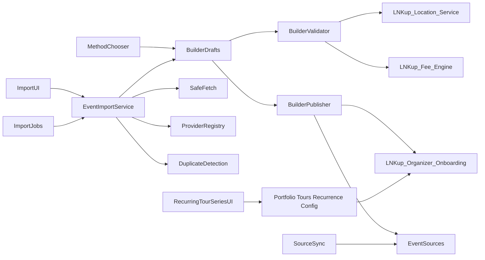

# Architecture

One draft → publish backend used by every creation method on web and native. Publication reuses `LNKup_Organizer_Onboarding` (event + opportunity creation, idempotency, location validation, geocoding, index sync, operations bootstrap), so there is no second event backend.

## Modules

| Module | Classes | Notes |
|---|---|---|
| Flags | `LNKup_Event_OS_Flags` | `event_builder_v3`, `event_import_v3`, `event_import_bulk`, `eventbrite_oauth`, `event_source_sync`, `portfolio_builder_v3`; all off by default |
| Drafts | `LNKup_Event_Builder_Drafts`, `LNKup_Event_Builder_Schema` | Private CPT `lnkup_event_draft` (not public, not queryable, no REST base) so drafts never reach marketplace queries that read `lnkup_event` with `post_status=any`. Bounded JSON state + revision |
| Validation | `LNKup_Event_Builder_Validator` | Creation progress, publication checklist, location/date/fee checks |
| Publish | `LNKup_Event_Builder_Publisher` | Maps state → onboarding input; client token `builder-{draft}` makes retries idempotent |
| Edit | `LNKup_Event_Builder_Editor` | Loads a published event into a draft (`source_event_id`), material-change review, applies via `update_event_from_request` / pricing |
| REST | `LNKup_Event_Builder_REST` | `lnkup/v1/organizer/builder/*` |
| Import | `LNKup_Safe_Fetch`, `LNKup_Import_Provider_Registry`, `LNKup_Event_Import_Service`, `LNKup_Event_Sources`, `LNKup_Event_Import_Files` (CSV/ICS), `LNKup_Event_Import_Jobs`, `LNKup_Eventbrite_Connection`, `LNKup_Event_Source_Sync`, `LNKup_Event_Import_REST` | |
| Portfolio | existing `LNKup_Portfolio_*` + `LNKup_Event_Builder_Portfolio` (stop/occurrence drafts → portfolio routes) | |
| Library | `LNKup_Event_Builder_Library` over `LNKup_Portfolio_Templates` + `LNKup_Organizer_Setups` | |
| UI | `LNKup_Event_Builder_View` + `event-builder.js/.css`; Imports Center `LNKup_Event_Imports_View`; admin `LNKup_Event_Imports_Admin` | |
| Mobile | `app/(organizer)/create/*`, `lib/api/event-builder.ts`, `lib/api/event-import.ts` | Server drafts; AsyncStorage cache |

## Integration points

- Organizer router: `?view=create` renders the builder when `event_builder_v3` is on (one guarded line in `LNKup_Organizer_Dashboard_Views::render`), `?view=imports` added to the allowlist.
- Public event page: `LNKup_Event_Distribution::external_disclosure` reads primary/other sources from `LNKup_Event_Sources`.
- Claims: imports matching `LNKup_External_Events` records route to the existing claim flow.
- Analytics: `LNKup_Analytics_Taxonomy::emit()` for creation events.
