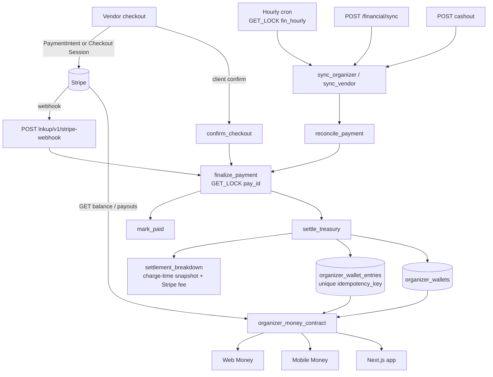

# Financial architecture map (12.22)

All money flows through `LNKup_Financial_Service` in the WordPress plugin. Web (`financial.js`), the premium Next.js app, and the Expo app only read REST; Stripe secret keys stay on the server.

## Charge

- `LNKup_Stripe_Provider::create_payment_intent()` / `create_checkout_session()` → `prepare_charge_for_stripe()`.
  - **Destination mode** (organizer Connect-ready): `transfer_data.destination` = organizer account, plus `application_fee_amount` = LNKup fee. Funds land on the organizer's connected account.
  - **Platform treasury:** a plain platform charge. Funds land on LNKup and are paid out via cashout transfer or manual payout.
- `persist_payment_settlement_meta('create')` stores the fee snapshot `_lnkup_fee_breakdown` and `_lnkup_application_fee_cents` that were sent to Stripe.
- PaymentIntent metadata carries `payment_post_id`, `organizer_user_id`, `vendor_user_id`, `event_id`, `application_id`.

## Confirmation → paid

- **Webhook** (`LNKup_Stripe_Webhooks::process_event`): `checkout.session.completed` / `async_payment_succeeded` and `payment_intent.succeeded` → `finalize_payment()`; `processing` → `mark_payment_processing()`; failures → `failed` (never over `paid`).
- **Client confirm and the checkout-summary fallback:** `verify_intent_for_payment()` (GET) → `finalize_payment()`.
- **`finalize_payment()`**, under the payment lock:
  1. `backfill_stripe_payment_meta()` (GET PaymentIntent + latest charge: amount, fee, destination, charge, balance transaction, transfer, livemode)
  2. `mark_paid()` (status, `paid_at`, application → paid, receipt, invoice)
  3. `settle_treasury()` once (`_lnkup_settled_at`)

## Ledger and wallet

- **`settle_treasury()`**:
  - `settlement_breakdown()` → `persist_payment_settlement_meta('settle')` (mode from where the funds actually are, snapshot kept)
  - transactions row → platform fee record → reserve → escrow (treasury only)
  - `LNKup_Organizer_Wallet::credit_from_payment()`
- **Destination charge:** a `connect_settlement` row (ledger mirror; money is on Stripe) keyed `payment:{id}:connect_settlement`.
- **Treasury charge:** a `credit` row to `available`, or to `pending` if escrow is active, keyed `payment:{id}:credit`, plus a reserve hold.
- **Treasury → Connect migration:** a compare-and-swap zeroes `available_balance` and writes a `treasury_migration` `connect_settlement` row (rolled back if the row cannot be written).
- **Escrow release:** `pending` → `available` (`transfer` row). Reserve release: an `available` credit.

## Transfers and payouts

- **Cash Out:** `request_organizer_cashout()` → `sync_organizer()` → `LNKup_Organizer_Payouts::request_cashout()` (client-token idempotency, approval workflow).
  - **Destination:** Connect payout on the organizer account (`stripe_connect_payout`); debit `payout:{id}:debit`, `processing_balance += amount`.
  - **Treasury with Connect ready:** transfer to the connected account (`stripe_connect`).
  - **Treasury without Connect:** manual (`approved`, paid by LNKup).
- **Payout webhooks** (`payout.paid` / `updated` / `failed` / `canceled`) for LNKup-created payouts → `mark_paid()` (lifetime paid, processing released) or `handle_async_failure()` (restore keyed `payout:{id}:restore`).
- **Stripe automatic payouts** on connected accounts are not LNKup records. The contract reads them (GET `/v1/payouts`, cached 5 min) as `paid_out` and `in_transit`.

## Read model

- `organizer_balance_payload()` is a pure read: wallet row, connect settlement sum, live Connect balance (GET), onboarding status.
- `organizer_money_contract()` produces the v1 contract (see `MONEY_DEFINITIONS.md`). It is attached as `money` to `/financial/dashboard`, `/financial/organizer-wallet` and `/financial/organizer-balances`; `vendor_money_contract()` is attached to the vendor dashboard.
- Lists: `/financial/transactions` (newest paid first, paged), `/financial/organizer-wallet/entries` (paged, with payment/payout references).

## Reconciliation and repair

- `LNKup_Financial_Reconciliation` is a read-only report: payments vs ledger vs webhooks vs Stripe (search by `metadata.organizer_user_id`, plus per-intent GET), schema health, migration audit, and same-amount clusters.
- `LNKup_Financial_Repair`: dry run → token → apply. Offsets duplicates, restores lost migration rows, settles Stripe-confirmed payments, finalizes Stripe-paid payments; audited and listed in `repair-runs`.
- wp-admin → LNKup → **Reconciliation** shows health, organizers, the per-organizer report and the repair workflow.
