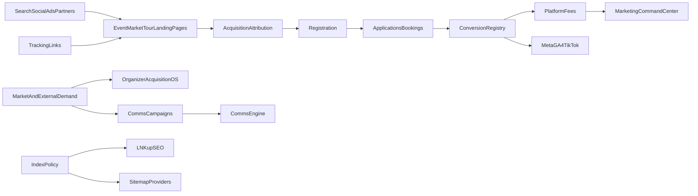

# Marketing, SEO & Distribution OS — Architecture

The OS is an orchestration layer over existing systems. It owns very little data: URL and indexing policy, tracking links and their daily aggregates, saved campaign segments, and market registry fields. Everything else is read from the system that already owns it.

## Data ownership matrix

| Logical entity | Owner (source of truth) | Storage | New? |
|---|---|---|---|
| Event, opportunity, application, payment | Marketplace CPTs | Posts + meta | No |
| Marketplace index (discovery) | `LNKup_Marketplace_Index` | `wp_lnkup_marketplace_index` | No |
| Market | `LNKup_Market_Pages` | Option `lnkup_city_markets` (+ new fields) | Fields only |
| Market health | `LNKup_Match_Market`, `LNKup_Org_Supply_Intel` | Snapshot tables | No |
| Indexability decision | `LNKup_Index_Policy` | Computed (no storage) | Yes (class) |
| Attribution touch | `LNKup_Acquisition_Attribution` | Cookies `lnkup_ft`/`lnkup_lt`, user meta `_lnkup_acq_*` | No (extended) |
| Conversion event | `LNKup_Conversion_Registry` | `wp_lnkup_conversion_events` | No |
| Analytics event stream | `LNKup_Marketplace_Analytics` | `wp_lnkup_analytics_events` + daily rollup table | Rollup table |
| Tracking link | `LNKup_Tracking_Links` | `wp_lnkup_tracking_links`, `wp_lnkup_tracking_link_daily` | Yes |
| Referral / commission | Referral, Connector, Partnership programs | Existing referral tables | No |
| Campaign | `LNKup_Comms_Campaigns` | `wp_lnkup_comms_campaigns` (+ columns) | Columns |
| Campaign segment | `LNKup_Comms_Segments` | `wp_lnkup_comms_segments` (rules JSON only) | Yes |
| Suppression | comms `suppressions` (+ bridge to outreach) | Existing tables | No |
| Organizer lead | `LNKup_Org_Leads` | `wp_lnkup_org_leads` | No |
| External demand | `LNKup_External_Events` | `wp_lnkup_external_event_interest` | No |
| Platform revenue | `LNKup_Platform_Fees` | `wp_lnkup_platform_fees` | No |
| Ad spend | `LNKup_Org_Growth_Spend` | `wp_lnkup_org_growth_spend` | No |
| Resource article | WordPress core posts | Posts in categories | No |
| Campaign landing page | `LNKup_Campaign_Landings` | Option `lnkup_campaign_landings` | No |
| Partner page | `LNKup_Partner_Landings` (needs an approved `LNKup_Partner_Organizations` record) | Option `lnkup_partner_landings` | Yes |
| Cohort page | `LNKup_Cohort_Landings` (interest → `LNKup_Org_Leads`, source `cohort`) | Option `lnkup_cohort_landings` | Yes |
| Marketing consent record | `LNKup_Lifecycle` | User meta `_lnkup_marketing_consent` | Yes |
| App deep-link resolution | `LNKup_App_Deep_Links` | Computed (no storage); App Store tokens in `lnkup_app_campaign` | Yes |

No second source of truth is introduced for events, users, applications, payments or commissions. High-volume streams (clicks, analytics) go to indexed tables with daily rollups and retention, never post meta.

## Extension points used

- SEO: `LNKup_SEO` filters (Rank Math + fallback), core `wp_sitemaps_*`, `wp_robots`.
- Attribution: `LNKup_Acquisition_Attribution::request_touch`, registration hooks `lnkup_user_registered`.
- Conversions: `lnkup_conversion_registry` filter, `lnkup_conversion_recorded` action.
- Comms: `LNKup_Comms_Registry` triggers, `LNKup_Comms_Audiences`, `LNKup_Comms_Campaigns`, suppression checks.
- Leads: `LNKup_Org_Leads` upsert API.
- Media: `LNKup_Event_Media::resolve()`.
- Apps: `LNKup_App_Links` (AASA / assetlinks, new filter `lnkup_app_links_paths`), `LNKup_App_Promo::store_url` (new filter `lnkup_app_store_url`), Expo `+native-intent.ts`, `pending-destination`.
- Comms: new actions `lnkup_comms_preferences_updated` and `lnkup_comms_unsubscribed` (consent records), filter `lnkup_comms_email_suppressed` (outreach suppression bridge).
- Admin: `LNKup_Marketing_Admin` (LNKup → Marketing) reads every module above; `LNKup_Search_Console` reads Google with credentials from `wp-config.php`.

## Module map

| Module | Classes | Frontend |
|---|---|---|
| SEO | `LNKup_Index_Policy`, `LNKup_SEO_URLs`, `LNKup_SEO_Schema`, `LNKup_Sitemaps`, `LNKup_SEO_Diagnostics`, `LNKup_Search_Console` | theme templates |
| Markets | `LNKup_Market_Registry`, `LNKup_Market_Discovery`, `LNKup_Event_Distribution`, `LNKup_OG_Images` | `market-landing.php`, `market-landing.js` |
| Attribution | `LNKup_Acquisition_Attribution` (extended), `LNKup_Tracking_Links`, `LNKup_Analytics_Taxonomy`, `LNKup_Ad_Platforms`, `LNKup_Revenue_Attribution` | `lnkup-attribution.js` |
| Toolkits | `LNKup_Organizer_Marketing`, `LNKup_Connector_Marketing`, `LNKup_QR`, `LNKup_Distribution`, `LNKup_Partner_Landings` | `organizer-marketing.js`, `connector-marketing.js`, `lnkup-qr.js`, `embed-list.js` |
| Campaigns | `LNKup_Comms_Campaign_Workflow`, `LNKup_Comms_Segments`, `LNKup_Comms_Marketing_REST`, `LNKup_Marketing_Role` | LNKup → Communications |
| Retention & content | `LNKup_Lifecycle`, `LNKup_Resources_Hub`, `LNKup_Cohort_Landings` | `single-post.php`, `category.php`, `home.php`, `cohort-landing.php` |
| Mobile | `LNKup_App_Deep_Links`, `LNKup_App_Links`, `LNKup_App_Promo` | Expo `app/link.tsx`, `app/event/[eventId].tsx`, `lib/navigation/deep-link-map.ts`, `pending-attribution.ts` |
| Command Center | `LNKup_Marketing_Admin` | wp-admin |

## Permissions model

| Actor | Capability | Access |
|---|---|---|
| Platform admin | `lnkup_manage_all` | Everything |
| Marketing staff | `lnkup_manage_marketing` (role `lnkup_marketing`: `read` + this capability only) | Command Center, campaigns, segments (aggregate previews), partner/cohort pages; **no** revenue attribution, financial records, private documents, user management, settings or flag changes |
| Finance | `lnkup_manage_marketplace_financials` or `lnkup_manage_all` | Revenue attribution report and CSV |
| Organizer owner / team | ownership + team `broadcast` | Their own events' links, graphics, embeds, performance |
| City Connector | `lnkup_connector` | Their links, assets, digests, own performance |
| Partner organization | — | Staff publish their `/with/{slug}/` page; performance is reported to staff (no partner self-serve view yet) |
| Vendor | `lnkup_vendor` | Alerts, follows, shares |
| Public | none | Public pages, public REST (public fields only), `/l/{code}` |

## Feature flags (all default off)

`seo_index_policy`, `market_category_pages`, `tracking_links`, `organizer_marketing`, `campaign_scheduling`, `ga4_enabled`, `tiktok_enabled`, `resources_hub`, `deep_links_v2`. Stored in `lnkup_settings` via `LNKup_Marketing_Flags`; administrators toggle them in Command Center → Diagnostics. Comms lifecycle messages use the comms flag `flow_discovery`.
