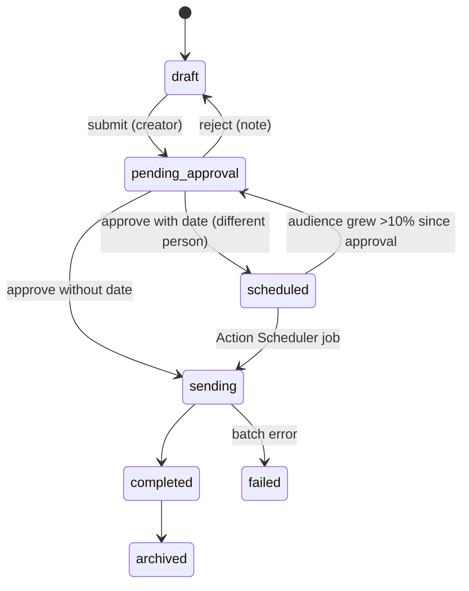

# Campaign integration

Campaigns extend the existing `lnkup-communications` engine (templates, preferences, frequency caps, quiet hours, suppression, delivery logs). No second messaging system was added.

## Workflow (flag `campaign_scheduling`)

- Capability `lnkup_manage_marketing` (role `lnkup_marketing`, administrators, `lnkup_admin`).
- Two-person rule: the submitter cannot approve. The approved audience size is stored; if it grows more than 10% before sending, the campaign returns to approval.
- With the flag off, the existing immediate-send campaigns are unchanged.

## Audiences

Saved segments (`lnkup_comms_segments`) store **rules**, never user lists, and preview returns counts only. New filters next to the existing role/category/city filters:

| Filter | Meaning |
|---|---|
| `market` | Recipients in the market's city and state (unknown market matches nobody) |
| `saved_opportunity` | Saved at least one opportunity |
| `open_spaces` | Organizers with unfilled spaces |
| `followed_tour` / `follows_any_tour` | Followers of a tour / any tour |
| `verified` | Verified vendor yes/no |
| `inactive_days` | No login or activity for N days (≤730) |

Optional exclusions: anyone messaged by another campaign in the last N days (0–90, off by default) and members of an excluded saved segment. Test sends go only to the configured test recipients.

## Consent and suppression

Every send goes through the engine's preference, category and frequency checks. Promotional campaigns additionally respect:

- Comms unsubscribes and preference opt-outs.
- **Suppression bridge**: Outreach unsubscribes, bounces and domain do-not-contact entries block promotional messages (bounces block everything); transactional messages are not blocked by an outreach unsubscribe.
- Marketing consent is recorded with its source (`_lnkup_marketing_consent`: registration default, preference change, unsubscribe, market alert) with a 20-entry history.

## Experiments

Optional A/B variants: deterministic assignment per campaign and user (`experiment_variant`, stored as `_xv`), variant copy rendered per recipient, control keeps base copy. Results compare clicks and the goal conversion within 14 days (z-test) and declare no winner below 100 recipients per arm.

## Goals and objectives

Objective (`awareness`, `signups`, `applications`, `bookings`, `reactivation`, `organizer_activation`) and goal conversion (`CompleteRegistration`, `VendorRegistered`, `OrganizerRegistered`, `SubmitApplication`, `Purchase`, `FirstEventPublished`, `Lead`) are stored in campaign meta; results read the conversion registry.

## Lifecycle messages added (comms flag `flow_discovery`)

| Trigger | When | Dedupe |
|---|---|---|
| `v_market_alert` | An opportunity is published that matches a vendor's market alert (runs before the legacy saved-search runner, which then skips it) | per vendor per opportunity |
| `v_followed_tour_new_stop` | A tour the vendor follows gains a published stop | per vendor per tour stop |
| `v_external_event_claimed` | An external event the vendor asked about is claimed by a verified organizer | per vendor per external event |

## Where it is managed

LNKup → Communications (existing campaign UI and the new `/comms/marketing/*` REST), with summaries and the approval queue count in Command Center → Campaigns.

## Testing rule

Tests capture mail and stub push; no campaign was sent to real users. Use controlled test recipients (`test_user_ids` in comms settings) on staging.
